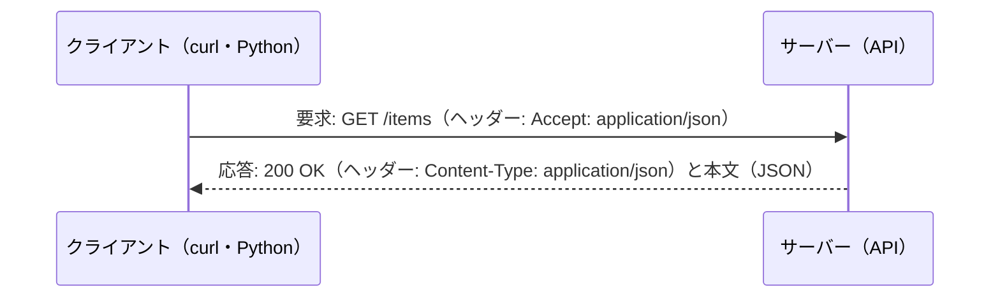

# 01-2 Linux の基本操作と HTTP API の呼び方

!!! abstract "到達目標"
    - Linux のシェルで、ファイルを探す・中身を見る・数える・結果をファイルに書く操作ができる
    - HTTP の要求と応答の中身（メソッド・ヘッダー・状態コード・本文）を説明し、curl で確かめられる
    - Python から HTTP API を呼び、タイムアウト・失敗・想定と違う形の応答を扱える

## 何か

AI のアプリは、多くの場合 Linux のサーバーで動き、HTTP で外の仕組みとつながります。
この教材で使うローカルの LLM（Ollama）も、手元で HTTP の API として動きます（07 以降）。

**シェル** は、文字でコマンドを打って、ファイルやプログラムを操作する画面です。
小さなコマンドを `|`（パイプ）でつなぎ、前のコマンドの出力を次のコマンドの入力にできます。

**HTTP** は、クライアントがサーバーに「要求」を送り、サーバーが「応答」を返す決まりです。



| 部分 | 要求 | 応答 |
|---|---|---|
| 1 行目 | メソッド（GET・POST など）と場所（URL） | 状態コード（200・404 など） |
| ヘッダー | 受け取りたい形（`Accept`）・認証（`Authorization`）など | 本文の形（`Content-Type`）など |
| 本文 | POST で送るデータ（JSON など） | 結果のデータ |

## なぜ必要か

- サーバーで動かすときに、画面の操作はできません。ログを探す・ファイルを数える・設定を確かめる、はシェルで行います
- API がうまく動かないとき、「自分のコードの誤り」か「相手の誤り」かを切り分けるには、HTTP の要求と応答をそのまま見る必要があります
- 状態コードの意味を知らないと、やり直しても無駄な失敗（400）を何度も送ったり、相手に負荷をかけて止められたり（429）します

Windows の人は WSL（Windows の中で Linux を動かす仕組み）を使うと、この章のコマンドがそのまま使えます。

## どうやるか

### シェルの基本

よく使うコマンドです。`<作業フォルダ>` は自分のフォルダに読み替えてください。

| やりたいこと | コマンド |
|---|---|
| 今いる場所 | `pwd` |
| 中身の一覧（隠しファイルと詳細も） | `ls -la` |
| 移動する | `cd <作業フォルダ>/examples` |
| フォルダを作る（途中も） | `mkdir -p out/p03` |
| 先頭・末尾を見る | `head -5 ファイル`・`tail -5 ファイル` |
| 行を探す | `grep 99999 ファイル` |
| 行を数える | `wc -l ファイル` |
| ファイルを探す | `find . -name "*.csv"` |
| 結果をファイルに書く（上書き・追記） | `コマンド > out.txt`・`コマンド >> out.txt` |
| エラーの出力だけをファイルに | `コマンド 2> err.txt` |
| 直前のコマンドの終了コード | `echo $?`（0 が成功） |

例えば、03 で使う問い合わせの CSV を調べます（`examples/` で実行）。

```bash
head -3 data/p03/inquiries_raw.csv          # 列名と最初の 2 行
wc -l data/p03/inquiries_raw.csv            # 行の数（152）
grep -c 99999 data/p03/inquiries_raw.csv    # 99999 を含む行の数
grep billing data/p03/inquiries_raw.csv | wc -l   # パイプでつなぐ
```

`wc -l` は 152 行と数えますが、データは 147 件（と列名の 1 行）です。
本文に改行を含む件があり、CSV では引用符の中の改行も 1 件の一部だからです。
**CSV は行の数で数えず、CSV を読める道具（Python の `csv`・pandas）で読む**、が大事な理由です（03 で扱います）。

`rm` で消したファイルは、ごみ箱に入らず、すぐに消えます。`rm -rf` は特に、場所を確かめてから使います。

### 環境変数と秘密情報

環境変数は、プログラムに外から設定を渡す仕組みです。API キーのような秘密情報は、コードに書かず、環境変数か `.env` ファイルで渡します。

```bash
export OLLAMA_HOST=http://localhost:11434   # このシェルの中だけで有効
echo "$OLLAMA_HOST"
```

```python
import os

base_url = os.environ.get("OLLAMA_HOST", "http://localhost:11434")  # 無ければ既定値
```

!!! failure "悪い例"
    `curl "https://api.example.com/items?key=<API キー>"` のように、キーを URL やコマンドに直接書く。
    シェルの履歴やサーバーのログに残る。

!!! success "良い例"
    キーは `.env` に書き（コミットしない）、プログラムが環境変数から読む。ヘッダー（`Authorization`）で送る。

### curl で HTTP を見る

curl は、HTTP の要求を送って応答を見るコマンドです（[公式ドキュメント](https://curl.se/docs/manpage.html)）。
`-i` を付けると、応答のヘッダーも表示します。外の API を使わずに試すため、手元に小さな Web サーバーを立てます。

```bash
mkdir -p /tmp/api && cd /tmp/api
echo '{"data": {"items": [{"id": 1, "name": "会員 A", "owner": {"name": "部署 A"}}]}}' > items.json
python -m http.server 8000      # このフォルダのファイルを返すサーバー（Ctrl+C で止める）
```

別のシェルで次を実行します。

```bash
curl -i http://localhost:8000/items.json      # 200 OK と、ヘッダーと本文
curl -s -o /dev/null -w '%{http_code}\n' http://localhost:8000/nothing.json   # 404
```

`python -m http.server` は、試すための簡単なサーバーです。本番では使いません
（[公式ドキュメント: http.server](https://docs.python.org/3/library/http.server.html) の警告）。

### 状態コードで、やり直すかを決める

状態コードは、応答の 1 行目の 3 桁の数です（[MDN: HTTP 状態コード](https://developer.mozilla.org/ja/docs/Web/HTTP/Reference/Status)）。

| コード | 意味 | やり直すか |
|---|---|---|
| 200・201 | 成功 | ― |
| 400 | 要求の誤り（形が違う） | やり直さない。要求を直す |
| 401・403 | 認証の誤り・権限が無い | やり直さない。キーや権限を直す |
| 404 | 場所が無い | やり直さない。URL を直す |
| 429 | 送りすぎ | 待ってからやり直す（`Retry-After` ヘッダーがあれば従う） |
| 500・502・503 | サーバー側の誤り | 少し待って、回数を決めてやり直す |

「4xx は自分の誤り、5xx は相手の誤り」と覚えると、切り分けが速くなります。

### Python から HTTP API を呼ぶ

01 の成果物（`examples/src/roadmap_examples/p01_api_to_csv.py`）は、標準ライブラリの `urllib` で JSON を取ります。

<!-- src: examples/src/roadmap_examples/p01_api_to_csv.py -->
```python title="examples/src/roadmap_examples/p01_api_to_csv.py"
class UrllibJsonGetter:
    """標準ライブラリ（urllib）で HTTP GET する本物の実装."""

    def get_json(self, url: str, timeout: float) -> Any:
        if not url.startswith(("https://", "http://")):
            raise ValueError(f"http(s) の URL を指定してください: {url}")
        request = urllib.request.Request(url, headers={"Accept": "application/json", "User-Agent": "roadmap-examples"})
        # スキームは上で http(s) に絞っている
        with urllib.request.urlopen(request, timeout=timeout) as response:  # nosec B310
            return json.load(response)
```

- **タイムアウト** を必ず渡します。渡さないと、相手が応答しないとき、いつまでも待ち続けます
- **URL の種類を http(s) に絞ります**。`urlopen` は `file://` のようなローカルのファイルも開けるので、外から受け取った URL をそのまま渡すと危険です
- `urlopen` は、4xx・5xx の応答を `HTTPError` という例外にします。`HTTPError` は `URLError` の仲間で、どちらも `OSError` の仲間です
  （[公式ドキュメント: urllib.error](https://docs.python.org/3/library/urllib.error.html)）

失敗の受け止め方は `main` にあります。接続の失敗・JSON でない応答・形の違いを、まとめて「エラー」として終了コード 1 にします。

<!-- src: examples/src/roadmap_examples/p01_api_to_csv.py -->
```python title="examples/src/roadmap_examples/p01_api_to_csv.py"
    try:
        items = find_items(getter.get_json(args.url, args.timeout), args.items_key)
    except (OSError, ValueError, DataError) as e:  # 接続の失敗・JSON でない応答・形の違い
        print(f"エラー: {e}", file=sys.stderr)
        return 1
```

`json.load` が JSON として読めないときに出す `JSONDecodeError` は、`ValueError` の仲間なので、ここで受け止められます。

手元のサーバーに向けて動かします（`examples/` で）。

```bash
uv run api-to-csv --url http://localhost:8000/items.json --items-key data.items --fields id,name,owner.name
uv run api-to-csv --url http://localhost:8000/nothing.json --fields id; echo $?   # エラー: HTTP Error 404 と 1
```

結果の CSV は標準出力に、件数やエラーは標準エラー出力に出します。こうすると `> out.csv` で CSV だけをファイルに書けます。

## 演習

1. シェルだけで、`examples/data/p03/inquiries_raw.csv` について次を調べ、使ったコマンドを残してください
    - 「対応時間」に 99999 を含む行の受付番号
    - 窓口の列（4 列目）に出てくる値の種類（ヒント: `cut -d, -f4 ファイル | sort | uniq -c`）。結果が正しくない行があれば、その理由
2. 手元にサーバーを立て、`api-to-csv` で次を確かめてください
    - 入れ子の項目（`owner.name`）が CSV の列になる
    - 無い URL では終了コードが 1 になり、CSV のファイルは作られない（`-o` を付けて確かめる）
3. 次の状態コードのとき、プログラムはやり直すべきかを、理由と一緒に書いてください: 400・401・429・503

- できたことの確かめ方: 1 と 2 は実行した結果。3 は 4 つの判断と理由
- 目安の時間: 3 時間

解答: [01-2 の解答](answers/01-2.md)

## もし〇〇がなかったら？

**タイムアウトがなかったら**、相手のサーバーが応答を返さないだけで、夜間のバッチが朝まで止まったままになります。
エラーにもならないので、気づくのは利用者からの連絡です。

**状態コードで分けずに、失敗したら何でもやり直していたら**、直さない限り成功しない 400 を何千回も送ります。
相手からは攻撃のように見え、429 で止められたり、キーを無効にされたりします。LLM の API では、その分の費用もかかります。

## 理解度チェック

1. `wc -l` で数えた行の数と、CSV の件数が合わないことがあるのはなぜですか。

    ??? note "答え"
        CSV では、引用符で囲んだ値の中に改行を含められるからです。1 件が複数の行になります。
        CSV の件数は、CSV を読める道具で数えます。

2. 404 と 503 の応答を受けたとき、それぞれどうしますか。

    ??? note "答え"
        404 は場所が無いので、やり直さずに URL を直します。
        503 はサーバー側が一時的に使えないので、少し待って、回数を決めてやり直します。

3. `urlopen` に、外から受け取った URL をそのまま渡すと何が危ないですか。

    ??? note "答え"
        `file://` のようなローカルのファイルを指す URL も開けるので、サーバーの中のファイルを読まれるおそれがあります。
        http と https だけに絞ってから渡します。

4. API キーを URL に書かず、ヘッダーと環境変数で渡すのはなぜですか。

    ??? note "答え"
        URL はシェルの履歴・サーバーのログ・ブラウザの履歴に残りやすいからです。
        キーはコードにも書かず、環境変数（`.env`）から読み、`Authorization` ヘッダーで送ります。
