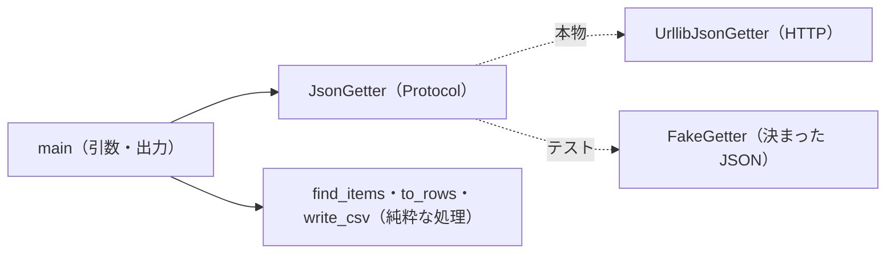

# 01-4 クラス設計・pytest・ruff

!!! abstract "到達目標"
    - 外の仕組み（HTTP・LLM）に触る部分を Protocol で分け、テストでは偽の実装に差し替えられる
    - pytest でテストを書き、parametrize・tmp_path・capsys を使い分けられる
    - ruff で静的解析と書式をそろえ、ブランチを切ってコミットし、プルリクエストで出せる

## 何か

01 の成果物は「公開 API からデータを取って CSV にする CLI」です（`examples/src/roadmap_examples/p01_api_to_csv.py`）。
この章では、その作りを題材に、テストしやすいクラスの分け方と、テスト・lint・Git の流れをまとめます。



- **Protocol** は、「このメソッドを持つもの」という型です。Java の `interface` に近いですが、`implements` と書く必要がありません。
  同じ名前・同じ引数のメソッドがあれば、その型として扱えます（[公式ドキュメント: Protocol](https://docs.python.org/3/library/typing.html#typing.Protocol)）
- **pytest** は、Python のテストの道具です。`assert` を書くだけで、失敗したときに値の違いを詳しく表示します（[公式ドキュメント](https://docs.pytest.org/en/stable/)）
- **ruff** は、静的解析（lint）と書式の整形を行う道具です（[公式ドキュメント](https://docs.astral.sh/ruff/)）

演習の環境では、pytest {{ versions.pytest }} と ruff {{ versions.ruff }} を使います。

## なぜ必要か

HTTP や LLM を直接呼ぶコードは、テストが難しくなります。

- テストのたびに外の API を呼ぶと、遅く、相手の都合で失敗し、LLM なら費用もかかる
- 「相手が 404 を返したとき」「JSON でない応答が来たとき」を、本物の API では起こせない

外に触る部分だけを小さく切り出し、残りを「入力を受けて結果を返すだけ」の処理にしておくと、ほとんどをテストで確かめられます。
この教材の 07 以降で LLM を呼ぶコードも、同じ形（`LLMClient` と、テスト用の `FakeLLM`）です。

lint と書式の道具が無いと、レビューで「import の順番」「使っていない変数」のような指摘に時間を使い、中身の議論ができません。

## どうやるか

### 外に触る部分を Protocol で分ける

<!-- src: examples/src/roadmap_examples/p01_api_to_csv.py -->
```python title="examples/src/roadmap_examples/p01_api_to_csv.py"
class JsonGetter(Protocol):
    """URL から JSON を取ってくる部品（本物は HTTP、テストでは偽の実装）."""

    def get_json(self, url: str, timeout: float) -> Any: ...
```

本物の実装 `UrllibJsonGetter`（01-2）は、`JsonGetter` を継承していません。`get_json` を持っているので、`JsonGetter` として使えます。

`main` は、`getter` を引数で受け取ります。省くと本物を使い、テストでは偽の実装を渡します。

<!-- src: examples/src/roadmap_examples/p01_api_to_csv.py -->
```python title="examples/src/roadmap_examples/p01_api_to_csv.py"
def main(argv: Sequence[str] | None = None, getter: JsonGetter | None = None, stdout: TextIO | None = None) -> int:
    args = parse_args(argv)
    getter = getter or UrllibJsonGetter()
    stdout = stdout or sys.stdout
```

Java で言えば、コンストラクタで依存を受け取る（DI）のと同じ考え方です。Python では、DI の仕組み（フレームワーク）を使わず、引数の既定値で済ませることが多いです。

!!! failure "悪い例"
    ```python
    def main() -> int:
        data = json.load(urllib.request.urlopen(sys.argv[1]))  # HTTP・引数・処理が 1 か所にまざる
        ...
    ```
    テストで HTTP を止められず、引数も `sys.argv` から直接読むので、テストから渡せない。

!!! success "良い例"
    外に触る部品（HTTP・標準出力）と引数を、`main` の引数で受け取る。残りの処理（`find_items`・`to_rows`）は、値を受けて値を返すだけにする。

### pytest でテストを書く

テストのファイルは `tests/test_<名前>.py`、テストの関数は `test_` で始めます。偽の実装は、テストのファイルの中に小さく書きます。

<!-- src: examples/tests/test_p01_api_to_csv.py -->
```python title="examples/tests/test_p01_api_to_csv.py"
class FakeGetter:
    """決まった JSON を返す偽の実装. 呼ばれた URL を残す."""

    def __init__(self, data: Any = None, error: Exception | None = None) -> None:
        self.data = data
        self.error = error
        self.urls: list[str] = []

    def get_json(self, url: str, timeout: float) -> Any:
        self.urls.append(url)
        if self.error:
            raise self.error
        return self.data
```

`error` を渡すと例外を投げるので、「接続に失敗したとき」も試せます。本物の API では起こしにくい場面です。

同じ形のテストを、入力だけ変えて何度も流すときは `parametrize` を使います（[公式ドキュメント: parametrize](https://docs.pytest.org/en/stable/how-to/parametrize.html)）。

<!-- src: examples/tests/test_p01_api_to_csv.py -->
```python title="examples/tests/test_p01_api_to_csv.py"
@pytest.mark.parametrize(
    ("data", "items_key", "message"),
    [
        ({"items": []}, None, "応答の最上位が配列ではありません"),
        ({"data": {}}, "data.items", "「data.items」が配列ではありません"),
        ([1, 2], None, "配列の要素がオブジェクトではありません"),
    ],
)
def test_unexpected_shape_is_an_error(data, items_key, message, capsys) -> None:
    argv = ["--url", "https://api.example.com/x", "--fields", "id"] + (["--items-key", items_key] if items_key else [])
    code, out = run(argv, FakeGetter(data))
    assert (code, out) == (1, "")
    assert message in capsys.readouterr().err
```

テストの関数の引数に名前を書くと、pytest が道具（fixture）を渡します。

| fixture | 中身 |
|---|---|
| `tmp_path` | テストごとの空の一時フォルダ（[公式ドキュメント](https://docs.pytest.org/en/stable/how-to/tmp_path.html)）。ファイルを書くテストに使う |
| `capsys` | 標準出力・標準エラー出力に書かれた文字を取り出す（[公式ドキュメント](https://docs.pytest.org/en/stable/how-to/capture-stdout-stderr.html)） |
| `monkeypatch` | テストの間だけ、関数や環境変数を差し替える。テストが終わると元に戻る |

演習のテストでは、`examples/tests/conftest.py` が、すべてのテストの間ネットワークへの接続を止めています。
偽の実装に差し替え忘れると、本物の HTTP を呼ぶ前に失敗するので、気づけます。

<!-- src: examples/tests/conftest.py -->
```python title="examples/tests/conftest.py"
@pytest.fixture(autouse=True)
def no_network(monkeypatch: pytest.MonkeyPatch) -> None:
    def refuse(*_args, **_kwargs):
        raise RuntimeError("テスト中にネットワークへ接続しようとしました（偽の実装に差し替えてください）")

    monkeypatch.setattr(socket.socket, "connect", refuse)
    monkeypatch.setattr(socket, "create_connection", refuse)
```

`autouse=True` は、「引数に書かなくても、すべてのテストで使う」という意味です。

```bash
uv run pytest                                  # すべて
uv run pytest tests/test_p01_api_to_csv.py     # 1 つのファイル
uv run pytest -k shape                         # 名前に shape を含むテストだけ
```

### ruff で lint と書式をそろえる

```bash
uv run ruff check .          # 静的解析（使っていない import・未定義の名前・古い書き方など）
uv run ruff check --fix .    # 直せるものは直す
uv run ruff format .         # 書式をそろえる（字下げ・引用符・改行の位置）
uv run ruff format --check . # そろっているかだけを確かめる（CI で使う）
```

どの規則を使うかは、`examples/pyproject.toml` の `[tool.ruff.lint]` に書いてあります（規則の一覧は [公式ドキュメント: Rules](https://docs.astral.sh/ruff/rules/)）。
この教材では、誤りの検出（`E`・`F`・`W`・`B`）・import の順番（`I`）・新しい書き方への置き換え（`UP`）・簡単にできる書き方（`SIM`）を選んでいます。

`UP` の規則は、例えば `TypeVar` を使った古い型の引数の書き方を見つけ、`def f[T](...)` の書き方（01-1）を勧めます。
覚えていなくても、道具が新しい書き方を教えてくれます。

### Git で出す

変更は、main に直接ではなく、ブランチで行い、プルリクエスト（PR）でレビューを受けます（[Pro Git](https://git-scm.com/book/ja/v2)）。

```bash
git switch -c add-average             # ブランチを作って移る
uv run pytest && uv run ruff check . && uv run ruff format --check .   # 出す前に確かめる
git status                            # 何が変わったか
git add src/roadmap_examples/my_module.py tests/test_my_module.py   # 入れるファイルを選ぶ
git commit -m "分類ごとの平均の対応時間を足す"
git push -u origin add-average        # 後は GitHub などの画面で PR を作る
```

- `git add .` で全部を入れず、ファイルを選びます。`.env`（秘密情報）や `.venv/` を入れないためです。どちらも `.gitignore` に書いておきます
- コミットのメッセージは「何を・なぜ」を 1 行で書きます。「修正」だけでは、後から履歴を読んで分かりません
- テストと lint は、手元で通してから push します。CI で同じ検査が走り、通らないと PR を取り込めない設定にしておきます

## 演習

01 の成果物の CLI に、オプション `--limit N`（先頭の N 件だけを CSV にする）を足してください。

1. 先にテストを書く（N 件より多い・少ない・0 以下は引数の誤り）。テストが失敗することを確かめる
2. `parse_args` と `main` を直し、テストを通す
3. `uv run ruff check ..` と `uv run ruff format --check ..` を通し、ブランチを切ってコミットする（push は任意）

- できたことの確かめ方: `uv run pytest` が通る。`git log --oneline -1` にコミットが出る
- 目安の時間: 3 時間

解答: [01-4 の解答](answers/01-4.md)

## もし〇〇がなかったら？

**外に触る部分を分けていなかったら**、テストのたびに本物の API を呼ぶことになります。
相手が止まっている日はテストが通らず、「自分の変更で壊れたのか」が分かりません。
07 以降の LLM では、テストを流すたびに費用がかかり、答えも毎回変わるので、テストとして使えなくなります。

**lint と書式の道具がなかったら**、使っていない import や、書いたつもりの変数の打ち間違いが、実行するまで見つかりません。
人によって書式が違うと、差分に関係のない行が混ざり、レビューで大事な変更を見落とします。

## 理解度チェック

1. `UrllibJsonGetter` は `JsonGetter` を継承していないのに、`main` に渡せるのはなぜですか。

    ??? note "答え"
        `JsonGetter` は Protocol で、同じ名前・同じ引数のメソッド（`get_json`）を持つものなら、その型として扱えるからです。
        Java の `implements` のような宣言は要りません。

2. `main` が `getter` と `stdout` を引数で受け取ると、テストで何ができるようになりますか。

    ??? note "答え"
        HTTP を偽の実装に差し替え、標準出力の代わりに `io.StringIO` で結果を受け取れます。
        外の API を呼ばずに、失敗の場面も含めて確かめられます。

3. `tmp_path` を使わずに、テストが決まった場所（例: `out.csv`）にファイルを書くと、何が困りますか。

    ??? note "答え"
        前のテストのファイルが残っていて結果が変わる、同時に流したテストどうしが同じファイルを壊し合う、作業フォルダが散らかる、などです。
        `tmp_path` はテストごとに空のフォルダを用意します。

4. `git add .` ではなく、ファイルを選んで `git add` するのはなぜですか。

    ??? note "答え"
        秘密情報（`.env`）や仮想環境（`.venv/`）、試しに作ったファイルを、うっかりコミットしないためです。
        `.gitignore` にも書いておき、二重に防ぎます。
