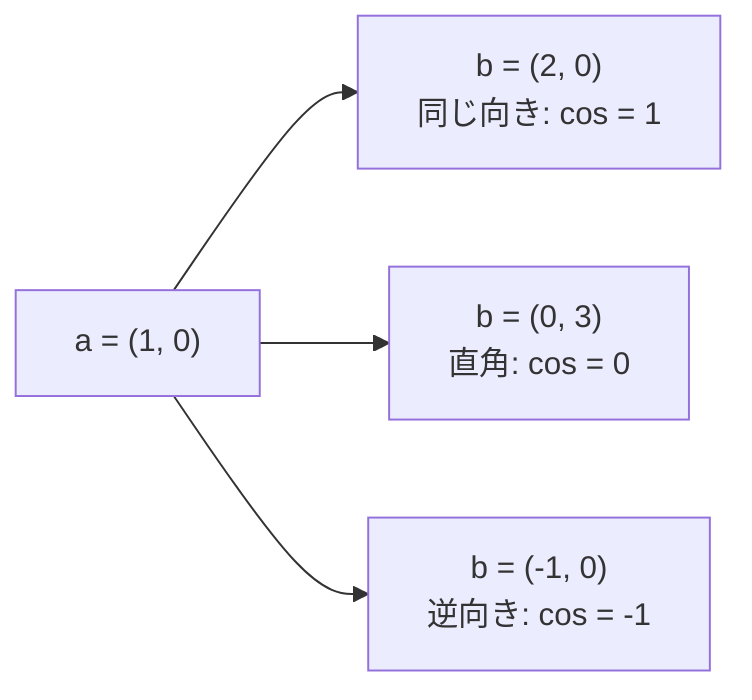

# 02-1 ベクトル・行列とコサイン類似度

!!! abstract "到達目標"
    - 内積・ノルム・コサイン類似度を、式と for 文の両方で計算して説明できる
    - NumPy の配列の形（shape）と、行列の掛け算・axis・ブロードキャストを使って、まとめて計算できる
    - 1 つの質問と多数の文書の類似度を、行列の掛け算 1 回で求め、上位を取り出せる

## 何か

**ベクトル** は、数の並びです。問い合わせの「文字数・添付の数」も、06 で見たエンベディング（文章を表す数百個の数）も、ベクトルです。
**行列** は、ベクトルを行として積み重ねた表です。100 件の文書のエンベディングは、「100 行 × 次元数」の行列になります。

ベクトルどうしの近さは、次の 3 つの計算で測ります。

| 名前 | 式 | 意味 |
|---|---|---|
| 内積 | a·b = Σ aᵢbᵢ | 同じ位置どうしを掛けて足す。向きが近く、長いほど大きい |
| ノルム（長さ） | ‖a‖ = √(a·a) | 原点からの距離 |
| コサイン類似度 | cos = a·b / (‖a‖ ‖b‖) | 長さで割って、向きだけを比べる。-1〜1 |



コサイン類似度は、長さを無視します。(1, 0) と (2, 0) と (10, 0) は、どれも「同じ向き」で 1 です。

## なぜ必要か

08 の RAG では、質問のエンベディングと、文書のエンベディングの近さで、答えの材料を探します。
近さの測り方を理解していないと、「なぜこの文書が選ばれたのか」「なぜ長い文書ばかり選ばれるのか」を説明できません。

計算の量も問題になります。文書が 1 万件、次元が数百あると、for 文で 1 つずつ計算すると遅くなります。
NumPy の配列の演算でまとめて計算すると、同じ結果がずっと速く出ます。

## どうやるか

### 式をそのまま書く

まず for 文で、式のとおりに書きます。計算の中身を確かめるための版です。

<!-- src: examples/src/roadmap_examples/p02_vectors.py -->
```python title="examples/src/roadmap_examples/p02_vectors.py"
def dot(a: Sequence[float], b: Sequence[float]) -> float:
    """内積: 同じ位置どうしを掛けて足す. a·b = Σ a_i b_i."""
    if len(a) != len(b):
        raise ValueError(f"ベクトルの長さが違います（{len(a)} と {len(b)}）")
    return sum(x * y for x, y in zip(a, b, strict=True))


def norm(a: Sequence[float]) -> float:
    """ノルム（長さ）: 自分との内積の平方根. ||a|| = √(a·a)."""
    return math.sqrt(dot(a, a))


def cosine(a: Sequence[float], b: Sequence[float]) -> float:
    """コサイン類似度: 内積を、2 つの長さで割る. 向きだけを比べる（-1〜1）. 長さ 0 なら 0 とする."""
    denom = norm(a) * norm(b)
    return dot(a, b) / denom if denom else 0.0
```

内積だけで比べると、長いベクトルほど大きくなります。

```pycon
>>> from roadmap_examples.p02_vectors import cosine, dot
>>> dot([1, 0], [2, 0]), dot([1, 0], [10, 0])
(2, 10)
>>> cosine([1, 0], [2, 0]), cosine([1, 0], [10, 0])
(1.0, 1.0)
```

テストでは、06 の `cosine` と同じ値になることも確かめています（`examples/tests/test_p02_vectors.py`）。

### NumPy の配列

NumPy は、数の配列をまとめて計算するライブラリです（[公式ドキュメント](https://numpy.org/doc/stable/user/absolute_beginners.html)）。
配列には **形（shape）** があります。`(2, 3)` は 2 行 3 列です。

```pycon
>>> import numpy as np
>>> a = np.array([[1.0, 2.0], [3.0, 4.0]])
>>> a.shape
(2, 2)
>>> a @ np.array([1.0, 0.5])  # 行列 × ベクトル（各行との内積）
array([2., 5.])
>>> np.linalg.norm(a, axis=1)  # 行ごとの長さ（axis=1 は「列の方向に計算して、行ごとに 1 つ」）
array([2.23606798, 5.        ])
>>> a * np.array([10, 100])  # 形の違う配列を、足りない方向に広げて計算する（ブロードキャスト）
array([[ 10., 200.],
       [ 30., 400.]])
```

- `@` は行列の掛け算、`*` は同じ位置どうしの掛け算です。取り違えると、エラーにならずに違う結果が出ることがあります
- `axis=0` は行の方向（列ごとに 1 つ）、`axis=1` は列の方向（行ごとに 1 つ）にまとめます
- ブロードキャストは、形の違う配列を、決まりに従って広げて計算する仕組みです（[公式ドキュメント: Broadcasting](https://numpy.org/doc/stable/user/basics.broadcasting.html)）

### 多数の文書との類似度を、まとめて求める

質問 1 つと文書 1,000 件の類似度を、for 文で 1,000 回計算する代わりに、行列で 1 回で計算します。
先に各行を長さ 1 にそろえておくと、内積がそのままコサイン類似度になります。

<!-- src: examples/src/roadmap_examples/p02_vectors.py -->
```python title="examples/src/roadmap_examples/p02_vectors.py"
def normalize_rows(m: ArrayLike) -> NDArray[np.float64]:
    """行列の各行を長さ 1 にする. 長さ 0 の行は 0 のまま."""
    m = np.asarray(m, dtype=np.float64)
    lengths = np.linalg.norm(m, axis=1, keepdims=True)
    return np.divide(m, lengths, out=np.zeros_like(m), where=lengths > 0)


def cosine_matrix(queries: ArrayLike, docs: ArrayLike) -> NDArray[np.float64]:
    """queries の各行と docs の各行のコサイン類似度を、行列の掛け算 1 回でまとめて求める（形は 質問数 × 文書数）."""
    return normalize_rows(queries) @ normalize_rows(docs).T
```

- `keepdims=True` は、長さの配列を `(行数, 1)` の形のまま残します。こうすると `m / lengths` がブロードキャストで行ごとに割り算になります
- `.T` は転置（行と列の入れ替え）です。`(質問数, 次元) @ (次元, 文書数)` で `(質問数, 文書数)` になります
- 長さ 0 の行は、0 で割らずに 0 のままにします（`where=`）

近い順に上位 k 件を取り出します。

<!-- src: examples/src/roadmap_examples/p02_vectors.py -->
```python title="examples/src/roadmap_examples/p02_vectors.py"
def top_k(query: ArrayLike, docs: ArrayLike, k: int) -> list[tuple[int, float]]:
    """query に近い文書の（行番号, 類似度）を、近い順に k 件."""
    sims = cosine_matrix(np.atleast_2d(query), docs)[0]
    order = np.argsort(-sims, kind="stable")[:k]  # 同じ値は行番号の小さい順（毎回同じ結果にする）
    return [(int(i), float(sims[i])) for i in order]
```

!!! failure "悪い例"
    ```python
    sims = [cosine(query, doc) for doc in docs]  # 1 件ずつ Python の for 文で計算する
    ```

!!! success "良い例"
    ```python
    sims = cosine_matrix([query], docs)[0]  # 行列の掛け算 1 回で、全件を計算する
    ```

384 次元・1,000 件の乱数のベクトルで比べると、for 文の版は約 64 ミリ秒、NumPy の版は約 2.3 ミリ秒でした
（手元の Linux・2 コアの仮想マシン・3 回測った中で最も速い値。01-3 の `measure` で測定）。

## 演習

ベクトルの近さは、ユークリッド距離（2 点の間の直線の距離）でも測れます。

```python
def euclidean(a: Sequence[float], b: Sequence[float]) -> float: ...
```

1. `euclidean` を for 文と `math.sqrt` で書き、`np.linalg.norm(np.subtract(a, b))` と同じ値になることをテストで確かめる
2. 長さを 1 にそろえたベクトルどうしでは、‖a − b‖² = 2 − 2 cos(a, b) になることを、乱数のベクトル 100 組で確かめる
3. 2 から、「長さ 1 にそろえたベクトルなら、距離の近い順と、コサイン類似度の高い順は同じになる」理由を説明する

- できたことの確かめ方: テストが通る。3 は 2〜3 文の説明
- 目安の時間: 2 時間

解答: [02-1 の解答](answers/02-1.md)

## もし〇〇がなかったら？

**長さで割らずに内積だけで比べていたら**、長い文書（数が大きいベクトル）ほど、どんな質問にも「近い」と判断されます。
08 の検索で、内容に関係なく長い文書ばかりが上位に来る、という形で表に出ます。

**行列でまとめて計算できなかったら**、文書が増えるほど検索が遅くなります。
1 件ずつの for 文は、件数に比例して遅くなるうえ、NumPy の配列の演算より 1 件あたりの手間もずっと大きいからです。

## 理解度チェック

1. (1, 0) と (10, 0) のコサイン類似度はいくつですか。内積はいくつですか。

    ??? note "答え"
        コサイン類似度は 1 です（同じ向き）。内積は 10 です。内積は長さの影響を受けます。

2. `normalize_rows` で各行を長さ 1 にした後、内積を取ると何になりますか。

    ??? note "答え"
        コサイン類似度になります。コサイン類似度は、内積を 2 つの長さで割ったものなので、長さが 1 なら内積そのものです。

3. 形が `(3, 384)` の質問の行列と、`(1000, 384)` の文書の行列から、`cosine_matrix` は何の形の行列を返しますか。

    ??? note "答え"
        `(3, 1000)` です。`(3, 384) @ (384, 1000)` で、質問ごと・文書ごとの類似度が 1 つずつ並びます。

4. `@` と `*` の違いを説明してください。

    ??? note "答え"
        `@` は行列の掛け算（行と列の内積）、`*` は同じ位置どうしの掛け算（形が違えばブロードキャスト）です。
        取り違えても、形によってはエラーにならないので、結果の形を確かめます。
