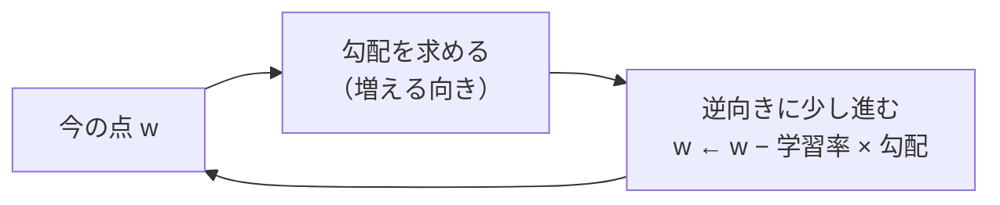

# 02-2 微分と勾配

!!! abstract "到達目標"
    - 微分を「その点での傾き」として説明し、数値（中心差分）で近似できる
    - 多変数の関数の勾配を求め、「勾配の逆向きに進むと値が小さくなる」ことを説明できる
    - 式で求めた勾配が正しいかを、数値の勾配と比べて確かめられる（勾配の確認）

## 何か

**微分** は、関数のある点での傾きです。「x を少しだけ増やしたら、f(x) はどれだけ増えるか」の割合です。

f(x) = x² なら、x = 3 での傾きは 6 です（式で求めると 2x）。x を 0.001 増やすと、f(x) はおよそ 0.006 増えます。

式を知らなくても、傾きは数値で近似できます。

| 方法 | 式 | 特徴 |
|---|---|---|
| 前進差分 | (f(x + h) − f(x)) / h | 簡単。誤差が h に比例する |
| 中心差分 | (f(x + h) − f(x − h)) / 2h | 前後を見る。誤差が h² に比例し、ずっと小さい |

変数が複数ある関数では、1 つの変数だけを少し動かしたときの傾き（**偏微分**）を、変数ごとに求めます。
それを並べたベクトルが **勾配** です。勾配は「値がいちばん速く増える向き」を指します。



## なぜ必要か

機械学習の「学習」は、損失（予測の外れの大きさ）が小さくなるように、モデルの数（パラメーター）を少しずつ動かすことです。
どちらへ動かせば損失が減るかを教えてくれるのが、勾配です（02-4 で使います）。

モデルが大きくなると、勾配の式を手で導いて実装します（05 の誤差逆伝播はその自動化です）。
式の実装には誤りが入りやすく、しかも「学習が少し遅い」程度にしか表に出ません。
数値の勾配と比べて確かめる方法を知っていれば、式の誤りをすぐに見つけられます。

## どうやるか

### 傾きを数値で近似する

<!-- src: examples/src/roadmap_examples/p02_gradient.py -->
```python title="examples/src/roadmap_examples/p02_gradient.py"
def derivative(f: Callable[[float], float], x: float, h: float = 1e-5) -> float:
    """f の x での傾きを、中心差分 (f(x+h) - f(x-h)) / 2h で近似する."""
    return (f(x + h) - f(x - h)) / (2 * h)


def forward_derivative(f: Callable[[float], float], x: float, h: float = 1e-5) -> float:
    """前進差分 (f(x+h) - f(x)) / h. 中心差分より誤差が大きい（比べるために置く）."""
    return (f(x + h) - f(x)) / h
```

```pycon
>>> from roadmap_examples.p02_gradient import derivative, forward_derivative
>>> derivative(lambda x: x**2, 3.0)
6.000000000039306
>>> forward_derivative(lambda x: x**2, 3.0)
6.000009999951316
```

e^x（`math.exp`）の微分は e^x 自身なので、x = 1 での正しい傾きは e です。h を変えて、誤差の大きさを比べました。

| h | 前進差分の誤差 | 中心差分の誤差 |
|---|---|---|
| 0.1 | 約 0.14 | 約 0.0045 |
| 0.001 | 約 0.0014 | 約 0.00000045 |
| 0.00001 | 約 0.000014 | 約 0.00000000006 |
| 10⁻¹² | 約 0.0004 | 約 0.0002 |

h を小さくすると誤差は減りますが、小さすぎると逆に増えます。
f(x + h) と f(x) がほとんど同じ数になり、引き算で有効な桁が消えるからです（桁落ち）。
この教材では h = 10⁻⁵ を既定にしています。2 つの性質は、テストで確かめています。

<!-- src: examples/tests/test_p02_gradient.py -->
```python title="examples/tests/test_p02_gradient.py"
def test_central_difference_is_more_accurate_than_forward() -> None:
    f, x, want = math.exp, 1.0, math.exp(1.0)  # exp の微分は exp
    central = abs(derivative(f, x, h=1e-3) - want)
    forward = abs(forward_derivative(f, x, h=1e-3) - want)
    assert central < forward / 100


def test_too_small_h_loses_precision() -> None:
    # h を小さくしすぎると、引き算の桁落ちで誤差が増える
    f, want = math.exp, math.exp(1.0)
    assert abs(derivative(f, 1.0, h=1e-12) - want) > abs(derivative(f, 1.0, h=1e-5) - want)
```

### 合成関数の微分（連鎖律）

f(x) = sin(x²) のように、関数の中に関数がある場合は、外側の傾きと内側の傾きを掛けます（連鎖律）。
外側 sin の傾きは cos、内側 x² の傾きは 2x なので、f の傾きは cos(x²) × 2x です。数値で確かめます。

```pycon
>>> import math
>>> derivative(lambda x: math.sin(x**2), 1.5)
-1.884520868128403
>>> 2 * 1.5 * math.cos(1.5**2)
-1.8845208681682175
```

05 の誤差逆伝播は、この掛け算を、出力から入力へ向かって順に行う仕組みです。

### 勾配を数値で求める

変数を 1 つずつ少し動かし、それぞれの傾きを並べます。

<!-- src: examples/src/roadmap_examples/p02_gradient.py -->
```python title="examples/src/roadmap_examples/p02_gradient.py"
def gradient(f: Callable[[NDArray[np.float64]], float], x: ArrayLike, h: float = 1e-5) -> NDArray[np.float64]:
    """多変数の関数 f の勾配（各変数での傾きを並べたベクトル）を、1 変数ずつ中心差分で近似する."""
    x = np.asarray(x, dtype=np.float64)
    grad = np.zeros_like(x)
    for i in range(x.size):
        step = np.zeros_like(x)
        step.flat[i] = h
        grad.flat[i] = (f(x + step) - f(x - step)) / (2 * h)
    return grad
```

f(x, y) = x² + 3xy の勾配は、式で求めると (2x + 3y, 3x) です。(1, 2) では (8, 3) になります。

```pycon
>>> import numpy as np
>>> from roadmap_examples.p02_gradient import gradient
>>> gradient(lambda v: float(v[0] ** 2 + 3 * v[0] * v[1]), [1.0, 2.0])
array([8., 3.])
```

数値の勾配は、変数の数 × 2 回、関数を呼びます。変数が数百万あるモデルでは遅すぎるので、学習には式の勾配を使い、
数値の勾配は「式が合っているか」を確かめるときだけ使います。

### 式の勾配を確かめる（勾配の確認）

式で求めた勾配と、数値の勾配の差を、2 つの大きさで割った「相対的な差」で比べます。

<!-- src: examples/src/roadmap_examples/p02_gradient.py -->
```python title="examples/src/roadmap_examples/p02_gradient.py"
def check_gradient(
    f: Callable[[NDArray[np.float64]], float],
    grad_f: Callable[[NDArray[np.float64]], NDArray[np.float64]],
    x: ArrayLike,
    tol: float = 1e-6,
) -> float:
    """式で求めた勾配 grad_f と数値の勾配の、相対的な差. tol を超えたら ValueError（式の誤りの疑い）."""
    x = np.asarray(x, dtype=np.float64)
    analytic, numeric = grad_f(x), gradient(f, x)
    diff = float(np.linalg.norm(analytic - numeric) / max(np.linalg.norm(analytic) + np.linalg.norm(numeric), 1e-12))
    if diff > tol:
        raise ValueError(f"勾配が合いません（相対的な差 {diff:.2e}）")
    return diff
```

!!! failure "悪い例"
    勾配の式を書いたら、そのまま学習に使う。2 を掛け忘れても、学習は（遅いだけで）進むので気づかない。

!!! success "良い例"
    小さな入力で `check_gradient` を通してから使う。テストに入れておけば、後で式を直したときも確かめられる。

<!-- src: examples/tests/test_p02_gradient.py -->
```python title="examples/tests/test_p02_gradient.py"
def test_check_gradient_finds_wrong_formula() -> None:
    def f(v: np.ndarray) -> float:
        return float(np.sum(v**2))

    assert check_gradient(f, lambda v: 2 * v, [1.0, -2.0, 0.5]) < 1e-8
    with pytest.raises(ValueError, match="勾配が合いません"):
        check_gradient(f, lambda v: v, [1.0, -2.0, 0.5])  # 2 を掛け忘れた
```

02-4 では、線形回帰の損失の勾配を、この方法で確かめてから使います。

## 演習

f(w₀, w₁) = (2w₀ + w₁ − 5)² について、次を行ってください。

1. 連鎖律で勾配の式を求め、`grad_f` として書く。`check_gradient` で (1, 1)・(0, 0)・(3, −2) の 3 点を確かめるテストを書く
2. (0, 0) から始め、`w ← w − 0.05 × 勾配` を 20 回繰り返し、f の値が減っていくことを確かめる
3. 2 の最後の w で、2w₀ + w₁ がいくつに近づいたかを確かめ、理由を説明する

- できたことの確かめ方: テストが通る。2 は f の値の並び、3 は 1〜2 文の説明
- 目安の時間: 2 時間

解答: [02-2 の解答](answers/02-2.md)

## もし〇〇がなかったら？

**勾配がなかったら**、パラメーターをどちらへ動かせば損失が減るかが分かりません。
すべての組み合わせを試すしかなく、パラメーターが 10 個を超えると、現実的な時間では終わりません。

**勾配の確認がなかったら**、式の実装の誤り（符号の間違い・係数の掛け忘れ）が、「学習がうまく進まない」という形でしか見えません。
データが悪いのか、学習率が悪いのか、式が悪いのかを切り分けられず、調べる時間が何倍にもなります。

## 理解度チェック

1. 前進差分より中心差分のほうが、誤差が小さいのはなぜですか（感覚的に）。

    ??? note "答え"
        前進差分は片側だけを見るので、曲がり方（2 次の項）の分がずれとして残ります。
        中心差分は前と後ろを見るので、そのずれが打ち消し合い、残る誤差が h² に比例して小さくなります。

2. h を 10⁻¹² のように小さくしすぎると、誤差が増えるのはなぜですか。

    ??? note "答え"
        f(x + h) と f(x − h) がほとんど同じ数になり、引き算で有効な桁が消える（桁落ち）からです。
        小数は限られた桁数でしか表せないので、h には「小さすぎない」値を選びます。

3. 勾配の逆向きに進むと、関数の値が小さくなるのはなぜですか。

    ??? note "答え"
        勾配は、値がいちばん速く増える向きを指すからです。逆向きに少し進めば、値はいちばん速く減ります。
        ただし進みすぎると、谷を飛び越えて値が増えることがあります（02-4 の学習率）。

4. 数値の勾配を、学習そのものに使わないのはなぜですか。

    ??? note "答え"
        変数の数 × 2 回、関数（損失の計算）を呼ぶので、変数が多いと遅すぎるからです。
        学習には式の勾配を使い、数値の勾配は式の確認に使います。
