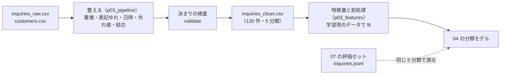

# 03-4 特徴量と前処理パイプライン

!!! abstract "到達目標"
    - 整えた表から特徴量を作り、予測の時点で使えない列（リーク）を見分けて外せる
    - 前処理（穴埋め・標準化・カテゴリの 0/1 化・文章のベクトル化）を、学習用のデータだけで fit し、評価用のデータには transform だけを行える
    - 同じ入力から何度でも同じ出力になるパイプラインを書き、出力の決まり（列・型・分類）を検査して次の部に渡せる

## 何か

**特徴量** は、モデルが読む数です。文章や「メール」のような文字は、そのままではモデルに渡せないので、数に変えます。
その変換をまとめたものが **前処理パイプライン** です。

03 の成果物は、汚れた CSV から、04 の学習に使える表までを、1 つのコマンドで作るパイプラインです。



scikit-learn の前処理は、2 つの段階に分かれます（[scikit-learn: データの前処理](https://scikit-learn.org/stable/modules/preprocessing.html)）。

| 段階 | すること | 例 |
|---|---|---|
| `fit` | データから、変換に必要な値を学ぶ | 中央値・平均と標準偏差・窓口の種類・文字の語彙 |
| `transform` | 学んだ値で変換する | 欠損を中央値で埋める・標準化する・0/1 の列にする |

## なぜ必要か

前処理の値（中央値や語彙）を、評価用のデータも含めた全体から学ぶと、評価用のデータの情報が学習に漏れます（**リーク**）。
評価の点数が実際より良く出て、本番で期待した精度が出ません（[scikit-learn: よくある落とし穴](https://scikit-learn.org/stable/common_pitfalls.html)）。

予測の時点で手に入らない列を特徴量にするのも、リークです。
03 のデータの「対応時間」は、対応が終わってから分かる値です。問い合わせが届いた時点で分類したいのに、それを使うと、
評価では良く見えても、本番では使えないモデルになります。

パイプラインを「何度実行しても同じ結果」にしておかないと、04 の結果が良くなったとき、モデルのおかげか、データが変わったせいかが分かりません。

## どうやるか

### 特徴量を足す

元の列から、行ごとに計算できる特徴量を足します。

<!-- src: examples/src/roadmap_examples/p03_features.py -->
```python title="examples/src/roadmap_examples/p03_features.py"
def add_features(df: pd.DataFrame) -> pd.DataFrame:
    """元の列から計算できる特徴量を足す（行ごとに決まる計算だけ. 全体の平均などはここで使わない）."""
    return df.assign(
        input_length=df[TEXT].str.len(),
        hour=df["received_at"].dt.hour,  # 受付日時が欠損の行は NaN（後で穴埋めする）
    )
```

「全体の平均との差」のような、ほかの行を見る計算はここで行いません。ほかの行を見る計算は fit で学ぶ値なので、前処理パイプラインの中で、学習用のデータだけから求めます。

使う列と、使わない列は、名前で決めておきます。

<!-- src: examples/src/roadmap_examples/p03_features.py -->
```python title="examples/src/roadmap_examples/p03_features.py"
TARGET = "category"
TEXT = "input"
CATEGORICAL = ["channel", "plan"]
NUMERIC = ["input_length", "hour"]
# 対応が終わってから分かる値. 分類したい時点（問い合わせが届いたとき）には無いので、特徴量にしない
LEAKY = ["response_minutes"]
```

### 列の種類ごとの前処理をまとめる

`ColumnTransformer` は、列ごとに別の前処理をかけ、結果を横に並べます
（[公式ドキュメント: ColumnTransformer](https://scikit-learn.org/stable/modules/generated/sklearn.compose.ColumnTransformer.html)）。

<!-- src: examples/src/roadmap_examples/p03_features.py -->
```python title="examples/src/roadmap_examples/p03_features.py"
    numeric = Pipeline(
        [
            ("impute", SimpleImputer(strategy="median")),  # 欠損を、学習用のデータの中央値で埋める
            ("scale", StandardScaler()),  # 平均 0・標準偏差 1 にそろえる（02-4）
        ]
    )
    # 列名を文字列 1 つで渡すと、1 次元（文章の並び）のまま渡る. 日本語は単語の区切りが無いので、1〜2 文字の並びを数える
    text = ("text", TfidfVectorizer(analyzer="char", ngram_range=(1, 2)), TEXT)
    if text_only:
        return ColumnTransformer([text])
    return ColumnTransformer(
        [
            text,
            ("cat", OneHotEncoder(handle_unknown="ignore"), CATEGORICAL),  # 学習で見なかった値は全部 0
            ("num", numeric, NUMERIC),
        ]
    )
```

| 列 | 前処理 | 結果 |
|---|---|---|
| 本文 | `TfidfVectorizer`: 1〜2 文字の並びの出現を数え、どの文にも出る並びを軽くする | 1 文字・2 文字の並びごとに 1 列（学習用の 97 件で約 1,270 列） |
| 窓口・プラン | `OneHotEncoder`: 値ごとに 0/1 の列を作る | 窓口 5 列・プラン 4 列 |
| 文字数・時刻 | `SimpleImputer` で欠損を中央値で埋め、`StandardScaler` で標準化 | 2 列 |

- 日本語は単語の間に空白が無いので、ここでは単語に分けず、文字の並び（「請求」「求書」など）を数えます
  （[公式ドキュメント: TfidfVectorizer](https://scikit-learn.org/stable/modules/generated/sklearn.feature_extraction.text.TfidfVectorizer.html) の `analyzer`）
- `handle_unknown="ignore"` は、学習で見なかった窓口（例えば「fax」）が来たとき、エラーにせず、窓口の列をすべて 0 にします
  （[公式ドキュメント: OneHotEncoder](https://scikit-learn.org/stable/modules/generated/sklearn.preprocessing.OneHotEncoder.html)）

### 07 の評価セットに合わせる: 本文だけを使う

04 の分類モデルは、07 の評価セット（`examples/data/p07/inquiries.jsonl`）で測り、07 で LLM と比べます。
評価セットの 1 件は `id`・`input`（本文）・`expected.category`（正解）だけで、窓口やプランはありません。

**評価のときに無い列は、学習にも使えません。** そのため、07 の評価セットで測るモデルは `build_preprocessor(text_only=True)` で、本文だけを使います。
窓口・プラン・時刻を使う前処理は、それらの列を持つデータで評価する場合のために残しています。

03 の出力の形は、07 の評価セットとそろえてあります。

| 03 の出力の列 | 型 | 07 の評価セットでの対応 |
|---|---|---|
| `id` | 文字列（`Q0001` など） | `id`（07 は `c001` など。重ならない） |
| `input` | 文字列（NFKC でそろえた本文） | `input` |
| `category` | `billing`・`account`・`bug`・`contract`・`other` のどれか | `expected.category`（同じ 5 種類） |
| `received_at`・`customer_id`・`plan`・`channel`・`response_minutes` | 日時・文字列・整数（欠損あり） | 無い（04 では使わないか、別の評価で使う） |

評価セットと同じ文は、学習用のデータに入っていません。答えを見せた試験にならないよう、テストで確かめています。

<!-- src: examples/tests/test_p03_pipeline.py -->
```python title="examples/tests/test_p03_pipeline.py"
def test_output_shape_matches_07_eval_set() -> None:
    df, _ = run()
    assert list(df.columns) == OUTPUT_COLUMNS
    assert set(df["category"]) == set(CATEGORIES)  # 07 の評価セットと同じ 5 種類
    assert set(df["channel"]) == {"email", "phone", "chat", "form", "unknown"}
    assert set(df["plan"]) == {"free", "standard", "pro", "unknown"}
    eval_inputs = {c.input for c in load_cases(DEFAULT_EVAL)}
    assert not eval_inputs & set(df["input"])  # 評価セットと同じ文を学習に入れない（答えを見せた試験になる）
```

### 学習用のデータだけで fit する

学習用と評価用に分けてから、学習用のデータだけで fit します。分類ごとの割合をそろえ（`stratify`）、seed で毎回同じ分け方にします。

<!-- src: examples/src/roadmap_examples/p03_features.py -->
```python title="examples/src/roadmap_examples/p03_features.py"
def split(df: pd.DataFrame, test_size: float = 0.25, seed: int = 0) -> tuple[pd.DataFrame, pd.DataFrame]:
    """学習用と評価用に分ける. 分類ごとの割合をそろえ（stratify）、seed で毎回同じ分け方にする."""
    train, test = train_test_split(df, test_size=test_size, random_state=seed, stratify=df[TARGET])
    return train.sort_values("id"), test.sort_values("id")
```

!!! failure "悪い例"
    ```python
    X = build_preprocessor().fit_transform(df)  # 全体で fit してから
    X_train, X_test = train_test_split(X)  # 分ける（評価用のデータの中央値や語彙が、学習に混ざる）
    ```

!!! success "良い例"
    ```python
    train, test = split(df)  # 先に分けて
    pre = build_preprocessor().fit(train)  # 学習用のデータだけで fit し
    X_train, X_test = pre.transform(train), pre.transform(test)  # 両方を transform する
    ```

学習用の 97 件で fit すると、時刻の中央値は 13 時です。全体の 130 件で fit すると 14 時になります。
語彙は、全体なら約 1,520 個、学習用だけなら約 1,270 個で、差の約 250 個は評価用のデータにしか出てこない文字の並びです。
全体で fit すると、これらが「知っている並び」として扱われ、評価が甘くなります。テストで確かめています。

<!-- src: examples/tests/test_p03_features.py -->
```python title="examples/tests/test_p03_features.py"
def test_preprocessor_learns_only_from_train(data) -> None:
    train, test = split(data)
    pre = build_preprocessor().fit(train)
    medians = pre.named_transformers_["num"].named_steps["impute"].statistics_
    assert medians.tolist() == train[NUMERIC].median().tolist()  # 全体ではなく学習用のデータの中央値
    vocab = pre.named_transformers_["text"].vocabulary_
    test_only = {c for text in test["input"] for c in text} - {c for text in train["input"] for c in text}
    assert test_only and not test_only & set(vocab)  # 評価用にしか無い文字は、語彙に入らない
    assert pre.transform(test).shape == (len(test), pre.transform(train).shape[1])
```

04 では、前処理とモデルを `make_pipeline` でつなぎます。こうすると、`fit` で前処理とモデルが学習用のデータだけから学び、
`predict` で同じ前処理が新しいデータにかかります（交差検証でも、分けた後で fit されます）。

```python
from sklearn.linear_model import LogisticRegression
from sklearn.pipeline import make_pipeline

model = make_pipeline(build_preprocessor(text_only=True), LogisticRegression(max_iter=1000))
model.fit(train, train[TARGET])
```

### 再実行できるパイプラインにする

03 の成果物 `examples/src/roadmap_examples/p03_pipeline.py` は、次の決まりを守っています。

| 決まり | 方法 | 確かめるテスト |
|---|---|---|
| 同じ入力から同じ出力 | 受付番号の順に並べる・改行は LF・日時の書き方を固定 | `test_rerun_gives_identical_output` |
| 入力を書き換えない | 結果は別のファイル（`--out`）に書く | ― |
| 出力の決まりを検査する | 列・id の重複・空の本文・分類の種類（`validate`） | `test_validate_rejects_broken_table` |
| 捨てた理由を報告する | `CleanReport`（03-3） | `test_run_on_sample_data_reports_every_drop` |
| 置いてある出力が最新 | `data/p03/inquiries_clean.csv` とパイプラインの出力を比べる | `test_committed_clean_csv_is_up_to_date` |

<!-- src: examples/src/roadmap_examples/p03_pipeline.py -->
```python title="examples/src/roadmap_examples/p03_pipeline.py"
def validate(df: pd.DataFrame) -> None:
    """整えた表の決まり. 破っていたら PipelineError（次の部に壊れたデータを渡さない）."""
    problems = []
    if list(df.columns) != OUTPUT_COLUMNS:
        problems.append(f"列が違います: {list(df.columns)}")
    if df["id"].duplicated().any():
        problems.append("id が重複しています")
    if df["input"].isna().any() or (df["input"].str.strip() == "").any():
        problems.append("本文が空の行があります")
    unknown = set(df["category"].dropna()) - set(CATEGORIES)
    if df["category"].isna().any() or unknown:
        problems.append(f"分類が 5 種類以外です: {sorted(unknown)}")
    if problems:
        raise PipelineError("; ".join(problems))
```

実行します（`examples/` で）。`--cases` を付けると、07 の評価セットと同じ形式の JSONL も書きます。04 は、どちらの形でも読めます。

```bash
uv run python -m roadmap_examples.p03_pipeline --out inquiries_clean.csv --cases inquiries_train.jsonl
```

<!-- src: examples/src/roadmap_examples/p03_pipeline.py -->
```python title="examples/src/roadmap_examples/p03_pipeline.py"
def to_cases(df: pd.DataFrame) -> list[EvalCase]:
    """07 の評価セットと同じ形式（id・input・expected.category）にする. 04 の学習データを JSONL でも渡せる."""
    return [EvalCase(row.id, row.input, {"category": row.category}) for row in df.itertuples(index=False)]
```

整えた表を読み直すときは `read_clean` を使います。CSV では日時や欠損のある整数が文字列になるので、型を戻して返します。

## 演習

1. パイプラインを実行し、`--cases` で書いた JSONL を、07 の `load_cases` で読めることをテストで確かめてください。
   読んだ件数と、分類ごとの件数も確かめます
2. 本文が「か。」で終わるか（質問の形か）を 0/1 で表す特徴量 `is_question` を `add_features` に足し、前処理の数の列に加えてください。
   前処理の出力の列が 1 つ増えることをテストで確かめます
3. 「全体で fit した語彙」と「学習用のデータだけで fit した語彙」の数を比べ、評価用のデータにしか無い並びが、全体で fit したときに何個入るかを数えてください

- できたことの確かめ方: `uv run pytest` が通る。3 は 2 つの語彙の数と差
- 目安の時間: 4 時間

解答: [03-4 の解答](answers/03-4.md)

## もし〇〇がなかったら？

**学習用のデータだけで fit していなかったら**、評価の点数は、評価用のデータを少しだけ覗いた状態で出た点数になります。
04 で「正解率 85%」と報告したモデルが、本番の新しい問い合わせでは 75% しか出ない、ということが起きます。
差の原因が前処理にあると気づくのは難しく、モデルの選び方を何度も変えて時間を使います。

**パイプラインが再実行できなかったら**（手で Excel を直した、実行のたびに並び順が変わる、など）、
04 の結果が先週と違ったとき、原因がデータかモデルかを切り分けられません。
同じ入力から同じ出力になり、捨てた件数まで毎回同じであることが、比べるための前提です。

## 理解度チェック

1. 「対応時間」を、問い合わせの分類の特徴量にしないのはなぜですか。

    ??? note "答え"
        対応が終わってから分かる値で、分類したい時点（問い合わせが届いたとき）には無いからです。
        学習と評価では使えても、本番では使えません（リーク）。

2. 前処理を、学習用と評価用に分ける前に全体で fit すると、何が問題ですか。

    ??? note "答え"
        中央値・平均・語彙などに、評価用のデータの情報が混ざるからです。評価の点数が実際より良く出ます。
        先に分け、学習用のデータだけで fit し、評価用のデータには transform だけを行います。

3. 04 の分類モデルで、窓口やプランを使わず、本文だけで学習するのはなぜですか。

    ??? note "答え"
        比べる基準になる 07 の評価セットには、本文と正解しか無いからです。評価のときに無い列は、学習にも使えません。

4. パイプラインの出力を「受付番号の順に並べる」「改行は LF」と決めているのはなぜですか。

    ??? note "答え"
        同じ入力から、いつも同じバイト列の出力にするためです。前の結果と比べたとき、違いがあれば中身が変わったと判断できます。
        並び順や改行が実行ごとに変わると、意味の無い差が出て、本当の変化が見えなくなります。
