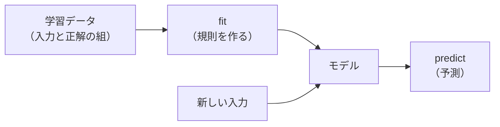

# 04-1 回帰と分類

!!! abstract "到達目標"
    - 回帰と分類の違いを、予測するもの（数か種類か）と測り方の違いから説明できる
    - scikit-learn の `fit` と `predict` で、回帰と分類のモデルを作れる
    - 日本語の文章を、文字の組（TF-IDF）で数の並びにして、分類のモデルに渡せる

## 何か

機械学習は、正解つきの例をたくさん見せて、入力から答えを出す規則をコンピューターに作らせる方法です。
正解つきの例から学ぶものを **教師あり学習** と呼びます。この部で扱うモデルの多くは、これです。

教師あり学習は、予測するものによって 2 つに分かれます。

| 種類 | 予測するもの | 例 | 測り方の例 |
|---|---|---|---|
| 回帰 | 数 | 問い合わせの対応にかかる時間（分） | 誤差の大きさ（MAE: 予測と実際の差の絶対値の平均） |
| 分類 | 決まった種類のどれか | 問い合わせの窓口（billing・account など） | 正解率・適合率・再現率（04-4） |



この部の題材は、07 と同じ **架空の会員制サービスに届く問い合わせ** です。
04 の成果物は、問い合わせを 5 つの窓口に振り分ける分類モデルです。07 で、LLM の分類と比べる基準になります。

## なぜ必要か

07 で比べる基準に使う仮のルールベース分類は、キーワードで振り分ける規則を手で書いたものです。07 の評価セットの 30 件中 20 件しか当たりません。

- 「請求」という語があれば billing、のような規則は、言い回しが少し違うだけで外れる
- 規則を足すほど、規則どうしがぶつかる（「ログインボタンでエラー」は bug か account か）
- 新しい言い回しが増えるたびに、人が規則を書き直す

Java で言えば、長い `if` と `else if` を手で保守し続ける状態です。
機械学習では、規則を書く代わりに **正解つきの例を集めます**。規則（重み）はモデルが例から作ります。
例を足して学習し直せば、新しい言い回しにも対応できます。

## どうやるか

演習のコードは scikit-learn を使います。scikit-learn のモデルは、どれも同じ形で使えます
（[公式ドキュメント: 線形モデル](https://scikit-learn.org/stable/modules/linear_model.html)）。

- `fit(X, y)`: 入力 `X` と正解 `y` から学習する
- `predict(X)`: 新しい入力の答えを出す

### 回帰: 対応にかかる時間を予測する

問い合わせの文字数と添付の数から、対応にかかる時間（分）を予測します。数字は架空です。

<!-- src: examples/src/roadmap_examples/p04_regression.py -->
```python title="examples/src/roadmap_examples/p04_regression.py"
def fit_and_score(
    train: list[tuple[int, int, float]] = HANDLING, test: list[tuple[int, int, float]] = TEST
) -> tuple[LinearRegression, RegressionResult]:
    """学習データで直線（平面）を当てはめ、学習に使っていないデータで誤差を測る."""
    x_train, y_train = to_xy(train)
    x_test, y_test = to_xy(test)
    model = LinearRegression().fit(x_train, y_train)
    baseline = np.full_like(y_test, y_train.mean())
```

`LinearRegression` は、「時間 = 係数 1 × 文字数 + 係数 2 × 添付の数 + 切片」の係数を、誤差の 2 乗の和が最小になるように決めます。
学習した係数は、テストで確かめています。

<!-- src: examples/tests/test_p04_regression.py -->
```python title="examples/tests/test_p04_regression.py"
def test_regression_learns_the_trend_and_beats_the_mean() -> None:
    _, result = fit_and_score()
    assert result.per_char == pytest.approx(0.094, abs=0.001)  # 100 文字で約 9 分
    assert result.per_file == pytest.approx(7.8, abs=0.1)  # 添付 1 つで約 8 分
    assert result.mae < 1.0 < result.baseline_mae
```

係数は「1 文字増えると約 0.094 分、添付が 1 つ増えると約 7.8 分」と読めます。
学習に使っていない 4 件での MAE は 1 分未満でした。いつも平均を答えるだけの基準（MAE 約 7 分）より、ずっと小さい誤差です。

02 で勾配降下を使って解いた線形回帰と、同じ問題です。NumPy の最小二乗法（`np.linalg.lstsq`）で解いても、同じ係数になることをテストで確かめています
（[公式ドキュメント: numpy.linalg.lstsq](https://numpy.org/doc/stable/reference/generated/numpy.linalg.lstsq.html)）。

### 分類: 文章を数の並びにする

モデルが受け取れるのは数だけです。文章は、まず数の並び（特徴量）にします。

よく使うのが **TF-IDF** です。語ごとに「この文章によく出るか（TF）」と「ほかの文章には少ないか（IDF）」を掛けた重みを付けます。
どの文章にも出る語（「です」など）の重みは小さく、その文章を特徴づける語の重みは大きくなります
（[公式ドキュメント: TfidfVectorizer](https://scikit-learn.org/stable/modules/generated/sklearn.feature_extraction.text.TfidfVectorizer.html)）。

問題は、何を「語」とするかです。英語は空白で単語に分かれますが、日本語は分かれません。

!!! failure "悪い例"
    ```python
    from sklearn.feature_extraction.text import TfidfVectorizer

    vectorizer = TfidfVectorizer()  # 既定は「英数字と文字の続き」を 1 語とする
    vectorizer.fit(["先月の請求書を再発行してもらえますか。", "請求書の送付先の住所を変えたいです。"])
    print(vectorizer.get_feature_names_out())  # 文がまるごと 1 語になる
    ```

    既定の分け方では、空白も記号も無い日本語の文は、句点までがまるごと 1 語になります。
    どの文も別の語になり、「請求書」が共通していることをモデルが使えません。
    手元で試すと、このモデルの評価セットでの正解は 30 件中 6 件でした。評価セットの文の語が学習データとほとんど一致せず、
    予測がほぼ当て推量になるためです（分類ごとの点数がほぼ同じなので、環境によって数件変わります）。

!!! success "良い例"
    文字を語の代わりにし、1 文字と、隣り合う 2 文字の組（「請求」「求書」）を語として扱います（`analyzer="char"`）。
    単語に分ける道具を入れずに、日本語を扱えます。

演習のコードのモデルは、文字の組の TF-IDF と、分類のモデル（ロジスティック回帰）をつないだものです。

<!-- src: examples/src/roadmap_examples/p04_classify.py -->
```python title="examples/src/roadmap_examples/p04_classify.py"
def build_model(c: float = 1.0, ngram_range: tuple[int, int] = (1, 2)) -> Pipeline:
    """文字の組の TF-IDF と、ロジスティック回帰をつないだモデル（まだ学習していない）."""
    return Pipeline(
        [
            ("tfidf", TfidfVectorizer(analyzer="char", ngram_range=ngram_range)),
            ("clf", LogisticRegression(C=c, max_iter=1000)),
        ]
    )
```

`Pipeline` は、前処理とモデルを 1 つにまとめたものです。`fit` を呼ぶと、TF-IDF の語彙を作ってから、モデルを学習します。
`predict` では、同じ語彙で文章を数にしてから予測します。学習と予測で前処理がずれません
（[公式ドキュメント: Pipeline](https://scikit-learn.org/stable/modules/compose.html)）。

### ロジスティック回帰

名前に「回帰」とありますが、分類のモデルです。分類ごとに「特徴量 × 重み」の和（点数）を出し、
点数を確率に直して、いちばん高い分類を答えます
（[公式ドキュメント: LogisticRegression](https://scikit-learn.org/stable/modules/generated/sklearn.linear_model.LogisticRegression.html)）。

重みを見ると、モデルが何を手がかりにしたかが分かります。

<!-- src: examples/src/roadmap_examples/p04_classify.py -->
```python title="examples/src/roadmap_examples/p04_classify.py"
def top_features(model: Pipeline, label: str, n: int = 5) -> list[str]:
    """その分類の重み（係数）が大きい文字の組. モデルが何を手がかりにしたかを読む."""
    names = model.named_steps["tfidf"].get_feature_names_out()
    clf = model.named_steps["clf"]
    row = clf.coef_[list(clf.classes_).index(label)]
    return [str(names[i]) for i in row.argsort()[::-1][:n]]
```

手元で実行すると、billing の上位は「書」「請」「請求」「求」「払」、contract の上位は「約」「契約」「契」「プ」「ラン」でした。
人が規則に書きそうな語を、例から見つけています。一方、bug の上位には「が」「と」「され」「ると」のような語尾も入ります。
「〜すると、〜が〜されません」という不具合の書き方の癖を、手がかりにしているためです。

### 07 の評価セットで測る

学習データは、03 の成果物（`examples/data/p03/inquiries_clean.csv`、架空の 130 件）の本文（`input`）と分類（`category`）です。
07 の評価セット（30 件）で測ります。評価セットは学習に使いません。
03 の表には対応にかかった時間（`response_minutes`）もありますが、問い合わせが届いた時点では分からない値なので使いません（03-4）。
文字の組の TF-IDF は、03 の `build_preprocessor(text_only=True)` と同じ設定です。

<!-- src: examples/tests/test_p04_classify.py -->
```python title="examples/tests/test_p04_classify.py"
def test_model_beats_the_07_rule_on_the_eval_set(model) -> None:
    report = run_eval(load_cases(DEFAULT_EVAL), model_predict(model), exact_match("category"))
    assert sum(r.score for r in report.results) == 24  # 07 の仮のルールベースは 20 件
    assert [r.id for r in report.results if r.score < 1] == ["c002", "c009", "c011", "c023", "c025", "c026"]
```

30 件中 24 件（80.0%）が正解でした。ただし、評価セットは 30 件と小さく、この数字をどこまで信じてよいかは 04-4 で確かめます。

`predict_proba` で、分類ごとの確率も出せます。

```python
from roadmap_examples.p04_classify import DEFAULT_TRAIN, load_train, train

model = train(load_train(DEFAULT_TRAIN))
print(model.classes_)
print(model.predict_proba(["請求書を再発行してください"]).round(2))
```

手元では billing の確率が 0.51 で最も高く、ほかは 0.09〜0.17 でした。答えは合っていても、確率は半分ほどです。
学習データが 130 件と少なく、重みが控えめに付くためです。確率を「自信」として使う前に、本当にその割合で当たるかを確かめます。

## 演習

1. 回帰で、文字数だけを使うモデルを作り、MAE を文字数と添付の数の両方を使うモデルと比べてください。
   テストに、2 つの MAE の大小を書きます
2. 分類で、`build_model(ngram_range=(1, 1))` と `(1, 3)` を学習し、07 の評価セットでの正解数を比べてください。
   比べた結果から「どれを採用するか」を決めてよいかも考えます（ヒント: 04-4 の交差検証）
3. 自分で考えた問い合わせを 3 つ作り、`predict_proba` の確率を表にしてください。
   いちばん高い確率が 0.5 未満の文は、どんな文かを考察します

- できたことの確かめ方: `uv run pytest` が通る。3 は確率の表と考察
- 目安の時間: 4 時間

解答: [04-1 の解答](answers/04-1.md)

## もし〇〇がなかったら？

**教師あり学習がなかったら**、分類の規則を人がすべて書くことになります。
07 の仮のルールベース分類のように、紛らわしい件で外れ、言い回しが増えるたびに規則を足す保守が続きます。
規則が 100 行を超えると、どの規則が効いているのか、誰にも説明できなくなります。

**文章を数にする方法がなかったら**、モデルは文章を受け取れません。
文字の組の TF-IDF は単純ですが、単語に分ける道具なしで日本語を数にでき、まず試す基準として十分に役に立ちます。

## 理解度チェック

1. 「問い合わせの対応にかかる時間」と「問い合わせの窓口」は、それぞれ回帰と分類のどちらですか。測り方はどう違いますか。

    ??? note "答え"
        時間は数を予測するので回帰、窓口は決まった種類から選ぶので分類です。
        回帰は誤差の大きさ（MAE など）、分類は正解率や再現率（04-4）で測ります。

2. 日本語の文章で、`TfidfVectorizer` の既定の分け方を使うと、何が起きますか。

    ??? note "答え"
        空白で区切られないため、句点までの文がまるごと 1 語になります。
        どの文も別の語になり、共通する語（「請求書」など）をモデルが使えません。`analyzer="char"` で文字の組を語にします。

3. `Pipeline` で TF-IDF とモデルをまとめると、何がうれしいですか。

    ??? note "答え"
        学習と予測で、同じ前処理（同じ語彙）が必ず使われます。前処理のかけ忘れや、学習と予測でのずれを防げます。
        04-4 の交差検証でも、分割ごとに前処理を学習し直せます。

4. 回帰のモデルの MAE が 1 分未満だったとき、「良いモデル」と言うために、ほかに何と比べますか。

    ??? note "答え"
        いつも平均を答えるだけの基準と比べます。基準の誤差より十分に小さくて初めて、モデルが入力から何かを学んだと言えます。
        また、学習に使っていないデータで測った誤差であることを確かめます。
