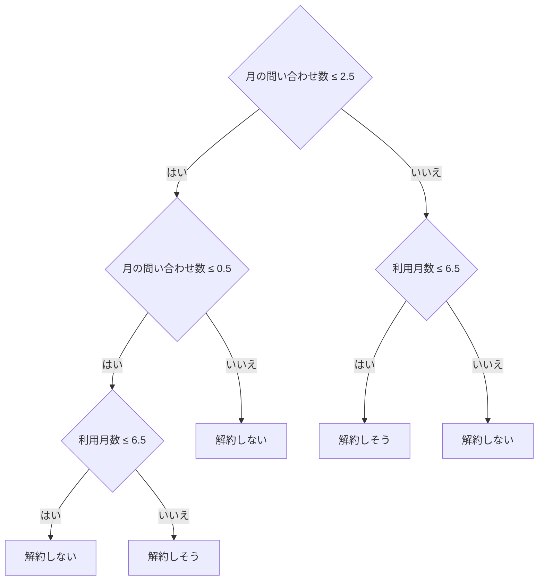

# 04-2 決定木・ランダムフォレスト

!!! abstract "到達目標"
    - 決定木が「もし〜なら」の分かれ道で予測する仕組みを、学習した木を読んで説明できる
    - 直線で分けるモデルでは表せない、条件の組み合わせのデータを、決定木で学習できる
    - ランダムフォレストの考え方と、特徴量の重要度を読むときの注意を説明できる

## 何か

**決定木** は、「利用月数が 6.5 以下か」のような質問を繰り返して、データを分けていくモデルです。
最後にたどり着いた枝（葉）で、いちばん多い答えを予測にします。



図は、この章の演習のコードが実際に学習した木です。学習では、各分かれ道で「分けた後の答えが最もそろう質問」を選びます
（そろい具合はジニ不純度などで測ります。[公式ドキュメント: 決定木](https://scikit-learn.org/stable/modules/tree.html)）。

**ランダムフォレスト** は、少しずつ違うデータと特徴量で決定木をたくさん作り、多数決（確率の平均）で予測するモデルです
（[公式ドキュメント: アンサンブル](https://scikit-learn.org/stable/modules/ensemble.html)）。
1 本の木は学習データの細かい違いに振り回されやすいですが、たくさんの木の平均を取ると、ぶれが小さくなります。

## なぜ必要か

04-1 のロジスティック回帰は、特徴量ごとの重みを足し合わせるモデルです。「この語があれば点数が上がる」は得意ですが、
「A かつ B のときだけ」「A のときは B が多いほど、A でないときは B が少ないほど」のような条件の組み合わせは苦手です。

業務の表のデータ（会員の利用月数・プラン・問い合わせの数など）では、こうした組み合わせがよく出てきます。

- 始めたばかりの会員は、問い合わせが多いほど解約しやすい
- 長く使っている会員は、逆に問い合わせが無いほど（使わなくなるほど）解約しやすい

決定木は、この組み合わせを分かれ道で表せます。学習した木は人が読めるので、「なぜその予測か」を業務の人に説明できます。

## どうやるか

### 条件の組み合わせを学習する

架空の規則で作った表（利用月数 10 通り × 月の問い合わせ数 6 通り = 60 件）を使います。

<!-- src: examples/src/roadmap_examples/p04_trees.py -->
```python title="examples/src/roadmap_examples/p04_trees.py"
def churn_rule(months: int, inquiries: int) -> int:
    """架空の規則（1 = 解約しそう）: 始めたばかりで問い合わせが多い人と、長く使っていて問い合わせが無い人."""
    return int(inquiries >= 3) if months < 6 else int(inquiries == 0)
```

同じデータで、決定木とロジスティック回帰を学習します。

<!-- src: examples/src/roadmap_examples/p04_trees.py -->
```python title="examples/src/roadmap_examples/p04_trees.py"
def fit_churn(max_depth: int = 3) -> tuple[DecisionTreeClassifier, LogisticRegression]:
    x, y = churn_table()
    tree = DecisionTreeClassifier(max_depth=max_depth, random_state=0).fit(x, y)
    linear = LogisticRegression(max_iter=1000).fit(x, y)
    return tree, linear
```

結果はテストで確かめています。

<!-- src: examples/tests/test_p04_trees.py -->
```python title="examples/tests/test_p04_trees.py"
def test_tree_learns_combined_conditions_that_a_line_cannot() -> None:
    x, y = churn_table()
    tree, linear = fit_churn(max_depth=3)
    assert tree.score(x, y) == 1.0
    assert linear.score(x, y) < 0.9
    assert fit_churn(max_depth=2)[0].score(x, y) < 1.0  # 浅すぎると表せない
```

- 深さ 3 の決定木は、60 件すべてを当てました
- ロジスティック回帰は 83.3% でした。60 件のうち 40 件は「解約しない」なので、いつも「解約しない」と答えても 66.7% です
- 深さ 2 の決定木は 91.7% でした。木は分かれ道を 1 つずつ、その場で最も良いものから選ぶので、規則が 2 段でも 3 段の木が要ることがあります

`export_text` で、学習した木を文字で読めます（[公式ドキュメント: 決定木](https://scikit-learn.org/stable/modules/tree.html)）。

<!-- src: examples/src/roadmap_examples/p04_trees.py -->
```python title="examples/src/roadmap_examples/p04_trees.py"
def tree_rules(tree: DecisionTreeClassifier) -> str:
    """学習した木を「もし〜なら」の字下げの文にする."""
    return export_text(tree, feature_names=FEATURES)
```

```text
|--- 月の問い合わせ数 <= 2.50
|   |--- 月の問い合わせ数 <= 0.50
|   |   |--- 利用月数 <= 6.50
|   |   |   |--- class: 0
|   |   |--- 利用月数 >  6.50
|   |   |   |--- class: 1
|   |--- 月の問い合わせ数 >  0.50
|   |   |--- class: 0
|--- 月の問い合わせ数 >  2.50
|   |--- 利用月数 <= 6.50
|   |   |--- class: 1
|   |--- 利用月数 >  6.50
|   |   |--- class: 0
```

規則の「6 か月未満」が「6.5 以下」になっているのは、学習データに 5 か月と 8 か月の間の値が無く、木がその中間で分けたためです。

### 問い合わせ文の分類で比べる

では、04 の成果物の問い合わせ文の分類でも、決定木が良いのでしょうか。同じ特徴量（文字の組の TF-IDF）に、違う分類器をつないで比べます。

<!-- src: examples/src/roadmap_examples/p04_trees.py -->
```python title="examples/src/roadmap_examples/p04_trees.py"
def text_models(seed: int = 0) -> dict[str, Pipeline]:
    """同じ特徴量（文字の組の TF-IDF）に、違う分類器をつないだモデル."""
    base = build_model()
    tfidf = base.named_steps["tfidf"]
    return {
        "ロジスティック回帰": base,
        "決定木": Pipeline([("tfidf", tfidf), ("clf", DecisionTreeClassifier(random_state=seed))]),
        "ランダムフォレスト": Pipeline(
            [("tfidf", tfidf), ("clf", RandomForestClassifier(n_estimators=200, random_state=seed))]
        ),
    }
```

測り方は、学習データの中の交差検証（04-4 で詳しく扱います）です。手元で実行した結果は次のとおりです。

| モデル | 正解率（5 分割の交差検証の平均） | 標準偏差 |
|---|---:|---:|
| ロジスティック回帰 | 73.8% | 10.4% |
| ランダムフォレスト | 63.8% | 7.9% |
| 決定木 | 50.0% | 4.2% |

条件: 学習データは 03 の成果物の 130 件、`StratifiedKFold(n_splits=5, shuffle=True, random_state=0)`。
大小の順は、テスト（`test_compare_text_models`）で確かめています。

文章の分類では、決定木 1 本は大きく負けました。文字の組の特徴量は数千個あり、1 つの文にはそのごく一部しか出てきません。
木は 1 つの分かれ道で 1 つの特徴量しか見ないので、少ない例から一般的な規則を作れません。
ランダムフォレストは木を 200 本平均して、決定木よりずっと良くなりました。ロジスティック回帰との差（10 ポイント）は標準偏差と同じくらいで、
「ロジスティック回帰がやや良さそう」までしか言えません。単純で速く、重みを読めるロジスティック回帰を選んでいます。

!!! failure "悪い例"
    「決定木は読めるし、表のデータで強いから」と、どのデータにも決定木を使う。

    データの形によって、合うモデルは違います。思い込みで選ぶと、文章の分類のように大きく負けることがあります。

!!! success "良い例"
    同じ特徴量・同じ分け方の交差検証で、候補のモデルを並べて比べる。
    差が標準偏差より小さければ、単純で速く、説明しやすいほうを選ぶ。

### 特徴量の重要度を読む

ランダムフォレストは、特徴量ごとの重要度（`feature_importances_`）を出せます。分かれ道でその特徴量を使って、答えがどれだけそろったかの平均です。

<!-- src: examples/src/roadmap_examples/p04_trees.py -->
```python title="examples/src/roadmap_examples/p04_trees.py"
def forest_importances(cases: Sequence[EvalCase], n: int = 5) -> list[tuple[str, float]]:
    """ランダムフォレストの特徴量の重要度（不純度の減り方の平均）が大きい文字の組."""
    forest = train(cases, text_models()["ランダムフォレスト"])
    names = forest.named_steps["tfidf"].get_feature_names_out()
    importances = forest.named_steps["clf"].feature_importances_
    order = importances.argsort()[::-1][:n]
    return [(str(names[i]), float(importances[i])) for i in order]
```

手元で実行すると、上位は「が」「。」「約」「書」「を」でした。「約」「書」のような分類の手がかりと、
「が」「。」「を」のような、どの分類にもよく出る文字が混ざって並びます。

重要度は「分けるのに使われた量」で、「意味として大事か」ではありません。
不純度にもとづく重要度は、値の種類が多い特徴量を高く見積もりやすく、学習データに合わせすぎたモデルでは、新しいデータに効かない特徴量も高く出ます。
公式ドキュメントは、学習に使っていないデータで測る **並べ替えの重要度**（permutation importance）を勧めています
（[公式ドキュメント: Permutation feature importance](https://scikit-learn.org/stable/modules/permutation_importance.html)）。

## 演習

1. `churn_rule` を「利用月数が 12 以上で、問い合わせが 4 以上なら解約しそう」に変えた表を作り、
   深さを 1〜4 で変えて、学習データの正解率が 1.0 になる最小の深さをテストで確かめてください
2. ロジスティック回帰に「利用月数 × 問い合わせ数」の列を足すと、元の規則の正解率がどう変わるかを確かめてください。
   特徴量を工夫すると、線形のモデルでも組み合わせを表せることがあります
3. 問い合わせ文のランダムフォレストで、`feature_importances_` の上位 10 の文字の組について、並べ替えの重要度を自分で測ってください。
   07 の評価セットを TF-IDF にし、その列だけを件の間で混ぜたとき、正解率がどれだけ下がるかを見ます
   （`sklearn.inspection.permutation_importance` は全部の列を測るので、列が数千あると時間がかかります）

- できたことの確かめ方: `uv run pytest` が通る。3 は上位 5 つの表と考察
- 目安の時間: 5 時間

解答: [04-2 の解答](answers/04-2.md)

## もし〇〇がなかったら？

**決定木がなかったら**、条件の組み合わせで決まる規則を、人が特徴量として作り込む（掛け算の列を足すなど）必要があります。
どの組み合わせが効くかを事前に知らないと、作れません。
また、予測の理由を「もし〜なら」の形で業務の人に見せる手段が減ります。

**ランダムフォレストのような平均がなかったら**、1 本の木の予測は、学習データが数件変わるだけで大きく変わります。
同じ手順で作り直したモデルの結果が毎回違うと、運用で信用されません。

## 理解度チェック

1. ロジスティック回帰が、この章の解約の規則を表せないのはなぜですか。決定木はどう表しますか。

    ??? note "答え"
        ロジスティック回帰は特徴量ごとの重みの和で判断するため、「利用月数によって、問い合わせ数の効き方が逆になる」組み合わせを表せません。
        決定木は、まず問い合わせ数で分け、その先で利用月数で分ける、という分かれ道の組み合わせで表します。

2. 文章の分類で、決定木 1 本の正解率が低かったのはなぜですか。

    ??? note "答え"
        文字の組の特徴量は数千個あり、1 つの文にはそのごく一部しか出てきません。
        木は 1 つの分かれ道で 1 つの特徴量しか見ないので、少ない例から一般的な規則を作れず、学習データの細かい違いに合わせてしまいます。

3. ランダムフォレストが 1 本の決定木より安定するのはなぜですか。

    ??? note "答え"
        少しずつ違うデータと特徴量で作った多くの木の予測を平均するからです。1 本ずつの木の外れ方が違えば、平均すると外れが打ち消し合います。

4. ランダムフォレストの `feature_importances_` の上位を、「モデルが大事だと判断した語」と説明してよいですか。

    ??? note "答え"
        そのまま説明するのは危険です。不純度にもとづく重要度は、分けるのに使われた量で、値の種類が多い特徴量を高く見積もりやすく、
        学習データにしか効かない特徴量も高く出ます。学習に使っていないデータで並べ替えの重要度を測って確かめます。
