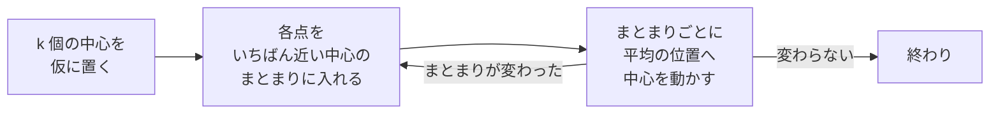

# 04-3 クラスタリング

!!! abstract "到達目標"
    - 正解の無いデータを近いものどうしでまとめる k-means の仕組みを説明できる
    - 列の単位をそろえる前処理と、まとまりの数 k の選び方（シルエット係数）を、コードで確かめられる
    - まとまりが人の決めた分類と一致するとは限らないことを、数字で示して説明できる

## 何か

**クラスタリング** は、正解の分類が無いデータを、似たものどうしのまとまり（クラスタ）に分ける方法です。
正解を使わずに学ぶので、**教師なし学習** と呼びます。

代表的な方法が **k-means** です。まとまりの数 k を人が決め、次の 2 つを、まとまりが変わらなくなるまで繰り返します
（[公式ドキュメント: K-means](https://scikit-learn.org/stable/modules/clustering.html#k-means)）。



最初の中心の置き方で結果が変わることがあるので、scikit-learn の `KMeans` は `n_init` 回やり直して、いちばんまとまりの良い結果を選べます
（[公式ドキュメント: KMeans](https://scikit-learn.org/stable/modules/generated/sklearn.cluster.KMeans.html)）。

## なぜ必要か

業務のデータの多くには、正解の分類が付いていません。分類を付けるには、人が 1 件ずつ読む必要があります。

- 会員を、利用の様子でいくつかの層に分けて、層ごとに案内を変えたい
- 「その他」に入った問い合わせの中に、新しく窓口を作るべき話題が隠れていないかを見たい
- 分類モデル（04-1）を作る前に、データにどんなまとまりがあるかをざっと見たい

クラスタリングは、こうした「まず全体をつかむ」ための道具です。
ただし、まとまりに名前を付け、使えるかを判断するのは人です。

## どうやるか

### 会員を利用の様子でまとめる

架空の会員 18 人の、月の利用時間（分）と月の問い合わせ数を使います。

<!-- src: examples/src/roadmap_examples/p04_cluster.py -->
```python title="examples/src/roadmap_examples/p04_cluster.py"
def cluster_members(k: int, scale: bool = True, members: Sequence[tuple[float, float]] = MEMBERS) -> np.ndarray:
    """会員を k 個にまとめ、まとまりの番号（0〜k-1）を返す. scale=True なら列ごとに平均 0・標準偏差 1 にそろえる."""
    x = np.array(members, dtype=float)
    kmeans = KMeans(n_clusters=k, n_init=10, random_state=0)
    model = make_pipeline(StandardScaler(), kmeans) if scale else kmeans
    return model.fit_predict(x)
```

データには、「よく使い、ほとんど問い合わせない」「よく使い、問い合わせも多い」「ほとんど使っていない」の 3 つの層を 6 人ずつ入れてあります。

### 列の単位をそろえる

k-means は、点と点の距離でまとまりを決めます。列ごとに単位と大きさが違うと、大きい列だけで距離が決まります。

!!! failure "悪い例"
    利用時間（数十〜1300 分）と問い合わせ数（0〜8 件）を、そのまま k-means に渡す。

    利用時間の差（数百）に比べて、問い合わせ数の差（数件）は距離にほとんど効きません。
    手元で試すと、「よく使う人」が利用時間の長短だけで 2 つに分かれ、問い合わせの多い人をまとめられませんでした。

!!! success "良い例"
    `StandardScaler` で、列ごとに平均 0・標準偏差 1 にそろえてから、k-means に渡す
    （[公式ドキュメント: 前処理](https://scikit-learn.org/stable/modules/preprocessing.html)）。
    `make_pipeline` でつなげば、そろえ方の学習とまとめる処理を 1 つにできます。

どちらの結果も、テストで確かめています。

<!-- src: examples/tests/test_p04_cluster.py -->
```python title="examples/tests/test_p04_cluster.py"
def test_scaled_kmeans_finds_the_three_groups() -> None:
    assert agreement(cluster_members(3), GROUPS) == 1.0


def test_without_scaling_the_large_column_wins() -> None:
    # 利用時間（数百〜千の単位）だけで分かれ、問い合わせの多さで分けられない
    assert agreement(cluster_members(3, scale=False), GROUPS) < 0.5
```

`agreement` は、まとまりと、人が決めた層との一致の度合い（調整ランド指数）です。偶然の一致なら 0 に近く、完全に一致すれば 1 です。
まとまりの番号（0・1・2）の付け方には左右されません
（[公式ドキュメント: Rand index](https://scikit-learn.org/stable/modules/clustering.html#rand-index)）。

### まとまりの数 k を選ぶ

本物のデータでは、層がいくつあるかは分かりません。k を変えて、**シルエット係数** を比べます。
各点について「自分のまとまりの中の近さ」と「いちばん近いほかのまとまりとの遠さ」を比べた値の平均で、-1〜1 をとります。
1 に近いほど、まとまりがはっきり分かれています
（[公式ドキュメント: Silhouette Coefficient](https://scikit-learn.org/stable/modules/clustering.html#silhouette-coefficient)）。

<!-- src: examples/src/roadmap_examples/p04_cluster.py -->
```python title="examples/src/roadmap_examples/p04_cluster.py"
def silhouette_by_k(ks: Sequence[int], members: Sequence[tuple[float, float]] = MEMBERS) -> dict[int, float]:
    """k ごとのシルエット係数（単位をそろえた後の距離で測る）. 大きいほど、まとまりがはっきりしている."""
    x = StandardScaler().fit_transform(np.array(members, dtype=float))
    return {k: float(silhouette_score(x, cluster_members(k, members=members))) for k in ks}
```

手元の結果は次のとおりです。k = 3 がいちばん大きく、入れた層の数と合いました（`test_silhouette_picks_three`）。

| k | 2 | 3 | 4 | 5 | 6 |
|---|---:|---:|---:|---:|---:|
| シルエット係数 | 0.56 | 0.78 | 0.74 | 0.72 | 0.63 |

シルエット係数は目安です。差が小さいときは、まとまりの中身を読み、業務で使い分けられる数を選びます。

### 問い合わせ文をまとめる

04 の学習データ（03 の成果物）の問い合わせ文 130 件を、分類の正解を使わずに 5 つにまとめます。
文章は、04-1 と同じく文字の組の TF-IDF で数にします。ここでは 2 文字の組だけを使い、2 件以上に出てくる組に絞ります。

<!-- src: examples/src/roadmap_examples/p04_cluster.py -->
```python title="examples/src/roadmap_examples/p04_cluster.py"
def cluster_texts(texts: Sequence[str], k: int) -> tuple[np.ndarray, list[list[str]]]:
    """問い合わせ文を k 個にまとめる. まとまりの番号と、まとまりごとに重みの大きい文字の組（上位 5 つ）を返す."""
    vectorizer = TfidfVectorizer(analyzer="char", ngram_range=(2, 2), min_df=2)
    x = vectorizer.fit_transform(texts)
    kmeans = KMeans(n_clusters=k, n_init=10, random_state=0).fit(x)
    names = vectorizer.get_feature_names_out()
    terms = [[str(names[i]) for i in center.argsort()[::-1][:5]] for center in kmeans.cluster_centers_]
    return kmeans.labels_, terms
```

手元で実行すると、まとまりごとの上位の文字の組は次のようになりました。

| まとまり | 上位の文字の組 | 中身（正解の分類の件数） |
|---|---|---|
| 0 | くだ・い。・てく・さい・ださ | 「〜してください」の文。other 6・billing 5 など、ばらばら |
| 1 | した・まし・た。・いま・され | 「〜しました」の文。bug 10・account 8 など |
| 2 | いで・たい・です・す。・した | 「〜したいです」の文。contract 10・other 9・account 9 など |
| 3 | すか・か。・ます・りま・でき | 「〜ますか」の質問。contract 15・billing 9・other 9 など |
| 4 | ん。・ませ・せん・ると・する | 「〜すると〜ません」の文。bug 11 など |

まとまりは、話題（請求・契約）より、**文末の形**（「〜ください」「〜ますか」「〜ません」）で分かれました。
窓口の分類との一致の度合いは 0.08 で、偶然（0）に近い値です（`test_text_clusters_do_not_match_human_categories`）。

これは k-means が悪いのではありません。文字の組の TF-IDF で測った「近さ」が、文末の形の近さだったということです。
まとまりは、使った特徴量の「近さ」をそのまま映します。08 で扱うエンベディング（意味の近い文が近いベクトルになるもの）を使うと、
話題でまとまりやすくなることが期待できます。どれだけ変わるかは、同じように一致の度合いで確かめます。

## 演習

1. `MEMBERS` に「そこそこ使い、問い合わせが多い」会員を 6 人足し、`silhouette_by_k` が選ぶ k が 4 になるかを確かめてください
2. 問い合わせ文から文末の形（「です。」「ますか。」「ください。」など）を正規表現で取り除いてから `cluster_texts` を実行し、
   上位の文字の組と、窓口の分類との一致の度合いがどう変わるかを調べてください
3. 2 の結果から、「その他」の問い合わせの中から新しい窓口の候補を探す手順を、3〜5 行の箇条書きで書いてください

- できたことの確かめ方: `uv run pytest` が通る。2 は上位の文字の組の表と一致の度合い、3 は手順
- 目安の時間: 4 時間

解答: [04-3 の解答](answers/04-3.md)

## もし〇〇がなかったら？

**クラスタリングがなかったら**、正解の無いデータの全体像をつかむには、人が全件を読むしかありません。
数万件の問い合わせから新しい話題を見つける作業は、現実的ではなくなります。

**単位をそろえる前処理がなかったら**、まとまりは大きい単位の列だけで決まります。
円と千円、分と時間のように単位を変えただけで結果が変わり、まとまりの意味を誰も説明できなくなります。

## 理解度チェック

1. k-means は、どんな手順を繰り返してまとまりを作りますか。

    ??? note "答え"
        各点をいちばん近い中心のまとまりに入れることと、まとまりごとに中心を平均の位置へ動かすことを、まとまりが変わらなくなるまで繰り返します。
        k（まとまりの数）は人が決めます。

2. 利用時間（分）と問い合わせ数（件）をそのまま k-means に渡すと、何が起きますか。

    ??? note "答え"
        値の大きい利用時間の差だけで距離が決まり、問い合わせ数がまとまりにほとんど効きません。
        `StandardScaler` で列ごとに単位をそろえてから渡します。

3. シルエット係数が最大の k を、そのまま採用してよいですか。

    ??? note "答え"
        目安にはなりますが、そのまま採用するとは限りません。差が小さいときは、まとまりの中身を読み、業務で使い分けられる数かどうかで決めます。

4. 問い合わせ文のまとまりが、窓口の分類と一致しなかったのはなぜですか。

    ??? note "答え"
        文字の組の TF-IDF で測った近さが、話題より文末の形（「〜ください」「〜ますか」）に強く影響されたからです。
        クラスタリングは、使った特徴量の近さをそのまま映すので、まとまりの意味は人が中身を読んで確かめます。
