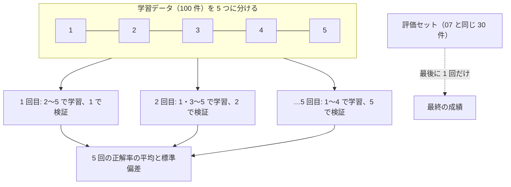

# 04-4 指標・交差検証・過学習

!!! abstract "到達目標"
    - 正解率・適合率・再現率・F1・混同行列の意味と使い分けを、不均衡なデータの例で説明できる
    - 交差検証でモデルや設定を比べ、差が誤差の範囲かどうかを判断できる
    - 過学習とデータ漏れを見抜き、評価レポートに「どの指標で、どれだけ良いか」を根拠つきで書ける

## 何か

モデルの良さは、1 つの数字では言えません。この章では、良さを正しく測る 3 つの道具を扱います。

| 道具 | 何をするか |
|---|---|
| 指標 | 正解率のほかに、分類ごとの適合率・再現率・F1、混同行列で、どこで外れたかを見る |
| 交差検証 | 学習データを k 個に分け、順に 1 つを検証に回して k 回測る。平均とばらつきで比べる |
| 過学習の確認 | 学習に使ったデータの成績と、使っていないデータの成績を並べ、差を見る |



評価セットは、モデルや設定を選ぶのには使いません。選ぶのは交差検証で、評価セットは最後に 1 回だけ測ります。

## なぜ必要か

数字の測り方を誤ると、使えないモデルを「良い」と判断します。

- 問い合わせの 95% が other なら、いつも other と答えるだけで正解率 95% になる。不具合の問い合わせは 1 件も拾えない
- 学習に使ったデータで測ると、丸暗記したモデルほど成績が良く見える
- 評価セットの結果を見ながら設定を何度も変えると、その評価セットに合わせ込んだ数字になる

07 では、04 のモデルを LLM と比べる基準にします。基準の数字が誤っていると、LLM を使うべきかの判断も誤ります。

## どうやるか

### 正解率の落とし穴

100 件のうち bug が 5 件のデータで、いつも other と答えるモデルを測ります。

<!-- src: examples/src/roadmap_examples/p04_metrics.py -->
```python title="examples/src/roadmap_examples/p04_metrics.py"
def accuracy_trap() -> Scores:
    """100 件のうち bug が 5 件. 「いつも other」と答えるだけのモデルの指標."""
    truth = ["other"] * 95 + ["bug"] * 5
    return imbalanced_scores(truth, ["other"] * 100)
```

<!-- src: examples/tests/test_p04_metrics.py -->
```python title="examples/tests/test_p04_metrics.py"
def test_accuracy_trap() -> None:
    scores = accuracy_trap()
    assert scores.accuracy == 0.95
    assert scores.recall_bug == 0.0
    assert scores.macro_f1 == pytest.approx(0.487, abs=0.001)
```

正解率は 95% でも、bug の再現率は 0 です。分類ごとの指標は次の意味です
（[公式ドキュメント: 指標](https://scikit-learn.org/stable/modules/model_evaluation.html)）。

| 指標 | 意味 | 計算 |
|---|---|---|
| 適合率（precision） | bug と答えたもののうち、本当に bug だった割合 | 当たった bug ÷ bug と答えた数 |
| 再現率（recall） | 本当の bug のうち、bug と答えられた割合 | 当たった bug ÷ 本当の bug の数 |
| F1 | 適合率と再現率の調和平均。片方だけ高くても上がらない | 2 × 適合率 × 再現率 ÷（適合率 + 再現率） |
| macro 平均 | 分類ごとの値を、件数に関係なく平均したもの | 少ない分類の悪さも同じ重みで効く |

業務では、どの誤りが痛いかで見る指標を決めます。
不具合を見逃すと困るなら bug の再現率、間違って不具合の担当に回すと困るなら bug の適合率を重く見ます。

### 学習データで測らない

!!! failure "悪い例"
    ```python
    from roadmap_examples.evalset import load_cases
    from roadmap_examples.p04_classify import DEFAULT_TRAIN, texts_and_labels, train

    cases = load_cases(DEFAULT_TRAIN)
    model = train(cases)
    print(model.score(*texts_and_labels(cases)))  # 学習に使ったデータで測る
    ```

    手元では 1.0（100%）でした。答えを見てから解いた試験の点数で、新しい問い合わせでの成績は分かりません。

!!! success "良い例"
    学習データの中では交差検証で測り、最後に評価セット（学習に使っていない 30 件）で測る。

### 過学習を見る

モデルが学習データの細かい違い（たまたまの言い回し）まで覚え、新しいデータで外れることを **過学習** と呼びます。
決定木の深さの上限を変えて、学習データと交差検証の正解率を並べます。

<!-- src: examples/src/roadmap_examples/p04_metrics.py -->
```python title="examples/src/roadmap_examples/p04_metrics.py"
def depth_curve(cases: Sequence[EvalCase], depths: Sequence[int | None]) -> list[DepthScore]:
    """決定木の深さの上限ごとに、学習データと交差検証の正解率を並べる."""
    texts, labels = texts_and_labels(cases)
    tfidf = build_model().named_steps["tfidf"]
    rows = []
    for depth in depths:
        model = Pipeline([("tfidf", tfidf), ("clf", DecisionTreeClassifier(max_depth=depth, random_state=0))])
        cv = cross_validate(cases, model)
        train_acc = model.fit(texts, labels).score(texts, labels)
        rows.append(DepthScore(depth, float(train_acc), cv.mean))
    return rows
```

手元の結果です（学習データ 100 件）。

| 深さの上限 | 1 | 2 | 4 | 8 | 16 | なし |
|---|---:|---:|---:|---:|---:|---:|
| 学習データの正解率 | 30% | 46% | 69% | 98% | 100% | 100% |
| 交差検証の正解率 | 28% | 34% | 51% | 43% | 41% | 41% |

深くするほど学習データの正解率は 100% に近づきますが、交差検証の正解率は深さ 4 で頭打ちになり、その後は下がります。
2 つの差が開き始めたところが、過学習の始まりです（`test_deep_trees_overfit`）。

### 交差検証で比べる

<!-- src: examples/src/roadmap_examples/p04_classify.py -->
```python title="examples/src/roadmap_examples/p04_classify.py"
def cross_validate(cases: Sequence[EvalCase], model: Pipeline | None = None, folds: int = 5) -> CVResult:
    """層化 k 分割の交差検証（分類ごとの割合をそろえて分ける. 並びを混ぜる乱数は固定）."""
    texts, labels = texts_and_labels(cases)
    cv = StratifiedKFold(n_splits=folds, shuffle=True, random_state=0)
    scores = cross_val_score(model or build_model(), texts, labels, cv=cv, scoring="accuracy")
    return CVResult([float(s) for s in scores])
```

- `StratifiedKFold` は、分けた各部分で分類の割合が全体とほぼ同じになるように分けます
  （[公式ドキュメント: 交差検証](https://scikit-learn.org/stable/modules/cross_validation.html)）。
  学習データは分類ごとに並んでいるので、ただの `KFold` で混ぜずに分けると、ある分類が検証にしか無い、ということが起きます
- `random_state` を固定して、毎回同じ分け方にします。比べるモデルどうしで、分け方をそろえるためです

04 のモデルの交差検証の正解率は、平均 67.0%、標準偏差 10.8% でした。5 回の成績は 50〜80% とばらつきます。
1 回の検証は 20 件なので、1 件で 5 ポイント動くからです。

設定（文字の組の長さ 1〜3 と、正則化の強さ C）を 9 通り試すと、平均は 66〜70%、標準偏差は 7〜12% でした。
差が標準偏差よりずっと小さいので、「どれも同じくらい」と判断し、既定の設定（1〜2 文字・C = 1.0）のままにしています。

### データ漏れを防ぐ

予測のときに手に入らない情報が、学習に紛れ込むことを **データ漏れ** と呼びます。成績が実際より良く見えます
（[公式ドキュメント: よくある落とし穴](https://scikit-learn.org/stable/common_pitfalls.html)）。

- 前処理（TF-IDF の語彙）を全部のデータで作ってから分けると、検証のデータの語彙が学習に漏れる。
  `Pipeline` を交差検証に渡せば、分割ごとに学習の部分だけで前処理を作り直す
- 学習データと評価セットに同じ文が入っていると、答えを見せた試験になる。成果物の CLI は、同じ文があれば止める

<!-- src: examples/src/roadmap_examples/p04_classify.py -->
```python title="examples/src/roadmap_examples/p04_classify.py"
def overlap(train_cases: Sequence[EvalCase], eval_cases: Sequence[EvalCase]) -> list[str]:
    """学習データと評価セットの両方にある問い合わせ文（あると、答えを見せた試験になる）."""
    seen = {c.input.strip() for c in train_cases}
    return sorted({c.input for c in eval_cases if c.input.strip() in seen})
```

### 04 の成果物: 評価レポート

学習・交差検証・評価セットでの比較を、1 つのコマンドで行い、レポート（Markdown）を書きます（`examples/` で実行）。

```bash
uv run python -m roadmap_examples.p04_classify --out results-p04.jsonl --report report-p04.md
```

レポートの主な部分です（手元の結果。乱数は固定しているので、同じデータなら同じ値になります）。

```text
## 交差検証（学習データの中だけで測る）

- 正解率: 平均 67.0%（標準偏差 10.8%、5 分割）

## 評価セットでの比較

| 基準・モデル | 正解率 | macro F1 | 正解率（基本） | 正解率（指示混入） | 正解率（紛らわしい） |
|---|---:|---:|---:|---:|---:|
| 多数派（常に同じ分類） | 20.0% | 0.067 | 21.1% | 0.0% | 22.2% |
| 07 の仮のルールベース | 66.7% | 0.659 | 84.2% | 100.0% | 22.2% |
| 04 のモデル | 96.7% | 0.966 | 94.7% | 100.0% | 100.0% |
```

レポートには、このほかに分類ごとの適合率・再現率・F1、混同行列、誤った件の一覧が入ります。
04 のモデルが誤ったのは c003（「支払い方法を口座振替に変えたいです。」正解 billing → 予測 contract）の 1 件でした。

**数字の読み方**: 評価セットでは 96.7% ですが、学習データの交差検証では 67.0% でした。差が大きいので、理由を考えます。

- 交差検証の各回は 80 件で学習しているが、最終のモデルは 100 件で学習している
- 学習データには、窓口をまたぐ言い回しの紛らわしい件を、わざと多めに入れてある
- 評価セットは 30 件と小さく、1 件で 3.3 ポイント動く
- 学習データも評価セットも、同じ人が同じ判断の基準で書いた架空のデータで、言い回しが似ている

そのため、レポートの結論は「07 の評価セットでは 96.7% で、仮のルールベースより 30 ポイント高い。
ただし交差検証では 67% で、新しい言い回しの問い合わせでは、もっと低く見積もるべき」とします。
このように、良い数字だけでなく、測り方と限界も書くのが評価レポートです。

### 07 の基準を差し替える

07 は、04 の結果がまだ無いため「仮のルールベース分類」を基準にしています（07-5 の「比べる基準について」）。
04 の成果物ができたので、次のどちらかで差し替えます。07 のコードと評価セットはそのまま使えます。

**方法 1（コマンド）**: 04 の結果のファイルを、07 の `--compare` に渡します。

```bash
uv run python -m roadmap_examples.p04_classify --out results-p04.jsonl
uv run python -m roadmap_examples.p07_classify --mode ollama --model <モデル名> \
    --out results-llm.jsonl --compare results-p04.jsonl
```

結果のファイルは 07-5 の形式（1 行目にまとめ、2 行目から 1 件ずつ）で、`id` が 07 の評価セットとそろっています。
07 は、04 のモデルと LLM で答えが変わった件を、後退した件から先に表示します。差し替えられることは、テストで確かめています。

<!-- src: examples/tests/test_p04_classify.py -->
```python title="examples/tests/test_p04_classify.py"
def test_results_can_replace_the_07_baseline(tmp_path: Path) -> None:
    """04 の結果のファイルを、07 の --compare に渡して比べられる（07 の基準の差し替え）."""
    base = tmp_path / "results-p04.jsonl"
    main(["--out", str(base)], stdout=io.StringIO())
    replies = [json.dumps({"category": c.expected["category"], "reason": "テスト"}) for c in load_cases(P07_EVAL)]
    stdout = io.StringIO()
    code = p07_main(
        ["--mode", "ollama", "--model", "m", "--compare", str(base)], llm=FakeLLM.of(replies), stdout=stdout
    )
    assert code == 0
    assert "前回からの変化: 1 件" in stdout.getvalue()  # 04 のモデルが誤った c003 だけ
```

**方法 2（コード）**: 07 の `baseline_predict` の代わりに、04 のモデルの予測の関数を `run_eval` に渡します。
`model_predict` は、`baseline_predict` と同じ形（`EvalCase` を受け取り `Prediction` を返す）です。

<!-- src: examples/src/roadmap_examples/p04_classify.py -->
```python title="examples/src/roadmap_examples/p04_classify.py"
def model_predict(model: Pipeline) -> Predict:
    """学習したモデルを、07 の `baseline_predict` と同じ形（EvalCase → Prediction）の関数にする."""

    def predict(case: EvalCase) -> Prediction:
        return Prediction({"category": str(model.predict([case.input])[0])})

    return predict
```

```python
from roadmap_examples.evalset import exact_match, load_cases, run_eval
from roadmap_examples.p04_classify import DEFAULT_TRAIN, model_predict, train
from roadmap_examples.p07_classify import DEFAULT_EVAL, summary
from roadmap_examples.p07_cost import Price

cases = load_cases(DEFAULT_EVAL)
predict = model_predict(train(load_cases(DEFAULT_TRAIN)))  # baseline_predict の代わり
report = run_eval(cases, predict, exact_match("category"), meta={"mode": "p04-model"})
print(summary(cases, report, Price(0.0, 0.0)))  # 07 と同じ形の表示（トークンと費用は 0）
```

07-5 の表は、「仮のルールベース分類」の列を「04 のモデル」に替えて埋めます。04 のモデルはトークンを使わないので、トークン数と費用は 0 です。
近道で 04 を飛ばした人は、07 の仮の基準のままで構いません。

## 演習

1. 07 の仮のルールベース分類と 04 のモデルで、分類ごとの適合率・再現率・F1 を表にしてください。
   ルールベースがいちばん苦手な分類と、その理由を考察します
2. `GridSearchCV` で、文字の組の長さ（1〜3）と C（0.1・1.0・10.0）の 9 通りを、学習データの交差検証で比べてください。
   いちばん良い設定を選び、評価セットで 1 回だけ測ります
3. 07-5 の表を、04 のモデルを基準にして埋めてください（方法 1 か方法 2）。
   LLM はローカルのモデルで動かします（Ollama が無ければ、04 のモデルの列だけを埋めます）
4. 03 の成果物（`examples/data/p03/inquiries_clean.csv`、130 件）の本文（`input`）と分類（`category`）で学習し直し、
   交差検証と 07 の評価セットで測ってください。`response_minutes`（対応にかかった時間）は、問い合わせが届いた時点では分からないので、特徴量に入れません

- できたことの確かめ方: `uv run pytest` が通る。1 は表と考察、2 は選んだ設定と評価セットの正解率、3 は埋めた表、4 は 2 つの学習データの比較
- 目安の時間: 5 時間

解答: [04-4 の解答](answers/04-4.md)

## もし〇〇がなかったら？

**交差検証がなかったら**、設定を比べるたびに評価セットを使うことになります。
評価セットに合わせ込んだ設定が選ばれ、本番の成績は評価セットの数字より悪くなります。気づくのは、運用を始めてからです。

**指標を分けて見なかったら**、件数の多い分類だけが当たるモデルを、正解率の高さで採用してしまいます。
数の少ない分類（不具合の報告など）こそ見逃すと困る、という業務は多くあります。

## 理解度チェック

1. 問い合わせの 95% が other のデータで、いつも other と答えるモデルの正解率と、bug の再現率はいくつですか。

    ??? note "答え"
        正解率は 95%、bug の再現率は 0 です。正解率だけでは、少ない分類を 1 件も拾えないことに気づけません。

2. 適合率と再現率は、それぞれどんな誤りを見る指標ですか。

    ??? note "答え"
        適合率は「bug と答えたのに、本当は bug でなかった」誤り（間違って拾う）を、
        再現率は「本当は bug なのに、bug と答えなかった」誤り（見逃す）を見ます。どちらが痛いかで、重く見る指標を決めます。

3. 設定を選ぶのに評価セットを使わず、交差検証を使うのはなぜですか。

    ??? note "答え"
        評価セットの結果を見て設定を選ぶと、その評価セットに合わせ込んだことになり、評価セットの成績が楽観的になるからです。
        設定は学習データの中の交差検証で選び、評価セットは最後に 1 回だけ使います。

4. 交差検証で 2 つの設定の平均が 67% と 70% でした。標準偏差は 10% 前後です。どちらを選びますか。

    ??? note "答え"
        差（3 ポイント）が標準偏差よりずっと小さいので、「同じくらい」と判断します。
        単純で速い、または説明しやすいほうを選び、選んだ理由をレポートに書きます。

5. 04 のモデルの成績が、評価セットでは 96.7%、交差検証では 67.0% でした。評価レポートにどう書きますか。

    ??? note "答え"
        両方の数字と測った条件を書き、差の理由（学習の件数の違い・評価セットの小ささ・データの書き手が同じこと）を添えます。
        結論は「評価セットではルールベースより大きく良いが、新しい言い回しでは低めに見積もる」のように、限界も含めて書きます。
