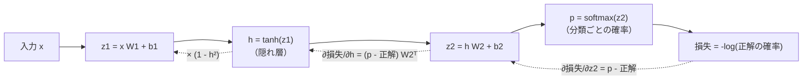

# 05-1 ニューラルネットワークと誤差逆伝播

!!! abstract "到達目標"
    - 全結合の層と活性化関数を重ねたニューラルネットワークの順伝播を、NumPy で書ける
    - 誤差逆伝播で勾配を求める仕組みを、連鎖律と計算の図で説明できる
    - 手で書いた勾配を数値微分と比べて、正しさを確かめられる

## 何か

**ニューラルネットワーク** は、「入力に重みを掛けて足し、活性化関数を通す」という層を重ねたモデルです。
1 層だけなら 04-1 のロジスティック回帰と同じです。層を重ね、間に活性化関数（`tanh` や ReLU のような曲がった関数）を挟むと、
直線では分けられないデータも分けられるようになります。

この章の演習のコードは、2 層のネットワークです。



実線が **順伝播**（入力から損失を計算する）、点線が **誤差逆伝播**（損失の勾配を、出力の側から入力の側へ戻す）です。
逆伝播は、微分の **連鎖律**（合成関数の微分は、それぞれの微分の掛け算）を、後ろから順に当てはめるだけです。

## なぜ必要か

02 で、勾配降下で線形回帰を解きました。パラメーターを勾配の逆向きに少しずつ動かせば、損失が下がります。
ニューラルネットワークも同じ方法で学習しますが、パラメーターが多く、層が重なっているので、勾配を 1 つずつ手で式にするのは大変です。

誤差逆伝播は、途中の値を覚えておき、出力の側から順に掛け算していくことで、全部のパラメーターの勾配を 1 回の逆向きの計算で求めます。
PyTorch（05-2）は、この計算を自動でします。それでも仕組みを知っておくと、次のような場面で原因を推測できます。

- 学習が進まない（勾配が 0 に近い、または大きすぎる）
- 勾配を消し忘れて、前のステップの勾配が足し込まれている
- 層を深くしたら、入力に近い層の重みが動かなくなった（05-3 の RNN で扱います）

## どうやるか

### 順伝播

<!-- src: examples/src/roadmap_examples/p05_mlp.py -->
```python title="examples/src/roadmap_examples/p05_mlp.py"
def softmax(z: np.ndarray) -> np.ndarray:
    """行ごとに確率（足して 1）にする. 最大値を引いてから exp を取り、大きな数で溢れないようにする."""
    e = np.exp(z - z.max(axis=-1, keepdims=True))
    return e / e.sum(axis=-1, keepdims=True)


def forward(params: Params, x: np.ndarray) -> tuple[np.ndarray, dict[str, np.ndarray]]:
    """順伝播. 逆伝播で使う途中の値（cache）も返す."""
    h = np.tanh(x @ params["w1"] + params["b1"])
    probs = softmax(h @ params["w2"] + params["b2"])
    return probs, {"x": x, "h": h, "probs": probs}
```

`x` は（件数, 入力の次元）の行列です。`@` は行列の掛け算で、全件をまとめて計算します。
逆伝播で使うため、途中の値（`h` など）を `cache` に残しておきます。

### 逆伝播

<!-- src: examples/src/roadmap_examples/p05_mlp.py -->
```python title="examples/src/roadmap_examples/p05_mlp.py"
def loss_and_grads(params: Params, x: np.ndarray, y: np.ndarray) -> tuple[float, Params]:
    """交差エントロピー（正解の確率の -log の平均）と、各パラメーターの勾配."""
    probs, cache = forward(params, x)
    n = len(y)
    loss = float(-np.log(probs[np.arange(n), y] + 1e-12).mean())
    # softmax と交差エントロピーを合わせた勾配は「確率 - 正解の one-hot」になる
    dz2 = probs.copy()
    dz2[np.arange(n), y] -= 1.0
    dz2 /= n
    grads = {"w2": cache["h"].T @ dz2, "b2": dz2.sum(axis=0)}
    dh = dz2 @ params["w2"].T
    dz1 = dh * (1.0 - cache["h"] ** 2)  # tanh の微分は 1 - tanh^2
    grads["w1"] = cache["x"].T @ dz1
    grads["b1"] = dz1.sum(axis=0)
    return loss, grads
```

読み方のこつは、**形（行列の大きさ）を合わせる** ことです。

- `dz2`（件数, 出力の次元）は「確率 - 正解」。正解の分類の確率が 1 に近いほど、勾配は 0 に近づく
- `w2` の勾配は、`w2` に掛かっていた `h` の転置と `dz2` の積。形は（隠れの次元, 出力の次元）で `w2` と同じになる
- `h` への勾配は `dz2` に `w2` の転置を掛ける。さらに `tanh` の微分（`1 - h²`）を掛けて、`z1` への勾配にする

### 勾配を数値微分で確かめる

手で書いた勾配は、間違えやすいものです。パラメーターを少しだけ動かして損失の変化を測る **数値微分** と比べます。

<!-- src: examples/src/roadmap_examples/p05_mlp.py -->
```python title="examples/src/roadmap_examples/p05_mlp.py"
def numerical_grad(f: Callable[[], float], param: np.ndarray, eps: float = 1e-5) -> np.ndarray:
    """中心差分（(f(p+ε) - f(p-ε)) / 2ε）で、param の各要素の勾配を近似する. 遅いので確かめるときだけ使う."""
    grad = np.zeros_like(param)
    for i in np.ndindex(param.shape):
        old = param[i]
        param[i] = old + eps
        plus = f()
        param[i] = old - eps
        minus = f()
        param[i] = old
        grad[i] = (plus - minus) / (2 * eps)
    return grad
```

<!-- src: examples/tests/test_p05_mlp.py -->
```python title="examples/tests/test_p05_mlp.py"
def test_backprop_matches_numerical_gradient() -> None:
    rng = np.random.default_rng(1)
    params = init_params(3, 5, 4, seed=1)
    x, y = rng.normal(size=(6, 3)), np.array([0, 1, 2, 3, 1, 0])
    _, grads = loss_and_grads(params, x, y)
    for name, p in params.items():
        expected = numerical_grad(lambda: loss_and_grads(params, x, y)[0], p)
        assert grads[name] == pytest.approx(expected, abs=1e-7), name
```

手元では、差の最大は 1e-11 程度でした。数値微分はパラメーターの数だけ損失を 2 回ずつ計算するので遅く、学習には使いません。
勾配の式を書いたときに、小さな大きさで確かめるためのものです。

### XOR を学習する

XOR（2 つの入力が違うときだけ 1）は、直線 1 本では分けられない、いちばん小さな例です。

<!-- src: examples/src/roadmap_examples/p05_mlp.py -->
```python title="examples/src/roadmap_examples/p05_mlp.py"
def train_xor(steps: int = 2000, lr: float = 0.5, n_hidden: int = 4, seed: int = 0) -> tuple[Params, list[float]]:
    """XOR を勾配降下で学習する. 損失の推移も返す."""
    params = init_params(2, n_hidden, 2, seed)
    losses = []
    for _ in range(steps):
        loss, grads = loss_and_grads(params, XOR_X, XOR_Y)
        for name in params:
            params[name] -= lr * grads[name]
        losses.append(loss)
    return params, losses
```

隠れ層 4 個、学習率 0.5、2000 回で、損失は約 0.74 から約 0.001 まで下がり、4 件すべてを当てます（`test_learns_xor`）。

### 重みの初期値

!!! failure "悪い例"
    ```python
    params = {"w1": np.zeros((2, 4)), "b1": np.zeros(4), "w2": np.zeros((4, 2)), "b2": np.zeros(2)}
    ```

    重みを全部 0（同じ値）で始めると、隠れ層の素子はどれも同じ計算をし、同じ勾配を受けます。
    いくら学習しても素子どうしの違いが生まれず、隠れ層が 1 個あるのと変わりません。
    この例では `w1` の勾配がすべて 0 になり、`w1` が動きません（`test_zero_init_cannot_break_symmetry`）。

!!! success "良い例"
    重みは小さな乱数で始める。演習のコードは、平均 0、標準偏差「1 ÷ √入力の次元」の正規分布を使っています。
    入力の次元が大きくても、足し合わせた値が大きくなりすぎないようにするためです。

## 演習

1. 隠れ層の活性化関数を `tanh` から ReLU（`max(0, z)`）に替えた `loss_and_grads` を書き、数値微分で勾配を確かめてください
2. `train_xor` の学習率を 0.01・0.5・5.0 と変え、最後の損失と予測を表にしてください
3. 隠れ層の素子の数を 1・2・3・4 と変え、乱数の種（`seed`）0〜9 の 10 回で、XOR を全部当てられた回数を数えてください

- できたことの確かめ方: `uv run pytest` が通る。2・3 は表と考察
- 目安の時間: 6 時間

解答: [05-1 の解答](answers/05-1.md)

## もし〇〇がなかったら？

**誤差逆伝播がなかったら**、パラメーターごとに数値微分で勾配を求めることになります。
パラメーターが 100 万個なら、1 回の更新に損失の計算が 200 万回要ります。
いまの大きなモデル（06 の LLM）は、誤差逆伝播なしには学習できません。

**活性化関数がなかったら**、層をいくら重ねても、行列の掛け算を重ねただけで、1 つの行列の掛け算と同じになります。
XOR のような、直線で分けられないデータを学習できません。

## 理解度チェック

1. 層を重ねるとき、間に活性化関数を挟むのはなぜですか。

    ??? note "答え"
        活性化関数が無いと、行列の掛け算を重ねても 1 つの行列の掛け算と同じで、直線で分けることしかできないからです。
        曲がった関数を挟むと、直線では分けられないデータ（XOR など）も表せます。

2. softmax と交差エントロピーを合わせた損失の、出力（softmax の前）への勾配は何ですか。

    ??? note "答え"
        「確率 - 正解の one-hot」です（件数で平均するなら、件数で割ります）。正解の確率が 1 に近いほど、勾配は 0 に近づきます。

3. 手で書いた勾配を、数値微分と比べるのはなぜですか。学習に数値微分を使わないのはなぜですか。

    ??? note "答え"
        手で書いた勾配の式は間違えやすく、間違っていても学習は動いてしまう（うまく下がらないだけ）ので、別の方法で確かめます。
        数値微分はパラメーターの数だけ損失を計算するので遅く、学習には使えません。

4. 重みを全部 0 で始めると、何が起きますか。

    ??? note "答え"
        隠れ層の素子がどれも同じ計算をし、同じ勾配を受けるので、いつまでも違いが生まれません。小さな乱数で始めて、素子ごとに違う動きをさせます。
