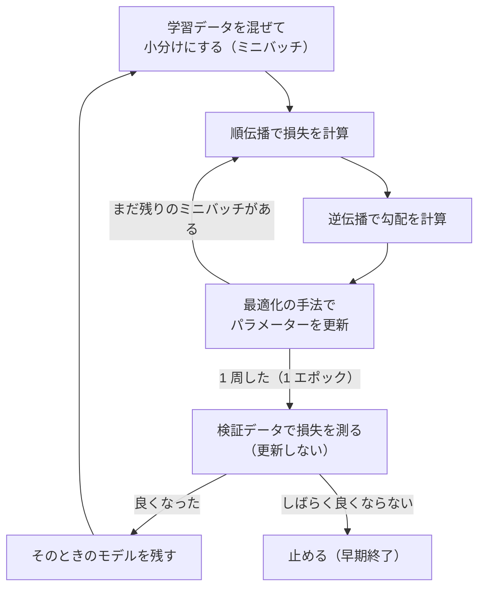

# 05-2 PyTorch の学習ループ

!!! abstract "到達目標"
    - 学習ループの部品（データの小分け・モデル・損失・最適化・検証）と、それぞれの役割を説明できる
    - PyTorch で、`zero_grad`・`backward`・`step` と検証（`eval`・`no_grad`）を正しい順に書ける
    - 検証の損失で学習を止め（早期終了）、いちばん良かった時点のモデルを残せる

## 何か

ニューラルネットワークの学習は、どのフレームワークでも、ほぼ同じ形のループになります。



- **ミニバッチ**: 全件ではなく、数十件ずつ勾配を計算して更新する。1 回の計算が軽く、更新の回数を増やせる
- **最適化の手法**: 勾配からパラメーターをどう動かすかの決まり。SGD（勾配 × 学習率だけ動かす）や Adam など
- **検証**: 学習に使っていないデータで損失を測る。04-4 の過学習の確認と同じ考え方

**PyTorch** は、このループを書くためのライブラリです。05-1 で手で書いた逆伝播を、`loss.backward()` の 1 行で自動で計算します
（[公式ドキュメント: 自動微分の仕組み](https://docs.pytorch.org/docs/stable/notes/autograd.html)）。

## なぜ必要か

05-1 では、勾配の式を手で書きました。層の種類が増えるたびに式を書き、数値微分で確かめるのは現実的ではありません。
PyTorch を使えば、順伝播を書くだけで勾配が求まり、よく使う層と最適化の手法も揃っています。

一方で、ループの組み立ては自分で書きます。順番を誤っても、多くの場合エラーにはならず、「学習がうまく進まない」だけになります。

- 勾配を消し忘れて、前のミニバッチの勾配が足し込まれる
- 検証のときにも勾配を記録して、メモリを無駄に使う
- 最後のエポックのモデルを使い、途中のいちばん良かったモデルを捨てる

部品の役割を理解しておくと、09（ファインチューニング）のような大きな学習のコードも、同じ形として読めます。

## どうやるか

演習のコードは、PyTorch と同じ組み立てを NumPy で書いています（CI の時間と容量を抑えるため）。
PyTorch で書いた同じ学習は、この章の後半に例として示します。

### データを小分けにする

<!-- src: examples/src/roadmap_examples/p05_loop.py -->
```python title="examples/src/roadmap_examples/p05_loop.py"
def batches(n: int, batch_size: int, rng: np.random.Generator) -> Iterator[np.ndarray]:
    """0〜n-1 を混ぜて、batch_size ずつの番号の配列にする（PyTorch の DataLoader(shuffle=True) にあたる）."""
    order = rng.permutation(n)
    for start in range(0, n, batch_size):
        yield order[start : start + batch_size]
```

エポックごとに混ぜ直すのは、毎回同じ順番だと、並び順の偏りまで学習してしまうことがあるためです。

### 最適化の手法

SGD は「パラメーター -= 学習率 × 勾配」です。Adam は、勾配の移動平均（どちらへ進むか）と、勾配の 2 乗の移動平均（どれだけ揺れているか）を覚えておき、
パラメーターごとに歩幅を変えます（[公式ドキュメント: Adam](https://docs.pytorch.org/docs/stable/generated/torch.optim.Adam.html)）。

<!-- src: examples/src/roadmap_examples/p05_loop.py -->
```python title="examples/src/roadmap_examples/p05_loop.py"
    def step(self, grads: Params) -> None:
        self.t += 1
        b1, b2 = self.betas
        for name, p in self.params.items():
            self.m[name] = b1 * self.m[name] + (1 - b1) * grads[name]
            self.v[name] = b2 * self.v[name] + (1 - b2) * grads[name] ** 2
            m_hat = self.m[name] / (1 - b1**self.t)  # 始めのうち 0 に寄る分を直す
            v_hat = self.v[name] / (1 - b2**self.t)
            p -= self.lr * m_hat / (np.sqrt(v_hat) + self.eps)
```

移動平均は 0 から始めるので、始めのうちは値が小さく出ます。`1 - b1**t` で割って直しています（バイアス補正）。

### ループと早期終了

<!-- src: examples/src/roadmap_examples/p05_loop.py -->
```python title="examples/src/roadmap_examples/p05_loop.py"
    for epoch in range(epochs):
        total = 0.0
        for idx in batches(len(x), batch_size, rng):
            loss, grads = loss_fn(params, x[idx], y[idx])  # PyTorch: loss = ...; loss.backward()
            optimizer.step(grads)  # PyTorch: optimizer.step()
            total += loss * len(idx)
        history.train_losses.append(total / len(x))
        val_loss, _ = loss_fn(params, *val)  # 検証は更新しない（PyTorch: model.eval() と torch.no_grad()）
        history.val_losses.append(val_loss)
        if val_loss < best:
            best, history.best_epoch, history.best_params = val_loss, epoch, copy.deepcopy(params)
        elif epoch - history.best_epoch >= patience:
            break
```

検証の損失が `patience` エポック続けて最小を更新しなければ止め、いちばん良かった時点のパラメーターを `best_params` に残します。
`copy.deepcopy` で写すのは、そのまま代入すると、後の更新で同じ配列が書き換わるためです。

題材は、2 つの三日月の形に並んだ点（scikit-learn の `make_moons`）です。直線では分けられません
（[公式ドキュメント: make_moons](https://scikit-learn.org/stable/modules/generated/sklearn.datasets.make_moons.html)）。
300 点を学習 210 点と検証 90 点に分け、隠れ層 16 個のネットワーク（05-1 と同じ形）で学習します。

<!-- src: examples/tests/test_p05_loop.py -->
```python title="examples/tests/test_p05_loop.py"
def test_training_loop_learns_moons_and_stops_early() -> None:
    history, accuracy = train_moons("adam", epochs=300)
    assert history.train_losses[-1] < history.train_losses[0]
    assert len(history.train_losses) < 300  # 検証の損失が下がらなくなって止まった
    assert history.best_epoch == int(np.argmin(history.val_losses))
    assert accuracy > 0.9
```

手元では、Adam（学習率 0.01）は 149 エポック目が最良で、169 エポック目で止まりました。検証の正解率は 96.7% です。
SGD（学習率 0.1）は 300 エポックでも下がり続け、最良は 299 エポック目、検証の正解率は 95.6% でした。
エポックは 1 から数えています（コードの `epoch` と `best_epoch` は 0 から数えるので、1 を足した値です）。

### PyTorch で書く

PyTorch の CPU 版は、無料で入れられます。演習のコードの環境（`examples/`）とは分けて入れると、`uv.lock` を変えずに済みます。
入れるコマンドは公式の手順のページで、Compute Platform に CPU を選ぶと表示されます（[PyTorch: Get Started](https://pytorch.org/get-started/locally/)）。
uv を使う例は次のとおりです（[uv: PyTorch との使い方](https://docs.astral.sh/uv/guides/integration/pytorch/)）。

```bash
uv venv <作業フォルダ>/torch-env
uv pip install --python <作業フォルダ>/torch-env torch --index-url https://download.pytorch.org/whl/cpu
uv pip install --python <作業フォルダ>/torch-env -e examples   # 演習のコード（moons など）も使えるようにする
```

上の三日月の学習を PyTorch で書くと、次のようになります。PyTorch の CPU 版で、手元で動くことを確かめています（CI では動かしません）。

例:

```python
import torch
from torch import nn
from torch.utils.data import DataLoader, TensorDataset

from roadmap_examples.p05_loop import moons

x, y = moons()
x_all = torch.tensor(x, dtype=torch.float32)
y_all = torch.tensor(y)  # 分類の番号（整数）
train_ds = TensorDataset(x_all[:210], y_all[:210])
val_x, val_y = x_all[210:], y_all[210:]

torch.manual_seed(0)
model = nn.Sequential(nn.Linear(2, 16), nn.Tanh(), nn.Linear(16, 2))  # 05-1 と同じ形
loss_fn = nn.CrossEntropyLoss()  # softmax と交差エントロピーをまとめたもの
optimizer = torch.optim.Adam(model.parameters(), lr=0.01)
loader = DataLoader(train_ds, batch_size=32, shuffle=True)

best, best_epoch, patience = float("inf"), -1, 20
for epoch in range(300):
    model.train()
    for xb, yb in loader:
        optimizer.zero_grad()  # 前のステップの勾配を消す（消さないと足し込まれる）
        loss = loss_fn(model(xb), yb)
        loss.backward()  # 誤差逆伝播（05-1 で手で書いた計算）
        optimizer.step()  # パラメーターを更新する
    model.eval()
    with torch.no_grad():  # 検証では勾配を記録しない
        val_loss = loss_fn(model(val_x), val_y).item()
    if val_loss < best:
        best, best_epoch = val_loss, epoch
        torch.save(model.state_dict(), "best.pt")  # いちばん良かった時点のパラメーター
    elif epoch - best_epoch >= patience:
        break

model.load_state_dict(torch.load("best.pt", weights_only=True))
```

手元では 133 エポック目が最良で、153 エポック目で止まり、検証の正解率は 95.6% でした（1 から数えた値）。乱数の扱いが NumPy の版と違うので、数字は一致しません。

NumPy の版との対応です。

| 役割 | 演習のコード（NumPy） | PyTorch |
|---|---|---|
| 小分け | `batches` | `DataLoader(..., shuffle=True)`（[公式ドキュメント](https://docs.pytorch.org/docs/stable/data.html)） |
| モデル | `init_params` と `forward` | `nn.Sequential(nn.Linear, nn.Tanh, nn.Linear)` |
| 損失 | `loss_and_grads` の損失 | `nn.CrossEntropyLoss`（softmax の前の値を受け取る。[公式ドキュメント](https://docs.pytorch.org/docs/stable/generated/torch.nn.CrossEntropyLoss.html)） |
| 勾配 | `loss_and_grads` の勾配（手で書いた） | `loss.backward()`（自動） |
| 更新 | `Adam.step(grads)` | `optimizer.zero_grad()` と `optimizer.step()` |
| 検証 | 更新しない | `model.eval()` と `torch.no_grad()` |
| 最良の保存 | `copy.deepcopy(params)` | `torch.save(model.state_dict(), ...)`（[公式ドキュメント](https://docs.pytorch.org/tutorials/beginner/saving_loading_models.html)） |

!!! failure "悪い例"
    ```python
    for xb, yb in loader:
        loss = loss_fn(model(xb), yb)
        loss.backward()
        optimizer.step()  # zero_grad を呼んでいない
    ```

    PyTorch は、勾配を既定で足し込みます。`zero_grad` を呼ばないと、前のミニバッチの勾配が残ったまま更新され、学習が乱れます。
    エラーにはならないので、気づきにくい誤りです（[公式チュートリアル: Optimizing Model Parameters](https://docs.pytorch.org/tutorials/beginner/basics/optimization_tutorial.html)）。

!!! success "良い例"
    ミニバッチごとに `zero_grad` → 損失 → `backward` → `step` の順に書く。
    検証では `model.eval()` で評価の動きに切り替え（Dropout などの層の動きが変わる）、`torch.no_grad()` で勾配の記録を止める
    （[公式ドキュメント: torch.no_grad](https://docs.pytorch.org/docs/stable/generated/torch.no_grad.html)）。
    次の学習の前に `model.train()` に戻す。

## 演習

1. NumPy の版で、SGD（学習率 0.1）と Adam（学習率 0.01）を比べ、止まったエポック・最良のエポック・最良の検証の損失・検証の正解率を表にしてください
2. 速度（勾配の移動平均）を使う SGD（モーメンタム 0.9）のクラスを `SGD` を元に書き、1 の表に 1 行足してください
3. 任意: PyTorch の CPU 版を入れ、本文の例を動かして、1 の表の Adam の行と比べてください（PyTorch を入れない場合は飛ばしてください）

- できたことの確かめ方: `uv run pytest` が通る。1〜3 は表と考察
- 目安の時間: 6 時間

解答: [05-2 の解答](answers/05-2.md)

## もし〇〇がなかったら？

**自動微分（PyTorch の `backward`）がなかったら**、層を変えるたびに 05-1 のように勾配の式を手で書き、数値微分で確かめることになります。
トランスフォーマー（05-4）のような層の多いモデルを、試行錯誤しながら作ることはできません。

**検証と早期終了がなかったら**、何エポック学習すればよいか分かりません。
学習の損失は下がり続けるので、過学習したモデルを「いちばん学習が進んだモデル」として使ってしまいます。

## 理解度チェック

1. ミニバッチで学習するのはなぜですか。

    ??? note "答え"
        全件で勾配を計算すると 1 回の更新が重くなるからです。数十件ずつにすると、1 回の計算が軽く、同じ時間で更新の回数を増やせます。
        エポックごとに混ぜ直して、並び順の偏りを学習しないようにします。

2. PyTorch で `optimizer.zero_grad()` を呼ばないと、何が起きますか。

    ??? note "答え"
        勾配が既定で足し込まれるので、前のミニバッチの勾配が残ったまま更新されます。エラーにはならず、学習が乱れるだけなので気づきにくい誤りです。

3. 検証で `model.eval()` と `torch.no_grad()` を使うのはなぜですか。

    ??? note "答え"
        `model.eval()` は Dropout などの層を評価の動きに切り替えます。`torch.no_grad()` は勾配の記録を止め、メモリと時間を節約します。
        検証ではパラメーターを更新しないので、勾配は要りません。

4. 早期終了で、最後のエポックではなく、いちばん良かった時点のモデルを残すのはなぜですか。

    ??? note "答え"
        止まる直前の `patience` エポックは、検証の損失が良くならなかった期間で、過学習が進んでいる可能性があるからです。
        検証の損失が最小だった時点のパラメーターを写して残し、それを使います。
