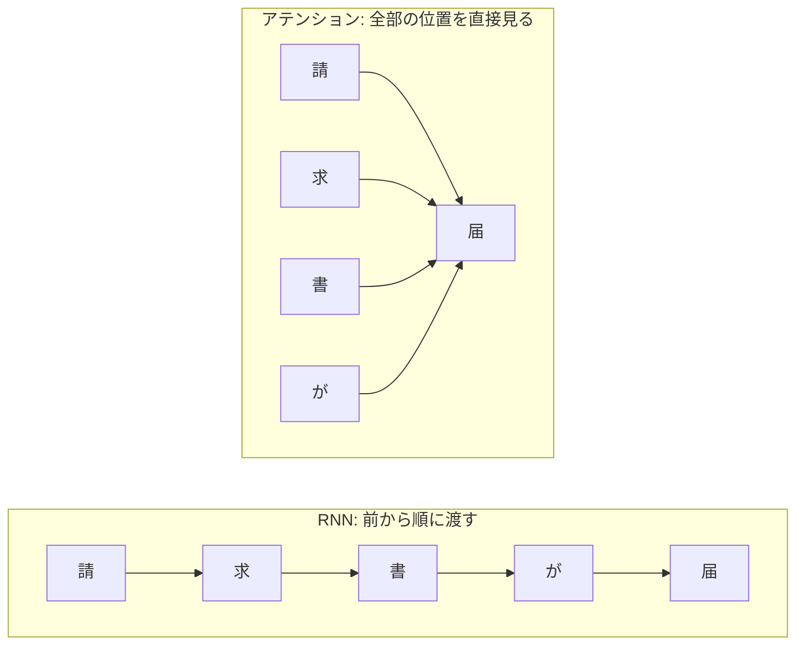

# 05-3 文章の扱い（RNN からアテンションへ）

!!! abstract "到達目標"
    - RNN が文章を前から 1 つずつ読む仕組みと、長い文章で前の情報が届きにくくなる理由を説明できる
    - 自己アテンション（Q・K・V と softmax）の計算を、図と NumPy のコードで説明できる
    - 言語モデルで未来の文字を隠す仕組み（因果マスク）を、テストで確かめられる

## 何か

文章は、文字（やトークン。06-1）が並んだ **系列** です。系列を扱うモデルには、大きく 2 つの考え方があります。

**RNN**（再帰型ニューラルネットワーク）は、前から 1 文字ずつ読み、それまでの内容を **隠れ状態**（数の並び）に詰め込みながら進みます。

**アテンション** は、各位置が、ほかの全部の位置を一度に見比べ、関係の深い位置の情報を重みつきで混ぜます。
同じ文章の中で見比べるものを **自己アテンション** と呼び、06 の LLM の中心にある仕組みです。



RNN では、最初の「請」の情報は 4 回の受け渡しを経て「届」に届きます。アテンションでは、「届」が「請」を直接見ます。

## なぜ必要か

RNN には、2 つの弱点があります。

- **長い文章で、前の情報が届きにくい**: 受け渡しのたびに少しずつ薄まり、学習のときも勾配が小さくなっていく（勾配消失）
- **並べて計算できない**: 前の隠れ状態ができるまで次に進めないので、文章が長いほど時間がかかる

アテンションは、どの 2 つの位置も直接つながるので、距離で情報が薄まりません。
全部の位置の計算は行列の掛け算でまとめてできるので、並べて計算でき、大量の文章で学習できます。
この 2 つが、トランスフォーマー（05-4）と LLM（06）がアテンションを使う理由です。

## どうやるか

### RNN で前の情報が薄まることを確かめる

<!-- src: examples/src/roadmap_examples/p05_attention.py -->
```python title="examples/src/roadmap_examples/p05_attention.py"
def rnn_states(xs: np.ndarray, w_x: np.ndarray, w_h: np.ndarray) -> np.ndarray:
    """h_t = tanh(x_t W_x + h_{t-1} W_h). xs は（長さ, 入力の次元）. 各時点の隠れ状態（長さ, 隠れの次元）を返す."""
    h = np.zeros(w_h.shape[0])
    states = []
    for x in xs:  # 前の結果を待たないと次に進めない（並べて計算できない）
        h = np.tanh(x @ w_x + h @ w_h)
        states.append(h)
    return np.array(states)
```

最初の入力だけを少しずらし、最後の隠れ状態がどれだけ動くかを測ります（`first_token_influence`）。
大きいほど、最初の文字の情報が最後まで届いています。手元の結果は次のとおりです。

| 文章の長さ | 2 | 5 | 10 | 20 |
|---|---:|---:|---:|---:|
| 最初の入力の影響（重みの大きさ 0.5） | 0.41 | 0.022 | 0.00014 | 0.00000001 |

長さが 2 倍になるごとに、影響はけた違いに小さくなります（`test_rnn_forgets_the_first_token_over_long_inputs`）。
受け渡しのたびに、重みと `tanh` の微分（1 以下）が掛かるからです。学習のときの勾配も、同じ掛け算で小さくなります。

この弱点を和らげるために、情報を残すかどうかを選ぶ門を足した RNN（LSTM・GRU）が作られました。
それでも、順に計算する点は変わりません。

### 自己アテンションの計算

各位置の数の並び（エンベディング）から、3 つの並びを作ります。

| 名前 | 役割 | たとえ |
|---|---|---|
| Q（クエリ） | 自分が探しているもの | 検索の言葉 |
| K（キー） | 自分が持っている情報の見出し | 本の見出し |
| V（バリュー） | 自分が渡す中身 | 本の中身 |

各位置の Q と、全部の位置の K の内積を取り、softmax で重み（足して 1）にして、V を重みつきで足します。
式で書くと `softmax(Q Kᵀ / √d) V` です（d は Q と K の次元）。

<!-- src: examples/src/roadmap_examples/p05_attention.py -->
```python title="examples/src/roadmap_examples/p05_attention.py"
def attention(
    q: np.ndarray, k: np.ndarray, v: np.ndarray, mask: np.ndarray | None = None
) -> tuple[np.ndarray, np.ndarray]:
    """softmax(Q K^T / √d) V. 出力と、重み（行ごとに足して 1）を返す. mask が False の位置の重みは 0 にする."""
    scores = q @ k.swapaxes(-1, -2) / np.sqrt(q.shape[-1])
    if mask is not None:
        scores = np.where(mask, scores, -np.inf)  # exp(-inf) = 0 なので、重みが 0 になる
    weights = softmax(scores)
    return weights @ v, weights
```

検索のたとえが成り立つことを、テストで確かめています。Q がある K と強く一致すると、その位置の V がほぼそのまま出てきます。

<!-- src: examples/tests/test_p05_attention.py -->
```python title="examples/tests/test_p05_attention.py"
def test_attention_looks_up_the_matching_key() -> None:
    keys = np.eye(3) * 10  # 3 つの鍵. 内積が大きい鍵に重みが集まる
    values = np.array([[1.0], [2.0], [3.0]])
    out, _ = attention(np.array([[0.0, 1.0, 0.0]]) * 10, keys, values)
    assert out[0, 0] == pytest.approx(2.0, abs=1e-6)
```

`√d` で割るのは、次元が大きいと内積の値が大きくなり、softmax の重みが 1 か所に偏りすぎるためです。
重みが偏りすぎると、ほかの位置に勾配が流れず、学習が進みにくくなります。

Q・K・V は、エンベディングに、学習する重みの行列を掛けて作ります（05-4）。どの位置を見るかは、学習で決まります。

### 未来の文字を隠す（因果マスク）

次の文字を予測する言語モデルでは、位置 i は 0〜i の文字だけを見てよく、i より後ろ（答え）を見てはいけません。
見てはいけない位置の点数を -∞ にすると、softmax の重みが 0 になります。

<!-- src: examples/src/roadmap_examples/p05_attention.py -->
```python title="examples/src/roadmap_examples/p05_attention.py"
def causal_mask(length: int) -> np.ndarray:
    """位置 i が見てよいのは 0〜i だけ（未来の文字を見ない）. 見てよいところが True の（長さ, 長さ）の表."""
    return np.tril(np.ones((length, length), dtype=bool))
```

<!-- src: examples/tests/test_p05_attention.py -->
```python title="examples/tests/test_p05_attention.py"
def test_causal_mask_hides_the_future() -> None:
    rng = np.random.default_rng(0)
    q, k, v = rng.normal(size=(3, 4, 2))
    out, weights = attention(q, k, v, causal_mask(4))
    assert np.allclose(np.triu(weights, k=1), 0.0)
    # 未来（最後の位置）の値を変えても、それより前の出力は変わらない
    v2 = v.copy()
    v2[3] += 10.0
    out2, _ = attention(q, k, v2, causal_mask(4))
    assert np.allclose(out[:3], out2[:3])
```

!!! failure "悪い例"
    言語モデルの学習で、因果マスクを付けずにアテンションを計算する。

    各位置が「次の文字」（答え）を見られるので、学習の損失はすぐに下がります。
    ところが文章を作るときは、まだ書いていない次の文字は無いので、モデルはまったく使えません。
    学習の損失だけを見ていると、気づきません。

!!! success "良い例"
    因果マスクを付け、「未来の文字を変えても、それより前の出力が変わらない」ことをテストで確かめる（上のテスト。05-4 のモデルでも同じテストをします）。

### PyTorch では

PyTorch には、同じ計算をする関数があります
（[公式ドキュメント: scaled_dot_product_attention](https://docs.pytorch.org/docs/stable/generated/torch.nn.functional.scaled_dot_product_attention.html)）。
`is_causal=True` で因果マスクを付けます。

例:

```python
import numpy as np
import torch
from torch.nn import functional as F

from roadmap_examples.p05_attention import attention, causal_mask

rng = np.random.default_rng(0)
q, k, v = rng.normal(size=(3, 5, 4))
ours, _ = attention(q, k, v, causal_mask(5))
theirs = F.scaled_dot_product_attention(*(torch.tensor(a) for a in (q, k, v)), is_causal=True)
print(np.allclose(ours, theirs.numpy()))  # True
```

PyTorch の CPU 版で、手元で `True` になることを確かめています。

マスクの True の意味は、関数によって逆です。演習のコードの `causal_mask` と `scaled_dot_product_attention` の `attn_mask` は「True = 見てよい」ですが、
`nn.MultiheadAttention` の `attn_mask` は「True = 見てはいけない」です（05-4 で使います。
[公式ドキュメント: MultiheadAttention](https://docs.pytorch.org/docs/stable/generated/torch.nn.MultiheadAttention.html)）。

## 演習

1. `first_token_influence` で、重みの大きさ（`scale`）を 0.5 と 1.5 にし、長さ 2・5・10・20 の影響を表にしてください
2. 乱数の Q と K（8 位置）で、次元 d を 4・64・256・1024 と変え、`√d` で割る場合と割らない場合の「各行の重みの最大値の平均」を表にしてください
3. 自己アテンションで、文の中の「どの位置がどの位置を見ているか」を確かめるテストを書いてください。
   例えば、位置 3 の Q を位置 1 の K と同じ向きにすると、位置 3 の重みが位置 1 に集まることを確かめます

- できたことの確かめ方: `uv run pytest` が通る。1・2 は表と考察
- 目安の時間: 6 時間

解答: [05-3 の解答](answers/05-3.md)

## もし〇〇がなかったら？

**アテンションがなかったら**、文章は RNN のように前から順に読むしかありません。
長い文章の最初の方の情報は薄まり、並べて計算できないので、大量の文章で学習するのに時間がかかります。
数千〜数十万トークンのコンテキスト（06-2）を扱う、いまの LLM は作れません。

**因果マスクがなかったら**、言語モデルは学習のときに答えを見てしまいます。
学習の損失は良く見えるのに、文章を作らせると使えないモデルができます。

## 理解度チェック

1. RNN で、長い文章の最初の情報が最後まで届きにくいのはなぜですか。

    ??? note "答え"
        隠れ状態を受け渡すたびに、重みと活性化関数の微分が掛かり、影響が少しずつ小さくなるからです。
        学習のときの勾配も同じ掛け算で小さくなります（勾配消失）。

2. 自己アテンションの Q・K・V は、それぞれどんな役割ですか。

    ??? note "答え"
        Q は自分が探しているもの、K は各位置が持つ情報の見出し、V は各位置が渡す中身です。
        Q と K の内積で重みを決め、V を重みつきで足します。

3. アテンションの点数を `√d` で割るのはなぜですか。

    ??? note "答え"
        次元 d が大きいと内積の値が大きくなり、softmax の重みが 1 か所に偏りすぎるからです。
        偏りすぎると、ほかの位置に勾配が流れにくくなり、学習が進みにくくなります。

4. 因果マスクは、何のために、どう作りますか。

    ??? note "答え"
        次の文字を予測する言語モデルで、各位置が自分より後ろ（答え）を見ないようにするためです。
        見てはいけない位置の点数を -∞ にして、softmax の重みを 0 にします。
