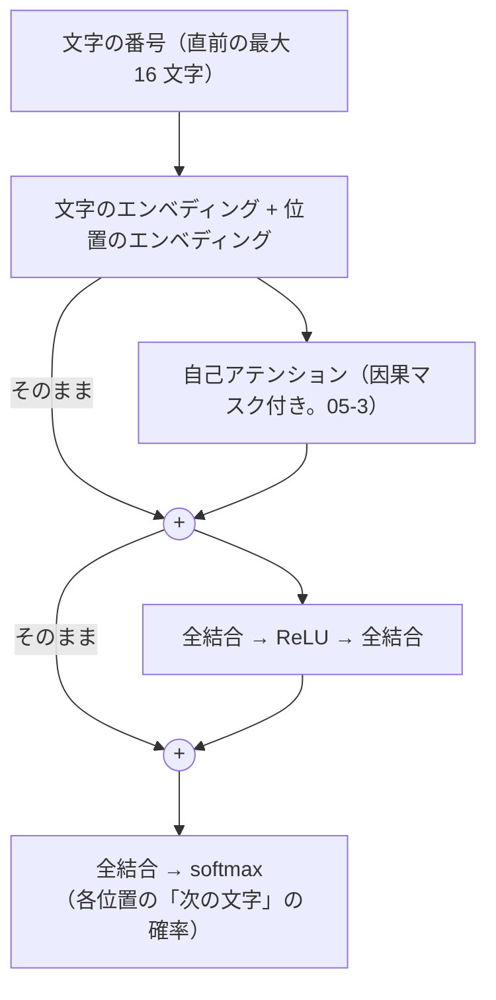

# 05-4 トランスフォーマーを小さく実装する

!!! abstract "到達目標"
    - トランスフォーマーのブロック（自己アテンション・全結合・残差接続・層の正規化）の役割を説明できる
    - 次の文字を予測する小さな言語モデルを CPU で学習させ、学習と検証の損失から、学べたかどうかを判断できる
    - 温度を変えて文章を作り、06 の LLM の「次のトークンを選ぶ」仕組みと結び付けて説明できる

## 何か

**トランスフォーマー** は、05-3 の自己アテンションを中心にしたモデルの組み立て方です。06 の LLM の多くが、この形をしています。

**言語モデル** は、それまでの文字（トークン）から、次に来る文字の確率を出すモデルです。
1 文字選んでは後ろに足し、また次を予測する、を繰り返すと、文章ができます。

この章の成果物は、文字単位の小さな言語モデルです。演習のコードは、トランスフォーマーのブロック 1 つを NumPy で書いています。



- **位置のエンベディング**: アテンションは位置の順番を知らないので、「何文字目か」を表す並びを足す
- **残差接続**（図の「+」）: 層の入力を、層の出力にそのまま足す。層を重ねても、勾配が入力の側まで届きやすくなる
- **全結合の層**: 各位置で、アテンションが集めた情報を変換する

本物のトランスフォーマーには、さらに **層の正規化**（LayerNorm。各位置の並びを平均 0・分散 1 にそろえる）・**複数のヘッド**（アテンションを何組も並べる）・
**ブロックの積み重ね** があります。演習のコードでは省き、この章の後半の PyTorch の例で入れます。

## なぜ必要か

06 では、LLM をトークン数・コンテキストの長さ・温度などの「外から見た性質」で扱います。
小さくても自分で作ると、それぞれが中で何に当たるかが分かります。

| 06 で扱う性質 | この章のモデルでは |
|---|---|
| コンテキストウィンドウ | 位置のエンベディングの数（`context`）。これより前の文字は読めない |
| 次のトークンの確率と温度 | 最後の位置の出力の softmax。温度で割ってから選ぶ |
| 学習のデータと費用 | 文章の量・ステップ数・パラメーターの数。CPU で数秒〜数十秒 |
| 学習したことしか書けない | 学習に無い文字は扱えず、学習した言い回しを組み合わせる |

## どうやるか

### 学習の文章を用意する

文字単位の言語モデルは、たくさんの文章が要ります。04 の学習データ（100 件・約 2,300 文字）だけでは、すぐに丸暗記します（演習 1 で確かめます）。
演習のコードでは、架空の問い合わせの部品を組み合わせて、1,500 行（約 47,000 文字）の文章を作ります。

<!-- src: examples/src/roadmap_examples/p05_charlm.py -->
```python title="examples/src/roadmap_examples/p05_charlm.py"
def template_corpus(n_lines: int = 1500, seed: int = 0) -> str:
    """部品を乱数で組み合わせた架空の問い合わせを n_lines 行作り、改行でつなぐ（seed が同じなら毎回同じ）."""
    rng = np.random.default_rng(seed)
    lines = []
    for _ in range(n_lines):
        t, p = TARGETS[rng.integers(len(TARGETS))], PATTERNS[rng.integers(len(PATTERNS))]
        o, c = OPENINGS[rng.integers(len(OPENINGS))], CLOSINGS[rng.integers(len(CLOSINGS))]
        lines.append(o + p.format(t=t) + c)
    return "\n".join(lines) + "\n"
```

文字は、出てきた文字を並べた語彙（112 文字）の番号にします。06-1 のトークナイザーの、いちばん単純な形です。

### 順伝播

<!-- src: examples/src/roadmap_examples/p05_charlm.py -->
```python title="examples/src/roadmap_examples/p05_charlm.py"
def forward(params: Params, idx: np.ndarray) -> tuple[np.ndarray, dict[str, np.ndarray]]:
    """idx は文字の番号の（バッチ, 長さ）. 各位置の「次の文字」のロジット（バッチ, 長さ, 語彙の数）を返す."""
    t = idx.shape[1]
    x0 = params["tok"][idx] + params["pos"][:t]
    q, k, v = x0 @ params["wq"], x0 @ params["wk"], x0 @ params["wv"]
    scores = q @ k.transpose(0, 2, 1) / np.sqrt(q.shape[-1])
    scores = np.where(np.tril(np.ones((t, t), dtype=bool)), scores, -np.inf)  # 未来の文字を見ない
    att = softmax(scores)
    mixed = att @ v
    x1 = x0 + mixed @ params["wo"]  # 残差接続: 入力に、アテンションの結果を足す
    z = x1 @ params["w1"] + params["b1"]
    r = np.maximum(z, 0.0)
    x2 = x1 + r @ params["w2"] + params["b2"]
    logits = x2 @ params["out"] + params["out_b"]
```

05-3 のアテンションに、Q・K・V を作る重み（`wq`・`wk`・`wv`）と、出力を戻す重み（`wo`）が加わりました。
どの位置を見るかは、これらの重みの学習で決まります。

1 つの文から、全部の位置の「次の文字」を同時に予測します。「請求書を」なら、「請」→「求」、「請求」→「書」、「請求書」→「を」の 3 問を一度に解きます。
因果マスクがあるので、各位置は答えを見られません。

### 逆伝播と、その確かめ

逆伝播は 05-1 と同じく、出力の側から連鎖律で戻ります。いちばん込み入ったアテンションの部分です。

<!-- src: examples/src/roadmap_examples/p05_charlm.py -->
```python title="examples/src/roadmap_examples/p05_charlm.py"
    # x1 = x0 + mixed Wo,  mixed = att v
    g["wo"] = rows(c["mixed"]).T @ rows(dx1)
    dmixed = dx1 @ params["wo"].T
    datt = dmixed @ c["v"].transpose(0, 2, 1)
    dv = c["att"].transpose(0, 2, 1) @ dmixed
    # softmax の微分: ds = att * (datt - Σ(datt * att)). 隠した位置は att = 0 なので勾配も 0
    dscores = c["att"] * (datt - (datt * c["att"]).sum(axis=-1, keepdims=True))
    dscores /= np.sqrt(c["q"].shape[-1])
    dq, dk = dscores @ c["k"], dscores.transpose(0, 2, 1) @ c["q"]
```

- 残差接続（`x1 = x0 + ...`）があるので、`x0` への勾配は「`x1` の勾配そのもの」と「アテンションを通って戻る勾配」の和になる
- 文字のエンベディングの勾配は、同じ文字が何度も出たら足し合わせる（`np.add.at`）

全部のパラメーターの勾配を、05-1 と同じく数値微分と比べています（`test_backprop_matches_numerical_gradient`。手元で差は 1e-10 未満）。
因果マスクが効いていることも確かめます。

<!-- src: examples/tests/test_p05_charlm.py -->
```python title="examples/tests/test_p05_charlm.py"
def test_future_tokens_do_not_change_earlier_predictions() -> None:
    params = init_params(10, SMALL)
    a = np.array([[1, 2, 3, 4, 5]])
    b = np.array([[1, 2, 3, 9, 9]])
    assert np.allclose(forward(params, a)[0][0, :3], forward(params, b)[0][0, :3])
```

### 学習する

学習のループは 05-2 と同じ形で、最適化は 05-2 の `Adam` です。文章のランダムな位置から 16 文字を取り出し、1 文字ずらしたものを正解にします。

<!-- src: examples/src/roadmap_examples/p05_charlm.py -->
```python title="examples/src/roadmap_examples/p05_charlm.py"
def sample_batch(data: np.ndarray, cfg: Config, rng: np.random.Generator) -> tuple[np.ndarray, np.ndarray]:
    """文字列のランダムな位置から context 文字を取り出す. 正解は 1 文字ずらしたもの（次の文字）."""
    starts = rng.integers(0, len(data) - cfg.context - 1, cfg.batch)
    x = np.stack([data[s : s + cfg.context] for s in starts])
    y = np.stack([data[s + 1 : s + cfg.context + 1] for s in starts])
    return x, y
```

`examples/` で実行します。

```bash
uv run python -m roadmap_examples.p05_charlm --steps 2000 --save charlm.npz
```

手元の出力です（学習は 8 秒ほど）。

```text
語彙: 112 文字 / 文章: 46839 文字（9 割の行で学習、1 割の行で検証）
何も学んでいないときの損失（log 語彙数）: 4.72
ステップ 500: 学習の損失 0.58 / 検証の損失 0.34
ステップ 1000: 学習の損失 0.34 / 検証の損失 0.34
ステップ 1500: 学習の損失 0.34 / 検証の損失 0.33
ステップ 2000: 学習の損失 0.35 / 検証の損失 0.36
```

**損失の読み方**: 何も学んでいない（全部の文字が同じ確率）ときの損失は log 語彙数（約 4.72）です。
検証の損失が 0.3 台まで下がり、学習の損失と同じくらいなので、学習に使っていない行でも次の文字を当てられています。
部品の組み合わせで作った文章は言い回しの種類が少ないので、500 ステップほどで下がりきりました。
学習の損失（ミニバッチの平均）が検証の損失より大きく出るのは、学習の損失がその 500 ステップの平均で、序盤の高い値を含むためです。

!!! failure "悪い例"
    04 の学習データ（100 件・約 2,300 文字）だけで学習し、学習の損失が下がったので「学べた」と判断する。

    手元で `--corpus data/p04/train.jsonl` を付けて試すと、学習の損失は 0.41 まで下がりましたが、
    検証の損失は 6.25 → 8.15 と上がり続け、何も学んでいないとき（5.82）より悪くなりました。学習した文を丸暗記しただけです。

!!! success "良い例"
    行の一部を検証に回し、学習と検証の損失を並べて見る。検証の損失が下がらなければ、文章を増やすか、モデルを小さくする。

### 文章を作る

<!-- src: examples/src/roadmap_examples/p05_charlm.py -->
```python title="examples/src/roadmap_examples/p05_charlm.py"
def generate(
    params: Params, vocab: Vocab, cfg: Config, prompt: str, length: int, temperature: float = 0.8, seed: int = 0
) -> str:
    """prompt に続けて、1 文字ずつ確率に従って選ぶ. temperature が小さいほど、確率の高い文字に偏る（06-2）."""
    rng = np.random.default_rng(seed)
    ids = list(vocab.encode(prompt))
    for _ in range(length):
        logits, _ = forward(params, np.array([ids[-cfg.context :]]))
        probs = softmax(logits[0, -1] / temperature)
        ids.append(int(rng.choice(len(probs), p=probs)))
    return vocab.decode(ids)
```

```bash
uv run python -m roadmap_examples.p05_charlm --load charlm.npz --prompt 請求 --length 40
```

手元では次の文章ができました（温度 0.8）。

```text
請求書の使い方が分かりません。
昨日からメールアドレスの確認方法を教えてください。ご
```

`ids[-cfg.context:]` で、直前の 16 文字だけを渡しています。これがこのモデルのコンテキストウィンドウです。
保存は NumPy の `.npz` 形式で、読み込みでは pickle を使わない設定（`allow_pickle=False`）にしています。
pickle は、読み込むだけで任意のコードが動く恐れがあるためです（[公式ドキュメント: numpy.savez](https://numpy.org/doc/stable/reference/generated/numpy.savez.html)）。

### PyTorch で書く

PyTorch では、層の正規化・複数のヘッド・ブロックの積み重ねを、用意された部品で足せます。
05-2 の手順で PyTorch の CPU 版を入れた環境で動きます。手元で動くことを確かめています（CI では動かしません）。

例:

```python
import torch
from torch import nn
from torch.nn import functional as F

from roadmap_examples.p05_charlm import Vocab, split_lines, template_corpus


class Block(nn.Module):
    """トランスフォーマーの 1 ブロック: 層の正規化 → 自己アテンション → 足し戻す → 層の正規化 → 全結合 → 足し戻す."""

    def __init__(self, dim: int, heads: int, hidden: int) -> None:
        super().__init__()
        self.ln1 = nn.LayerNorm(dim)
        self.attn = nn.MultiheadAttention(dim, heads, batch_first=True)
        self.ln2 = nn.LayerNorm(dim)
        self.mlp = nn.Sequential(nn.Linear(dim, hidden), nn.ReLU(), nn.Linear(hidden, dim))

    def forward(self, x: torch.Tensor) -> torch.Tensor:
        t = x.shape[1]
        future = torch.triu(torch.ones(t, t, dtype=torch.bool), diagonal=1)  # True の位置は見ない
        h = self.ln1(x)
        x = x + self.attn(h, h, h, attn_mask=future, need_weights=False)[0]
        return x + self.mlp(self.ln2(x))


class CharLM(nn.Module):
    def __init__(self, vocab_size: int, context: int = 32, dim: int = 64, heads: int = 4, layers: int = 2) -> None:
        super().__init__()
        self.context = context
        self.tok = nn.Embedding(vocab_size, dim)
        self.pos = nn.Embedding(context, dim)
        self.blocks = nn.Sequential(*[Block(dim, heads, 4 * dim) for _ in range(layers)])
        self.ln = nn.LayerNorm(dim)
        self.out = nn.Linear(dim, vocab_size)

    def forward(self, idx: torch.Tensor) -> torch.Tensor:
        x = self.tok(idx) + self.pos(torch.arange(idx.shape[1]))
        return self.out(self.ln(self.blocks(x)))


text = template_corpus()
vocab = Vocab.build(text)
train_text, val_text = split_lines(text)
train_data = torch.tensor(vocab.encode(train_text))
val_data = torch.tensor(vocab.encode(val_text))


def get_batch(data: torch.Tensor, context: int = 32, size: int = 32) -> tuple[torch.Tensor, torch.Tensor]:
    starts = torch.randint(0, len(data) - context - 1, (size,))
    x = torch.stack([data[s : s + context] for s in starts])
    y = torch.stack([data[s + 1 : s + context + 1] for s in starts])
    return x, y


def lm_loss(model: CharLM, x: torch.Tensor, y: torch.Tensor) -> torch.Tensor:
    logits = model(x)
    return F.cross_entropy(logits.reshape(-1, logits.shape[-1]), y.reshape(-1))


torch.manual_seed(0)
model = CharLM(len(vocab.chars))
optimizer = torch.optim.AdamW(model.parameters(), lr=3e-3)
for step in range(1, 1001):
    loss = lm_loss(model, *get_batch(train_data))
    optimizer.zero_grad()
    loss.backward()
    optimizer.step()
    if step % 200 == 0:
        model.eval()
        with torch.no_grad():
            val_loss = lm_loss(model, *get_batch(val_data)).item()
        model.train()
        print(f"ステップ {step}: 学習 {loss.item():.2f} / 検証 {val_loss:.2f}")


@torch.no_grad()
def generate(model: CharLM, prompt: str, length: int, temperature: float = 0.8) -> str:
    model.eval()
    ids = torch.tensor(vocab.encode(prompt)).unsqueeze(0)  # （1, 文字数）
    for _ in range(length):
        logits = model(ids[:, -model.context :])[:, -1] / temperature  # 最後の位置の「次の文字」
        next_id = torch.multinomial(F.softmax(logits, dim=-1), num_samples=1)
        ids = torch.cat([ids, next_id], dim=1)
    return vocab.decode(ids[0].tolist())


print(generate(model, "請求", 40))
```

- `nn.MultiheadAttention` は、Q・K・V を作る重みと、ヘッドを分けて戻す計算をまとめた部品です。
  `attn_mask` の True は「見てはいけない」なので、`triu`（対角より上が True）で未来を隠します
  （[公式ドキュメント: MultiheadAttention](https://docs.pytorch.org/docs/stable/generated/torch.nn.MultiheadAttention.html)）
- 層の正規化は、アテンションと全結合の **前** に置いています（`nn.LayerNorm`。[公式ドキュメント](https://docs.pytorch.org/docs/stable/generated/torch.nn.LayerNorm.html)）
- `AdamW` は、Adam に重みの減衰（重みを少しずつ 0 に近づける）を正しく組み込んだものです
  （[公式ドキュメント: AdamW](https://docs.pytorch.org/docs/stable/generated/torch.optim.AdamW.html)）

手元では、1000 ステップで 30 秒ほどかかり、検証の損失は 0.3 前後になりました。パラメーターは約 11 万 7 千個で、
NumPy の版（約 1 万 6 千個）の 7 倍ほどです。部品の組み合わせで作った文章では、NumPy の版と損失はほぼ同じでした。
文章の種類が少なく、小さなモデルでも学びきれるためです。もっと多様な文章では、層やヘッドの多さが効いてきます。

## 演習

1. 04 の学習データだけ（`--corpus data/p04/train.jsonl`）で学習し、部品を組み合わせた文章で学習したときと、学習と検証の損失を比べてください
2. 保存したモデルで、温度を 0.2・0.8・1.5 と変えて文章を作り、違いを説明してください
3. `Config(context=2)`・`Config(context=4)`・`Config(context=16)` で 2000 ステップ学習し、最後の検証の損失を比べてください。
   テストで「16 のほうが 2 より損失が小さい」ことを確かめます
4. 任意: PyTorch の例を動かし、`layers` を 1 と 2 にして、パラメーターの数と検証の損失を比べてください

- できたことの確かめ方: `uv run pytest` が通る。1・2・4 は結果と考察
- 目安の時間: 6 時間

解答: [05-4 の解答](answers/05-4.md)

## もし〇〇がなかったら？

**位置のエンベディングがなかったら**、アテンションは文字の並び順を区別できません。
「請求書を送る」と「送る請求書を」が、同じ文字の集まりとして扱われます。

**残差接続がなかったら**、ブロックを積み重ねるほど、入力に近い層まで勾配が届きにくくなります（05-3 の RNN と同じ問題）。
LLM のように数十のブロックを重ねたモデルは、学習できなくなります。

## 理解度チェック

1. 言語モデルは、何を予測するモデルですか。それで文章を作るには、どうしますか。

    ??? note "答え"
        それまでの文字（トークン）から、次に来る文字の確率を予測するモデルです。
        確率に従って 1 文字選んで後ろに足し、また次を予測する、を繰り返して文章を作ります。

2. この章のモデルで、コンテキストウィンドウに当たるものは何ですか。それより前の文字はどうなりますか。

    ??? note "答え"
        位置のエンベディングの数（`context`、16 文字）です。文章を作るときは直前の 16 文字だけを渡すので、それより前の文字は予測に使われません。

3. 学習の損失が下がったのに、そのモデルは学べていない、ということがあるのはなぜですか。どう見分けますか。

    ??? note "答え"
        学習した文章を丸暗記しても、学習の損失は下がるからです。学習に使っていない行で検証の損失を測り、
        学習の損失と並べて見ます。検証の損失が、何も学んでいないとき（log 語彙数）より悪ければ、学べていません。

4. 温度を小さくすると、作られる文章はどう変わりますか。

    ??? note "答え"
        確率の高い文字に選び方が偏り、学習でよく見た言い回しに近い、変化の少ない文章になります。
        大きくすると、確率の低い文字も選ばれやすくなり、変わった（崩れた）文章が増えます。
