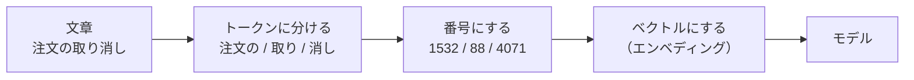

# 06-1 トークンとエンベディング

!!! abstract "到達目標"
    - トークンとは何かを、文字・単語との違いから説明できる
    - トークン数が言語や文章の種類で変わる理由を説明し、本物のトークン数をモデルの応答から測れる
    - エンベディング（文章や語のベクトル）とは何かを説明し、コサイン類似度で比べられる

## 何か

LLM は、文字をそのまま読むわけではありません。文章はまず **トークン** に分けられます。
トークンは、モデルが読み書きする単位です。1 文字のことも、単語や単語の一部のこともあります。

トークンは番号（ID）に置き換えられ、番号ごとに決まった数の並び（ベクトル）に変わってから、モデルに入ります。
このベクトルを **エンベディング**（埋め込み）と呼びます。意味の近いものほど、近いベクトルになるように学習されています。



図の分け方と番号は説明のための例です。どう分けるかは、モデルごとに決まっています（トークナイザーと呼びます）。

## なぜ必要か

LLM の費用・速さ・一度に読める量（06-2）は、どれも **文字数ではなくトークン数** で決まります。

- クラウドの API の料金は、入力と出力のトークン数で決まる（07-4）
- 一度に読める量（コンテキストウィンドウ）も、トークン数で決まっている
- 同じ意味の文章でも、言語やモデルによってトークン数が違う。「1 文字 = 1 トークン」や「4 文字 = 1 トークン」と決めつけると、見積もりが外れる

エンベディングは、08 の RAG で「質問に近い資料を探す」ときの土台です。
文章をベクトルにすると、言葉が違っても意味が近い文章を、数の計算で見つけられます。

## どうやるか

### 小さなトークナイザーで仕組みを確かめる

多くのモデルのトークナイザーは、BPE（Byte Pair Encoding）という考え方で作られています。
「よく並んで出てくる 2 つを、1 つのトークンにまとめる」を、決めた回数だけ繰り返して語彙を作ります。

演習のコードの `train_bpe` は、その考え方だけを取り出した小さな実装です。1 文字ずつから始め、いちばん多く並ぶ組をまとめます。

<!-- src: examples/src/roadmap_examples/p06_tokens.py -->
```python title="examples/src/roadmap_examples/p06_tokens.py"
def train_bpe(corpus: Sequence[str], num_merges: int) -> list[Pair]:
    """1 文字ずつから始め、いちばん多く並ぶ組を 1 つにまとめる、を num_merges 回まで繰り返す.

    2 回以上出てくる組が無くなったら、そこで止める. 同じ回数の組は、文字の順で先のものを選ぶ（毎回同じ結果にする）.
    """
    texts = [list(text) for text in corpus]
    merges: list[Pair] = []
    for _ in range(num_merges):
        counts: Counter[Pair] = Counter()
        for tokens in texts:
            counts.update(zip(tokens, tokens[1:], strict=False))
        if not counts:
            break
        best, n = min(counts.items(), key=lambda kv: (-kv[1], kv[0]))
        if n < 2:
            break
        merges.append(best)
        texts = [merge(tokens, best) for tokens in texts]
    return merges
```

学習したまとめ方を、学習した順に当てはめると、文章がトークンに分かれます。

<!-- src: examples/src/roadmap_examples/p06_tokens.py -->
```python title="examples/src/roadmap_examples/p06_tokens.py"
def tokenize(text: str, merges: Sequence[Pair]) -> list[str]:
    """学習したまとめ方を、学習した順に当てはめる. 学習で見なかった並びは、1 文字ずつのまま残る."""
    tokens = list(text)
    for pair in merges:
        tokens = merge(tokens, pair)
    return tokens
```

テストで、2 つの性質を確かめています。

<!-- src: examples/tests/test_p06_tokens.py -->
```python title="examples/tests/test_p06_tokens.py"
def test_text_from_the_training_domain_needs_fewer_tokens() -> None:
    merges = train_bpe(CORPUS, num_merges=10)
    seen, unseen = "注文の取り消し", "配送日の変更願"  # どちらも 7 文字
    assert len(tokenize(seen, merges)) < len(tokenize(unseen, merges)) == 7
```

- 学習に使った文章（ここでは「注文」「請求書」の多い文章）によく出る並びは、少ないトークンになる
- 学習で見なかった並び（「配送」）は、1 文字ずつに分かれ、トークンが多くなる

本物のトークナイザーも同じです。学習に使った文章に英語が多ければ、英語は少ないトークンで表せ、ほかの言語は多くなりがちです。
どれだけ違うかはモデルごとに違うので、決めつけずに測ります。

### 本物のトークン数を測る

本物のトークン数は、モデルの応答に書かれた数を使います。
Ollama のチャットの API は、入力のトークン数を `prompt_eval_count`、出力のトークン数を `eval_count` で返します
（[公式ドキュメント: チャットの API](https://docs.ollama.com/api/chat)）。

演習のコードの `OllamaChat`（07 で詳しく使います）は、この 2 つを `input_tokens` と `output_tokens` に入れて返します。

```python
from roadmap_examples.llm import Message
from roadmap_examples.ollama_client import OllamaChat

llm = OllamaChat("<モデル名>", options={"temperature": 0, "num_predict": 1})
for text in ["日本の首都はどこですか？", "What is the capital of Japan?"]:
    result = llm.complete([Message("user", text)])
    print(len(text), "文字", result.input_tokens, "トークン")
```

`num_predict` は、出力のトークン数の上限です（[公式ドキュメント: チャットの API](https://docs.ollama.com/api/chat) の options）。
入力のトークン数だけを知りたいときは 1 にすると、答えを長く書かせずに済みます。

入力のトークン数には、自分の文章のほかに、会話の区切りの分も入ります（06-3 のチャットのテンプレート）。
短い質問でも、文字数より大きな数になるのはそのためです。

!!! failure "悪い例"
    ```python
    def estimate_tokens(text: str) -> int:
        return len(text) // 4  # 英語の目安を、どの言語にも使う
    ```

    英語の目安を日本語に当てはめると、トークン数を少なく見積もりがちです。費用や、コンテキストに入るかの判断を誤ります。

!!! success "良い例"
    評価セット（07-5）の数十件を、使うモデルで実際に流し、応答のトークン数から 1 件あたりの平均を出します。
    演習のコードの `rough_tokens`（`len(text) // 4`）は、テストで決まった数を作るためだけのもので、見積もりには使いません。

### エンベディングを比べる

モデルの中では、トークンごとにエンベディングがあります。これとは別に、**文章全体を 1 つのベクトルにする** 専用のモデル
（エンベディングのモデル）もあります。08 の検索で使うのは、こちらです。

どちらの場合も、2 つのベクトルの近さは、多くの場合 **コサイン類似度** で比べます。ベクトルの向きが同じほど 1 に近く、
関係が無いほど 0 に近くなります。

<!-- src: examples/src/roadmap_examples/p06_tokens.py -->
```python title="examples/src/roadmap_examples/p06_tokens.py"
def cosine(a: Sequence[float], b: Sequence[float]) -> float:
    """コサイン類似度（-1〜1. 向きが同じほど 1 に近い）. 長さ 0 のベクトルは 0 とする."""
    if len(a) != len(b):
        raise ValueError(f"ベクトルの長さが違います（{len(a)} と {len(b)}）")
    dot = sum(x * y for x, y in zip(a, b, strict=True))
    norm = math.sqrt(sum(x * x for x in a)) * math.sqrt(sum(y * y for y in b))
    return dot / norm if norm else 0.0
```

Ollama では、エンベディングのモデルで文章をベクトルにできます
（[公式ドキュメント: エンベディング](https://docs.ollama.com/capabilities/embeddings)）。

```python
from roadmap_examples.ollama_client import OllamaEmbedder
from roadmap_examples.p06_tokens import cosine

embedder = OllamaEmbedder("<エンベディングのモデル名>")
a, b, c = embedder.embed(["請求書を再発行したい", "領収書をもう一度出してほしい", "パスワードを忘れた"])
print(cosine(a, b), cosine(a, c))
```

言葉はほとんど重ならなくても、意味が近い文章（請求書と領収書の再発行）のほうが、近いベクトルになることが期待できます。
どれだけ近くなるかはモデルしだいなので、08 で評価セットを使って確かめます。

比べるベクトルは、**同じエンベディングのモデル** で作ったものどうしに限ります。モデルが違うと、ベクトルの意味がそろっていません。

## 演習

1. `CORPUS` に「解約の手続き」「解約の時期」「解約の理由」の 3 文を足して `train_bpe` を実行し、
   「解約の」が 1 つのトークンになることを、テストで確かめてください
2. 同じ 2 つの文章（例:「注文の取り消し」と「配送日の変更願」）で、`num_merges` を 0・5・20 と変えたときのトークン数を、
   テストに表として書いてください。まとめる回数が増えると、学習した文章のトークン数がどう変わるかを確かめます
3. 任意: Ollama で、06 の質問（`examples/data/p06/questions.jsonl`）の q01（日本語）と q02（英語）の `input_tokens` を比べてください。
   文字数と、トークン数の比を表にします

- できたことの確かめ方: `uv run pytest` が通る。3 は、表（使ったモデル名を添える）
- 目安の時間: 1.5 時間

解答: [06-1 の解答](answers/06-1.md)

## もし〇〇がなかったら？

**トークンという単位がなかったら**、1 文字ずつ読むか、単語ごとに読むかのどちらかになります。
1 文字ずつでは文章がとても長い並びになり、一度に読める量がすぐに足りなくなります。
単語ごとでは、辞書に無い語（新しい製品名・型番）を表せません。トークンは、その中間の単位です。

**エンベディングがなかったら**、文章の近さは、同じ語が入っているかでしか測れません。
「請求書」と「領収書」のように、語は違っても意味が近い文章を見つけられず、08 の検索の多くの質問が外れます。

## 理解度チェック

1. LLM の費用や、一度に読める量を見積もるとき、文字数ではなくトークン数を使うのはなぜですか。

    ??? note "答え"
        料金もコンテキストウィンドウも、トークン数で決まっているからです。
        1 文字が何トークンになるかは言語やモデルで違うので、文字数からの換算では外れます。

2. 小さな BPE で、学習した文章によく出る語が少ないトークンになるのはなぜですか。

    ??? note "答え"
        よく並ぶ 2 つを 1 つにまとめる操作を、多い順に繰り返して語彙を作るからです。
        学習した文章によく出る並びほど先にまとまり、1 つのトークンで表せるようになります。

3. Ollama で入力のトークン数を知るには、応答のどの値を見ますか。短い質問でも、文字数から思うより大きくなるのはなぜですか。

    ??? note "答え"
        `prompt_eval_count` を見ます（演習のコードでは `input_tokens`）。
        会話の区切り（チャットのテンプレート。06-3）の分も、入力のトークンに含まれるからです。

4. 2 つの文章のエンベディングをコサイン類似度で比べるとき、気をつけることは何ですか。

    ??? note "答え"
        同じエンベディングのモデルで作ったベクトルどうしで比べることです。モデルが違うと、ベクトルの意味がそろっていません。
        また、近さの値がどれだけ当てになるかは、評価セットで確かめます（08）。
