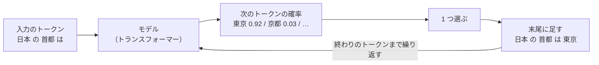

# 06-2 LLM の仕組みとコンテキストウィンドウ

!!! abstract "到達目標"
    - LLM が文章を作る仕組みを、「次のトークンを選ぶ」の繰り返しとして説明できる
    - temperature が答えにどう効くかを説明し、仕事に合わせて決められる
    - コンテキストウィンドウ（一度に読めるトークン数）の制約を見積もり、収まるように会話を削るコードを書ける

## 何か

LLM（大規模言語モデル）は、それまでのトークンの並びを読んで、**次のトークンの確率** を出すモデルです。
確率から 1 つ選んで末尾に足し、また次を予測する、を「終わり」のトークンが出るまで繰り返します。
長い答えも、この 1 トークンずつの繰り返しでできています。



モデルの中身はトランスフォーマーと呼ばれる仕組みで、アテンションで並びの中のどのトークンを参考にするかを決めます（05 で実装します）。
06 では中身に立ち入らず、外から見た性質を扱います。

**コンテキストウィンドウ** は、モデルが一度に読めるトークン数の上限です。入力（指示・会話の履歴・資料）と、
これから書く出力の両方が、この上限に入らなければなりません。

## なぜ必要か

LLM を業務に組み込むと、入力はすぐに長くなります。

- チャットでは、会話の履歴を毎回送る。往復するたびに入力が長くなる
- RAG（08）では、検索した資料をプロンプトに入れる
- エージェント（10）では、ツールの結果が会話に積み重なる

上限を超えると、読まれない部分が出たり、エラーになったりします。どうなるかは、モデルや動かす仕組みしだいです。
「いつの間にか最初の指示が読まれていなかった」を防ぐには、入力のトークン数を測り、上限に収まるように自分で削ります。

temperature（確率からの選び方の設定）も、知らずに使うと困ります。分類のように正解が 1 つの仕事で答えが毎回変わると、
評価（07-5）の結果が実行のたびにぶれます。

## どうやるか

### 確率から 1 つ選ぶ: temperature

モデルが出すのは、トークンごとの点数（logits）です。softmax という計算で、合計が 1 の確率に直します。
temperature は、点数を割る数です。小さいほど確率の差が開き、大きいほど差が縮まります。

<!-- src: examples/src/roadmap_examples/p06_context.py -->
```python title="examples/src/roadmap_examples/p06_context.py"
def softmax(logits: Sequence[float], temperature: float = 1.0) -> list[float]:
    """点数（logits）を確率にする. temperature が小さいほど偏り、0 以下なら最大の 1 つだけが 1 になる."""
    if not logits:
        raise ValueError("点数が空です")
    if temperature <= 0:
        best = max(range(len(logits)), key=lambda i: logits[i])
        return [1.0 if i == best else 0.0 for i in range(len(logits))]
    scaled = [x / temperature for x in logits]
    top = max(scaled)
    exps = [math.exp(x - top) for x in scaled]  # 最大を引いてから exp（大きな数で溢れないように）
    total = sum(exps)
    return [e / total for e in exps]
```

テストで、temperature の効き方を確かめています。

<!-- src: examples/tests/test_p06_context.py -->
```python title="examples/tests/test_p06_context.py"
def test_low_temperature_sharpens_high_temperature_flattens() -> None:
    assert softmax(LOGITS, 0.5)[0] > softmax(LOGITS, 1.0)[0] > softmax(LOGITS, 2.0)[0]


def test_temperature_zero_is_greedy() -> None:
    assert softmax(LOGITS, 0) == [1.0, 0.0, 0.0]
```

| temperature | 選ばれ方 | 向く仕事 |
|---|---|---|
| 0（か、ごく小さい） | ほぼいつも、いちばん確率の高いトークン | 分類・抽出・JSON の出力など、正解が 1 つのもの |
| 1 前後 | 確率どおりに、ときどき別のトークンも選ぶ | 言い回しを変えた文章・案出し |

Ollama では、`options` の `temperature` で決めます（[公式ドキュメント: チャットの API](https://docs.ollama.com/api/chat) の options）。
0 にしたから必ず同じ答えになる、と決めつけず、評価では同じ入力を何回か流して、答えがぶれないかも確かめておきます。
乱数の種（`seed`）を決める設定もあります（[公式ドキュメント: 答えを作る API](https://docs.ollama.com/api/generate) の options）。

### LLM を呼ぶ形を決める

演習のコードは、LLM を直接呼ばず、`LLMClient` という形（インターフェース）を受け取ります。
`complete` に会話（`Message` の一覧）を渡すと、答えとトークン数が返ります。

<!-- src: examples/src/roadmap_examples/llm.py -->
```python title="examples/src/roadmap_examples/llm.py"
@dataclass(frozen=True)
class Message:
    role: Role
    content: str


@dataclass(frozen=True)
class Completion:
    text: str
    input_tokens: int
    output_tokens: int


class LLMClient(Protocol):
    """LLM の呼び出し. 実装は本物のモデルでも偽物でもよい."""

    def complete(self, messages: Sequence[Message]) -> Completion: ...
```

`Protocol` は、Java のインターフェースに近いものです。`complete` を持つクラスなら、どれでも `LLMClient` として渡せます
（[公式ドキュメント: typing.Protocol](https://docs.python.org/ja/3/library/typing.html#typing.Protocol)）。
本物は Ollama を呼ぶ `OllamaChat`（07）、テストでは決まった答えを返す `FakeLLM` を渡します。

<!-- src: examples/src/roadmap_examples/llm.py -->
```python title="examples/src/roadmap_examples/llm.py"
@dataclass
class FakeLLM:
    """決まった応答を順に返す偽の実装. 受け取ったメッセージを `calls` に残す."""

    replies: list[str]
    calls: list[list[Message]] = field(default_factory=list)
```

LLM の答えは毎回変わりえて、呼ぶには時間もかかります。テストを `FakeLLM` で書くと、毎回同じ結果を、すぐに確かめられます。

### コンテキストに収める

コンテキストウィンドウの上限が 8,000 トークンなら、使える量は次のようになります。

```text
入力に使える量 = 上限（8,000）- 出力のために空けておく量（例: 1,000）= 7,000 トークン
```

出力も同じ上限に入るので、入力だけで上限いっぱいにすると、答えを書く余地がなくなります。

会話が長くなったら、古いメッセージから削ります。system（役割や決まり）は、いつも残します。

<!-- src: examples/src/roadmap_examples/p06_context.py -->
```python title="examples/src/roadmap_examples/p06_context.py"
def fit_history(
    messages: Sequence[Message],
    max_context: int,
    reserve_output: int,
    count: Callable[[str], int] = rough_tokens,
) -> list[Message]:
    """system と、新しい順に入るだけのメッセージを残す（古いものから削る）.

    入力に使えるのは max_context - reserve_output トークン. 最後のメッセージ（いまの質問）が入らなければ止める.
    """
    budget = max_context - reserve_output
    system = [m for m in messages if m.role == "system"]
    rest = [m for m in messages if m.role != "system"]
    used = sum(count(m.content) for m in system)
    kept: list[Message] = []
    for m in reversed(rest):
        size = count(m.content)
        if used + size > budget:
            break
        kept.append(m)
        used += size
    if rest and not kept:
        raise ContextOverflow(f"最後のメッセージが、入力に使える {budget} トークンに入りません")
    return system + kept[::-1]
```

トークンの数え方（`count`）は差し替えられます。テストでは文字数（`len`）で数え、どこで削られるかを確かめています。

<!-- src: examples/tests/test_p06_context.py -->
```python title="examples/tests/test_p06_context.py"
def test_fit_history_drops_oldest_first_and_keeps_system() -> None:
    kept = fit_history(HISTORY, max_context=100, reserve_output=30, count=count_chars)
    # 入力に使えるのは 70. system 10 + 最新 20 + その前 30 = 60（さらに前の 30 は入らない）
    assert [m.content[0] for m in kept] == ["s", "b", "c"]
```

本物で使うときは、`count` を「使うモデルで測ったトークン数に近い数え方」にし、`reserve_output` には余裕を持たせます。
数え方は目安でしかないからです（06-1）。

!!! failure "悪い例"
    ```python
    history.append(Message("user", question))
    result = llm.complete(history)  # 履歴を全部、毎回送る
    ```

    会話が続くほど入力が長くなり、費用と時間が増え、いつか上限を超えます。超えたときにどうなるかを、コードが決めていません。

!!! success "良い例"
    ```python
    history.append(Message("user", question))
    result = llm.complete(fit_history(history, max_context=8000, reserve_output=1000))
    ```

    上限に収まる分だけを送ります。古い会話を要約して残す方法もあります（10-2 で、エージェントの状態として扱います）。

### Ollama のコンテキストの長さ

Ollama で動かすモデルのコンテキストの長さは、モデルが扱える最大の長さとは別に、Ollama の設定で決まります。
既定の長さは、手元の GPU のメモリによって変わります（[公式ドキュメント: コンテキストの長さ](https://docs.ollama.com/context-length)）。
変えるには、Ollama を起動するときの環境変数 `OLLAMA_CONTEXT_LENGTH` か、チャットの API の `options` の `num_ctx` を使います
（[公式ドキュメント: チャットの API](https://docs.ollama.com/api/chat) の options）。

```python
llm = OllamaChat("<モデル名>", options={"temperature": 0, "num_ctx": 8192})
```

コンテキストを長くすると、その分のメモリが要り、遅くなります（06-4）。
公式ドキュメントには、入力が上限を超えたときの動きが書かれていません。入力のトークン数（`input_tokens`）を記録し、
上限に近づいていないかを自分で確かめます。

## 演習

1. `fit_history` を、トークン数を `rough_tokens` で数えたときにも期待どおりに削るか、テストで確かめてください。
   system 1 件と、長さの違う user・assistant を 6 件並べ、`max_context` を変えて、残る件数が減っていくことを確かめます
2. `softmax` と `sample` を使い、点数 `[2.0, 1.0, 0.1]` から 1,000 回選んだとき、temperature 0.5・1.0・2.0 で、
   いちばん点数の高いものが選ばれる回数がどう変わるかを、テストで確かめてください（`random.Random(0)` で固定する）
3. 任意: Ollama で `num_ctx` を小さく（例: 512）して、それより長い文章（08 の設計書の 1 本など）の要約を頼んでください。
   `input_tokens` と、答えが文章の最後の部分に触れているかを、`num_ctx` を大きくした場合と比べます

- できたことの確かめ方: `uv run pytest` が通る。3 は、`num_ctx` ごとの `input_tokens` と答えの違いのメモ（モデル名を添える）
- 目安の時間: 2.5 時間

解答: [06-2 の解答](answers/06-2.md)

## もし〇〇がなかったら？

**コンテキストウィンドウの見積もりがなかったら**、会話や資料が増えたある日、急に答えがおかしくなります。
最初に渡した決まり（「資料に無いことは書かない」など）が読まれなくなっても、エラーにならずに気づけないことがあります。

**temperature を決めていなかったら**、同じ入力で答えが毎回変わり、プロンプトを直した効果なのか、たまたまなのかを区別できません。
評価セット（07-5）で比べる前に、仕事に合わせて決めておきます。

## 理解度チェック

1. LLM が長い答えを書くとき、内部では何を繰り返していますか。

    ??? note "答え"
        それまでのトークンの並びから次のトークンの確率を出し、1 つ選んで末尾に足す、を繰り返しています。
        「終わり」のトークンが選ばれるか、出力の上限に達したところで止まります。

2. 問い合わせの分類に、temperature を 0 にするのはなぜですか。

    ??? note "答え"
        正解が 1 つの仕事では、いちばん確率の高い答えを毎回選んでほしいからです。
        答えのぶれが小さくなり、評価の結果も比べやすくなります。

3. コンテキストウィンドウが 8,000 トークンのモデルに、7,900 トークンの入力を送ると、何に困りますか。

    ??? note "答え"
        出力も同じ上限に入るので、答えを書ける量が 100 トークンほどしか残りません。答えが途中で切れます。
        出力の分を先に空けておき、入力をその残りに収めます。

4. `fit_history` で、system のメッセージだけは削らないのはなぜですか。

    ??? note "答え"
        system には役割や守るべき決まりが書かれていて、削るとモデルがそれを読まなくなるからです。
        古い会話は削っても答えに困らないことが多いですが、決まりが消えると答え方そのものが変わります。
