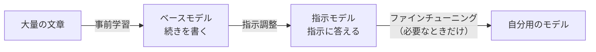

# 06-3 事前学習・指示調整・ファインチューニングの違い

!!! abstract "到達目標"
    - モデルが作られる段階（事前学習・指示調整・ファインチューニング）と、それぞれで何が身につくかを説明できる
    - ベースモデルと指示モデルの違いを、チャットのテンプレートを使って説明できる
    - やりたいことに対して、プロンプト・RAG・ファインチューニングのどれを先に試すかを判断できる

## 何か

公開されている LLM の多くは、次の段階を経て作られています。



| 段階 | 何で学習するか | 身につくこと |
|---|---|---|
| 事前学習 | ウェブや本などの大量の文章（次のトークンを当てる） | 言葉の知識・一般的な知識・文章の続きを書く力 |
| 指示調整 | 「指示と、望ましい答え」の組。人の好みに合わせる調整を加えることも多い | 指示に従って答える・会話の形で答える・断るべきことを断る |
| ファインチューニング | 自分の用途の例（入力と出力の組） | 決まった形式・口調・特定の仕事のやり方 |

事前学習だけのモデルを **ベースモデル**、指示調整まで終えたモデルを **指示モデル**（チャットモデル）と呼びます。
演習で使うのは、指示モデルです。モデルの一覧で `instruct` や `chat` と書かれていたり、何も書かれていなかったりします。
ベースモデルは、`base` や `text` と書かれていることが多いです（呼び方はモデルごとに違うので、説明を読んで確かめます）。

## なぜ必要か

段階の違いを知らないと、次のような誤りをします。

- ベースモデルにチャットで質問し、答えではなく「質問の続き」や「似た質問の一覧」が返ってきて戸惑う
- 「社内の規程を答えられるようにしたいから、ファインチューニングする」と決める。
  実際は、規程を検索してプロンプトに入れる RAG（08）のほうが、安く、更新もしやすい
- モデルが知らないはずのこと（学習した後の出来事・社内の情報）を、もっともらしく答えたのに気づかない

事前学習の文章には、集めた時点までのことしか入っていません。モデルの知識には、この「いつまで」の区切りがあります。

## どうやるか

### チャットのテンプレートを見る

指示モデルは、「system・user・assistant の区切りが入った文章」の続きとして、assistant の答えを書くように学習しています。
こちらが送ったメッセージの一覧は、モデルに渡す前に、区切りを入れた 1 つの文章に組み立てられます。
これを **チャットのテンプレート** と呼びます。

演習のコードの `render_chat` は、架空の区切りで、その組み立てを真似したものです。

<!-- src: examples/src/roadmap_examples/p06_template.py -->
```python title="examples/src/roadmap_examples/p06_template.py"
def render_chat(messages: Sequence[Message]) -> str:
    """メッセージを、区切りを入れた 1 つの文章にする. 最後は assistant の始まりで終え、その続きをモデルに書かせる."""
    parts = [f"<|{m.role}|>\n{m.content}{END}\n" for m in messages]
    return "".join(parts) + "<|assistant|>\n"
```

<!-- src: examples/tests/test_p06_template.py -->
```python title="examples/tests/test_p06_template.py"
def test_render_chat_marks_roles_and_ends_with_assistant() -> None:
    text = render_chat(MESSAGES)
    assert text == "<|system|>\n短く答える<|end|>\n<|user|>\n首都は？<|end|>\n<|assistant|>\n"
```

最後が `<|assistant|>` の始まりで終わっているので、指示モデルは「ここから答えを書く」と読み取ります。
ベースモデルは、この区切りの意味を学習していないので、ただの文章として続きを書きます。

本物の区切りはモデルごとに違います。Ollama では、モデルの詳細（`/api/show`）の `template` で確かめられます
（[公式ドキュメント: モデルの詳細](https://docs.ollama.com/api-reference/show-model-details)・
[Modelfile の TEMPLATE](https://docs.ollama.com/modelfile)）。

```bash
curl http://localhost:11434/api/show -d '{"model": "<モデル名>"}'
```

区切りもトークンになるので、入力のトークン数には区切りの分も入ります（06-1）。

<!-- src: examples/src/roadmap_examples/p06_template.py -->
```python title="examples/src/roadmap_examples/p06_template.py"
def overhead_tokens(messages: Sequence[Message], count: Callable[[str], int]) -> int:
    """区切りのぶん増えるトークン数（組み立てた文章のトークン数 - 中身だけのトークン数）."""
    return count(render_chat(messages)) - sum(count(m.content) for m in messages)
```

メッセージが増えるほど区切りも増えます。短いメッセージを何十件も送ると、区切りの分が無視できなくなります。

### テンプレートを通さずに送る

Ollama の答えを作る API（`/api/generate`）には、テンプレートを通さずに文章をそのまま送る `raw` があります
（[公式ドキュメント: 答えを作る API](https://docs.ollama.com/api/generate)）。

```bash
curl http://localhost:11434/api/generate -d '{
  "model": "<モデル名>",
  "prompt": "日本の首都は",
  "raw": true,
  "stream": false,
  "options": {"num_predict": 30}
}'
```

区切りが無いので、指示モデルでも「質問への答え」ではなく「文章の続き」として書くことがあります。
ベースモデルがいつもしているのは、この「続きを書く」です。演習 3 で、テンプレートありとなしを比べます。

### 何で直すかを決める

モデルの答えに不満があるとき、直す方法は大きく 3 つあります。費用と手間が小さいものから試します。

| やりたいこと | 先に試すこと | 理由 |
|---|---|---|
| 答えの形をそろえたい・手順を守らせたい | プロンプト（07-1）・構造化出力（07-2） | すぐ試せて、元に戻すのも簡単 |
| 社内の資料や最新の情報で答えさせたい | RAG（08） | 資料を差し替えるだけで更新できる。出典も示せる |
| 決まった仕事を、短いプロンプトで、安いモデルで安定してさせたい | ファインチューニング（09） | 例を集める手間と、学習の費用がかかる。資料が変わるたびに学習し直す |

!!! failure "悪い例"
    「備品の貸出の規程に答えるチャットボットを作る。規程を覚えさせるために、規程の文章でファインチューニングする」

    規程が変わるたびに学習し直しになります。モデルが規程のどこを根拠にしたかも示せず、覚え違いに気づきにくくなります。

!!! success "良い例"
    「規程を検索してプロンプトに入れ、出典つきで答えさせる（RAG）。答え方の形がそろわないときは、プロンプトの例示で直す。
    それでも直らない形の問題があるときに、ファインチューニングを検討する」

ファインチューニングの判断と方法は 09 で扱います。

## 演習

1. `overhead_tokens` を使い、同じ中身を「1 件のメッセージにまとめた場合」と「5 件に分けた場合」で、区切りの分のトークン数を比べるテストを書いてください
   （数え方は `len` で構いません）
2. 次の 4 つの要望に、プロンプト・RAG・ファインチューニングのどれを先に試すかと、その理由を書いてください
    - 答えをいつも JSON で返してほしい
    - 先週改訂された社内の旅費の規程に答えてほしい
    - 問い合わせの分類を、いまより小さく安いモデルで、同じ精度でしたい
    - 答えの最後に、いつも担当の窓口を書き添えてほしい
3. 任意: Ollama で、使う予定のモデルの `template` を `/api/show` で表示し、system・user・assistant の区切りに当たる部分を探してください。
   さらに、同じ文章を `/api/generate` で `raw` あり・なしで送り、答えの違いを比べます

- できたことの確かめ方: `uv run pytest` が通る。2 は、4 つの要望ごとの判断と理由。3 は、区切りの部分の抜き出しと、答えの違いのメモ
- 目安の時間: 2 時間

解答: [06-3 の解答](answers/06-3.md)

## もし〇〇がなかったら？

**指示調整がなかったら**、モデルは「指示に答える」ことを知らず、質問の続きを書くだけです。
同じことをさせるには、「質問: …\n答え:」のような文章の型と例をたくさん並べ、続きとして答えを書かせる工夫が要ります。

**段階の違いを知らなかったら**、知識を足したいときに、いきなりファインチューニングを選びがちです。
例を集めて学習し、資料が変わるたびに学習し直す手間をかけた末に、RAG なら数日で済んだと分かることになります。

## 理解度チェック

1. ベースモデルと指示モデルの違いは何ですか。

    ??? note "答え"
        ベースモデルは事前学習だけを終えたモデルで、渡された文章の続きを書きます。
        指示モデルは、さらに指示と答えの組で調整されていて、会話の区切りの後に答えを書くように学習しています。

2. チャットのテンプレートとは何ですか。入力のトークン数とどう関係しますか。

    ??? note "答え"
        メッセージの一覧を、役割の区切りを入れた 1 つの文章に組み立てる決まりです。モデルごとに違います。
        区切りもトークンになるので、入力のトークン数は、メッセージの中身だけより多くなります。

3. 社内の規程に答えさせたいとき、ファインチューニングより RAG を先に試すのはなぜですか。

    ??? note "答え"
        規程が変わっても資料を差し替えるだけで済み、答えの根拠（出典）も示せるからです。
        ファインチューニングは、変わるたびに学習し直しが要り、どこを根拠にしたかも示せません。

4. モデルが、学習した後の出来事についてもっともらしく答えることがあるのはなぜですか。

    ??? note "答え"
        事前学習の文章は、集めた時点までのものだからです。知らないことでも、次のトークンを確率で選ぶ仕組みなので、
        それらしい文章を作ってしまいます。最新の情報が要るときは、RAG やツール（07-3）で渡します。
