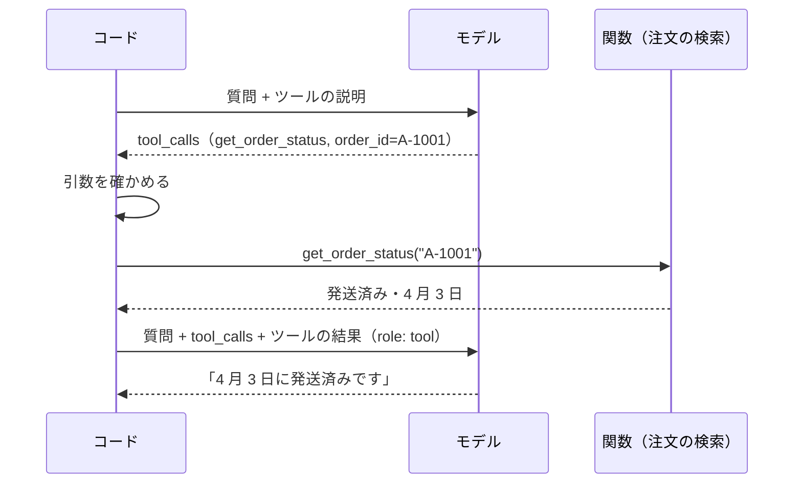

# 07-3 関数呼び出しとツール使用

!!! abstract "到達目標"
    - ツール使用（関数呼び出し）の往復を、メッセージの形まで説明できる
    - ツールの説明を JSON スキーマで書き、モデルが返した引数を確かめてから実行するコードを書ける
    - どのツールをモデルに渡してよいか（読むだけか、書き換えるか）を判断できる

## 何か

ツール使用（tool use、関数呼び出し・function calling とも呼びます）は、
モデルに「この関数を、この引数で呼んでほしい」と答えさせる仕組みです。

大事な点は、**モデルは関数を実行しない** ことです。モデルが返すのは、関数の名前と引数の JSON だけです。
実行するかどうか、どう実行するかは、いつもこちらのコードが決めます。



## なぜ必要か

LLM が知っているのは、学習したときまでの一般的な知識だけです。
「注文 A-1001 はいつ届くか」は、こちらのデータベースを見ないと答えられません。

全部の注文をプロンプトに入れるわけにはいきません。費用がかかり、コンテキスト（06）にも入りきりません。
ツール使用なら、モデルが「何を調べればよいか」を決め、こちらのコードが必要な分だけを調べて返せます。

これは 10 のエージェントの土台です。エージェントは、この往復を、答えが出るまで繰り返すものです。

## どうやるか

### ツールの説明を書く

ツールは、名前・説明・引数の JSON スキーマで説明します。モデルは説明の文章を読んで、どのツールを使うかを決めます。
Ollama のチャットの API には、`tools` に次の形で渡します（[公式ドキュメント: チャットの API](https://docs.ollama.com/api/chat) の `tools`）。

<!-- src: examples/src/roadmap_examples/p07_tools.py -->
```python title="examples/src/roadmap_examples/p07_tools.py"
    def spec(self) -> dict[str, Any]:
        """モデルに渡すツールの説明（Ollama の tools の形）."""
        return {
            "type": "function",
            "function": {"name": self.name, "description": self.description, "parameters": self.parameters},
        }
```

演習の題材は、架空の注文を調べるツールと、よくある質問を探すツールです。

<!-- src: examples/src/roadmap_examples/p07_tools.py -->
```python title="examples/src/roadmap_examples/p07_tools.py"
SUPPORT_TOOLS = [
    Tool(
        "get_order_status",
        "注文番号から、注文の状態（発送済み・準備中など）と発送日を調べる",
        {
            "type": "object",
            "properties": {"order_id": {"type": "string", "description": "注文番号（例: A-1001）"}},
            "required": ["order_id"],
            "additionalProperties": False,
        },
        get_order_status,
    ),
    Tool(
        "search_faq",
        "よくある質問から、キーワードに合う回答を探す",
        {
            "type": "object",
            "properties": {"keyword": {"type": "string", "description": "探す語（例: 領収書）", "minLength": 1}},
            "required": ["keyword"],
            "additionalProperties": False,
        },
        search_faq,
    ),
]
```

ツール使用に対応していないモデルもあります。Ollama のモデルの一覧では、
[tools で絞り込んだ一覧](https://ollama.com/search?c=tools) から選んでください。

### 往復を回す

モデルが `tool_calls` を返したら、次の順に処理します。

1. モデルの答え（`tool_calls` つき）を会話に足す
2. ツールを実行し、結果を `role` が `tool` のメッセージで足す（`tool_name` にツールの名前）
3. もう一度モデルを呼ぶ

ツールの結果の形は、Ollama の公式ドキュメントに合わせています
（[公式ドキュメント: ツール呼び出し](https://docs.ollama.com/capabilities/tool-calling)）。

<!-- src: examples/src/roadmap_examples/p07_tools.py -->
```python title="examples/src/roadmap_examples/p07_tools.py"
    for step in range(1, max_steps + 1):
        turn = chat.chat(history, specs)
        tokens_in += turn.input_tokens
        tokens_out += turn.output_tokens
        if not turn.tool_calls:
            history.append({"role": "assistant", "content": turn.text})
            return ToolRun(turn.text, history, step, tokens_in, tokens_out)
        history.append(
            {
                "role": "assistant",
                "content": turn.text,
                "tool_calls": [{"function": {"name": c.name, "arguments": c.arguments}} for c in turn.tool_calls],
            }
        )
        for call in turn.tool_calls:
            history.append({"role": "tool", "tool_name": call.name, "content": call_tool(registry, call)})
    raise ToolLoopError(f"{max_steps} 回の往復で答えが出ませんでした")
```

往復の回数には上限（`max_steps`）を設けます。モデルが同じツールを呼び続けても、ここで止まります。

### 引数を確かめてから実行する

モデルが返す引数は、モデルが作った文章です。07-2 と同じく、スキーマで確かめてから使います。
知らないツールの名前や、誤った引数は、実行せずに誤りの内容をモデルに返します。
モデルはそれを読んで、引数を直して呼び直せます。

<!-- src: examples/src/roadmap_examples/p07_tools.py -->
```python title="examples/src/roadmap_examples/p07_tools.py"
def call_tool(tools: dict[str, Tool], call: ToolCall) -> str:
    """1 回分のツールを実行し、結果を JSON の文字列にする. 誤りもモデルに返す（直して呼び直せるように）."""
    tool = tools.get(call.name)
    if tool is None:
        return json.dumps({"error": f"ツール「{call.name}」はありません"}, ensure_ascii=False)
    problems = validate(call.arguments, tool.parameters)
    if problems:
        return json.dumps({"error": "引数が正しくありません", "details": problems}, ensure_ascii=False)
    try:
        result = tool.func(**call.arguments)
    except (KeyError, ValueError) as e:
        return json.dumps({"error": str(e)}, ensure_ascii=False)
    return json.dumps(result, ensure_ascii=False)
```

!!! failure "悪い例"
    ```python
    for call in turn.tool_calls:
        result = globals()[call.name](**call.arguments)
    ```

    モデルが返した名前で、どの関数でも呼べてしまいます。`delete_order` のような関数がファイルにあれば、それも呼ばれます。
    呼べるツールは、渡した一覧（`registry`）の中だけにします。

### テストは偽のモデルで書く

往復の流れは、決まった `ChatTurn` を順に返す `FakeToolChat` で確かめます。
1 回目に「ツールを呼ぶ」、2 回目に「答える」を返させ、2 回目に渡されたメッセージを調べます。

<!-- src: examples/tests/test_p07_tools.py -->
```python title="examples/tests/test_p07_tools.py"
def test_run_with_tools_executes_call_and_returns_answer() -> None:
    chat = FakeToolChat(
        [
            ChatTurn("", [ToolCall("get_order_status", {"order_id": "A-1001"})], 100, 20),
            ChatTurn("4 月 3 日に発送済みです。", [], 150, 15),
        ]
    )
    run = run_with_tools(chat, QUESTION, SUPPORT_TOOLS)
    assert run.text == "4 月 3 日に発送済みです。"
    assert (run.steps, run.input_tokens, run.output_tokens) == (2, 250, 35)
    # 2 回目の呼び出しには、モデルの tool_calls と、ツールの結果（role: tool）が入っている
    second = chat.calls[1]
    assert second[1]["tool_calls"][0]["function"]["name"] == "get_order_status"
    assert second[2]["role"] == "tool"
    assert second[2]["tool_name"] == "get_order_status"
    assert json.loads(second[2]["content"])["status"] == "発送済み"
```

本物のモデルで試すときは、`OllamaChat` の `chat` を使います。

```python
from roadmap_examples.ollama_client import OllamaChat
from roadmap_examples.p07_tools import SUPPORT_TOOLS, run_with_tools

chat = OllamaChat("<ツールに対応したモデル名>", options={"temperature": 0})
run = run_with_tools(chat, [{"role": "user", "content": "注文 A-1001 はもう届きますか？"}], SUPPORT_TOOLS)
print(run.text, run.steps, run.input_tokens, run.output_tokens)
```

### 渡してよいツールを決める

ツールは「読むだけ」と「書き換える」に分けて考えます。

| 種類 | 例 | モデルに渡すか |
|---|---|---|
| 読むだけ | 注文の状態を調べる・よくある質問を探す | 渡してよい（誤って呼ばれても、データは変わらない） |
| 書き換える | 注文を取り消す・返金する・課題を起票する | この章では渡さない。10 で、実行の前に人が承認する形にする |

モデルは、問い合わせ文に書かれた指示（「注文を取り消して」）に従ってツールを選ぶこともあります。
書き換えるツールを、確認なしに渡してはいけません。

## 演習

1. 会員番号から、契約中のプラン名と次の更新日を返すツール `get_plan(member_id)` を足してください。
   データは `ORDERS` と同じように、架空の辞書でかまいません。無い会員番号は `KeyError` にします
2. `FakeToolChat` で、次の流れのテストを書いてください
    - 1 回目: モデルが存在しない会員番号で `get_plan` を呼ぶ
    - 2 回目: モデルが正しい会員番号で呼び直す
    - 3 回目: モデルが答える
    - 確かめること: 2 回目の呼び出しに渡されたツールの結果に `error` があること、答えまでの往復が 3 回であること
3. 任意: Ollama のツールに対応したモデルで、「会員 M-001 のプランの更新日は？」と聞き、どのツールが呼ばれたかを記録してください

- できたことの確かめ方: `uv run pytest` が通る
- 目安の時間: 2 時間

解答: [07-3 の解答](answers/07-3.md)

## もし〇〇がなかったら？

**ツール使用がなかったら**、モデルに注文の状態を答えさせるには、全部の注文をプロンプトに入れるしかありません。
費用がかかり、すぐにコンテキストの上限に達します。入れなければ、モデルはもっともらしい日付を作って答えます。

**引数の検証と往復の上限がなかったら**、モデルが作った誤った引数で関数が落ちたり、
同じツールを呼び続けて止まらなくなったりします。止まらない往復は、そのまま費用になります。

## 理解度チェック

1. ツール使用で、関数を実行するのはモデルとコードのどちらですか。

    ??? note "答え"
        コードです。モデルは関数の名前と引数を JSON で返すだけです。実行するか、どう実行するかはコードが決めます。

2. ツールの結果を返すメッセージの `role` は何ですか。結果の前に、会話に何を足しておきますか。

    ??? note "答え"
        `role` は `tool` です（`tool_name` にツールの名前）。その前に、モデルの答え（`tool_calls` つきの assistant のメッセージ）を足します。
        モデルは「自分がどのツールを呼んだか」と「その結果」を並べて読みます。

3. 誤った引数のときに、例外で止めずに誤りの内容をモデルに返すのはなぜですか。

    ??? note "答え"
        モデルが誤りを読んで、引数を直して呼び直せるからです。往復の上限があるので、直らなければそこで止まります。

4. 「注文を取り消す」ツールを、この章のやり方でモデルに渡してはいけないのはなぜですか。

    ??? note "答え"
        データを書き換えるツールだからです。モデルが誤って、または問い合わせ文の指示に従って呼ぶと、取り消しが実際に起きます。
        書き換えるツールは、実行の前に人が承認する形（10）にします。
