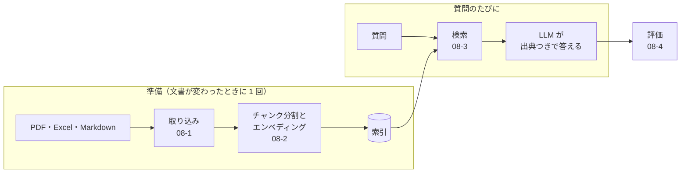

# 08-1 文書の取り込み（PDF・Excel を Markdown に）

!!! abstract "到達目標"
    - RAG（検索してから答える仕組み）の全体の流れと、取り込みの役目を説明できる
    - PDF と Excel から文字と表を取り出し、見出しつきの Markdown にそろえるコードを書ける
    - 取り込みで情報が落ちる場面（画像だけの PDF・結合したセル・数式）を見つけて、扱いを決められる

## 何か

RAG（Retrieval-Augmented Generation、検索拡張生成）は、質問に関係する資料を検索し、その資料を LLM に渡して答えさせる仕組みです。
08 では、架空の「備品貸出システム」の設計書に、出典つきで答える Q&A を作ります。



この章は、最初の「取り込み」です。形式がばらばらの文書を、同じ形（見出しつきの Markdown）にそろえます。

- PDF: ページごとに文字を取り出し、「ページ N」の見出しを付ける
- Excel: シートごとに、Markdown の表にする
- Markdown: そのまま使う

題材の設計書は `examples/data/p08/docs/` にあります（すべて架空です）。

## なぜ必要か

業務の文書は、PDF・Excel・Word・Wiki のように形式がばらばらです。
後ろの処理（分割・検索・生成）を形式ごとに作ると、手間が形式の数だけ増えます。
最初に 1 つの形にそろえれば、後ろの処理は 1 つで済みます。Java でいえば、入力を共通の DTO に詰め替えてから処理するのと同じです。

Markdown を選ぶ理由は 3 つです。

- 見出し（`#`）が残るので、チャンク分割（08-2）で区切りに使え、出典に「どの節か」を示せる
- 表を表のまま書ける。LLM も Markdown の表を読みやすい
- 人が開いて、取り込みの結果を目で確かめられる

## どうやるか

### PDF から文字を取り出す

PDF の読み込みには pypdf を使います。ページごとに `extract_text()` で文字を取り出します
（[公式ドキュメント: 文字の取り出し](https://pypdf.readthedocs.io/en/stable/user/extract-text.html)）。

<!-- src: examples/src/roadmap_examples/p08_ingest.py -->
```python title="examples/src/roadmap_examples/p08_ingest.py"
def pdf_to_markdown(path: Path) -> str:
    """ページごとに「## ページ N」の見出しを付ける（出典にページを示せるように）."""
    reader = PdfReader(path)
    parts = [f"# {path.stem}"]
    for number, page in enumerate(reader.pages, 1):
        text = (page.extract_text() or "").strip()
        parts.append(f"## ページ {number}\n\n{text or EMPTY_PAGE}")
    return "\n\n".join(parts) + "\n"
```

PDF には「ここが見出し」「ここが表」という情報がふつうは入っていません。文字が、紙の上の位置に置かれているだけです。
公式ドキュメントも、表は位置を決めて置いた文字にすぎず、行と列を取り出すのは難しいと書いています。そのため:

- 取り出した文字の並びや空白が、見た目と違うことがある
- 表は、行と列が崩れた文字の並びになることが多い
- スキャンした紙のような、画像だけのページからは文字を取り出せない。OCR（画像から文字を読む処理）が要る

画像だけのページは、空のままにせず、「取り出せなかった」と書いておきます。
空のままだと、検索で見つからない理由（そもそも文字が無い）に、後で気づけません。

### Excel を Markdown の表にする

Excel の読み込みには openpyxl を使います。`iter_rows(values_only=True)` で、セルの値だけを行ごとに読みます
（[公式ドキュメント: チュートリアル](https://openpyxl.readthedocs.io/en/stable/tutorial.html)）。

<!-- src: examples/src/roadmap_examples/p08_ingest.py -->
```python title="examples/src/roadmap_examples/p08_ingest.py"
def xlsx_to_markdown(path: Path) -> str:
    """シートごとに「## シート名」の見出しと表を書く. 空の行は飛ばす."""
    workbook = load_workbook(path, read_only=True, data_only=True)
    try:
        parts = [f"# {path.stem}"]
        for sheet in workbook.worksheets:
            rows = [[cell_text(v) for v in row] for row in sheet.iter_rows(values_only=True)]
            rows = [r for r in rows if any(r)]
            table = rows_to_table(rows)
            parts.append(f"## {sheet.title}\n\n{table or '（空のシート）'}")
    finally:
        workbook.close()  # 読み取り専用のブックは、明示して閉じる（公式ドキュメント）
    return "\n\n".join(parts) + "\n"
```

- `data_only=True`: 数式のセルは、数式ではなく、最後に Excel で保存したときの値を読みます。
  Excel で開いて保存していないファイル（プログラムで作ったものなど）は、値が入っていないことがあります
- `read_only=True`: 大きなファイルも少ないメモリで読めます。読み取り専用のブックは `close()` で閉じます
  （[公式ドキュメント: 読み取り専用の読み込み](https://openpyxl.readthedocs.io/en/stable/optimized.html)）

セルの値は、Markdown の表を壊さない形にします。`|` は `\|` に、セルの中の改行は空白にします。

!!! failure "悪い例"
    ```python
    rows = [str(row) for row in sheet.iter_rows(values_only=True)]
    ```

    `('E-101', '入力の形が正しくない', None)` のような Python の表記がそのまま本文になります。
    `None` や引用符が検索の語に混じり、列の見出しとの対応も分からなくなります。

結合したセルは、左上のセルにだけ値が入り、ほかは空として読まれます。
設計書の Excel では結合がよく使われるので、取り込んだ表を開いて、意味が崩れていないかを確かめます。
結合したセルと、Excel で保存していない数式の値が落ちることは、テストで確かめています。

<!-- src: examples/tests/test_p08_ingest.py -->
```python title="examples/tests/test_p08_ingest.py"
    markdown = xlsx_to_markdown(path)
    assert "| 貸出期間 |  | 延長は 1 回 |" in markdown  # 「14 日」は結合で消えた
    assert "## 数式\n\n| 合計 |\n|---|" in markdown  # 数式のセルの値は空（右端の空の列は落ちる）
```

### フォルダをまとめて取り込む

形式ごとの変換を辞書にまとめ、フォルダの中を順に変換します。
読めないファイルが 1 つあっても止めずに続け、最後に一覧で知らせます。

<!-- src: examples/src/roadmap_examples/p08_ingest.py -->
```python title="examples/src/roadmap_examples/p08_ingest.py"
CONVERTERS = {
    ".pdf": pdf_to_markdown,
    ".xlsx": xlsx_to_markdown,
    ".md": lambda path: path.read_text(encoding="utf-8-sig"),
}
```

```bash
uv run python -m roadmap_examples.p08_ingest <取り込む文書のフォルダ> <Markdown を書くフォルダ>
```

テストでは、PDF と Excel をテストの中で作ってから変換します（`examples/tests/test_p08_ingest.py`）。
空の行を飛ばすこと、`|` を逃がすこと、文字の無いページに印を付けることを確かめています。

<!-- src: examples/tests/test_p08_ingest.py -->
```python title="examples/tests/test_p08_ingest.py"
def test_pdf_to_markdown_adds_page_headings(tmp_path: Path) -> None:
    path = tmp_path / "error-codes.pdf"
    path.write_bytes(make_pdf([["Error codes", "E-101 invalid input"], []]))
    markdown = pdf_to_markdown(path)
    assert markdown.startswith("# error-codes\n")
    assert "## ページ 1" in markdown
    assert "E-101 invalid input" in markdown
    assert f"## ページ 2\n\n{EMPTY_PAGE}" in markdown  # 文字の無いページ（スキャンした紙など）
```

### 取り込みの結果を目で見る

取り込みは、自動のテストだけでは品質を保てません。元の文書と並べて、次を確かめます。

| 確かめること | よくある崩れ |
|---|---|
| 見出しが残っているか | PDF では見出しも本文と同じ文字になる |
| 表の行と列が合っているか | PDF の表は 1 列に並ぶ。Excel の結合したセルは空になる |
| 文字が抜けていないか | 画像だけのページ・図の中の文字 |
| 余計なものが混じっていないか | ページ番号・ヘッダー・フッターが本文に混じる |

崩れが多い文書は、元の形式で直す（Excel を Markdown で書き直す、など）ほうが、後の工程が楽になることもあります。

## 演習

1. 架空の「エラーコード一覧」の Excel を、openpyxl で作ってください（1 枚目のシートに 3 行以上。1 つのセルに改行を入れる）
2. `xlsx_to_markdown` で Markdown にし、表の行数と、改行が空白になったことをテストで確かめてください
3. Excel の 2 枚目のシートに `=1+1` の数式を書いて保存し、`xlsx_to_markdown` の結果を見てください。
   値が空になる理由を、`data_only=True` の説明から考えてください

- できたことの確かめ方: `uv run pytest` が通る。3 は、結果と理由の説明
- 目安の時間: 2 時間

解答: [08-1 の解答](answers/08-1.md)

## もし〇〇がなかったら？

**取り込みで形をそろえなかったら**、PDF 用・Excel 用・Word 用の分割と検索を、それぞれ作ることになります。
しかも、PDF のページ番号や Excel のシート名のような「どこに書いてあったか」が形式ごとにばらばらになり、出典を同じ形で示せません。

**取り込みの結果を確かめなかったら**、画像だけのページや崩れた表は、検索で見つからないまま気づかれません。
「資料に書いてあるのに、答えられない」原因が、検索や LLM ではなく取り込みにあることは、よくあります。

## 理解度チェック

1. PDF の表を取り込むと、行と列が崩れやすいのはなぜですか。

    ??? note "答え"
        PDF にはふつう「ここが表」という情報が無く、文字が紙の上の位置に置かれているだけだからです。
        取り出すときに、どの文字が同じ行・同じ列かを、位置から推測するしかありません。

2. 画像だけのページを、空のままにせず「取り出せなかった」と書くのはなぜですか。

    ??? note "答え"
        答えられない原因が「そもそも文字が無い」ことに、後で気づけるようにするためです。
        空のままだと、検索や LLM の誤りと区別がつきません。

3. `data_only=True` で読んだ数式のセルが、空になることがあるのはなぜですか。

    ??? note "答え"
        `data_only=True` は、最後に Excel で保存したときの値を読むからです。
        プログラムで作って Excel で一度も開いていないファイルには、その値が入っていません。

4. 取り込んだ文書に、ページやシートの見出しを付けるのはなぜですか。

    ??? note "答え"
        チャンク分割で区切りに使い、答えの出典に「どのページ（シート）か」を示せるようにするためです。
