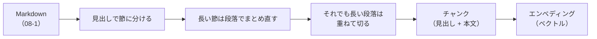

# 08-2 チャンク分割とエンベディング

!!! abstract "到達目標"
    - 文書をチャンク（検索の単位）に分ける理由と、大きさ・重なりの決め方を説明できる
    - 見出しで区切り、見出しをチャンクに残す分割のコードを書ける
    - エンベディングの性質（同じモデルで作る・長さをそろえて比べる）を踏まえて、ベクトルを作って比べられる

## 何か

チャンク分割は、文書を検索の単位となる小さなかたまり（チャンク）に分けることです。
エンベディングは、文章を数の並び（ベクトル）にしたものです。意味の近い文章ほど、近いベクトルになるように作られています（06 で扱いました）。



この教材では、チャンクに次の 4 つを持たせます。

<!-- src: examples/src/roadmap_examples/p08_chunk.py -->
```python title="examples/src/roadmap_examples/p08_chunk.py"
@dataclass(frozen=True)
class Chunk:
    id: str  # 例: 02-api.md#3
    source: str  # 文書のファイル名
    heading: str  # 例: 備品貸出システム 設計書: API > 呼び出しの回数の制限
    text: str  # 検索と生成に使う本文（見出しを先頭に付ける）

    @property
    def cite(self) -> str:
        """出典の表示（文書 > 見出し）."""
        return f"{self.source} > {self.heading}" if self.heading else self.source
```

## なぜ必要か

文書を丸ごと 1 件として扱うと、次のことに困ります。

- 1 つの文書に、認証・制限・エラーコードのように話題がいくつもある。文書全体のベクトルは、どの話題にも中途半端に近くなる
- 検索で当たった文書を丸ごとプロンプトに入れると、トークンが増え（07-4）、関係の無い文章が LLM の答えを迷わせる
- 出典を「どの文書か」までしか示せない。「どの節か」まで示すほうが、人が確かめやすい

逆に、細かく分けすぎても困ります。「上限は 60 回」だけのチャンクでは、何の上限なのかが分かりません。
だから、見出しで区切り、見出しをチャンクに残します。

## どうやるか

### 見出しで節に分ける

Markdown の見出し（`#`）を区切りにし、「親の見出し > 子の見出し」の並びを覚えておきます。
コードブロックの中の `#`（シェルのコメントなど）は、見出しとみなしません。

<!-- src: examples/src/roadmap_examples/p08_chunk.py -->
```python title="examples/src/roadmap_examples/p08_chunk.py"
def split_sections(markdown: str) -> list[tuple[str, str]]:
    """（見出しの並び, 本文）の一覧. コードブロックの中の # は見出しとみなさない."""
    sections: list[tuple[str, str]] = []
    path: list[str] = []
    body: list[str] = []
    in_code = False

    def flush() -> None:
        text = "\n".join(body).strip()
        if text:
            sections.append((" > ".join(path), text))
        body.clear()

    for line in markdown.splitlines():
        if line.lstrip().startswith("```"):
            in_code = not in_code
        level = len(line) - len(line.lstrip("#"))
        if not in_code and 1 <= level <= 6 and line[level : level + 1] == " ":
            flush()
            path[:] = path[: level - 1] + [line[level:].strip()]
            continue
        body.append(line)
    flush()
    return sections
```

### 長い節を、段落と重なりで分ける

節が長いときは、段落（空行の区切り）をまとめて、決めた文字数（`max_chars`）以下にします。
それでも長い段落だけを、文字数で切ります。切るときは、前のかたまりの終わりを `overlap` 文字だけ重ねます。
文の途中で切れても、どちらかのかたまりに、切れ目の前後がそろって入るようにするためです。

<!-- src: examples/src/roadmap_examples/p08_chunk.py -->
```python title="examples/src/roadmap_examples/p08_chunk.py"
def split_long(text: str, max_chars: int, overlap: int) -> list[str]:
    """max_chars ごとに切る. 次のかたまりは、前のかたまりの最後の overlap 文字から始める."""
    step = max_chars - overlap
    return [text[i : i + max_chars] for i in range(0, max(len(text) - overlap, 1), step)]
```

最後に、各かたまりの先頭に見出しの並びを付けます。「上限は 60 回」が「API > 呼び出しの回数の制限」の下にあると分かり、
検索でも生成でも手がかりになります。

<!-- src: examples/src/roadmap_examples/p08_chunk.py -->
```python title="examples/src/roadmap_examples/p08_chunk.py"
def chunk_markdown(markdown: str, source: str, max_chars: int = 400, overlap: int = 50) -> list[Chunk]:
    if not 0 <= overlap < max_chars:
        raise ValueError("overlap は 0 以上、max_chars 未満にしてください")
    markdown = markdown.replace("\r\n", "\n")  # Windows の改行（CRLF）でも、空行で段落を分けられるように
    chunks: list[Chunk] = []
    for heading, body in split_sections(markdown):
        for piece in split_text(body, max_chars, overlap):
            text = f"{heading}\n{piece}" if heading else piece
            chunks.append(Chunk(f"{source}#{len(chunks) + 1}", source, heading, text))
    return chunks
```

!!! failure "悪い例"
    ```python
    chunks = [text[i : i + 400] for i in range(0, len(text), 400)]
    ```

    見出しも段落も無視して、400 文字ごとに切っています。表の途中や文の途中で切れ、
    「何の話か」が分からないかたまりができます。重なりも無いので、切れ目にまたがる答えはどちらにも入りません。

### 大きさと重なりの決め方

`max_chars` と `overlap` に、どんな文書にも合う正解はありません。評価（08-4）で比べて決めます。

| 大きさ | 良い点 | 困る点 |
|---|---|---|
| 小さい（100〜200 文字） | 検索がピンポイントで当たる | 文脈が足りない。答えに要る情報が複数のチャンクに散る |
| 大きい（800 文字〜） | 文脈がそろう | 関係の無い文章が混じり、検索も生成もぼやける。トークンが増える |

この教材の設計書は節が短いので、`max_chars=400` で、ほとんどの節が 1 つのチャンクになります。
テストで、題材の設計書のチャンクが 400 文字（と見出し）以下に収まることを確かめています。

### エンベディングを作る

エンベディングは、エンベディング用のモデルで作ります。Ollama では `/api/embed` に、文章の一覧を渡します
（[公式ドキュメント: エンベディングの API](https://docs.ollama.com/api/embed)）。
モデルは [エンベディングのモデルの一覧](https://ollama.com/search?c=embedding) から選び、`ollama pull <モデル名>` で取ってきます。

<!-- src: examples/src/roadmap_examples/ollama_client.py -->
```python title="examples/src/roadmap_examples/ollama_client.py"
    def embed(self, texts: Sequence[str]) -> list[list[float]]:
        if not texts:
            return []
        data = self.transport.post_json(
            f"{self.base_url.rstrip('/')}/api/embed", {"model": self.model, "input": list(texts)}, self.timeout
        )
        vectors = data.get("embeddings", [])
        if len(vectors) != len(texts):
            raise ValueError(f"エンベディングの数が合いません（送った {len(texts)} 件 / 返った {len(vectors)} 件）")
        return [[float(x) for x in v] for v in vectors]
```

エンベディングを使うときの決まりごとです。

- **質問とチャンクは、同じモデルで作る**。モデルが違うと、ベクトルの意味がそろわず、比べられない
- **モデルを替えたら、チャンクのベクトルを全部作り直す**。どのモデルで作ったかを、索引と一緒に記録しておく
- **長さをそろえてから比べる**。ベクトルの長さを 1 にそろえると、内積がコサイン類似度（向きの近さ）になる。
  返るベクトルの長さがそろっているかは、公式ドキュメントに書かれていないので、自分でそろえる（08-3 の `normalize`）
- モデルの説明ページに、質問と文書に付ける決まった前置きが書かれていることがある。書かれていれば従う

テストでは、本物のエンベディングの代わりに `FakeEmbedder` を使います。
2 文字ずつの組を数えるだけなので意味は分かりませんが、毎回同じベクトルになり、ネットワークも使いません。
「意味の近さ」を確かめるのは、本物のモデルで動かす評価（08-4）の役目です。

## 演習

1. `chunk_markdown` を、題材の設計書 `02-api.md` に `max_chars` を 100・400・1000 にして当て、チャンクの数を比べてください
2. 次の 2 つをテストで確かめてください
    - `max_chars=100` のとき、どのチャンクも本文（見出しを除く）が 100 文字以下
    - どの `max_chars` でも、元の本文の「1 分間に 60 回まで」が、どれかのチャンクに切れずに入っている
3. 任意: Ollama のエンベディングのモデルで、「API は 1 分間に何回まで呼べますか？」と各チャンクのコサイン類似度を計算し、
   上位 3 件を `max_chars` ごとに比べてください

- できたことの確かめ方: `uv run pytest` が通る。3 は、上位 3 件の表と、使ったモデル名
- 目安の時間: 2 時間

解答: [08-2 の解答](answers/08-2.md)

## もし〇〇がなかったら？

**チャンク分割がなかったら**、文書を丸ごと検索し、丸ごとプロンプトに入れることになります。
長い文書ほどトークンが増え、関係の無い節に引きずられた答えが増えます。出典も「この文書のどこか」としか示せません。

**チャンクに見出しを残さなかったら**、「上限は 60 回」だけのチャンクが、何の上限なのか分からなくなります。
「バッチの再実行は何回か」という質問に、API の上限のチャンクが当たってしまうこともあります。

## 理解度チェック

1. チャンクを小さくしすぎると、何に困りますか。

    ??? note "答え"
        文脈が足りなくなります。答えに要る情報が複数のチャンクに散り、検索で全部を集められないことがあります。
        「何の話か」が分からないかたまりも増えます。

2. 長い段落を切るときに、重なり（overlap）を設けるのはなぜですか。

    ??? note "答え"
        切れ目にまたがる文が、どちらかのかたまりに、前後がそろって入るようにするためです。
        重なりが無いと、切れ目の文はどちらのかたまりでも途中で切れます。

3. エンベディングのモデルを替えたら、チャンクのベクトルを作り直すのはなぜですか。

    ??? note "答え"
        モデルが違うと、ベクトルの意味（どの方向が何を表すか）がそろわず、質問のベクトルと比べられないからです。

4. ベクトルの長さを 1 にそろえてから内積を取るのはなぜですか。

    ??? note "答え"
        長さをそろえると、内積がコサイン類似度（向きの近さ）になるからです。
        そろえないと、長い（値の大きい）ベクトルほど、向きと関係なく点が高くなります。
