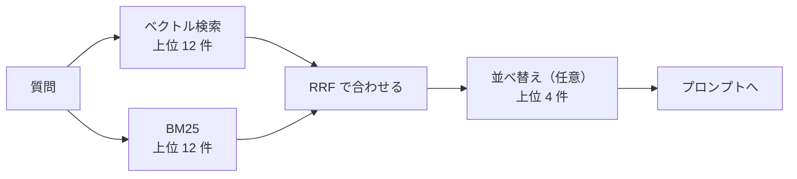

# 08-3 ベクトル検索・ハイブリッド検索・並べ替え

!!! abstract "到達目標"
    - ベクトル検索とキーワード検索（BM25）の得意・不得意を説明できる
    - 2 つの検索の結果を、順位で合わせる（RRF）コードを書ける
    - 並べ替え（リランク）を足すかどうかを、精度と費用から判断できる

## 何か

検索は、質問に関係するチャンクを上から k 件選ぶ処理です。この章では 3 つの探し方と、その後の並べ替えを扱います。

| 探し方 | 比べるもの | 得意 | 不得意 |
|---|---|---|---|
| ベクトル検索 | エンベディングの向きの近さ | 言い換え（「呼びすぎたら」と「回数の制限」） | 型番やコード（`E-302`）のような、意味の薄い語 |
| キーワード検索（BM25） | 語の重なり | 型番・コード・固有の用語 | 言い換え（同じ語が無いと当たらない） |
| ハイブリッド検索 | 2 つの順位を合わせる | 両方の得意を足す | 2 回探すぶん、少し遅い |

並べ替え（リランク）は、検索で多めに取った候補を、もっと丁寧な方法で採点し直して、上位だけを残すことです。



## なぜ必要か

設計書への質問には、2 種類が混じります。

- 「API を呼びすぎたらどうなる？」: 資料には「呼び出しの回数の制限」「429」と書いてあり、質問と同じ語が少ない
- 「E-302 はどんなとき？」: コードそのものが手がかり。意味の近さでは、ほかのエラーコードと区別しにくい

ベクトル検索だけでは後者を、キーワード検索だけでは前者を取りこぼします。
検索で外れたチャンクは、LLM には届きません。どれだけ良いモデルを使っても、届かない資料からは答えられません。

## どうやるか

### ベクトル検索

チャンクのベクトルを行列にまとめ、各行の長さを 1 にそろえておきます。
質問のベクトルとの内積が、そのままコサイン類似度になります。数千件までなら、NumPy で全件と比べても十分に速く動きます。

<!-- src: examples/src/roadmap_examples/p08_search.py -->
```python title="examples/src/roadmap_examples/p08_search.py"
def normalize(matrix: np.ndarray) -> np.ndarray:
    """各行の長さを 1 にする（長さ 0 の行はそのまま）. 内積がそのままコサイン類似度になる."""
    norms = np.linalg.norm(matrix, axis=1, keepdims=True)
    return matrix / np.where(norms == 0, 1.0, norms)


class VectorIndex:
    def __init__(self, embedder: Embedder, chunks: Sequence[Chunk]) -> None:
        self.embedder = embedder
        self.chunks = list(chunks)
        vectors = embedder.embed([c.text for c in self.chunks])
        self.matrix = normalize(np.asarray(vectors, dtype=np.float64).reshape(len(self.chunks), -1))

    def search(self, query: str, k: int) -> list[Hit]:
        q = normalize(np.asarray(self.embedder.embed([query]), dtype=np.float64))[0]
        scores = self.matrix @ q
        order = np.argsort(-scores, kind="stable")[:k]
        return [Hit(self.chunks[i], float(scores[i])) for i in order]
```

件数が数十万を超える、複数のサーバーで共有する、文書を頻繁に足し引きする、といった場合は、ベクトル用のデータベースを使います。
専用の製品のほか、ふだん使っているデータベースに拡張を入れてベクトルを扱う方法もあります。
どれを使っても「ベクトルを入れ、近い順に k 件取る」という役目は同じなので、この章の `VectorIndex` と差し替えられる形にしておきます。
製品を選ぶときは、件数・更新の頻度・絞り込み（文書の種類や権限で絞る）の要否・運用の手間で比べます。

### キーワード検索（BM25）

BM25 は、キーワード検索の代表的な採点の式です。次の 3 つで点を決めます。

- 質問の語が、チャンクに何回出るか（多いほど高い。ただし回数が増えるほど伸びは鈍る。`k1` で調整）
- その語が、ほかのチャンクにどれだけ出るか（どこにでもある語ほど低い。idf と呼ぶ）
- チャンクの長さ（長いチャンクは語が出やすいので補正する。`b` で調整）

<!-- src: examples/src/roadmap_examples/p08_search.py -->
```python title="examples/src/roadmap_examples/p08_search.py"
    def score(self, query: str, index: int) -> float:
        doc, length = self.docs[index], self.lengths[index]
        total = 0.0
        for t in set(tokens(query)):
            f = doc.get(t, 0)
            if f:
                norm = self.k1 * (1 - self.b + self.b * length / self.avg_length)
                total += self.idf[t] * f * (self.k1 + 1) / (f + norm)
        return total
```

日本語は単語の間に空白が無いので、「語」の決め方が要ります。
この教材では、依存を増やさないために、文字を 2 文字ずつの組（バイグラム）にして語とします。
「制限」「回数」のような 2 文字の語はそのまま当たり、長い語も 2 文字ずつの重なりで当たります。
単語に分ける道具（形態素解析）を使うと、より自然な語で数えられます。

### 順位を合わせる（RRF）

ベクトル検索の点（コサイン類似度）と BM25 の点は、尺度がまったく違います。そのまま足すことはできません。
RRF（Reciprocal Rank Fusion）は、点ではなく順位で合わせます。各一覧で r 位なら `1 / (k + r)` を足します（この教材では k を 60 にします。k が小さいほど、上位と下位の差が大きくなります）。

<!-- src: examples/src/roadmap_examples/p08_search.py -->
```python title="examples/src/roadmap_examples/p08_search.py"
def rrf(rankings: Sequence[Sequence[Hit]], k: int = 60) -> list[Hit]:
    """順位を合わせる: 各一覧で r 位なら 1 / (k + r) 点を足す. 点数の尺度が違う検索も、順位だけで合わせられる."""
    scores: dict[str, float] = {}
    chunks: dict[str, Chunk] = {}
    for ranking in rankings:
        for rank, hit in enumerate(ranking, 1):
            scores[hit.chunk.id] = scores.get(hit.chunk.id, 0.0) + 1.0 / (k + rank)
            chunks[hit.chunk.id] = hit.chunk
    order = sorted(scores, key=lambda cid: (-scores[cid], cid))
    return [Hit(chunks[cid], scores[cid]) for cid in order]
```

両方の一覧に出たチャンクは、点が 2 回足されるので上に来ます。テストで確かめています。

<!-- src: examples/tests/test_p08_search.py -->
```python title="examples/tests/test_p08_search.py"
def test_rrf_merges_by_rank() -> None:
    a, b, c = (Hit(ch, 0.0) for ch in CHUNKS)
    fused = rrf([[a, b], [b, c]], k=60)
    assert [h.chunk.id for h in fused] == ["b#1", "a#1", "c#1"]  # 両方に出た b がいちばん上
    assert fused[0].score == pytest.approx(1 / 62 + 1 / 61)
```

ハイブリッド検索は、2 つの検索でそれぞれ多めに（k の 3 倍）取ってから合わせ、上位 k 件を返します。

<!-- src: examples/src/roadmap_examples/p08_search.py -->
```python title="examples/src/roadmap_examples/p08_search.py"
@dataclass
class HybridRetriever:
    """ベクトル検索とキーワード検索の結果を、rrf で合わせる. 合わせる前に、それぞれ多めに（k × widen 件）取る."""

    vector: VectorIndex
    keyword: BM25
    widen: int = 3

    def search(self, query: str, k: int) -> list[Hit]:
        n = k * self.widen
        return rrf([self.vector.search(query, n), self.keyword.search(query, n)])[:k]
```

### 並べ替え（リランク）

ハイブリッド検索で 10〜20 件の候補を取り、もっと丁寧な採点で上位だけを残します。
丁寧な採点には、質問とチャンクを組にして読む専用のモデル（クロスエンコーダー）や、LLM を使います。
この教材では、手元の LLM に候補をまとめて採点させます。

<!-- src: examples/src/roadmap_examples/p08_search.py -->
```python title="examples/src/roadmap_examples/p08_search.py"
def rerank(llm: LLMClient, query: str, hits: Sequence[Hit], top_n: int) -> list[Hit]:
    """候補を LLM に採点させて並べ替える. 採点が読めない・数が合わないときは、元の順のまま上位 top_n を返す."""
    docs = "\n\n".join(f"[{i}]\n{h.chunk.text}" for i, h in enumerate(hits, 1))
    messages = [Message("system", RERANK_PROMPT), Message("user", f"<資料>\n{docs}\n</資料>\n\n質問: {query}")]
    try:
        scores = json.loads(llm.complete(messages).text)["scores"]
    except (json.JSONDecodeError, KeyError, TypeError):
        return list(hits[:top_n])
    if len(scores) != len(hits) or not all(isinstance(s, int | float) for s in scores):
        return list(hits[:top_n])
    order = sorted(range(len(hits)), key=lambda i: (-scores[i], i))
    return [Hit(hits[i].chunk, float(scores[i])) for i in order[:top_n]]
```

- 採点が読めないときは、元の順のまま返します。並べ替えは「良くするための追加の手順」なので、失敗しても検索を止めません
- 07-2 と同じく、Ollama の `format` に `{"scores": [...]}` のスキーマを渡すと、崩れにくくなります
- 並べ替えは、質問ごとに LLM を 1 回多く呼びます。時間と費用が増えるので、評価（08-4）で検索の点が上がるときだけ足します

!!! failure "悪い例"
    ```python
    hits = vector.search(query, 4) + bm25.search(query, 4)
    hits.sort(key=lambda h: h.score, reverse=True)
    ```

    コサイン類似度（-1〜1）と BM25 の点（0〜十数）を、同じ尺度として並べています。BM25 の結果がいつも上に来ます。
    同じチャンクが 2 回入ることもあります。尺度の違う点は、順位（RRF）で合わせます。

### 題材の設計書で確かめる

評価セット（`examples/data/p08/qa.jsonl`）のうち、資料に答えがある 12 問で、根拠の文書が上位 4 件に入るかを確かめています。
テストでは `FakeEmbedder`（意味を見ない）を使うので、ここで確かめているのは「仕組みが正しくつながっているか」です。
意味の近さを含めた検索の良さは、本物のエンベディングで 08-4 の評価を流して測ります。

<!-- src: examples/tests/test_p08_search.py -->
```python title="examples/tests/test_p08_search.py"
def test_hybrid_retrieval_on_design_docs() -> None:
    chunks = load_chunks(DEFAULT_DOCS)
    retriever = HybridRetriever(VectorIndex(FakeEmbedder(), chunks), BM25(chunks))
    report = eval_retrieval(load_cases(DEFAULT_EVAL), retriever, k=4)
    assert report.mean == 1.0  # 12 問（資料に答えがある問い）の根拠の文書が、すべて上位 4 件に入る
    assert len(report.results) == 12
```

## 演習

1. `VectorIndex`（`FakeEmbedder`）・`BM25`・`HybridRetriever` の 3 つで、評価セットの検索の点（recall@1・recall@4）を出し、表にしてください
2. BM25 の `b` を 0（長さの補正なし）と 1 にして、recall@1 が変わるかを確かめてください
3. 任意: 本物のエンベディング（`OllamaEmbedder`）で 1 の表を作り直し、`FakeEmbedder` との違いを考えてください。
   特に「言い換え」のタグの質問（q05・q06・q10）を見ます

- できたことの確かめ方: 1・2 は表（テストにしてもよい）。3 は表と、使ったモデル名・考察
- 目安の時間: 3 時間

解答: [08-3 の解答](answers/08-3.md)

## もし〇〇がなかったら？

**ハイブリッド検索がなかったら**、ベクトル検索だけではエラーコードや型番の質問を、キーワード検索だけでは言い換えた質問を取りこぼします。
業務の質問には両方が混じるので、どちらか一方だと、ある種類の質問がいつも答えられない、という偏りが出ます。

**検索の点を測らなかったら**、答えが外れたときに、検索を直すべきか、プロンプトやモデルを直すべきかが分かりません。
検索で外れた資料は LLM に届かないので、プロンプトをいくら直しても答えは良くなりません（08-4）。

## 理解度チェック

1. ベクトル検索が、エラーコード（`E-302`）の質問を苦手とするのはなぜですか。

    ??? note "答え"
        エンベディングは意味の近さを表すもので、`E-302` と `E-301` のようなコードは意味の上では区別しにくいからです。
        語がそのまま一致するかを見るキーワード検索のほうが得意です。

2. ベクトル検索と BM25 の点を、そのまま足してはいけないのはなぜですか。

    ??? note "答え"
        点の尺度が違うからです（コサイン類似度は -1〜1、BM25 は 0 から上限なし）。
        足すと、尺度の大きい BM25 の結果がいつも上に来ます。RRF は順位で合わせるので、尺度の違いに左右されません。

3. BM25 の idf は、何のためにありますか。

    ??? note "答え"
        多くのチャンクに出る語（「システム」「の」など）の点を低くし、少ないチャンクにしか出ない語（「429」など）の点を高くするためです。
        どこにでもある語では、チャンクを区別できません。

4. 並べ替え（リランク）を、いつも足すのがよいとは限らないのはなぜですか。

    ??? note "答え"
        質問ごとに LLM（や専用のモデル）を余分に呼ぶので、時間と費用が増えるからです。
        評価で検索の点が上がる場合にだけ足します。
