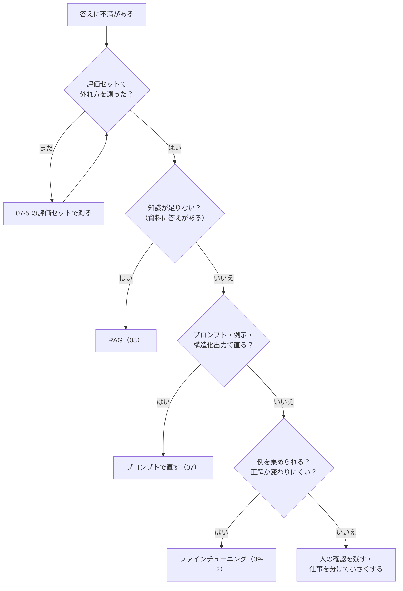

# 09-1 ファインチューニングか RAG か

!!! abstract "到達目標"
    - 答えへの不満を「知識が足りない」と「やり方が足りない」に分け、プロンプト・RAG・ファインチューニングのどれで直すかを判断できる
    - ファインチューニングに要るもの（例・評価セット・学習の環境・更新の手間）を見積もれる
    - 学習の例と評価セットに同じ文章が混ざっていないかを、コードで確かめられる

## 何か

**ファインチューニング** は、学習済みのモデルの重みを、自分の用途の例（入力と正解の組）で追加学習して少し変えることです（06-3）。
**RAG** は、重みを変えずに、質問に関係する資料を検索してプロンプトに入れることです（08）。

どちらも「モデルの答えを自分の業務に合わせる」方法ですが、直せるものが違います。

| 観点 | RAG | ファインチューニング |
|---|---|---|
| 直せるもの | **知識**（何を答えるか。規程・設計書・最新の情報） | **やり方**（どう答えるか。形・口調・判断の癖・決まった手順） |
| 更新 | 資料を差し替えればすぐ変わる | 例を直して学習し直す（時間と費用がかかる） |
| 根拠 | 出典を示せる（08-4） | どの例から覚えたかは示せない |
| 要るもの | 資料と検索の仕組み | 入力と正解の組・学習の環境・評価セット |
| 毎回の費用 | 資料の分だけ入力が長くなる | 短いプロンプトで済むことがある。小さいモデルに替えられることもある |
| よくある失敗 | 検索が外れる・資料に無い | 例に無い入力に弱い（過学習）・もとの能力が落ちる |

試す順番は、費用と手間の小さいものからです。



RAG とファインチューニングは、どちらか一方でなくても構いません。
「資料は RAG で渡し、答え方の形だけを学習でそろえる」のように組み合わせることもできます。

## なぜ必要か

ファインチューニングは「自分専用のモデル」という響きがあり、最初に選ばれがちです。しかし、選び方を誤ると次のことが起きます。

- 規程や設計書を覚えさせようとして学習したのに、規程が変わるたびに学習し直しになる（06-3 の悪い例）
- 例を集めて学習したが、もともとプロンプトの例示で直る問題だった。学習の手間と費用が無駄になる
- 学習の例に評価セットと同じ文章が混ざっていて、点が上がったように見えた。本番では上がっていなかった

最後の誤りは気づきにくいので、コードで確かめます。モデルは学習した文章の答えを覚えられるので、
同じ文章で測ると、覚えたかどうかを測ることになってしまいます。

## どうやるか

### 先に基準を測る

判断の前に、07 の評価セットで今の点を測ります。まず LLM を使わない基準（仮のルールベース分類）です。

```bash
uv run python -m roadmap_examples.p07_classify --mode baseline --out results-baseline.jsonl
```

手元で流すと、次のように表示されます（テストで確かめている値です）。

```text
正解率: 66.7%（20 / 30 件）
タグごとの正解率: 基本 84%, 指示混入 100%, 紛らわしい 22%
```

「紛らわしい」の件（請求の画面のエラーなど、2 つの分類にまたがる問い合わせ）で外れています。
次に、07 のプロンプトでローカルのモデルを流し、同じ評価セットで比べます（07-5）。

```bash
uv run python -m roadmap_examples.p07_classify --mode ollama --model <モデル名> \
    --out results-llm.jsonl --compare results-baseline.jsonl
```

この 2 つが、09 で学習を試すかどうかを決める基準になります。

### 外れ方を分ける

外れた件を 1 件ずつ読み、どの種類の外れ方かを分けます。直し方は外れ方で決まります。

| 外れ方 | 例 | 先に試すこと |
|---|---|---|
| 知らないことを聞かれた | 社内の手続き・設計書の値 | RAG（08） |
| 出力の形が崩れる | JSON にならない・余計な説明がつく | 構造化出力（07-2） |
| 手順や決まりを守らない | 理由を書かない・分類の一覧に無いものを答える | プロンプトの手順と例示（07-1） |
| 判断の癖が合わない | 「請求の画面のエラー」を billing にする（正解は bug） | 例示を増やす → それでも足りなければ学習 |
| 速さ・費用が合わない | 大きなモデルでないと点が出ない | 小さなモデルを学習で合わせる |

学習が効きやすいのは、下の 2 行です。「判断の癖」は、言葉で書き切れない決まりを、たくさんの例で伝える場面です。

### 学習するかを決める

次の 5 つにすべて「はい」と答えられるときに、学習を試します。

1. **評価セットがある**: 前後を同じ評価セットで比べられる（07-5）
2. **プロンプトと例示を試した**: 例示を増やしても、検証用の例（評価セットとは別に取っておく例）の点が頭打ちになった
3. **例を集められる**: 評価セットとは別に、入力と正解の組を集められる。まず少ない数で試し、点が上がるかを見てから増やす
4. **正解が変わりにくい**: 分類の決まりや答えの形が、月単位で変わらない（変わるなら RAG かプロンプトのほうが直しやすい）
5. **学習と配備の手段がある**: 学習する環境（09-2）と、学習したモデルを動かす場所（09-3・12）がある

!!! failure "悪い例"
    「備品の貸出の規程に答えさせたい。規程の文章を学習の例にして、ファインチューニングする」

    規程は知識です。規程が変わるたびに学習し直しになり、答えの出典も示せません。

!!! success "良い例"
    「規程は RAG で渡す。問い合わせの分類は、例示を 3 件から 10 件に増やしても『紛らわしい』の点が上がらなかった。
    そこで、評価セットを見ていない人が書いた 40 件で LoRA を試し、設定は検証用の 10 件で選び、評価セットで 1 回だけ前後を比べる」

### 学習の例と評価セットを分ける

学習の例は、評価セットとは別に集めます。この教材では、07 の評価セット（30 件）を **見ていない人** が、分類の定義（07-1 の分類の一覧）だけから書いた例を使います。
汎用の例 25 件（`base_train.jsonl`）・業務の例 40 件（`sft_train.jsonl`）・設定を選ぶための検証用 10 件（`sft_val.jsonl`）で、
どれも `examples/data/p09/` にあります。形式は 07-5 の評価セットと同じで、`expected` に分類と理由（`reason`）を書いています。

```json
{"id": "t005", "input": "先月プランを下げたのに、今月も上位プランの金額で請求されています。差額を返してください。", "expected": {"category": "billing", "reason": "プラン変更に触れているが用件は請求の誤り"}, "tags": ["紛らわしい"]}
```

!!! warning "評価セットを見ながら学習の例を書かない"
    この教材の最初の版では、評価セットを見ながら学習の例を書いたため、評価セットの言い換えのような例（「解約したはずの月の分まで引き落とされた」に対する
    「解約した後なのに請求が来た」など）が 10 組以上混ざっていました。その版では LoRA で 63% → 87% に上がって見えましたが、
    評価セットを見ずに書いた問い合わせで測ると 50〜57% でした。完全に同じ文章でなくても、言い換えが混ざるだけで点は水増しされます。

同じ文章が混ざっていないかは、コードで確かめます。全角と半角の違いや空白の違いだけの文章も、同じとみなします。

<!-- src: examples/src/roadmap_examples/p09_sft.py -->
```python title="examples/src/roadmap_examples/p09_sft.py"
def normalized(text: str) -> str:
    """比べるための形（全角・半角をそろえ、空白を除く）."""
    return "".join(unicodedata.normalize("NFKC", text).split())


def overlaps(train: Sequence[EvalCase], evaluation: Sequence[EvalCase]) -> list[tuple[str, str]]:
    """学習の例と評価セットで、同じ文章の組（学習の id, 評価の id）. 空でなければ学習に使わない."""
    seen = {normalized(c.input): c.id for c in evaluation}
    return [(c.id, seen[normalized(c.input)]) for c in train if normalized(c.input) in seen]
```

<!-- src: examples/tests/test_p09_sft.py -->
```python title="examples/tests/test_p09_sft.py"
def test_training_examples_do_not_overlap_the_eval_set() -> None:
    assert overlaps(load_cases(SFT_TRAIN), load_cases(DEFAULT_EVAL)) == []


def test_overlap_ignores_width_and_spaces() -> None:
    train = [EvalCase("t1", "ＣＳＶ を出力すると 文字化けします。", {})]
    assert overlaps(train, load_cases(DEFAULT_EVAL)) == [("t1", "c015")]
```

- テストにしておくと、学習の例を足したときに、評価セットの文章をうっかり写していないかを毎回確かめられます
- 文章が少し違うだけの「ほぼ同じ」例も、点を水増しします。演習 2 で、句読点の違いも同じとみなすように広げます
- 学習の例を集めるときは、評価セットを見ながら書かない。評価セットを作った人とは別の人が書くと、さらに安全です

### 似すぎた組を並べて読む

言い換えは、完全一致では見つかりません。そこで、2 文字の組の重なり（ジャッカード係数。0〜1）で似ている度合いを測り、
評価セットに似ている学習の例を、似ている順に並べて人が読みます。

<!-- src: examples/src/roadmap_examples/p09_sft.py -->
```python title="examples/src/roadmap_examples/p09_sft.py"
def similarity(a: str, b: str) -> float:
    """2 文字の組の重なり（ジャッカード係数. 0〜1. 1 なら同じ組の集まり）."""
    x, y = bigrams(a), bigrams(b)
    return len(x & y) / len(x | y) if x | y else 0.0
```

この教材の学習の例で測ると、業務の例（40 件）と検証用（10 件）では、いちばん似た組でも 0.33 でした。
汎用の例（25 件）には、0.69 の組が 1 組ありました（b007「担当者が交代したので、登録しているメールアドレスを変更したいです。」と、
評価セットの c008「登録しているメールアドレスを変更したいです。」）。評価セットを見ずに書いても、よくある言い回しは重なることがあります。
この 1 組は残し、評価セットの点が 1 件分は水増しされうることを結果と一緒に書きます。テストでは、0.5 を超える組がこの 1 組だけであることを確かめています。

<!-- src: examples/tests/test_p09_sft.py -->
```python title="examples/tests/test_p09_sft.py"
def test_training_examples_are_not_paraphrases_of_the_eval_set() -> None:
    """09-1 の本文に書いた結果: 似ている度合い 0.5 を超える組は、汎用の例の b007 と c008 の 1 組だけ."""
    evaluation = load_cases(DEFAULT_EVAL)
    for path in (SFT_TRAIN, SFT_VAL):
        assert nearest_pairs(load_cases(path), evaluation, top=1)[0][0] < 0.5
    close = [(t, e) for score, t, e in nearest_pairs(load_cases(BASE_TRAIN), evaluation, top=5) if score > 0.5]
    assert close == [("b007", "c008")]
```

この確かめには限界があります。語をほとんど写した言い換え（0.7 前後）は拾えますが、語を大きく変えた言い換えは低く出ます。
最初の版の言い換えの組を同じ方法で測ると 0.26〜0.40 で、いまの例の最大（0.33）と区別できませんでした。
数値で切るだけで安心せず、上位の組を人が読むこと、そして何より **評価セットを見ていない人が学習の例を書く** ことが本当の守りです。

### 判断を書き残す

判断は、理由と数字と一緒に書き残します。13 の設計書の「RAG か学習か」の節に、この形で書きます。

```markdown
## RAG か学習か

- 知識（規程・設計書）: RAG で渡す。資料は月に数回変わるため
- 分類の判断: 例示 3 件 → 10 件で、評価セットの正解率は（値）→（値）。「紛らわしい」は（値）のまま
- 決めたこと: 評価セットを見ていない人が書いた 40 件で LoRA を試す。同じ文章が無いことは overlaps で、似すぎた組は nearest_pairs で確かめた
- やめる条件: LoRA の後も、評価セットの正解率が例示 10 件のときを上回らなければ、学習はやめて人の確認を残す
```

「やめる条件」を先に書いておくと、学習に時間をかけすぎるのを防げます。

## 演習

1. 仮のルールベース分類（`--mode baseline`）で外れた 10 件を `--out` の結果から取り出し、上の「外れ方を分ける」の表のどれに当たるかを分けてください。
   それぞれ、RAG・プロンプト・学習のどれで直すかと、その理由を書きます
2. `overlaps` を広げて、句読点（「、」「。」「！」「？」など）の違いだけの文章も同じとみなす関数 `near_overlaps` を書いてください。
   「CSV を出力すると、文字化けします！」が評価セットの c015 と重なると判定されるテストを書きます
3. 次の 4 つの要望に、RAG・プロンプト・ファインチューニングのどれを先に試すか（組み合わせてもよい）と、その理由を書いてください
    - 設計書の API のエラーコードの意味を答えてほしい
    - 問い合わせの分類を、いまより小さなモデルで、同じ正解率でしたい
    - 答えをいつも「結論 → 理由 → 出典」の順に書いてほしい
    - 毎週変わる当番表に答えてほしい

- できたことの確かめ方: `uv run pytest` が通る。1 と 3 は、件ごと・要望ごとの判断と理由
- 目安の時間: 3 時間

解答: [09-1 の解答](answers/09-1.md)

## もし〇〇がなかったら？

**この判断の手順がなかったら**、「専用のモデルを作れば全部解決する」と考えて、知識の問題まで学習で直そうとします。
資料が変わるたびに学習し直す手間を抱え、根拠を示せない答えに悩むことになります。

**学習の例と評価セットを分ける確かめがなかったら**、評価セットの文章を覚えただけのモデルを「良くなった」と判断します。
本番の問い合わせでは点が上がらず、学習にかけた時間の分だけ、原因を探すのも遅れます。

## 理解度チェック

1. RAG で直せるものと、ファインチューニングで直せるものの違いを、1 文ずつで説明してください。

    ??? note "答え"
        RAG は知識（何を答えるか）を直します。資料を差し替えればすぐ変わり、出典も示せます。
        ファインチューニングはやり方（どう答えるか。形・口調・判断の癖）を直します。重みを変えるので、変えるには学習し直しが要ります。

2. 学習を試す前に、評価セットで今の点を測っておくのはなぜですか。

    ??? note "答え"
        学習の前後を同じ物差しで比べるためです。基準が無いと、学習で良くなったのか、もともとプロンプトで足りていたのかが分かりません。
        「やめる条件」（基準を上回らなければやめる）も決められません。

3. 学習の例に評価セットと同じ文章が混ざると、何が困りますか。

    ??? note "答え"
        モデルが答えを覚えるので、評価セットの点が実力より高く出ます。本番の問い合わせでは上がっていないのに、良くなったと判断してしまいます。

4. 「毎週変わる当番表に答えてほしい」に、ファインチューニングが向かないのはなぜですか。

    ??? note "答え"
        当番表は知識で、毎週変わるからです。学習で覚えさせると毎週学習し直しが要り、古い当番を答える恐れもあります。
        当番表を資料として RAG で渡せば、差し替えるだけで済みます。
