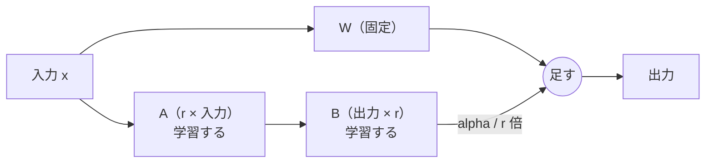

# 09-2 SFT・LoRA・QLoRA

!!! abstract "到達目標"
    - SFT（教師ありファインチューニング）の学習の例の形を説明でき、07 の分類の例から作れる
    - LoRA の仕組み（固定した重みに B @ A を足す・B を 0 で始める・マージする）を、式とコードで説明できる
    - 小さなモデルを LoRA で調整し、07 の評価セットで前後を比べられる
    - 本物の LLM を LoRA で調整して Ollama で動かすまでの手順と、費用がかかる場面を説明できる

## 何か

**SFT**（Supervised Fine-Tuning、教師ありファインチューニング）は、「入力と、望ましい出力」の組でモデルを追加学習することです。
06-3 の指示調整も SFT の一種です。09 では、07 の分類の例で SFT をします。

SFT で重みのどこを変えるかで、やり方が分かれます。

| やり方 | 学習する重み | 特徴 |
|---|---|---|
| フルの調整 | 全部 | いちばん自由に変えられるが、メモリと保存の容量がいちばん要る |
| **LoRA** | 足した小さな行列だけ | 元の重みは固定。学習する重みが少なく、保存するのも差分だけ |
| **QLoRA** | LoRA と同じ | 固定した元の重みを 4 ビットに量子化して持つ（09-3）。さらにメモリが減る |

**LoRA**（Low-Rank Adaptation）は、元の重みの行列 W（出力 × 入力）を固定し、その差分を 2 つの小さな行列の積で表します。

```text
使う重み = W + (alpha / r) × B @ A
  A: r × 入力    （小さな乱数で始める）
  B: 出力 × r    （0 で始める）
  r: ランク（小さな数. 4・8・16 など）
```



学習する重みの数は、W なら「出力 × 入力」ですが、LoRA なら「r × (入力 + 出力)」です。
例えば 4096 × 4096 の行列に r = 16 の LoRA を付けると、約 1,678 万個が約 13 万個になります。
LoRA の考え方と PEFT（LoRA などをまとめたライブラリ）での使い方は、公式ドキュメントにあります
（[公式ドキュメント: PEFT の LoRA](https://huggingface.co/docs/peft/developer_guides/lora)）。

## なぜ必要か

フルの調整は、学習のメモリが大きくなります。重みのほかに、勾配と最適化の状態も持つからです（09-3 で見積もります）。
個人の PC や無料の環境では、小さなモデルでもフルの調整は難しいことがあります。

LoRA なら、学習する重みが少ないので、勾配と最適化の状態も少なくて済みます。
保存するのも差分（A と B）だけなので、用途ごとに小さな差分を持ち、元のモデルは 1 つで済みます。

もう 1 つの理由は、「元の能力を壊しにくい」ことです。元の重みは固定なので、学習の前の答えにいつでも戻せます。
B を 0 で始めるため、学習の前は元のモデルとまったく同じ答えになります。

## どうやるか

### SFT の例を作る

学習の例は、07 と **同じプロンプト** で作ります。学習の後のモデルを、07 の `p07_classify` でそのまま評価できるからです。

<!-- src: examples/src/roadmap_examples/p09_sft.py -->
```python title="examples/src/roadmap_examples/p09_sft.py"
def to_record(case: EvalCase, spec: PromptSpec = DEFAULT_SPEC) -> dict[str, Any]:
    """1 件を、会話の prompt-completion の形にする. 例示は入れない（例示の役目を学習が担う）."""
    expected = case.expected
    if "category" not in expected or "reason" not in expected:
        raise EvalSetError(f"{case.id}: 学習の例には expected の category と reason が要ります")
    return {
        "prompt": [
            {"role": "system", "content": system_prompt(spec)},
            {"role": "user", "content": wrap_inquiry(case.input)},
        ],
        "completion": [{"role": "assistant", "content": answer_json(expected["category"], expected["reason"])}],
    }
```

- `prompt` と `completion` に分けた会話の形は、学習のライブラリ TRL の `SFTTrainer` が読める形の 1 つです
  （[公式ドキュメント: SFT Trainer](https://huggingface.co/docs/trl/sft_trainer)）。この形では、既定で `completion`（答え）の部分だけで損失を計算します
- 例示（07-1 の 3 件）は入れません。学習が例示の役目を担うので、プロンプトが短くなり、毎回の入力トークンが減ります
- 書き出す前に、評価セットと同じ文章が無いかを確かめます（09-1 の `overlaps`）

```bash
uv run python -m roadmap_examples.p09_sft --out sft.jsonl    # 40 件を書き出す
```

### LoRA を小さく書く

本物の LLM の学習は、GPU と大きなライブラリが要ります。そこで、仕組みを NumPy だけの小さなモデルで確かめます。
モデルは「文字と 2 文字の組を数えたベクトル → 中間の層（32 個）→ 5 つの分類」です（05-1 の小さなニューラルネットワークと同じ形）。
本物の LLM の線形の層の代わりに、中間の層の重み `w1`（32 × 512）に LoRA を付けます。

<!-- src: examples/src/roadmap_examples/p09_lora.py -->
```python title="examples/src/roadmap_examples/p09_lora.py"
@dataclass(frozen=True)
class LoRA:
    """中間の層の重み w1 に足す差分を、B @ A の形（ランク r）で持つ."""

    a: np.ndarray  # (r, DIM)
    b: np.ndarray  # (HIDDEN, r)
    alpha: float

    @property
    def r(self) -> int:
        return self.a.shape[0]

    @property
    def n_params(self) -> int:
        return self.a.size + self.b.size

    def delta(self) -> np.ndarray:
        """w1 に足す差分（alpha / r 倍する）."""
        return (self.alpha / self.r) * self.b @ self.a


def init_lora(model: TinyModel, r: int = 4, alpha: float = 8.0, seed: int = 0) -> LoRA:
    """A は小さな乱数、B は 0 で始める（学習の前は差分が 0 なので、元のモデルと同じ答えになる）."""
    rng = np.random.default_rng(seed)
    hidden, dim = model.w1.shape
    return LoRA(rng.normal(0, 1 / np.sqrt(dim), (r, dim)), np.zeros((hidden, r)), alpha)
```

A を乱数、B を 0 で始めるのは、PEFT の既定と同じ考え方です（PEFT の既定では A の乱数の分布が違います）。

学習では、A と B だけを動かします。`w1` についての勾配（05-1 の誤差逆伝播）を、行列の積の微分で A と B についての勾配に直します。

<!-- src: examples/src/roadmap_examples/p09_lora.py -->
```python title="examples/src/roadmap_examples/p09_lora.py"
    opt = Adam(lr)
    params = {"a": lora.a, "b": lora.b}
    scale = lora.alpha / lora.r
    for _ in range(epochs):
        current = replace(lora, a=params["a"], b=params["b"])
        g_w1 = backward(model, x, y, model.w1 + current.delta())["w1"]
        # w1 + scale × B @ A の、A と B についての勾配（行列の積の微分）
        grads = {"a": scale * params["b"].T @ g_w1, "b": scale * g_w1 @ params["a"].T}
        params = opt.step(params, grads)
    return replace(lora, a=params["a"], b=params["b"])
```

学習が終わったら、差分を `w1` に足し込めます（**マージ**）。マージしたモデルは元と同じ大きさで、LoRA を付けたままと同じ答えを返します。

<!-- src: examples/src/roadmap_examples/p09_lora.py -->
```python title="examples/src/roadmap_examples/p09_lora.py"
def merge(model: TinyModel, lora: LoRA) -> TinyModel:
    """差分を w1 に足し込んだ、ふつうのモデルにする（大きさも速さも元と同じ）."""
    return replace(model, w1=model.w1 + lora.delta())
```

ここまでの性質は、テストで確かめています。

<!-- src: examples/tests/test_p09_lora.py -->
```python title="examples/tests/test_p09_lora.py"
def test_lora_trains_only_a_and_b() -> None:
    base = base_model()
    w1_before = base.w1.copy()
    x, y = encode(load_cases(SFT_TRAIN))
    lora = train_lora(base, init_lora(base, r=4), x, y, epochs=30)
    assert np.array_equal(base.w1, w1_before)  # 元の重みは変わらない
    assert lora.delta().any()
    assert np.linalg.matrix_rank(lora.delta()) <= 4  # 差分のランクは r 以下
    assert lora.n_params == 4 * (512 + 32)
    assert lora.n_params < base.n_params / 7
```

### 07 の評価セットで前後を比べる（09 の成果物）

「事前学習」の代わりに、汎用の短い例 25 件（`examples/data/p09/base_train.jsonl`）で小さなモデルを作ります。
これを LoRA で、業務の例 40 件（`sft_train.jsonl`）に合わせ、07 の評価セット 30 件で前後を比べます。
比べるために、同じ 40 件でのフルの調整も並べます。

```bash
uv run python -m roadmap_examples.p09_lora --out results-lora.jsonl
```

手元（Linux・CPU）で流した結果です（乱数の種 `--seed 0`。秒数は環境で変わります）。

| モデル | 正解率 | 学習した重みの数 | 学習の秒数 |
|---|---|---|---|
| 調整の前（汎用の例だけで学習） | 63.3%（19 / 30） | 16,581 | 0.28 |
| LoRA（r=4） | 86.7%（26 / 30） | 2,176 | 0.15 |
| フルの調整 | 86.7%（26 / 30） | 16,581 | 0.18 |

- LoRA は、学習する重みが約 8 分の 1 でも、この題材ではフルの調整と同じ正解率になりました
- 07 の仮のルールベース分類（66.7%）より上です。結果は 07-5 の形式の JSONL なので、07 の結果と `compare` で件ごとに比べられます
- 30 件の評価セットでは、1〜2 件の差は偶然でも出ます。差が偶然かどうかの見方は 11-1 で扱います

ランク r を変えると、次のようになりました（同じ条件）。

| r | 1 | 2 | 4 | 8 | 16 |
|---|---|---|---|---|---|
| 正解率 | 56.7% | 76.7% | 86.7% | 86.7% | 86.7% |
| 学習する重みの数 | 544 | 1,088 | 2,176 | 4,352 | 8,704 |

r が小さすぎると、差分で表せる変化が足りず、調整の前より下がることもあります。大きくしても、ある所から先は上がりません。
r は小さい値から試し、評価セットの点が頭打ちになる所で止めます。

!!! failure "悪い例"
    学習の例と評価セットを分けずに学習し、学習の例での正解率（100% 近く）を報告する。
    r や学習の回数を、評価セットの点を見ながら何十通りも試し、いちばん良い 1 回だけを報告する。

!!! success "良い例"
    学習の例と評価セットを分け（09-1）、乱数の種・r・学習の回数を書いた上で、評価セットの結果を前後で並べる。
    試した設定の数も書く。設定を何十通りも選ぶなら、評価セットとは別に、選ぶための例（検証用）を分けておく。

### 本物の LLM で LoRA を試す（例）

ここからは、本物の LLM を LoRA で調整する手順の例です。`examples/` には入れていません（PyTorch などの大きなライブラリと、モデルのダウンロードが要るため）。
試すときは、`examples/` とは別のフォルダに仮想環境を作ります。

小さな指示モデル（数億パラメータ）なら、GPU が無い PC でも学習できます（時間はかかります）。費用はかかりません。

```bash
uv init lora-trial && cd lora-trial
uv add trl peft datasets
```

例: TRL と PEFT で LoRA の学習をする（`sft.jsonl` は上で書き出したもの）。

```python
from datasets import load_dataset
from peft import LoraConfig
from trl import SFTConfig, SFTTrainer

dataset = load_dataset("json", data_files="sft.jsonl", split="train")
trainer = SFTTrainer(
    model="<小さな指示モデルの名前>",
    train_dataset=dataset,
    args=SFTConfig(output_dir="lora-out", num_train_epochs=3, learning_rate=1e-4),
    peft_config=LoraConfig(r=8, lora_alpha=16, lora_dropout=0.05, target_modules="all-linear"),
)
trainer.train()
trainer.save_model("lora-out")  # 保存されるのは差分（アダプター）だけ
```

- `LoraConfig` の `r`・`lora_alpha`・`target_modules`（LoRA を付ける層）は、上の NumPy の例の r・alpha・`w1` に当たります。
  `"all-linear"` は、すべての線形の層に付ける指定です（[公式ドキュメント: PEFT の LoRA](https://huggingface.co/docs/peft/developer_guides/lora)）
- 学習率は、フルの調整より高め（`1e-4` 程度）がよく使われます（[公式ドキュメント: SFT Trainer](https://huggingface.co/docs/trl/sft_trainer)）
- 学習の例が 40 件では少なすぎることもあります。評価セットの点を見て、例を足すかを決めます

### Ollama で動かす

Ollama は、Safetensors（重みのファイルの形式の 1 つ）の重みか、GGUF（llama.cpp の形式）のファイルを取り込めます
（[公式ドキュメント: モデルの取り込み](https://docs.ollama.com/import)）。そこで、差分を元の重みにマージしてから取り込みます。

例: 差分をマージして保存する。

```python
from peft import AutoPeftModelForCausalLM
from transformers import AutoTokenizer

model = AutoPeftModelForCausalLM.from_pretrained("lora-out")
merged = model.merge_and_unload()  # 元に戻せない新しいモデルを返す（その場で書き換えるのではない）
merged.save_pretrained("merged")
AutoTokenizer.from_pretrained("<小さな指示モデルの名前>").save_pretrained("merged")
```

`merge_and_unload` は、上の `merge` と同じことをします（[公式ドキュメント: PEFT の LoRA](https://huggingface.co/docs/peft/developer_guides/lora)）。
取り込み方は 2 つです。

1. **Safetensors のまま**: `Modelfile` に `FROM ./merged` と書き、`ollama create` する。Ollama が対応している種類（アーキテクチャ）のモデルに限られます
2. **GGUF にしてから**: llama.cpp の変換の道具で GGUF にし、必要なら量子化してから（09-3）、`FROM ./model-q4_k_m.gguf` と書く。
   Ollama は GGUF を取り込むときに量子化しないので、先に量子化しておきます

```bash
# 2 の例（llama.cpp のリポジトリで. 変換の道具の使い方は llama.cpp の説明を確かめる）
python convert_hf_to_gguf.py <merged のフォルダ> --outfile model-f16.gguf --outtype f16
./build/bin/llama-quantize model-f16.gguf model-q4_k_m.gguf Q4_K_M

# Modelfile（中身は 1 行: FROM ./model-q4_k_m.gguf）を置いたフォルダで
ollama create my-classifier -f Modelfile
```

取り込んだら、07 の評価で前後を比べます。比べる相手は、学習の前の元のモデルの結果です。

```bash
uv run python -m roadmap_examples.p07_classify --mode ollama --model my-classifier \
    --out results-tuned.jsonl --compare results-llm.jsonl
```

元のモデルのテンプレート（06-3）が、取り込んだモデルでも正しく使われているかも確かめます（`ollama show --modelfile my-classifier`）。
テンプレートが違うと、学習したときと違う区切りでプロンプトが組み立てられ、点が下がります。

### QLoRA

QLoRA は、固定する元の重みを 4 ビットに量子化して読み込み、その上で LoRA を学習する方法です。
元の重みのメモリが約 4 分の 1 になるので、同じ GPU でより大きなモデルを学習できます（09-3 で見積もります）。
PEFT と、量子化のライブラリ bitsandbytes を組み合わせて使います（[公式ドキュメント: PEFT の量子化](https://huggingface.co/docs/peft/developer_guides/quantization)）。
4 ビットの読み込みには、対応した GPU が要ります。

### 任意（有料）: GPU で学習する

!!! warning "任意: 従量課金の GPU を使います"
    CPU と小さなモデルだけで進める場合は、この節を飛ばしてください（09 の成果物は作れます）。
    試す場合は、先に費用の上限と止め方を決めてください（[学び方](../guide.md) の「従量課金の API は任意」と同じ考え方です）。

大きなモデルの学習や QLoRA は、GPU が要ります。クラウドの GPU の多くは、使った時間に応じた課金です。
無料の枠がある GPU のノートブック環境もありますが、使える時間や GPU の種類は変わることがあるので、利用規約を確かめます。

1. **上限を決める**: 「1 回の学習で何時間まで」「月にいくらまで」を先に決め、管理画面の予算の通知を設定する
2. **小さく試す**: まず学習の例 10 件・1 エポックで最後まで動くかを確かめてから、本番の設定で流す
3. **自動で止める**: 何もしていない時間が続いたら止まる設定（アイドルのタイムアウト）を使う。学習の設定でも、最大の時間や回数を決める
4. **消す**: 学習が終わったら、成果物（差分のファイル）を手元に保存し、インスタンスと、付けたディスクを削除する。止めただけでは、ディスクの料金が続くことがある

## 演習

1. `p09_lora` を `--rank` 1・2・4・8 で流し、正解率と学習する重みの数の表を作ってください。
   さらに `--seed` を 3 つ変えて、r=4 の正解率がどれだけぶれるかを確かめ、「r をいくつにするか」を理由つきで決めます
2. LoRA の差分を `w1` だけでなく、出力の層 `w2`（5 × 32）にも付けたら、学習する重みの数はいくつ増えるかを計算してください。
   さらに、学習の前（B が 0）の答えが元のモデルと同じになることを、`w2` の差分でも確かめるテストを書きます
3. `p09_sft` で `sft.jsonl` を書き出し、1 行目を読んで、system・user・assistant の中身がそれぞれ何かを説明してください。
   評価セットの 1 件を学習の例に混ぜると、`p09_sft` がエラーで止まることも確かめます
4. 任意: 上の「本物の LLM で LoRA を試す」の手順で、小さな指示モデルを CPU で学習し、Ollama に取り込んで、07 の評価セットで前後を比べてください

- できたことの確かめ方: `uv run pytest` が通る。1 は表と決めた r と理由。3 は説明。4 は前後の正解率と条件（モデル・r・学習の回数・かかった時間）
- 目安の時間: 1〜3 で 4 時間（4 は環境しだいで数時間）

解答: [09-2 の解答](answers/09-2.md)

## もし〇〇がなかったら？

**LoRA がなかったら**、モデルを調整するたびに、元のモデルと同じ大きさの重みを丸ごと学習し、丸ごと保存することになります。
学習のメモリが足りず、個人の PC では小さなモデルでも学習できないことがあります。用途ごとに大きなモデルのコピーが増え、保存と配布も重くなります。

**B を 0 で始める決まりがなかったら**、学習の前から元のモデルと違う答えを返します。
学習で良くなったのか、最初の乱数で変わっただけなのかが分からず、元の能力をいきなり壊すこともあります。

## 理解度チェック

1. LoRA で、学習する重みの数が少なくなるのはなぜですか。4096 × 4096 の行列に r = 8 の LoRA を付けたときの数も答えてください。

    ??? note "答え"
        元の重み W（出力 × 入力）は固定し、差分を B（出力 × r）と A（r × 入力）の積で表すからです。
        学習するのは r × (入力 + 出力) 個だけです。8 × (4096 + 4096) = 65,536 個で、元の約 1,678 万個の 256 分の 1 です。

2. LoRA の B を 0 で始めるのはなぜですか。

    ??? note "答え"
        B @ A が 0 になり、学習の前は元のモデルとまったく同じ答えになるからです。学習で生じた変化だけを、前後で比べられます。

3. マージとは何ですか。マージすると何がうれしいですか。

    ??? note "答え"
        学習した差分 (alpha / r) × B @ A を、元の重み W に足し込むことです。
        マージしたモデルは元と同じ大きさ・同じ速さで動き、LoRA に対応していない仕組み（Ollama の取り込みなど）でも使えます。

4. SFT の学習の例を、07 と同じプロンプトで作るのはなぜですか。

    ??? note "答え"
        学習した後のモデルを、07 の評価（`p07_classify`）でそのまま評価できるからです。
        学習のときと使うときでプロンプトが違うと、学習した答え方が出にくくなります。

5. QLoRA は LoRA と何が違いますか。

    ??? note "答え"
        学習するのは LoRA と同じ小さな行列ですが、固定する元の重みを 4 ビットに量子化して持ちます。
        元の重みのメモリが約 4 分の 1 になり、同じ GPU でより大きなモデルを学習できます。
