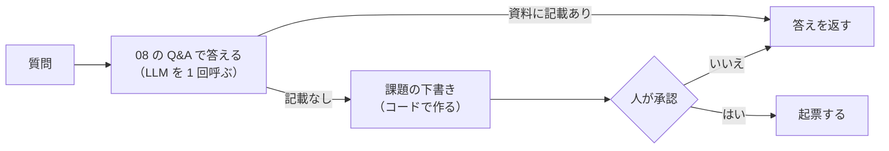
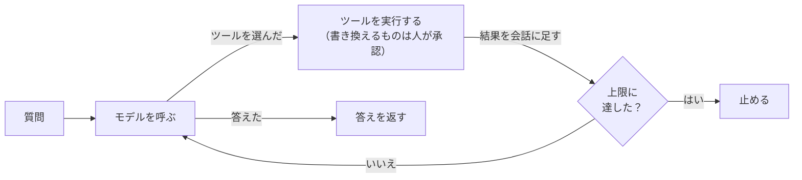

# 10-1 エージェントのループとワークフローの違い

!!! abstract "到達目標"
    - ワークフロー（手順をコードで決める）とエージェント（手順をモデルに選ばせる）の違いを説明できる
    - エージェントのループ（モデルを呼ぶ → ツールを実行する → 結果を返す）と、止まる条件をコードで読める
    - 作りたい仕組みに、ワークフローとエージェントのどちらが向くかを判断できる

## 何か

LLM とツールを組み合わせる作り方は、大きく 2 つあります。

**ワークフロー** は、手順をコードで決め、LLM は決まった場所でだけ使う作り方です。
「答えを作る → 資料に無ければ課題の下書きを作る → 人が承認したら起票する」の順番は、いつも同じです。



**エージェント** は、どのツールを、どの順番で、何回使うかをモデルに選ばせる作り方です。
コードは、モデルを呼び、モデルが選んだツールを実行して結果を返す、を繰り返します（ループ）。07-3 のツール使用の往復を、答えが出るまで続けるものです。



| | ワークフロー | エージェント |
|---|---|---|
| 手順を決めるのは | コード | モデル |
| 同じ入力での動き | いつも同じ | 実行のたびに変わりうる |
| 得意なこと | 手順が決まっている仕事 | 手順が入力しだいで変わる仕事（何をどれだけ調べるか） |
| 費用と時間 | 見積もりやすい（呼ぶ回数が決まる） | 往復の回数しだい。上限が要る（10-4） |
| テスト | 手順ごとに書ける | 動き方（どのツールを呼んだか）も評価する（10-4） |

## なぜ必要か

「エージェント」は流行の言葉なので、何でもエージェントで作りたくなります。しかし、モデルに手順を任せると、次のことが起きます。

- 必要なツールを呼ばずに答える、同じツールを何度も呼ぶ、頼まれていない操作をする
- 往復の回数が実行ごとに変わり、費用と時間が読めない
- 同じ入力でも動きが変わるので、テストが難しい

手順が決まっている仕事なら、ワークフローのほうが安く、速く、確実です。
エージェントが向くのは、「何を、どれだけ調べれば答えられるか」が入力ごとに違う仕事です。
業務では、両方を組み合わせることも多くあります（全体はワークフロー、その中の 1 段だけエージェント、など）。

## どうやるか

### ワークフローで作る

演習のコードの `answer_or_file` は、08 の Q&A に起票を足したワークフローです。
LLM を呼ぶのは「答えを作る」の 1 回だけで、課題の下書きはコードで作ります。

<!-- src: examples/src/roadmap_examples/p10_workflow.py -->
```python title="examples/src/roadmap_examples/p10_workflow.py"
def answer_or_file(
    question: str, retriever: Retriever, llm: LLMClient, tracker: IssueTracker, approver: Approver
) -> WorkflowResult:
    ans = answer(question, retriever, llm)
    if not ans.is_no_answer:
        return WorkflowResult(ans, None, None)
    title, body = draft_issue(question)
    decision = approver.review(ApprovalRequest("create_issue", {"title": title, "body": body}))
    if decision is None or not decision.approved:
        return WorkflowResult(ans, decision, None)
    issue = tracker.find(title) or tracker.create(title, body)
    return WorkflowResult(ans, decision, issue)
```

- `answer` は 08 の Q&A です。資料に答えが無いと「資料に記載がありません」と答えます（`is_no_answer`）
- `approver`（承認の係）と `tracker`（起票先）は差し替えられます。起票先は手元のファイルかメモリで、外部のサービスには繋ぎません
- 同じ題名の課題があれば、新しく作りません

この作り方では、「資料に無ければ必ず起票の提案をする」ことになります。利用者が起票を望んでいるかは見ていません。
それを入力から判断させたいとき、エージェントの出番になります。

### エージェントのループ

10 の成果物は、モデルにツールを選ばせるエージェントです。ツールは 2 つです。

| ツール | すること | 種類 | 人の承認 |
|---|---|---|---|
| `search_docs` | 08 の設計書を検索し、出典と本文を返す | 読むだけ | 要らない |
| `create_issue` | 課題を起票する（手元の JSONL ファイルに足す） | 書き換える | 要る（10-4） |

ループの本体です。07-3 の `run_with_tools` と同じ往復に、状態（10-2）・承認（10-4）・上限（10-4）を足しています。

<!-- src: examples/src/roadmap_examples/p10_agent.py -->
```python title="examples/src/roadmap_examples/p10_agent.py"
def run_agent(
    chat: ToolChat,
    state: AgentState,
    tools: Sequence[Tool],
    approver: Approver,
    limits: AgentLimits = AgentLimits(),  # noqa: B008 — 変更できない（frozen）ので既定値に使ってよい
    read_only: frozenset[str] = frozenset({"search_docs"}),
) -> AgentState:
    """モデルが答えるか、上限に達するか、承認待ちになるまで、往復を繰り返す. 承認待ちの状態から呼ぶと続きから動く."""
    registry = {t.name: t for t in tools}
    specs = [t.spec() for t in tools]
    if not process_pending(state, registry, approver, limits, read_only):
        return state
    while True:
        reason = limit_reached(state, limits)
        if reason:
            state.status, state.stop_reason = STOPPED, reason
            return state
        turn = chat.chat(state.messages, specs)
        state.steps += 1
        state.input_tokens += turn.input_tokens
        state.output_tokens += turn.output_tokens
        if not turn.tool_calls:
            state.messages.append({"role": "assistant", "content": turn.text})
            state.status, state.answer = ANSWERED, turn.text
            return state
        calls = [{"name": c.name, "arguments": c.arguments} for c in turn.tool_calls]
        state.messages.append(
            {"role": "assistant", "content": turn.text, "tool_calls": [{"function": c} for c in calls]}
        )
        state.pending = calls
        if not process_pending(state, registry, approver, limits, read_only):
            return state
```

ループが終わるのは、次の 3 つのどれかです。止まる条件を、ループを書く前に決めておきます。

1. モデルがツールを呼ばずに答えた（`answered`）
2. 上限に達した（`stopped`）。上限は、モデルを呼ぶ **前に** 確かめる
3. 人の承認を待つことになった（`waiting_approval`。10-2）

`process_pending` は、モデルが選んだツールを 1 つずつ処理し、結果を `role` が `tool` のメッセージで会話に足します（10-4 で中身を見ます）。

### テストは台本どおりに動く偽のモデルで

モデルの動きは、07-3 の `FakeToolChat` に「台本」（決まった `ChatTurn` の並び）を渡して再現します。
次のテストは、「検索して答える」流れで、読むだけのツールが承認なしで実行されることを確かめます。

<!-- src: examples/tests/test_p10_agent.py -->
```python title="examples/tests/test_p10_agent.py"
def test_read_only_tool_runs_without_approval() -> None:
    chat = FakeToolChat([search("貸出期間"), say("14 日です（04-data.md）")])
    approver = ScriptedApprover([])
    state = run_agent(chat, start_state("備品は何日借りられますか？"), tools(), approver)
    assert state.status == ANSWERED
    assert state.answer == "14 日です（04-data.md）"
    assert approver.requests == []
    assert state.events[0]["status"] == "ok" and state.events[0]["approved"] is None
    results = json.loads(chat.calls[1][-1]["content"])["results"]
    assert any("04-data.md" in r["source"] for r in results)
```

台本で確かめられるのは、こちらのコード（ツールの実行・承認・上限）が正しく動くかです。
本物のモデルが台本どおりに動くかは、評価セットで確かめます（10-4）。

### 手元で動かす

ツール使用に対応したモデル（06-4 の `capabilities` に `tools` があるもの）で動かします（`examples/` で実行）。

```bash
uv run python -m roadmap_examples.p10_agent --model <ツールに対応したモデル名> --issues issues.jsonl \
    --question "備品を買うときの承認の流れを教えてください。資料に無ければ課題にしてください。"
```

- `--issues` は起票先のファイルです。承認すると、このファイルに 1 行足されます
- 検索は、`--embed-model` を省くとキーワード検索（08-3 の BM25）だけになります。付けると 08 と同じハイブリッド検索です
- 起票の前に、画面に引数が表示され、`y` と答えたときだけ起票されます

!!! failure "悪い例"
    「設計書の質問に答えて、資料に無ければ必ず起票する」仕組みを、エージェントで作る。

    手順は決まっているのに、モデルが検索を飛ばしたり、起票を忘れたりする余地を作っています。往復の分だけ費用も増えます。

!!! success "良い例"
    決まった手順はワークフローにする。「起票を望んでいるか」「何を何回調べるか」のように、
    入力しだいで変わる判断がある部分だけをエージェントにし、上限と承認で囲む。

## 演習

1. `answer_or_file` で、同じ題名の課題が既にあるときに、新しく作らずに既存の課題を返すことを、テストで確かめてください
   （`MemoryIssueTracker` に先に 1 件入れておく）
2. `FakeToolChat` で、エージェントが「検索 → 言い換えてもう一度検索 → 答える」と動く台本を作り、
   往復が 3 回・ツールの記録が 2 件・承認の依頼が 0 件になることを、テストで確かめてください
3. 任意: 手元の Ollama で、同じ 2 つの質問（資料に答えがあるもの・無いもの）を、ワークフロー（`answer_or_file`）とエージェント（`p10_agent`）で動かし、
   LLM を呼んだ回数・トークン数・起票の提案の有無を表にしてください

- できたことの確かめ方: `uv run pytest` が通る。3 は、表（モデル名を添える）と、どちらが向くかの考察
- 目安の時間: 3 時間

解答: [10-1 の解答](answers/10-1.md)

## もし〇〇がなかったら？

**ワークフローという選択肢がなかったら**、手順が決まった仕事もモデルに任せることになります。
同じ入力で動きが変わり、障害の調べ方も「そのときモデルがどう判断したか」をたどる作業になります。

**ループの止まる条件がなかったら**、モデルが同じツールを呼び続けたとき、プロセスは止まりません。
クラウドの API なら、止まるまでの呼び出しがすべて費用になります。

## 理解度チェック

1. ワークフローとエージェントの違いを、「手順を決めるのはだれか」で説明してください。

    ??? note "答え"
        ワークフローは、手順をコードで決め、LLM は決まった場所でだけ使います。
        エージェントは、どのツールをどの順番で何回使うかをモデルが選び、コードはそれを実行して結果を返します。

2. 手順が決まっている仕事を、エージェントで作らないほうがよいのはなぜですか。

    ??? note "答え"
        モデルが手順を飛ばしたり、余計な操作をしたりする余地ができ、費用と時間も読めなくなるからです。
        決まった手順はコードで書いたほうが、安く、速く、テストもしやすくなります。

3. `run_agent` のループが終わる条件を 3 つ挙げてください。上限は、モデルを呼ぶ前と後のどちらで確かめますか。

    ??? note "答え"
        モデルが答えたとき・上限に達したとき・人の承認を待つことになったとき、です。
        上限はモデルを呼ぶ前に確かめます。呼んだ後では、上限を超える 1 回の費用がもうかかっているからです。

4. `FakeToolChat` の台本で書いたテストで、確かめられることと確かめられないことは何ですか。

    ??? note "答え"
        確かめられるのは、ツールの実行・承認・上限など、こちらのコードの動きです。
        本物のモデルが、その台本のとおりにツールを選ぶかは確かめられません。それは評価セットで測ります（10-4）。
