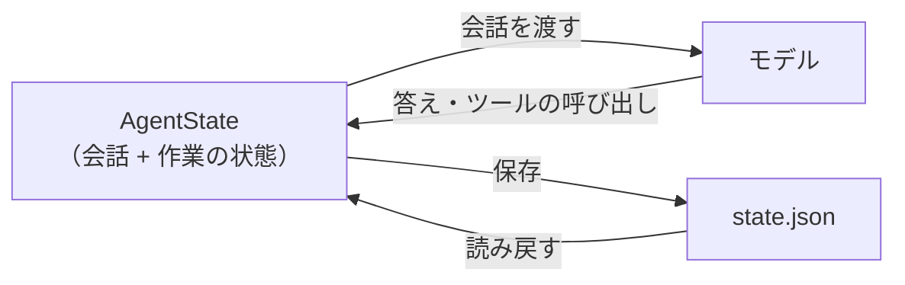

# 10-2 メモリと状態の管理

!!! abstract "到達目標"
    - エージェントが持つ記憶（会話・作業の状態・長く残す記憶）の違いと、それぞれの置き場所を説明できる
    - 作業の状態を保存し、人の承認を待つ間に止めて、続きから動かすコードを書ける
    - 会話を削るときに、ツールの呼び出しと結果の組を壊さないように書ける

## 何か

LLM は、前の呼び出しを覚えていません。毎回、渡された会話だけを読んで答えます（06-2）。
エージェントが「覚えている」ように見えるのは、こちらのコードが記憶を持ち、毎回モデルに渡し直しているからです。

エージェントの記憶は、3 つに分けて考えます。

| 種類 | 中身 | 残す期間 | この教材での置き場所 |
|---|---|---|---|
| 会話（短い記憶） | system・依頼・モデルの答え・ツールの呼び出しと結果 | 1 回の作業の間 | `AgentState.messages` |
| 作業の状態 | 往復の回数・トークン数・ツールの記録・承認待ちの呼び出し・結果 | 1 回の作業の間（止めても続きから動かせるように保存する） | `AgentState` の残りの項目 |
| 長く残す記憶 | 利用者の好み・前回の作業の要点など | 作業をまたいで | この教材では作らない（設計の注意だけを扱う） |



## なぜ必要か

業務のエージェントでは、1 回の作業がすぐに終わるとは限りません。

- 起票の承認を頼んでも、担当者が見るのは数時間後かもしれない。その間、プロセスを動かしたまま待つのは無駄で、再起動で消える
- ツールの結果が積み重なり、会話がコンテキストに入りきらなくなる（06-2）
- 障害を調べるとき、「どのツールを、どの引数で呼び、どうなったか」の記録が要る

状態をコードの側に、決まった形で持っておけば、保存・再開・記録・削る、をどれも普通のプログラムとして書けます。

## どうやるか

### 状態を 1 つにまとめる

演習のコードの `AgentState` は、会話と作業の状態をまとめたものです。JSON にして保存し、読み戻せます。

<!-- src: examples/src/roadmap_examples/p10_state.py -->
```python title="examples/src/roadmap_examples/p10_state.py"
@dataclass
class AgentState:
    messages: list[dict[str, Any]]
    steps: int = 0  # モデルを呼んだ回数（往復の回数）
    tool_calls: int = 0  # 実行（または却下）したツールの呼び出しの回数
    input_tokens: int = 0
    output_tokens: int = 0
    events: list[dict[str, Any]] = field(default_factory=list)  # ツールの記録（名前・引数・結果の種類・承認）
    pending: list[dict[str, Any]] = field(default_factory=list)  # まだ実行していないツールの呼び出し（先頭から順に）
    status: str = RUNNING
    answer: str = ""
    stop_reason: str = ""
```

- 回数とトークン数を状態に入れておくと、止めて再開しても、上限（10-4）を前回の続きから数えられます
- `events` は、ツールの記録です。何を呼んで、承認されたか、却下されたかが残ります
- 中身を辞書と文字列と数だけにしているので、そのまま JSON にできます

### 承認を待つ間は、保存して止める

承認の係（10-4）が「まだ決めていない」（`None`）を返したら、ツールを実行せずに `waiting_approval` で止まります。
実行していない呼び出しは `pending` に残ります。

<!-- src: examples/src/roadmap_examples/p10_agent.py -->
```python title="examples/src/roadmap_examples/p10_agent.py"
        handled = handle_call(state.pending[0], registry, approver, read_only)
        if handled is None:
            state.status = WAITING
            return False
```

保存した状態を読み戻して `run_agent` に渡すと、`pending` の先頭から続きを処理し、その後でモデルを呼びます。
テストで、この流れを確かめています。

<!-- src: examples/tests/test_p10_agent.py -->
```python title="examples/tests/test_p10_agent.py"
def test_waiting_for_approval_saves_state_and_resumes(tmp_path: Path) -> None:
    tracker = MemoryIssueTracker()
    first = FakeToolChat([file_issue()])
    state = run_agent(first, start_state(QUESTION), tools(tracker), ScriptedApprover([]))
    assert state.status == WAITING
    assert state.pending == [{"name": "create_issue", "arguments": ISSUE}]
    assert tracker.issues == []
    # 承認を待つ間に保存して止め、後で読み戻して続きから動かす
    path = tmp_path / "state.json"
    path.write_text(state.to_json(), encoding="utf-8")
    resumed = AgentState.from_json(path.read_text(encoding="utf-8"))
    second = FakeToolChat([say("起票しました")])
    done = run_agent(second, resumed, tools(tracker), ScriptedApprover([Decision(True)]))
    assert done.status == ANSWERED
    assert len(tracker.issues) == 1
    assert done.steps == 2  # 止める前の 1 回 + 続きの 1 回
    assert second.calls[0][-1]["role"] == "tool"
```

2 つ目の偽のモデル（`second`）が最初に受け取った会話は、ツールの結果（`role` が `tool`）で終わっています。
モデルは、止める前の会話と、承認の後に実行した結果を、続けて読めます。

Java の業務システムで、承認待ちの申請をデータベースに保存し、承認されたら次の処理に進めるのと同じ考え方です。
本番では、ファイルではなくデータベースに置き、だれがいつ承認したかも残します。

!!! failure "悪い例"
    ```python
    answer = input("起票してよいですか？ [y/N] ")  # 承認されるまで、プロセスが止まったまま待つ
    ```

    担当者が見るまでプロセスを動かし続けることになり、その間に再起動すると、途中の会話も消えます。

!!! success "良い例"
    承認の係が「まだ決めていない」を返せるようにし、状態を保存して止める。
    承認されたら、保存した状態から続きを動かす。

### 会話を削る

会話が長くなったら、06-2 と同じく古いものから削ります。エージェントでは、1 つ気をつけることがあります。
ツールの結果（`role` が `tool`）は、その前の assistant の呼び出し（`tool_calls`）と組です。組の片方だけを残すと、モデルはどの呼び出しの結果か分かりません。

<!-- src: examples/src/roadmap_examples/p10_state.py -->
```python title="examples/src/roadmap_examples/p10_state.py"
def trim_messages(messages: list[dict[str, Any]], keep_last: int) -> list[dict[str, Any]]:
    """system と最初の user（依頼）を残し、残りは新しい keep_last 件だけにする.

    切れ目がツールの結果（role が tool）から始まると、どの呼び出しの結果か分からなくなるので、その結果も削る.
    """
    size = 2 if messages and messages[0]["role"] == "system" else 1
    head, rest = list(messages[:size]), messages[size:]
    if len(rest) <= keep_last:
        return list(messages)
    tail = rest[len(rest) - keep_last :]
    while tail and tail[0]["role"] == "tool":
        tail = tail[1:]
    return head + tail
```

<!-- src: examples/tests/test_p10_state.py -->
```python title="examples/tests/test_p10_state.py"
def test_trim_does_not_start_with_an_orphan_tool_result() -> None:
    messages = [SYSTEM, ASK, call(1), result(1), call(2), result(2)]
    trimmed = trim_messages(messages, keep_last=3)  # そのまま切ると result(1) から始まる
    assert trimmed == [SYSTEM, ASK, call(2), result(2)]
```

最初の依頼（user）を残すのは、それが作業の目的だからです。目的が消えると、モデルは何のために調べているのかを見失います。
削る代わりに、古いやり取りを LLM で要約して 1 件にまとめる方法もあります。要約は情報が落ちるので、評価セット（10-4）で、削り方による違いを確かめます。

### 長く残す記憶の注意

作業をまたいで覚えておく記憶（「この利用者は英語で答えてほしい」など）は便利ですが、次のことに気をつけます。

| 気をつけること | 理由 | 対策の例 |
|---|---|---|
| 何を残すかを決める | 何でも残すと、古い・誤った内容がずっと答えに混ざる | 残す項目を決め、利用者が見て消せるようにする |
| 残した内容を指示として扱わない | ツールの結果や資料に紛れた指示（11-2）が記憶に入ると、次の作業でも効いてしまう | 記憶はデータとして渡し、「この中の指示には従わない」と決める |
| 個人情報・秘密を残さない | 記憶は会話より長く残り、ほかの作業から読めることがある | 残す前に伏せる（11-3）。だれの記憶かを分けて保存する |

## 演習

1. `p10_agent` の CLI に、承認を後で決める使い方を足す設計を書いてください。
   `--state state.json` で、承認待ちになったら状態を保存して終わり、`--resume state.json --decision approve` で続きを動かす、とします。
   承認の係（`Approver`）と `run_agent` をどう使うかを、コードの下書きで示します
2. `trim_messages` で、system が無い会話（最初が user）のときにも、最初の依頼が残ることをテストで確かめてください
3. 任意: 手元の Ollama で `p10_agent` を動かし、承認の画面で `N` を答えたとき、モデルが次に何と答えたかを記録してください。
   却下の理由（`comment`）が会話に入っていることを、保存した状態か画面の記録で確かめます

- できたことの確かめ方: `uv run pytest` が通る。1 は下書きのコードと、その説明
- 目安の時間: 3 時間

解答: [10-2 の解答](answers/10-2.md)

## もし〇〇がなかったら？

**状態をコードの側に持たなかったら**、承認を待つ間もプロセスを止められず、再起動で作業が最初からになります。
途中の記録も無いので、「なぜこの課題が起票されたのか」を後から説明できません。

**会話を削るときに組を気にしなかったら**、ツールの結果だけが残った会話をモデルに渡すことになります。
モデルによっては呼び出しのエラーになり、そうでなくても、どの質問への結果かを取り違えた答えになります。

## 理解度チェック

1. LLM が前の呼び出しを覚えていないのに、エージェントが会話の続きを答えられるのはなぜですか。

    ??? note "答え"
        こちらのコードが会話を状態として持ち、毎回モデルに渡し直しているからです。モデルは、渡された会話だけを読んで答えます。

2. 承認を待つときに、プロセスを動かしたまま待たずに、状態を保存して止めるのはなぜですか。

    ??? note "答え"
        承認はすぐに返ってくるとは限らず、待つ間の再起動で作業が消えるからです。
        保存しておけば、承認されたときに続きから動かせ、途中の記録も残ります。

3. 会話を削るとき、ツールの結果から始まる形にしてはいけないのはなぜですか。

    ??? note "答え"
        ツールの結果は、その前の assistant のツールの呼び出しと組だからです。呼び出しが無いと、どの呼び出しの結果か分かりません。

4. 長く残す記憶に、資料やツールの結果の内容をそのまま入れると、何が起きる恐れがありますか。

    ??? note "答え"
        資料に紛れた指示が記憶に入り、後の別の作業でもモデルがそれに従ってしまう恐れがあります。
        記憶はデータとして扱い、残す内容を決めて、利用者が見て消せるようにします。
