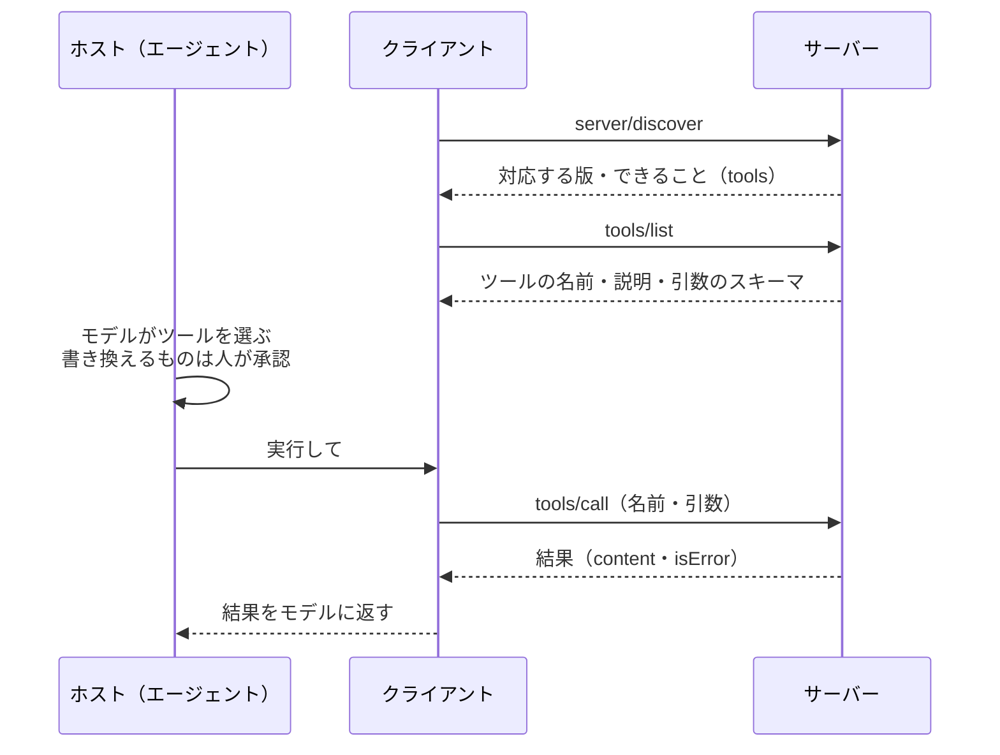

# 10-3 MCP でツールをつなぐ

!!! abstract "到達目標"
    - MCP（Model Context Protocol）の役割と、ホスト・クライアント・サーバーの関係を説明できる
    - ツールの一覧と実行のメッセージ（`tools/list`・`tools/call`）の形を、小さな実装で読める
    - MCP のツールをエージェントにつなぐとき、承認をどこで行い、ツールの注釈をどこまで信じるかを判断できる

## 何か

MCP（Model Context Protocol）は、LLM を使うアプリと、ツールやデータを提供するプログラムをつなぐための、公開された決まり（プロトコル）です
（[公式の仕様](https://modelcontextprotocol.io/specification/2026-07-28)）。登場するのは 3 つです。

| 名前 | 役割 | この章の例 |
|---|---|---|
| ホスト | LLM を使うアプリ。どのサーバーにつなぐかを決める | 10 のエージェント |
| クライアント | ホストの中で、1 つのサーバーとやり取りする部品 | `McpClient` |
| サーバー | ツール（ほかに資料やプロンプト）を提供するプログラム | 設計書の検索と起票を公開する `p10_mcp` |

メッセージは JSON-RPC 2.0（JSON で「どの処理を、どの引数で」を送る決まり）です。
ツールの部分で使うのは、次の 3 つの要求です。



つなぎ方（トランスポート）は 2 つが決まっています。この章では **stdio** を使います。ホストがサーバーを子プロセスとして起動し、
標準入力と標準出力で、1 行に 1 つのメッセージをやり取りします（[仕様: stdio](https://modelcontextprotocol.io/specification/2026-07-28/basic/transports/stdio)）。
もう 1 つは HTTP で送る Streamable HTTP です。

## なぜ必要か

07-3 と 10-1 では、ツールをエージェントと同じプログラムの中に Python の関数として書きました。これには限界があります。

- 同じツール（設計書の検索など）を、別のアプリや別の言語のエージェントから使いたいとき、作り直しになる
- ツールの実装（データベースの接続など）が、エージェントのコードに混ざる
- 使うツールを増やすたびに、エージェントのコードを直すことになる

MCP に合わせたサーバーにしておけば、MCP に対応したホストなら、どれからでも同じツールを使えます。
Java でいえば、決まったインターフェースを実装しておけば、どの呼び出し側からも差し替えて使える、という考え方を、プロセスの外まで広げたものです。

## どうやるか

### メッセージの形を見る

この章の実装は、仕様の 2026-07-28 版に合わせています。この版では、接続ごとの状態を持ちません。
要求ごとに、`params` の `_meta` で、プロトコルの版とクライアントのできること（capabilities）を送ります
（[仕様: 基本のプロトコル](https://modelcontextprotocol.io/specification/2026-07-28/basic)）。

```json
{"jsonrpc": "2.0", "id": 2, "method": "tools/call", "params": {
  "name": "search_docs", "arguments": {"query": "アクセストークン"},
  "_meta": {"io.modelcontextprotocol/protocolVersion": "2026-07-28", "io.modelcontextprotocol/clientCapabilities": {}}}}
```

応答の `result` には、結果の種類を表す `resultType` が入ります。ツールの結果は `content`（文章などの一覧）と、失敗したかを表す `isError` です
（[仕様: ツール](https://modelcontextprotocol.io/specification/2026-07-28/server/tools)）。

```json
{"jsonrpc": "2.0", "id": 2, "result": {
  "resultType": "complete", "content": [{"type": "text", "text": "{\"results\": [...]}"}], "isError": false}}
```

2025-11-25 版までは、最初に `initialize` の要求で版を決め、その接続の間は同じ版を使う決まりでした。
いま公開されているサーバーやホストには、この古い版のものも多くあります。新しい版と古い版をつなぐときの決まりも、仕様に書かれています
（[仕様: 版と互換性](https://modelcontextprotocol.io/specification/2026-07-28/basic/versioning)）。
この章の小さな実装は 2026-07-28 版だけに対応し、`initialize` には誤りを返します。

### サーバーを小さく書く

`McpServer.handle` は、1 つのメッセージを受け取り、応答を返します。前の要求の内容には頼りません。

<!-- src: examples/src/roadmap_examples/p10_mcp.py -->
```python title="examples/src/roadmap_examples/p10_mcp.py"
        if "id" not in message:
            return None
        msg_id, method = message["id"], message["method"]
        params = message.get("params") or {}
        meta = params.get("_meta") if isinstance(params, dict) else None
        if not isinstance(meta, dict) or META_VERSION not in meta or META_CAPABILITIES not in meta:
            return error(msg_id, INVALID_PARAMS, f"_meta に {META_VERSION} と {META_CAPABILITIES} が要ります")
        if meta[META_VERSION] not in SUPPORTED_VERSIONS:
            data = {"supported": SUPPORTED_VERSIONS, "requested": meta[META_VERSION]}
            return error(msg_id, UNSUPPORTED_PROTOCOL_VERSION, "Unsupported protocol version", data)
```

- `id` の無いメッセージは通知で、応答を返しません
- `_meta` に版とできることが無ければ、誤った引数（`-32602`）を返します
- 対応していない版なら、`-32022` と、対応している版の一覧を返します。クライアントは一覧から選んで送り直せます

ツールの一覧と実行の部分です。ツールの中身は、10-1 の `qa_tools`（検索と起票）をそのまま使います。

<!-- src: examples/src/roadmap_examples/p10_mcp.py -->
```python title="examples/src/roadmap_examples/p10_mcp.py"
        elif method == "tools/list":
            result = {"tools": [self.describe(t) for t in self.tools], "ttlMs": 0, "cacheScope": "public"}
        elif method == "tools/call":
            registry = {t.name: t for t in self.tools}
            name = params.get("name")
            if name not in registry:
                return error(msg_id, INVALID_PARAMS, f"Unknown tool: {name}")
            text = call_tool(registry, ToolCall(name, dict(params.get("arguments") or {})))
            result = {"content": [{"type": "text", "text": text}], "isError": has_error(text)}
```

仕様は、失敗を 2 種類に分けています。

| 失敗 | 例 | 返し方 |
|---|---|---|
| プロトコルの誤り | 知らないツール・要求の形の誤り | JSON-RPC の `error` |
| ツールの実行の誤り | 引数の値の誤り・見つからない | `result` の `isError: true`（モデルが読んで直せるように） |

07-3 で、誤った引数を例外にせずモデルに返したのと同じ考え方です。

### stdio で動かす

stdio では、1 行に 1 つのメッセージを読み、応答を 1 行で書きます。メッセージの中に改行を入れてはいけません。
標準出力にはメッセージ以外を書かず、ログは標準エラーに書きます（[仕様: stdio](https://modelcontextprotocol.io/specification/2026-07-28/basic/transports/stdio)）。

<!-- src: examples/src/roadmap_examples/p10_mcp.py -->
```python title="examples/src/roadmap_examples/p10_mcp.py"
def serve(server: McpServer, stdin: TextIO, stdout: TextIO) -> None:
    """stdio で動かす: 1 行に 1 つのメッセージを読み、応答を 1 行で書く. 標準入力が閉じたら終わる."""
    for line in stdin:
        if not line.strip():
            continue
        try:
            message = json.loads(line)
        except json.JSONDecodeError:
            response: dict[str, Any] | None = error(None, PARSE_ERROR, "Parse error")
        else:
            response = server.handle(message)
        if response is not None:
            stdout.write(json.dumps(response, ensure_ascii=False) + "\n")  # json.dumps は改行を \n に置き換える
            stdout.flush()
```

`print` で途中経過を標準出力に書くと、それがメッセージとして読まれ、クライアントが壊れます。デバッグの出力も標準エラーに書きます。

サーバーは、次のコマンドで起動します。ふだんは人が起動するのではなく、ホストが子プロセスとして起動します（`examples/` で実行）。

```bash
uv run python -m roadmap_examples.p10_mcp --issues issues.jsonl
```

検索はキーワード検索（BM25）だけにしているので、LLM もネットワークも使いません。テストでは、実際に子プロセスとして起動し、
標準入出力でやり取りしています（`examples/tests/test_p10_mcp.py` の `test_stdio_subprocess_end_to_end`）。

### クライアントからツールを使う

`McpClient.call` は、要求ごとに `_meta` を付けて送ります。

<!-- src: examples/src/roadmap_examples/p10_mcp.py -->
```python title="examples/src/roadmap_examples/p10_mcp.py"
    def call(self, method: str, params: dict[str, Any] | None = None) -> dict[str, Any]:
        """要求を送る. 要求ごとに _meta で版・クライアント・できることを送る（接続の状態に頼らない）."""
        meta = {
            META_VERSION: self.protocol_version,
            META_CLIENT: {"name": self.name, "version": self.version},
            META_CAPABILITIES: {},
        }
        message = {"jsonrpc": "2.0", "id": self.next_id, "method": method, "params": {**(params or {}), "_meta": meta}}
        self.next_id += 1
        response = self.transport.request(message)
        if "error" in response:
            e = response["error"]
            raise McpError(e["code"], e["message"], e.get("data"))
        return response["result"]
```

`remote_tools` は、サーバーのツールの一覧を、10 のエージェントが使える `Tool` に変えます。実行すると `tools/call` を送ります。
エージェントの側から見ると、手元の関数と区別なく使えます。

```python
import sys

from roadmap_examples.ollama_client import OllamaChat
from roadmap_examples.p10_agent import ConsoleApprover, run_agent, start_state
from roadmap_examples.p10_mcp import McpClient, StdioTransport, remote_tools

transport = StdioTransport([sys.executable, "-m", "roadmap_examples.p10_mcp", "--issues", "issues.jsonl"])
try:
    tools = remote_tools(McpClient(transport))
    chat = OllamaChat("<ツールに対応したモデル名>", options={"temperature": 0})
    state = run_agent(chat, start_state("<質問>"), tools, ConsoleApprover())
    print(state.answer)
finally:
    transport.close()
```

### 承認はホストで行い、注釈は信じすぎない

サーバーは、ツールに振る舞いの注釈（ヒント）を付けられます。`readOnlyHint`（読むだけか）・`destructiveHint`（消したり上書きしたりするか）などです。

<!-- src: examples/src/roadmap_examples/p10_mcp.py -->
```python title="examples/src/roadmap_examples/p10_mcp.py"
QA_ANNOTATIONS: dict[str, dict[str, bool]] = {
    "search_docs": {"readOnlyHint": True, "openWorldHint": False},
    "create_issue": {"readOnlyHint": False, "destructiveHint": False, "idempotentHint": True, "openWorldHint": False},
}
```

ただし仕様は、信頼できるサーバーのもの以外の注釈を、信用してはいけないとしています。
また、ツールの呼び出しを人が拒めるようにし、操作の前に確認を求めるべきだとしています（[仕様: ツール](https://modelcontextprotocol.io/specification/2026-07-28/server/tools) の注意）。

そこで 10 のエージェントは、注釈を見て承認を省くことはしません。承認なしで実行してよいツールは、ホストの側で名前を決めた許可リスト（`read_only`）だけです。
それ以外は、MCP のツールでも手元のツールでも、承認を求めます。テストで確かめています。

<!-- src: examples/tests/test_p10_mcp.py -->
```python title="examples/tests/test_p10_mcp.py"
def test_agent_uses_remote_tools_and_still_asks_for_approval(server, tmp_path: Path) -> None:
    tools = remote_tools(McpClient(InProcessTransport(server)))
    issue = {"title": "購入の承認の流れが無い", "body": "質問: 購入の承認"}
    chat = FakeToolChat([ChatTurn("", [ToolCall("create_issue", issue)], 10, 1), ChatTurn("見送りました", [], 10, 1)])

    class Deny:
        def review(self, request):
            return Decision(False)

    state = run_agent(chat, start_state("起票して"), tools, Deny())
    assert state.events[0]["status"] == "denied"
    assert not (tmp_path / "issues.jsonl").exists()
```

ツールの説明（`description`）も、サーバーが書いた文章です。説明の中に「このツールを先に必ず呼べ」のような指示が紛れていることもあります。
知らないサーバーをつなぐ前に、ツールの一覧と説明を読んで確かめます（攻撃の例は 11 で扱います）。

### 実際に使うときは公式の SDK

この章の実装は、仕組みを見るための最小のものです。リソース・プロンプト・取り消し・HTTP のトランスポートなどは扱っていません。
実際にサーバーやクライアントを作るときは、公式の SDK を使います。Python の SDK は、2026-07-28 版とそれより前の版に対応しています
（[公式: Python SDK](https://github.com/modelcontextprotocol/python-sdk)）。
この教材の `examples/` には SDK を入れていません（依存が多いため）。次は SDK のドキュメントに載っている書き方の例です。

例: SDK でサーバーを書く（[公式ドキュメント: サーバーを動かす](https://py.sdk.modelcontextprotocol.io/run/)・[ツール](https://py.sdk.modelcontextprotocol.io/servers/tools/)）

```python
from mcp.server import MCPServer
from mcp.types import ToolAnnotations

mcp = MCPServer("roadmap-qa")


@mcp.tool(title="設計書を検索する", annotations=ToolAnnotations(read_only_hint=True, open_world_hint=False))
def search_docs(query: str) -> str:
    """設計書を検索し、関係する節を返す."""
    ...


if __name__ == "__main__":
    mcp.run()  # 引数なしなら stdio で動く
```

例: SDK のクライアントで、stdio のサーバーを起動してツールを呼ぶ（[公式ドキュメント: トランスポート](https://py.sdk.modelcontextprotocol.io/client/transports/)）

```python
from mcp import Client, StdioServerParameters

server = StdioServerParameters(command="uv", args=["run", "server.py"])


async def main() -> None:
    async with Client(server) as client:
        tools = await client.list_tools()
        print([tool.name for tool in tools.tools])
        result = await client.call_tool("search_docs", {"query": "アクセストークン"})
        print(result)
```

SDK を使っても、承認をホストで行い、注釈を信じすぎない、という考え方は同じです。SDK のドキュメントも、注釈はヒントで安全の仕組みではないと書いています。

## 演習

1. サーバーに、読むだけのツール `list_docs`（設計書のファイル名の一覧を返す。引数なし）を足し、`tools/list` に出ることと、`tools/call` で一覧が返ることをテストで確かめてください。
   引数なしのスキーマは `{"type": "object", "additionalProperties": False}` にします（仕様の Tools の例）
2. `McpClient` に、`-32022`（対応していない版）を受けたら、`data.supported` から自分も対応している版を選んで 1 回だけ送り直す処理を足し、テストで確かめてください
3. 任意: 別の作業フォルダで公式の Python SDK を入れ、`search_docs` だけを公開するサーバーを書いて、SDK のクライアントから呼んでください（費用はかかりません）

- できたことの確かめ方: `uv run pytest` が通る。3 は、動かしたコードと、ツールの一覧の出力
- 目安の時間: 4 時間

解答: [10-3 の解答](answers/10-3.md)

## もし〇〇がなかったら？

**MCP のような共通の決まりがなかったら**、ツールを使うアプリごとに、つなぎ方を作り直すことになります。
検索のツールを 3 つのアプリで使うなら、3 通りの書き方で同じものを作り、直すときも 3 か所を直します。

**承認をホストで行う決まりがなかったら**、サーバーの注釈（「読むだけです」）を信じて、書き換えるツールを確認なしに実行するかもしれません。
注釈は、サーバーを書いた人の自己申告にすぎません。

## 理解度チェック

1. MCP のホスト・クライアント・サーバーの役割を、それぞれ 1 文で説明してください。

    ??? note "答え"
        ホストは LLM を使うアプリで、どのサーバーにつなぐかを決めます。クライアントはホストの中で 1 つのサーバーとやり取りする部品です。
        サーバーは、ツールなどを提供するプログラムです。

2. 2026-07-28 版の MCP で、要求ごとに `_meta` で版とできることを送るのはなぜですか。

    ??? note "答え"
        この版は接続ごとの状態を持たないからです。サーバーは前の要求に頼らず、1 つの要求だけで処理できる必要があります。

3. ツールの実行の誤り（引数の値の誤りなど）を、JSON-RPC の `error` ではなく `isError: true` の結果で返すのはなぜですか。

    ??? note "答え"
        モデルが誤りの内容を読んで、引数を直して呼び直せるようにするためです。プロトコルの誤りは、モデルが直せることが少ないので `error` で返します。

4. サーバーが `readOnlyHint: true` を付けたツールでも、ホストの許可リストに無ければ承認を求めるのはなぜですか。

    ??? note "答え"
        注釈はサーバーの自己申告で、信頼できるサーバーのもの以外は信用しないよう、仕様が求めているからです。
        承認なしで実行してよいかは、ホストの側で決めます。

5. stdio のサーバーで、途中経過を `print` で標準出力に書いてはいけないのはなぜですか。

    ??? note "答え"
        標準出力はメッセージのやり取りに使うので、メッセージ以外を書くと、クライアントがそれを読んで壊れるからです。ログは標準エラーに書きます。
