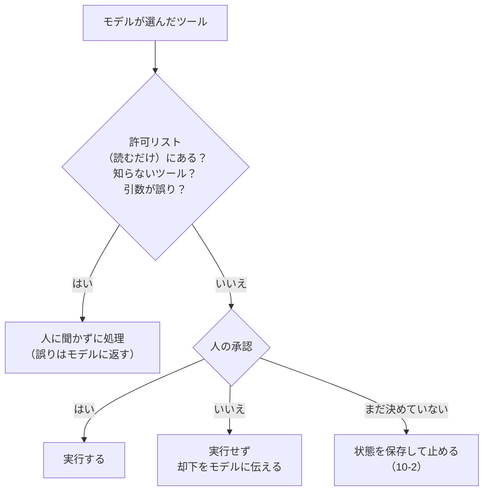

# 10-4 人の承認・回数と費用の上限

!!! abstract "到達目標"
    - どのツールに人の承認が要るかを、許可リストで決められる
    - 承認の画面に何を見せ、却下されたらどうするかを設計し、コードにできる
    - 往復・ツールの呼び出し・トークン・費用の上限を、モデルを呼ぶ前に確かめる形で書ける
    - 07-5 の評価セットの考え方で、エージェントの動き方（どのツールを呼び、起票を提案したか）を測れる

## 何か

エージェントを業務で動かすときは、**止まる仕組みを先に作ります**。止まる仕組みは 2 つです。

- **人の承認**: 書き換えるツール（起票・送信・削除など）は、人が引数を見て「はい」と答えたときだけ実行する
- **上限**: 往復の回数・ツールの呼び出しの回数・トークン数・費用の見積もりのどれかが上限に達したら、モデルを呼ばずに止める

10 のエージェントが、モデルの選んだツールを 1 つ処理する流れです。



## なぜ必要か

モデルは、誤ってツールを選ぶことがあります。資料やツールの結果に紛れた指示に従ってしまうこともあります（11-2）。
書き換えるツールが確認なしに動くと、誤りがそのまま業務のデータに残ります。

MCP の仕様も、ツールの呼び出しを人が拒めるようにし、操作の前に確認を求めるべきだとしています
（[仕様: ツール](https://modelcontextprotocol.io/specification/2026-07-28/server/tools)）。

上限が無いと、モデルが同じツールを呼び続けたとき、止まりません。クラウドの API なら、止まるまでの呼び出しがすべて費用になります（07-4）。

## どうやるか

### 承認が要るツールを決める: 許可リスト

承認なしで実行してよいのは、ホストが名前で決めた **読むだけのツール** だけにします。それ以外は、全部承認を求めます。
「危ないツールを列挙して止める」のではなく、「安全と確かめたツールだけを通す」形です（許可リスト）。
新しいツールを足したとき、書き忘れても承認を求める側に倒れます。

<!-- src: examples/src/roadmap_examples/p10_agent.py -->
```python title="examples/src/roadmap_examples/p10_agent.py"
    name, args = call["name"], call["arguments"]
    event: dict[str, Any] = {"name": name, "arguments": args, "approved": None}
    tool = registry.get(name)
    if tool is None or name in read_only or validate(args, tool.parameters):
        result = call_tool(registry, ToolCall(name, args))
        return result, {**event, "status": "error" if has_error(result) else "ok"}
    decision = approver.review(ApprovalRequest(name, args))
    if decision is None:
        return None
    if not decision.approved:
        result = json.dumps(
            {"error": "人が承認しなかったので、実行していません", "comment": decision.comment}, ensure_ascii=False
        )
        return result, {**event, "status": "denied", "approved": False}
    result = call_tool(registry, ToolCall(name, args))
    return result, {**event, "status": "error" if has_error(result) else "ok", "approved": True}
```

- 知らないツールと、引数が誤った呼び出しは、人に聞かずに誤りとしてモデルに返します。実行できない呼び出しで人の手を止めないためです
- 引数が正しい書き換えのツールだけを、人に見せます
- 承認されたかどうかを、記録（`events`）に残します

### 承認の画面に見せるもの

承認の画面には、**実行される引数そのもの** を見せます。モデルに「これから何をするか」を要約させて見せると、要約と実際の引数が違うことがあるからです。

<!-- src: examples/src/roadmap_examples/p10_agent.py -->
```python title="examples/src/roadmap_examples/p10_agent.py"
    def review(self, request: ApprovalRequest) -> Decision | None:
        print(f"\nツール「{request.tool}」を実行しようとしています:", file=self.out)
        print(json.dumps(request.arguments, ensure_ascii=False, indent=2), file=self.out)
        answer = self.ask("実行してよいですか？ [y/N] ").strip().lower()
        return Decision(True) if answer == "y" else Decision(False, "人が承認しませんでした")
```

- `y` だけを承認とし、それ以外（空のまま Enter を含む）はすべて却下です。迷ったら実行しない側に倒します
- 1 回の承認は、見せた 1 件の呼び出しにだけ有効です。同じ会話で 2 回目の起票があれば、もう一度聞きます

却下したら、実行しなかったことと理由を、ツールの結果としてモデルに伝えます。モデルは却下を読んで、別の答え方を選べます。

<!-- src: examples/tests/test_p10_agent.py -->
```python title="examples/tests/test_p10_agent.py"
def test_denied_issue_is_not_created_and_model_is_told() -> None:
    tracker = MemoryIssueTracker()
    chat = FakeToolChat([file_issue(), say("起票は見送りました")])
    state = run_agent(chat, start_state(QUESTION), tools(tracker), ScriptedApprover([Decision(False, "重複です")]))
    assert tracker.issues == []
    assert state.events[0]["status"] == "denied"
    told = json.loads(chat.calls[1][-1]["content"])
    assert "承認しなかった" in told["error"] and told["comment"] == "重複です"
```

### 承認の後に同じ操作を繰り返さない

モデルが同じ起票を 2 回呼ぶこともあります。人が 2 回とも承認してしまうと、同じ課題が 2 件できます。
起票のツールは、同じ題名があれば新しく作らない作りにしています（何度呼んでも結果が同じ、の意味で「冪等」と呼びます）。

<!-- src: examples/src/roadmap_examples/p10_agent.py -->
```python title="examples/src/roadmap_examples/p10_agent.py"
    def create_issue(title: str, body: str) -> dict[str, Any]:
        same = tracker.find(title)
        if same is not None:  # 同じ題名は作らない（承認の後に同じ呼び出しが繰り返されても、1 件だけ）
            return {"id": same.id, "created": False, "note": "同じ題名の課題が既にあります"}
        return {"id": tracker.create(title, body).id, "created": True}
```

### 上限を決める

上限は 4 つです。どれも、モデルを呼ぶ前に確かめます。

<!-- src: examples/src/roadmap_examples/p10_agent.py -->
```python title="examples/src/roadmap_examples/p10_agent.py"
@dataclass(frozen=True)
class AgentLimits:
    max_steps: int = 6  # モデルを呼ぶ回数
    max_tool_calls: int = 8  # ツールを実行（または却下）する回数
    max_tokens: int = 30_000  # 入力 + 出力の合計
    price: Price = FREE  # 費用の見積もりに使う単価（ローカルのモデルは 0. 07-4）
    max_cost: float | None = None  # 費用の見積もりの上限（None なら見ない）
```

<!-- src: examples/src/roadmap_examples/p10_agent.py -->
```python title="examples/src/roadmap_examples/p10_agent.py"
def limit_reached(state: AgentState, limits: AgentLimits) -> str:
    """上限に達していれば、その理由を返す（達していなければ空の文字列）. モデルを呼ぶ前に確かめる."""
    if state.steps >= limits.max_steps:
        return f"往復の回数が上限（{limits.max_steps} 回）に達しました"
    if state.tokens >= limits.max_tokens:
        return f"トークン数が上限（{limits.max_tokens}）に達しました"
    if limits.max_cost is not None:
        spent = cost(state.input_tokens, state.output_tokens, limits.price)
        if spent >= limits.max_cost:
            return f"費用の見積もりが上限（{limits.max_cost}）に達しました（{spent:.4f}）"
    return ""
```

| 上限 | 決め方の目安 |
|---|---|
| 往復の回数 | 期待する流れ（検索 → 必要なら起票 → 答える）の回数に、言い換えの検索 1〜2 回分を足す |
| ツールの呼び出し | 1 回の往復で複数のツールを呼ぶモデルもあるので、往復とは別に数える |
| トークン数 | 評価セットで 1 件あたりのトークン数を測り（下の評価）、その数倍にする |
| 費用の見積もり | クラウドの API を使うときだけ。1 回の実行で使ってよい金額（07-4） |

上限の値は、評価セットで実際の往復とトークンを測ってから決めます。上限で止まった件が多ければ、上限ではなくプロンプトやツールの説明を見直します。

!!! failure "悪い例"
    ```python
    while True:
        turn = chat.chat(messages, specs)
        if not turn.tool_calls:
            break
        for call in turn.tool_calls:
            messages.append({"role": "tool", "content": run(call)})  # 何でも実行し、止まる条件はモデルしだい
    ```

!!! success "良い例"
    許可リストに無いツールは人の承認を求め、往復・ツール・トークン・費用の上限をモデルを呼ぶ前に確かめる（`run_agent`）。
    止まった理由（`stop_reason`）と、ツールの記録（`events`）を残す。

### エージェントを評価セットで確かめる

07-5 の評価セットの考え方を、エージェントにも当てます。エージェントでは、答えの中身に加えて **動き方** を確かめます。
評価セットは `examples/data/p10/agent_cases.jsonl`（8 件）です。

```json
{"id": "a04", "input": "備品を買うときの承認の流れを教えてください。資料に無ければ課題にしてください。", "expected": {"issue": true, "tools": ["search_docs"]}, "tags": ["起票を頼まれた"]}
{"id": "a06", "input": "備品を買うときの承認の流れを教えてください。", "expected": {"issue": false, "tools": ["search_docs"]}, "tags": ["起票を頼まれていない"]}
```

a04 と a06 は、同じ質問で、起票を頼んだかどうかだけが違います。頼まれていないのに起票を提案したら誤りです。

件ごとに確かめることです。

<!-- src: examples/src/roadmap_examples/p10_eval.py -->
```python title="examples/src/roadmap_examples/p10_eval.py"
def checks(case: EvalCase, output: dict[str, Any]) -> dict[str, bool]:
    """件ごとの確かめること. 名前と、合っていたか."""
    expected = case.expected
    result = {
        "答えた（上限の中で）": output["status"] == ANSWERED,
        "起票の提案": output["proposed_issue"] == expected.get("issue", False),
        "呼ぶべきツール": set(expected.get("tools", [])) <= set(output["called"]),
        "承認なしで書き換えていない": all(
            e["approved"] is True for e in output["events"] if e["name"] == "create_issue" and e["status"] == "ok"
        ),
    }
    words = expected.get("keywords", [])
    if words:
        result["答えの語"] = all(w in output["answer"] for w in words)
    return result
```

評価では、承認の係に `RecordingApprover` を使います。頼まれた承認を記録して、すべて却下します。
起票を「提案したか」は記録で分かり、評価のたびに課題が増えることはありません。

手元のモデルで流します（`examples/` で実行）。1 件ごとに、往復とトークンの上限がかかります。

```bash
uv run python -m roadmap_examples.p10_eval --model <ツールに対応したモデル名>
```

点の平均・タグごとの点・外れた件と、外れた確かめごとが表示されます。結果は次の形の表にまとめます（値はモデルで変わるので、形だけを示します）。

| 項目 | 値 |
|---|---|
| 点の平均 | （表示された値） |
| タグごと | 起票を頼まれた（値）・起票を頼まれていない（値）・答えがある（値）・ツールが要らない（値） |
| 外れた件 | （例: a06: 起票の提案） |
| トークン（入力 / 出力） | （表示された値） |
| 条件 | モデル名・`--max-steps`・`--max-tokens` |

プロンプト（`SYSTEM`）やツールの説明を直したら、評価を流し直し、点が下がった件が無いかを確かめます（07-5 の `compare`）。

### 任意（有料）: クラウドの API で動かす

!!! warning "任意: 従量課金の API を使います"
    ローカルのモデルだけで進める場合は、この節を飛ばしてください（10 の成果物は作れます）。
    試す場合は、先に費用の上限と止め方を決めてください（[学び方](../guide.md) の「従量課金の API は任意」）。

エージェントは、1 件で何回もモデルを呼びます。クラウドの API で動かすときは、次を先に決めます。

1. **1 回の実行の上限**: `AgentLimits` の `price` に公式の料金ページで確かめた単価を入れ、`max_cost` に 1 回の実行で使ってよい金額を入れる。
   `max_steps` と `max_tokens` も、評価セットで測った値をもとに小さめにする
2. **管理画面の上限と通知**: 利用の上限と予算の通知を設定する（上限で止まるか、通知だけかは API ごとに違う）
3. **評価の回数**: 評価セット 8 件 × 1 件の上限で、1 回の評価の最大の費用を見積もってから流す
4. **止め方**: キーの無効化・削除の手順を先に確かめ、使い終わったらキーを消す。キーは `.env` にだけ書く

クラウドの API のツール使用を `ToolChat`（`chat(messages, tools)` を持つクラス）として書けば、`run_agent` と `p10_eval` はそのまま使えます。

## 演習

1. 1 回の実行で起票は 1 件まで、という決まりを足してください。承認の係を包むクラス（1 件承認した後は、すべて却下する）として書き、
   台本で 2 回起票しようとするテストで、2 回目が人に聞かれずに却下されることを確かめます
2. 評価セットに 2 件足してください（「起票を頼まれたが、資料に答えがある」「資料に答えが無いが、起票は頼まれていない」）。
   期待どおりに動く台本と、外れる台本の両方で、点がどう変わるかをテストで確かめます
3. 任意: 手元の Ollama で `p10_eval` を流し、上の形の表を作ってください。外れた件を 1 つ選び、プロンプトかツールの説明を 1 か所だけ直して、流し直した結果と比べます

- できたことの確かめ方: `uv run pytest` が通る。3 は、直す前と後の表（モデル名を添える）と、直した内容
- 目安の時間: 4 時間

解答: [10-4 の解答](answers/10-4.md)

## もし〇〇がなかったら？

**人の承認がなかったら**、モデルの誤りや、資料に紛れた指示で、課題が勝手に起票されます。
起票ならまだ消せますが、メールの送信や支払いのように、取り消せない操作もあります。

**上限がなかったら**、同じツールを呼び続けるループに気づくのは、PC が重くなったときか、請求が届いたときです。
**動き方の評価がなかったら**、頼まれていない起票を提案する癖に、利用者から苦情が来るまで気づけません。

## 理解度チェック

1. 承認が要るツールを「危ないツールの一覧」ではなく「承認なしでよいツールの許可リスト」で決めるのはなぜですか。

    ??? note "答え"
        新しいツールを足したときに書き忘れても、承認を求める側に倒れるからです。
        危ないものの一覧だと、書き忘れたツールが確認なしに実行されます。

2. 承認の画面に、モデルが書いた要約ではなく、実行される引数そのものを見せるのはなぜですか。

    ??? note "答え"
        要約と実際の引数が違うことがあるからです。人が承認するのは、実際に実行される内容でなければ意味がありません。

3. 上限を、モデルを呼んだ後ではなく呼ぶ前に確かめるのはなぜですか。

    ??? note "答え"
        呼んだ後に確かめると、上限を超える 1 回分の費用と時間が、もうかかっているからです。
        呼ぶ前に確かめれば、上限に達した時点で呼ばずに止められます。

4. エージェントの評価で、答えの中身のほかに確かめることを 2 つ挙げてください。評価では、なぜ承認をすべて却下しますか。

    ??? note "答え"
        呼ぶべきツールを呼んだか、起票を頼まれたときだけ提案したか、などです（上限の中で答えたか、承認なしで書き換えていないか、も確かめます）。
        承認をすべて却下するのは、評価のたびに本当に起票されるのを防ぎつつ、提案したかどうかは記録で分かるからです。
