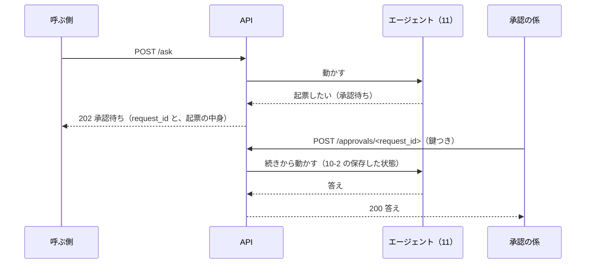

# 12-1 FastAPI で API にする

!!! abstract "到達目標"
    - エージェントを HTTP の API にするときの、パス・本文・状態の番号（ステータスコード）を設計できる
    - 人の承認のように時間のかかる処理を、「承認待ち」を返して後から続ける形で API にできる
    - 同じ API を、標準ライブラリ（WSGI）と FastAPI で書き比べ、テストで確かめられる

## 何か

**API** は、ほかのプログラムから呼べる入り口です。ここでは、11 のガードレールつきのエージェントを、HTTP で呼べるようにします。
画面（チャットの UI）や、ほかの業務システム、CI から、同じ入り口で呼べるようになります。

12 で作る API は 3 つの入り口を持ちます（`examples/src/roadmap_examples/p12_api.py`）。

| メソッドとパス | 本文 | 返すもの |
|---|---|---|
| `GET /healthz` | なし | 動いているか（`200`）。モデルは呼ばない |
| `POST /ask` | `{"question": "..."}` | 答え（`200`）か、承認待ち（`202`。何を承認するかを返す） |
| `POST /approvals/<request_id>` | `{"approved": true}` | 承認した後の答え（`200`）。承認の係の鍵が要る |



**FastAPI** は、Python で API を書く代表的なライブラリです。本文の形を型で書くと、受け取った JSON の確かめと、API の説明書を作ってくれます
（[公式ドキュメント: FastAPI の最初の一歩](https://fastapi.tiangolo.com/tutorial/first-steps/)）。

## なぜ必要か

10 のエージェントは、コマンドで 1 回ずつ動かすものでした。業務で使うには、次のことが要ります。

- 画面やほかのシステムから、いつでも呼べる
- 何人もの利用者が、それぞれの質問を送れる
- 人の承認を、その場で画面に聞くのではなく、承認の係が後から返せる（承認は数分後かもしれないし、翌日かもしれない）
- 1 回ごとの応答時間・トークン・結果を記録して、監視できる（12-4）

API にすると、エージェントの中身（モデル・プロンプト・ツール）を変えても、呼ぶ側を変えずに済みます。

## どうやるか

### 入り口と状態の番号を決める

状態の番号（HTTP のステータスコード）は、呼ぶ側が次に何をすればよいかが分かるように選びます。

| 番号 | いつ | 呼ぶ側がすること |
|---|---|---|
| `200` | 答えた。入力で止めた（`status` が `blocked`）・上限で止まった（`stopped`）ときも `200` で、`status` で区別する | `answer` を見せる |
| `202` | 承認待ち（`waiting_approval`） | 承認の係に `approval` を見せる |
| `400` | 本文が JSON でない・`question` が無い | 呼び方を直す |
| `401` / `403` | 承認の鍵が違う / 承認の API が無効 | 鍵を確かめる |
| `404` / `409` | 承認待ちの依頼が無い / もう承認待ちではない | 二重に承認していないか確かめる |
| `413` | 本文が大きすぎる（16 KB 超） | 短くする |
| `503` | モデルに繋がらない | 時間をおいて送り直す |

入力で止めた・上限で止まったを `200` にしているのは、API の呼び方は正しく、エージェントが「答えられない」と判断した結果だからです。
呼び方の誤り（`400` 台）と、モデルの都合（`503`）とは分けます。

### 標準ライブラリで書く

`examples/` では、依存を増やさないように、Python の標準ライブラリの WSGI（Web サーバーと Python のアプリをつなぐ決まり）で書いています
（[公式ドキュメント: wsgiref](https://docs.python.org/ja/3/library/wsgiref.html)）。
アプリは `app(environ, start_response)` の形の関数で、テストでは、サーバーを立てずに関数として呼べます。

<!-- src: examples/src/roadmap_examples/p12_api.py -->
```python title="examples/src/roadmap_examples/p12_api.py"
    def __call__(self, environ: dict[str, Any], start_response: StartResponse) -> Iterable[bytes]:
        method, path = environ.get("REQUEST_METHOD", "GET"), environ.get("PATH_INFO", "/")
        if method == "GET" and path == "/healthz":
            status, body = 200, {"status": "ok", "model": self.model, "prompt_version": self.version}
        elif method == "POST" and path == "/ask":
            status, body = self.ask(environ)
        elif method == "POST" and APPROVAL_PATH.match(path):
            status, body = self.approve(environ, APPROVAL_PATH.match(path).group("id"))
        else:
            status, body = 404, {"error": "そのパスはありません"}
```

`/ask` は、本文を確かめてから、11 の `run_guarded` を呼びます。承認の係は「まだ決めていない」を返す `Deferred` です。
API ではその場で人に聞けないので、書き換えのツールに来たら、状態を保存して `202` を返します。

<!-- src: examples/src/roadmap_examples/p12_api.py -->
```python title="examples/src/roadmap_examples/p12_api.py"
    def ask(self, environ: dict[str, Any]) -> tuple[int, dict[str, Any]]:
        code, data = self.read_json(environ)
        if code:
            return code, {"error": "本文は JSON のオブジェクトにしてください（16 KB まで）"}
        question = data.get("question")
        if not isinstance(question, str) or not question.strip():
            return 400, {"error": "question（文字列）を入れてください"}
        return self.run(uuid.uuid4().hex, "/ask", question, None, Deferred())
```

### 承認を後から受け取る

承認の API は、承認の係だけが知る鍵（環境変数 `APPROVER_TOKEN`）で守ります。質問を送る利用者が、自分で承認できてはいけないからです。

<!-- src: examples/src/roadmap_examples/p12_api.py -->
```python title="examples/src/roadmap_examples/p12_api.py"
    def approve(self, environ: dict[str, Any], request_id: str) -> tuple[int, dict[str, Any]]:
        if not self.approver_token:
            return 403, {"error": "承認の API は無効です（APPROVER_TOKEN が設定されていません）"}
        scheme, _, given = environ.get("HTTP_AUTHORIZATION", "").partition(" ")
        if scheme.lower() != "bearer" or not hmac.compare_digest(
            given.encode("utf-8"), self.approver_token.encode("utf-8")
        ):
            return 401, {"error": "承認の係の鍵が違います"}
        code, data = self.read_json(environ)
        if code or not isinstance(data.get("approved"), bool):
            return 400, {"error": 'approved（true か false）を入れてください. 例: {"approved": true}'}
        saved = self.store.load(request_id)
        if saved is None:
            return 404, {"error": "承認待ちの依頼が見つかりません"}
        question, state = saved
        if state.status != WAITING:
            return 409, {"error": "この依頼は承認待ちではありません"}
        decision = Decision(data["approved"], str(data.get("comment", "")))
        return self.run(request_id, "/approvals", question, state, Fixed(decision))
```

- `Authorization` は「方式 鍵」の形なので、空白で分けて、方式が `Bearer` であることも確かめます
- 鍵の比べ方は `hmac.compare_digest` です。ふつうの `==` は、違う文字が見つかった所で比べるのをやめるので、かかった時間から鍵を推し量られる恐れがあります
  （[公式ドキュメント: hmac.compare_digest](https://docs.python.org/ja/3/library/hmac.html#hmac.compare_digest)）
- 鍵が設定されていなければ、承認の API そのものを無効にします（`403`）。鍵の付け忘れで、誰でも承認できる状態になるのを防ぎます
- 保存した状態（10-2）から続きを動かすので、承認が翌日でも、サーバーを再起動していても動きます。承認が済んだ状態のファイルは消します
- 承認待ちのファイル（`var/pending/`）には、会話（質問の本文）が入っています。承認されないまま放っておくと残り続けるので、
  期限（例: 7 日）を決め、それより古い承認待ちのファイルは消す運用にします（ファイルの更新日時で選んで消す。12 のコードには入れていません）

この流れは、テストで確かめています。

<!-- src: examples/tests/test_p12_api.py -->
```python title="examples/tests/test_p12_api.py"
def test_issue_waits_for_approval_then_continues(tmp_path: Path) -> None:
    tracker = MemoryIssueTracker()
    app = make_app(tmp_path, [search("延長 回数"), file_issue(), say("起票しました")], tracker)
    status, body = call(app, "POST", "/ask", {"question": FILE})
    assert status == 202 and body["status"] == "waiting_approval"
    assert body["approval"]["tool"] == "create_issue" and tracker.issues == []
    request_id = body["request_id"]
    assert (tmp_path / "pending" / f"{request_id}.json").is_file()

    assert call(app, "POST", f"/approvals/{request_id}", {"approved": True})[0] == 401  # 鍵が無い
    assert call(app, "POST", f"/approvals/{request_id}", {"approved": True}, token="wrong")[0] == 401
    basic = {"REQUEST_METHOD": "POST", "PATH_INFO": f"/approvals/{request_id}", "HTTP_AUTHORIZATION": f"Basic {TOKEN}"}
    basic |= {"CONTENT_LENGTH": "18", "wsgi.input": io.BytesIO(b'{"approved": true}')}
    setup_testing_defaults(basic)
    status: list[str] = []
    app(basic, lambda s, _h: status.append(s))
    assert status[0].startswith("401")  # Bearer 以外の書き方は受け付けない
    status, body = call(app, "POST", f"/approvals/{request_id}", {"approved": True}, token=TOKEN)
    assert status == 200 and body["answer"] == "起票しました"
    assert [i.title for i in tracker.issues] == ["延長の回数が資料に無い"]
    assert not (tmp_path / "pending" / f"{request_id}.json").exists()
    assert call(app, "POST", f"/approvals/{request_id}", {"approved": True}, token=TOKEN)[0] == 404
```

### 手元で動かす

```bash
# examples/ で. 鍵は長いランダムな文字列にする（例: python -c "import secrets; print(secrets.token_hex(16))"）
APPROVER_TOKEN=<承認の係の鍵> uv run python -m roadmap_examples.p12_api --model <ツールに対応したモデル名>

# 別の端末で
curl -s localhost:8000/healthz
curl -s localhost:8000/ask -H "Content-Type: application/json" -d '{"question": "備品は何日間借りられますか？"}'
```

- 既定では `127.0.0.1`（自分の PC）だけで待ち受けます。ほかの PC から呼べるようにするのは、12-2 でコンテナにするときです
- 記録（`requests.jsonl`）・承認待ち・起票先は `var/` に置かれます（`--data-dir` で変えられる）。`var/` は `.gitignore` に入れています
- 標準ライブラリのサーバー（`wsgiref`）は、1 度に 1 つの依頼しか処理しません。学ぶ・試すには十分ですが、多くの人が使うなら次の FastAPI と、そのサーバーを使います

### FastAPI で書く（例）

同じ `/ask` を FastAPI で書いた例です。`examples/` には入れていません（依存が増えるため）。自分のプロジェクトで試すときは、別のフォルダで入れます。

```bash
uv add "fastapi[standard]" httpx    # httpx はテスト（TestClient）に要る
```

例: `main.py`（承認の API は省いています）

```python
from fastapi import FastAPI, HTTPException
from pydantic import BaseModel, Field

from roadmap_examples.ollama_client import OllamaChat
from roadmap_examples.p08_chunk import load_chunks
from roadmap_examples.p08_rag import DEFAULT_DOCS
from roadmap_examples.p08_search import BM25
from roadmap_examples.p10_agent import MemoryIssueTracker, qa_tools
from roadmap_examples.p11_guard import run_guarded
from roadmap_examples.p12_api import Deferred

app = FastAPI()
TOOLS = qa_tools(BM25(load_chunks(DEFAULT_DOCS)), MemoryIssueTracker())


def make_chat():
    return OllamaChat("<モデル名>", options={"temperature": 0})


class AskBody(BaseModel):
    question: str = Field(min_length=1, max_length=1000)


class AskReply(BaseModel):
    status: str
    answer: str


@app.get("/healthz")
def healthz() -> dict[str, str]:
    return {"status": "ok"}


@app.post("/ask")
def ask(body: AskBody) -> AskReply:
    result = run_guarded(make_chat(), body.question, TOOLS, Deferred())
    if result.status == "waiting_approval":
        raise HTTPException(status_code=501, detail="承認の API はこの例では省いています")
    return AskReply(status=result.status, answer=result.answer)
```

例: `test_main.py`（[公式ドキュメント: テスト](https://fastapi.tiangolo.com/tutorial/testing/)）

```python
from fastapi.testclient import TestClient

import main
from roadmap_examples.ollama_client import ChatTurn, ToolCall
from roadmap_examples.p07_tools import FakeToolChat

client = TestClient(main.app)


def test_ask(monkeypatch):
    search = ChatTurn("", [ToolCall("search_docs", {"query": "貸出 期間"})], 1, 1)
    chat = FakeToolChat([search, ChatTurn("14 日です", [], 1, 1)])
    monkeypatch.setattr(main, "make_chat", lambda: chat)
    response = client.post("/ask", json={"question": "備品は何日間借りられますか？"})
    assert response.status_code == 200
    assert response.json() == {"status": "answered", "answer": "14 日です"}


def test_validation():
    assert client.post("/ask", json={"question": ""}).status_code == 422
    assert client.get("/healthz").json() == {"status": "ok"}
```

この 2 つのファイルは、FastAPI を入れた別の環境で、テストが通ることを確かめています。WSGI の版と比べた違いです。

| 観点 | 標準ライブラリ（WSGI） | FastAPI |
|---|---|---|
| 本文の確かめ | 自分で書く（`read_json`・型の確かめ） | 型（`AskBody`）を書けば、確かめて `422` を返してくれる |
| API の説明書 | 自分で書く | 自動で作られる（`/docs`） |
| 同時に来た依頼 | `wsgiref` は 1 つずつ | 本番向けのサーバーで、複数を並べて処理できる |
| 依存 | なし | FastAPI と、その依存 |

!!! failure "悪い例"
    `/ask` の中で、承認の答えを `input()` で待つ。承認の API に鍵が無く、誰でも `approved: true` を送れる。
    モデルに繋がらないと、HTTP の 500 とエラーの全文（スタックトレース）がそのまま返る。

!!! success "良い例"
    承認待ちは `202` で返して状態を保存し、承認は鍵つきの別の入り口で受ける。
    モデルに繋がらないときは `503` と決まった文を返し、詳しい理由は記録（12-4）に残す。

## 演習

1. `GET /requests/<request_id>` を足し、承認待ちの依頼の中身（承認を待っているツールと引数）を返すようにしてください。
   承認待ちでない・無い依頼は `404` にし、承認の鍵が無いと見られないようにします。テストも書きます
2. 承認の API に `{"approved": false, "comment": "重複です"}` を送ったとき、課題が作られず、
   モデルに却下の理由が伝わる（10-4）ことを確かめるテストを書いてください
3. 任意: FastAPI の例に、承認の API（`POST /approvals/{request_id}`）を足してください。鍵は `Header` で受け取り、`hmac.compare_digest` で比べます

- できたことの確かめ方: `uv run pytest` が通る。3 は FastAPI を入れた環境でテストが通る
- 目安の時間: 4 時間

解答: [12-1 の解答](answers/12-1.md)

## もし〇〇がなかったら？

**API がなかったら**、エージェントを使うたびに、誰かがコマンドを打つことになります。
画面やほかのシステムから使えず、1 回ごとの応答時間やトークンも記録できないので、監視（12-4）も始められません。

**承認待ちを返す仕組みがなかったら**、承認が済むまで HTTP の接続を開いたまま待つことになります。
承認が数分後なら接続が切れ、エージェントの途中の状態も失われます。もう一度質問を送ると、検索からやり直しになり、トークンも二重にかかります。

## 理解度チェック

1. 入力で止めた・上限で止まったときに、`400` ではなく `200` を返し、本文の `status` で区別するのはなぜですか。

    ??? note "答え"
        呼び方（本文の形）は正しく、エージェントが判断した結果だからです。`400` 台は「呼ぶ側が呼び方を直す」ときに使います。
        混ぜると、呼ぶ側が自分の誤りなのか、エージェントの判断なのかを区別できません。

2. 人の承認を API にするとき、`202` を返して、後から別の入り口で承認を受け取るのはなぜですか。

    ??? note "答え"
        承認は、いつ返ってくるか分からないからです。その場で待つと接続が切れ、途中の状態も失われます。
        状態を保存して `202` を返せば、承認が翌日でも、続きから動かせます。

3. 12 の API では、質問の API には鍵を付けず（自分の PC だけで待ち受ける）、承認の API だけに鍵を付けています。承認の API を分けて鍵で守るのはなぜですか。

    ??? note "答え"
        質問を送る人が、自分で承認できてはいけないからです。承認は、書き換えを確かめる係だけができるようにします。
        質問の API に鍵が無いのは、自分の PC だけで待ち受けているからです。ほかの PC に開くときは、質問の API にも認証を付けます（12-3）。
        鍵が設定されていなければ、承認の API そのものを無効にして、付け忘れで誰でも承認できる状態を防ぎます。

4. FastAPI で本文の形を型（`AskBody`）で書くと、何をしてくれますか。

    ??? note "答え"
        受け取った JSON が型に合うかを確かめ、合わなければ `422` を返してくれます。型から API の説明書（`/docs`）も作られます。
        標準ライブラリの版では、これを自分で書いています。
