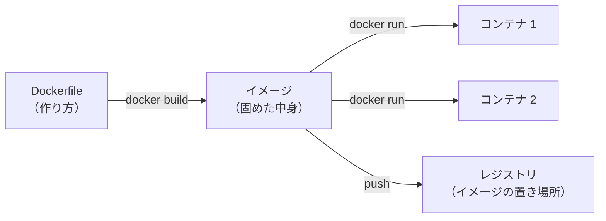

# 12-2 Docker と CI/CD

!!! abstract "到達目標"
    - コンテナとイメージの違いを説明でき、12-1 の API を動かす Dockerfile を読んで書ける
    - Ollama とエージェントの API を、compose で一緒に動かせる
    - CI でテストとイメージの組み立てを流し、コミットに結びついた版のイメージを作る流れ（CI/CD）を設計できる

## 何か

**コンテナ** は、アプリと、それが動くのに要るもの（Python・依存・設定）をまとめて、ほかから切り離して動かす仕組みです。
コンテナの元になる、固めた中身を **イメージ** と呼び、イメージの作り方を書いたファイルが **Dockerfile** です。
Java でいえば、アプリと JRE と依存の JAR を 1 つにまとめて、どの PC でも同じように起動できる形にするイメージです。



**CI/CD** は、変更のたびに、テスト（CI: 継続的インテグレーション）と、配れる形への組み立て・配備（CD: 継続的デリバリー・デプロイ）を自動で流す仕組みです。
この教材のリポジトリも、push のたびに検査とテストを流し、通ったときだけサイトを公開しています（`.github/workflows/ci.yml`）。

## なぜ必要か

12-1 の API を、別の PC やクラウドで動かそうとすると、次のことで止まりがちです。

- Python の版や依存の版が違って、手元では動いたのに動かない
- 起動の手順（環境変数・データの置き場所）が、人の記憶にしかない
- テストを通っていない変更が、そのまま配備される

コンテナにすると、「この Dockerfile から作ったイメージ」は、どこで動かしても同じ中身です。
CI でテストとイメージの組み立てを流せば、「テストが通ったコミットのイメージだけを配る」ことができます。

## どうやるか

### Dockerfile を書く

`examples/Dockerfile` です。uv の公式の説明にある、依存とコードを分けて入れる書き方に沿っています
（[公式ドキュメント: uv と Docker](https://docs.astral.sh/uv/guides/integration/docker/)）。

<!-- src: examples/Dockerfile -->
```dockerfile title="examples/Dockerfile"
# 版はタグ（パッチの版と OS まで）と digest（中身の目印）で固定する. 更新するときは両方を書き換える
FROM python:3.12.16-slim-trixie@sha256:dacd1678a25ee255c22ea5de948374f5542db3562dd365038b14349051ea156c

# uv は公式のイメージから写す（https://docs.astral.sh/uv/guides/integration/docker/ ）. 版は extra.versions.uv と同じ（check_versions.py が照合）
COPY --from=ghcr.io/astral-sh/uv:0.8.17@sha256:e4644cb5bd56fdc2c5ea3ee0525d9d21eed1603bccd6a21f887a938be7e85be1 /uv /uvx /bin/
ENV UV_COMPILE_BYTECODE=1
WORKDIR /app

# 依存だけを先に入れる（コードだけを直したときは、この層を作り直さない）
COPY pyproject.toml uv.lock ./
RUN uv sync --locked --no-dev --no-install-project

# コードと題材（設計書）を入れて、プロジェクトを入れる
COPY README.md ./
COPY src ./src
COPY data ./data
RUN uv sync --locked --no-dev
```

- **版を固定する**: Python のイメージ・uv のイメージ・依存（`uv.lock`）の版を固定します。イメージは、タグ（パッチの版と OS まで: `3.12.16-slim-trixie`）と、
  中身の目印の digest（`@sha256:…`）の両方で書きます。タグだけだと、同じタグのまま中身が差し替わることがあるからです。digest は、公式のレジストリでタグを調べて書き写しました
- **uv の版**: 演習で使う uv と同じにしています（学び方のページの版）。`scripts/check_versions.py` が、この行の版と `mkdocs.yml` の `extra.versions.uv` を照合し、ずれたら CI で止めます
- **層を分ける**: Docker は、Dockerfile の行ごとに結果（層）を取っておき、変わっていない行は作り直しません。
  依存を先に入れておくと、コードだけを直したときは、依存の層が使い回されて速く組み立てられます
- **`--locked`**: `uv.lock` が `pyproject.toml` と合っていなければ失敗します。手元と違う版が入るのを防ぎます。`--no-dev` で、テスト用の依存（pytest など）は入れません

<!-- src: examples/Dockerfile -->
```dockerfile title="examples/Dockerfile"
# root では動かさない. 記録と承認待ちは /app/var（ボリュームをつなぐ）
RUN useradd --create-home agent && mkdir -p /app/var && chown agent /app/var
USER agent
ENV AGENT_DATA_DIR=/app/var
EXPOSE 8000
HEALTHCHECK --interval=30s --timeout=3s \
  CMD ["/app/.venv/bin/python", "-c", "import urllib.request; urllib.request.urlopen('http://127.0.0.1:8000/healthz', timeout=2)"]
CMD ["/app/.venv/bin/python", "-m", "roadmap_examples.p12_api", "--host", "0.0.0.0", "--port", "8000"]
```

- **root で動かさない**: コンテナの中でも、管理者（root）でアプリを動かさないようにします。乗っ取られたときの被害を小さくするためです
- **書き込む場所を分ける**: 記録・承認待ち・起票先は `/app/var` だけに書きます。コンテナは作り直すと中身が消えるので、ここにボリューム（コンテナの外に残る置き場所）をつなぎます
- **`HEALTHCHECK`**: 12-1 の `/healthz` を定期的に呼び、動いているかを Docker に知らせます（[公式ドキュメント: HEALTHCHECK](https://docs.docker.com/reference/dockerfile/#healthcheck)）
- **待ち受ける場所**: コンテナの中では `0.0.0.0`（すべての場所）で待ち受けます。外からどこまで呼べるかは、コンテナを動かす側（下の compose の `ports`）で絞ります

イメージに入れないものは `examples/.dockerignore` に書きます（`.venv`・テスト・記録・`.env`）。
手元の仮想環境はその PC 用なので、イメージの中で作り直します（[公式ドキュメント: ビルドの文脈](https://docs.docker.com/build/concepts/context/)）。
`.env` を入れないのは、秘密をイメージに焼き込まないためです。秘密は、動かすときに環境変数で渡します。

```bash
cd examples
docker build -t roadmap-agent .
docker run --rm -p 127.0.0.1:8000:8000 -e AGENT_MODEL=<モデル名> -e OLLAMA_BASE_URL=http://<Ollama の場所>:11434 roadmap-agent
```

手元でこのイメージを組み立て、`/healthz` が `200` を返すこと、Ollama に繋がらないと `/ask` が `503` を返して記録に残ることを確かめています。

### compose で Ollama と一緒に動かす

エージェントの API は、Ollama が無いと答えられません。compose を使うと、複数のコンテナをまとめて動かせます
（[公式ドキュメント: Docker Compose](https://docs.docker.com/compose/)）。Ollama の公式のイメージは `ollama/ollama` です
（[公式ドキュメント: Ollama の Docker](https://docs.ollama.com/docker)）。

<!-- src: examples/compose.yaml -->
```yaml title="examples/compose.yaml"
services:
  ollama:
    image: ollama/ollama:${OLLAMA_TAG:-0.40.11} # 版を固定する（上げるときは OLLAMA_TAG か、この既定を書き換える）
    volumes:
      - ollama:/root/.ollama # 入れたモデルを、作り直しても残す
  agent:
    build: .
    environment:
      AGENT_MODEL: ${AGENT_MODEL:?AGENT_MODEL に、ツールに対応したモデル名を書いてください}
      OLLAMA_BASE_URL: http://ollama:11434 # 同じ compose の中では、サービス名で呼べる
      APPROVER_TOKEN: ${APPROVER_TOKEN:-} # 空なら、承認の API は使えない
    ports:
      - "127.0.0.1:8000:8000" # 自分の PC からだけ呼べるようにする
    volumes:
      - agent-data:/app/var # 記録（requests.jsonl）・承認待ち・起票先
    depends_on:
      - ollama
```

- `${AGENT_MODEL:?…}` は、値が無ければ、その文を出して止める書き方です（[公式ドキュメント: 変数の展開](https://docs.docker.com/compose/how-tos/environment-variables/variable-interpolation/)）。
  モデル名の書き忘れで、動かない API が立ち上がるのを防ぎます
- 値は、リポジトリ直下の `.env`（`.env.example` を写したもの）に `AGENT_MODEL` と `APPROVER_TOKEN` を書いて渡します
- Ollama は `ports` を書いていないので、自分の PC からも直接は呼べません。エージェントの API だけが、compose の中の名前（`ollama`）で呼びます
- `ports` の `127.0.0.1:` で、自分の PC からだけ呼べるようにしています。ほかの PC に開くときは、承認の鍵に加えて、質問の API にも認証を付けてからにします

```bash
cd examples
docker compose --env-file ../.env up --build -d
docker compose exec ollama ollama pull <モデル名>      # 最初の 1 回だけ
curl -s localhost:8000/ask -H "Content-Type: application/json" -d '{"question": "備品は何日間借りられますか？"}'
docker compose logs agent                              # 動きを見る
docker compose down                                    # 止める（ボリュームは残る）
```

!!! failure "悪い例"
    `FROM python:latest` で始め、`pip install` で版を固定せずに入れる。`.env` ごとイメージにコピーする。
    root のまま動かし、記録はコンテナの中に書く（作り直すと消える）。

!!! success "良い例"
    ベースのイメージと uv と依存の版を固定し、依存の層を先に作る。秘密は動かすときの環境変数で渡す。
    root でないユーザーで動かし、書き込む場所をボリュームに分ける。`HEALTHCHECK` で動いているかを確かめる。

### CI でテストとイメージの組み立てを流す

CI では、テストが通ってから、イメージを組み立てて、動くかを確かめます。イメージには、コミットの SHA（変更の目印）を名前に付けます。
`latest` のような動く名前だけだと、どの変更のイメージが動いているかが分からなくなるからです。

例: 自分のリポジトリの `.github/workflows/image.yml`（11-4 の守りのテストの後に置く）

```yaml
name: image
on:
  pull_request:
  push:
    branches: [main]
permissions:
  contents: read
jobs:
  build:
    runs-on: ubuntu-latest
    timeout-minutes: 20
    steps:
      - uses: actions/checkout@v7 # 実際はコミットの SHA で固定する
        with:
          persist-credentials: false
      - name: イメージを組み立てる
        working-directory: examples
        run: docker build -t roadmap-agent:${{ github.sha }} .
      - name: 起動して /healthz を確かめる（モデルは呼ばない）
        run: |
          docker run -d --name agent -p 127.0.0.1:8000:8000 -e AGENT_MODEL=check roadmap-agent:${{ github.sha }}
          for i in $(seq 1 10); do curl -fsS localhost:8000/healthz && exit 0; sleep 2; done
          docker logs agent
          exit 1
```

- イメージを組み立てる前に、11-4 の守りのテスト（`uv run pytest`）を同じワークフローか別のワークフローで流し、通ったものだけを使います
- 起動の確かめでは、モデルを呼ばない `/healthz` だけを見ます。CI に Ollama は要りません
- イメージをレジストリ（イメージの置き場所）に送るのは、main に入ったときだけにします。GitHub のコンテナのレジストリなら、
  ワークフローの `GITHUB_TOKEN` で送れます（[公式ドキュメント: コンテナのレジストリ](https://docs.github.com/ja/packages/working-with-a-github-packages-registry/working-with-the-container-registry)）。
  送るジョブだけに `packages: write` の権限を付けます

この流れをまとめると、次のとおりです。

| 段階 | いつ | 何を | 失敗したら |
|---|---|---|---|
| CI | PR・push のたび | 静的解析・テスト（11-4 の攻撃例を含む）・イメージの組み立てと起動の確かめ | PR を通さない |
| 送る | main に入ったとき | コミットの SHA の名前で、イメージをレジストリに送る | 配備しない |
| 配備（12-3） | 人が決めたとき | 送ったイメージの SHA を指定して動かす | 前の SHA に戻す |

## 演習

1. `examples/` で `docker build` し、`docker run` で起動して `/healthz` を呼んでください。さらに Ollama を止めたまま `/ask` を呼び、
   `503` が返ることと、`docker exec` で `/app/var/requests.jsonl` に `error` の記録が残ることを確かめます（Docker が使えない環境なら、Dockerfile を読んで各行の役目を説明します）
2. Dockerfile の `COPY src ./src` を `COPY . .` に変えると、何が起きうるかを 2 つ挙げてください（`.dockerignore` も見ます）
3. compose で `docker compose up` し、モデルを入れてから、12-1 の承認の流れ（`202` → `/approvals`）を `curl` で通してください。
   `docker compose down` の後にもう一度 `up` して、`requests.jsonl` が残っていることを確かめます
4. 上の `image.yml` の例に、11-4 の守りのテストが通ってからイメージを組み立てるように、ジョブの順番（`needs`）を足してください

- できたことの確かめ方: 1・3 は、実行したコマンドと結果。2 は説明。4 は YAML
- 目安の時間: 4 時間

解答: [12-2 の解答](answers/12-2.md)

## もし〇〇がなかったら？

**コンテナがなかったら**、配備する PC ごとに、Python と依存と設定を手で整えることになります。
手順書どおりにしたつもりでも、少しの版の違いで動かず、「手元では動くのに」が繰り返されます。

**CI/CD がなかったら**、テストを流し忘れた変更や、誰かの PC で手で組み立てたイメージが配備されます。
問題が起きたとき、どの変更のイメージが動いているのかが分からず、前の版に戻すこともできません。

## 理解度チェック

1. イメージとコンテナの違いを説明してください。

    ??? note "答え"
        イメージは、アプリと動くのに要るものを固めた中身（作り方は Dockerfile）です。
        コンテナは、イメージから起動した、動いている 1 つの実体です。1 つのイメージから、いくつものコンテナを起動できます。

2. Dockerfile で、依存を入れる行を、コードをコピーする行より先に書くのはなぜですか。

    ??? note "答え"
        Docker は行ごとの結果（層）を取っておき、変わっていない行は作り直さないからです。
        依存を先に入れておけば、コードだけを直したときは依存の層が使い回され、組み立てが速くなります。

3. `.env` をイメージに入れず、動かすときに環境変数で渡すのはなぜですか。

    ??? note "答え"
        イメージに入れると、イメージを手に入れた人なら誰でも秘密を取り出せるからです。
        環境変数で渡せば、同じイメージを、環境ごとに違う秘密で動かせます。

4. CI で作るイメージに、`latest` だけでなくコミットの SHA の名前を付けるのはなぜですか。

    ??? note "答え"
        どの変更から作ったイメージかが、名前で分かるからです。問題が起きたら、前の SHA のイメージを指定して戻せます。
        `latest` は新しいイメージが来るたびに中身が変わるので、何が動いているかが分からなくなります。
