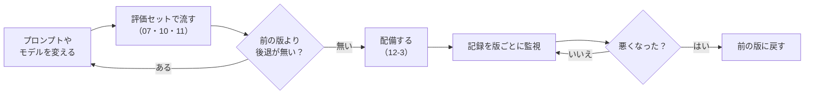

# 12-4 監視とモデル・プロンプトの版管理

!!! abstract "到達目標"
    - AI アプリで見るべき数字（状態ごとの割合・応答時間・トークンと費用・ガードレールが見つけたこと）を挙げ、1 回ごとの記録から集計できる
    - 1 回の依頼の中で、どの往復が遅いかを追える記録（追跡）を残せる
    - モデルとプロンプトに版を付けて記録し、版ごとに結果を比べ、悪くなったら前の版に戻せる

## 何か

**監視** は、動いているシステムの数字を見続け、悪くなったら気づける仕組みです。
ふつうの Web アプリなら、エラーの割合と応答時間を見ます。AI アプリでは、それに加えて次を見ます。

| 見るもの | 何が分かるか | 12 での記録の場所 |
|---|---|---|
| 状態ごとの割合（答えた・承認待ち・上限で止めた・入力で止めた・エラー） | 上限で止まる依頼が増えた、モデルに繋がらない | `status` |
| 応答時間（中央値と 95 パーセンタイル） | 遅くなった。まれに極端に遅い依頼がある | `latency_ms` |
| トークンと費用の見積もり | 1 件あたりの入力が増えた（資料が長い・往復が多い） | `input_tokens`・`output_tokens`・`cost` |
| ガードレールが見つけたこと | 攻撃が増えた・資料に個人情報が混ざっている | `findings` |
| 版 | どのモデルとプロンプトの組み合わせの結果か | `model`・`prompt_version` |

**95 パーセンタイル** は、応答時間を小さい順に並べて、95% の位置の値です。「20 回に 1 回は、これより遅い」の境目です。
平均では、まれに極端に遅い依頼が埋もれてしまうので、中央値（50 パーセンタイル）と一緒に見ます。

**版管理** は、モデルとプロンプトの組み合わせに名前（版）を付けて、記録と評価の結果をその版に結びつけることです。
コードを Git で管理するのと同じように、プロンプトとモデルも「いつ、何に変えたか」を追えるようにします。

## なぜ必要か

AI アプリは、コードを変えなくても振る舞いが変わります。

- モデルの名前が同じでも、入れ直したときに中身（重み）が変わっていた
- 資料（08 の設計書）が増えて、検索の結果が長くなり、トークンと応答時間が増えた
- 攻撃を試す人が現れ、ガードレールで止める依頼が急に増えた

記録が無いと、「最近遅い」「最近おかしい」と言われても、いつから・何が原因かを調べられません。
版が記録に無いと、プロンプトを直した後に悪くなっても、直す前と比べられず、戻すべき版も分かりません。

## どうやるか

### 1 回ごとに記録を残す

12-1 の API は、1 回の依頼ごとに、JSONL の記録に 1 行を足します。

<!-- src: examples/src/roadmap_examples/p12_api.py -->
```python title="examples/src/roadmap_examples/p12_api.py"
        self.log.write(
            {
                "time": self.now().isoformat(timespec="seconds"),
                "request_id": request_id,
                "endpoint": endpoint,
                "status": result.status,
                "latency_ms": round((self.clock() - started) * 1000, 1),
                "input_tokens": tokens_in,
                "output_tokens": tokens_out,
                "cost": cost(tokens_in, tokens_out, self.price),
                "model": self.model,
                "prompt_version": self.version,
                "findings": result.findings,
                "trace": chat.spans
                + [{"kind": "tool", "name": e["name"], "status": e["status"]} for e in (final.events if final else [])],
            }
        )
```

- **質問と答えの本文は残しません**。本文には個人情報が入りうるので（11-3）、記録を見られる人に広がるのを防ぎます。
  何が起きたかは、状態・トークン・ガードレールの見つけたこと・ツールの記録で追います
- `request_id` は、API の答えにも入れています。利用者から「この依頼がおかしい」と言われたら、`request_id` で記録を探します
- 費用の見積もりは、単価（`--price-in`・`--price-out`）を渡したときだけ 0 以外になります（ローカルのモデルは 0）

### どの往復が遅いかを追う

1 回の依頼の中で、モデルを何回呼び、どれに時間がかかったかを残します（**追跡**、トレース）。
モデルの呼び出しを包んで、1 回ごとの時間とトークンを記録します。

<!-- src: examples/src/roadmap_examples/p12_api.py -->
```python title="examples/src/roadmap_examples/p12_api.py"
    def chat(self, messages: Sequence[dict[str, Any]], tools: Sequence[dict[str, Any]] | None = None) -> ChatTurn:
        started = self.clock()
        turn = self.inner.chat(messages, tools)
        self.spans.append(
            {
                "kind": "model",
                "ms": round((self.clock() - started) * 1000, 1),
                "input_tokens": turn.input_tokens,
                "output_tokens": turn.output_tokens,
                "tool_calls": [c.name for c in turn.tool_calls],
            }
        )
        return turn
```

記録の `trace` には、モデルの往復とツールの記録が並びます。例えば「往復が 6 回あって、最後の往復の入力トークンが多い」なら、
検索の結果が会話に積み重なっています（10-2 の会話を削る処理を見直す）。

本番では、このような追跡を、決まった形で集めて画面で見る仕組み（OpenTelemetry など）に送ることが多いです
（[公式ドキュメント: OpenTelemetry のトレース](https://opentelemetry.io/docs/concepts/signals/traces/)）。
LLM の呼び出しの記録の決め方（属性の名前など）も、OpenTelemetry の生成 AI 向けの決まりとしてまとめられています
（[OpenTelemetry: 生成 AI の決まり](https://github.com/open-telemetry/semantic-conventions-genai)）。
12 では、仕組みを理解するために、自分で JSONL に書いています。

### 集計して監視の画面を作る

記録を集計し、監視の画面（HTML 1 枚）と、しきい値の確かめをします。手元に記録が無くても試せるように、架空の 40 件の記録
（`examples/data/p12/requests-sample.jsonl`。プロンプトの版が途中で変わる）を用意しています。

```bash
uv run python -m roadmap_examples.p12_monitor data/p12/requests-sample.jsonl --html monitor.html --max-p95-ms 8000
```

```text
件数: 40
状態: answered 34 件（85%）, blocked 2 件（5%）, stopped 2 件（5%）, waiting_approval 2 件（5%）
応答時間: 中央値 2091 ms / 95 パーセンタイル 3407 ms
トークン: 入力 95334（1 件 2383）/ 出力 4185（1 件 105）
費用の見積もり: 0.0000
ガードレールが見つけたこと: 指示の上書きの形があります 2 件, 電話番号 1 件
プロンプトの版ごと:
  0f9e8d7c6b5a: 20 件 / 95 パーセンタイル 2662 ms / 止めた 0%
  a1b2c3d4e5f6: 20 件 / 95 パーセンタイル 9776 ms / 止めた 10%
```

`monitor.html` をブラウザで開くと、数字のカードと、新しい 50 件の応答時間の棒（状態で色分け）、版ごとの表が出ます。
外部のファイルや通信を使わない 1 枚の HTML なので、どこでも開けます。

パーセンタイルは「最も近い順位」の方法で計算しています。

<!-- src: examples/src/roadmap_examples/p12_monitor.py -->
```python title="examples/src/roadmap_examples/p12_monitor.py"
def percentile(values: Sequence[float], q: float) -> float:
    """最も近い順位の方法: 小さい順に並べ、全体の q% の位置（切り上げ）の値."""
    if not values:
        return 0.0
    ordered = sorted(values)
    rank = max(1, math.ceil(q / 100 * len(ordered)))
    return ordered[rank - 1]
```

### しきい値で知らせる

しきい値を超えたら、終了コード 1 で知らせます。1 日 1 回などの決まった時間に流し、失敗したら知らせる仕組み（cron や CI の定期実行）につなぎます。

<!-- src: examples/src/roadmap_examples/p12_monitor.py -->
```python title="examples/src/roadmap_examples/p12_monitor.py"
def alerts(s: Stats, t: Thresholds) -> list[str]:
    found = []
    if t.max_p95_ms is not None and s.p95_ms > t.max_p95_ms:
        found.append(f"応答時間の 95 パーセンタイルが {s.p95_ms:.0f} ms です（しきい値 {t.max_p95_ms:.0f} ms）")
    if t.max_stopped_rate is not None and s.rate("stopped") > t.max_stopped_rate:
        found.append(f"上限で止まった割合が {s.rate('stopped'):.0%} です（しきい値 {t.max_stopped_rate:.0%}）")
    if t.max_cost is not None and s.cost > t.max_cost:
        found.append(f"費用の見積もりの合計が {s.cost:.4f} です（しきい値 {t.max_cost}）")
    return found
```

しきい値の決め方の目安です。

| しきい値 | 決め方 |
|---|---|
| 応答時間の 95 パーセンタイル | 利用者が待てる時間から決める。最初の 1 週間の記録を見て、その少し上に置く |
| 上限で止まった割合 | 評価セット（10-4）で止まった割合を基準にする。それより大きく増えたら、資料かプロンプトの変化を疑う |
| 費用の見積もり | 07-4 で決めた月の上限を、日割りにした値 |

### モデルとプロンプトに版を付ける

プロンプトの版は、system とツールの説明から作ります。中身が 1 文字でも変われば、別の版になります。

<!-- src: examples/src/roadmap_examples/p12_api.py -->
```python title="examples/src/roadmap_examples/p12_api.py"
def prompt_version(tools: Sequence[Tool], config: GuardConfig) -> str:
    """system とツールの説明から作る版（中身が 1 文字でも変われば、別の版になる）. 記録に残し、結果を版ごとに比べる."""
    raw = json.dumps([guarded_system(config), [t.spec() for t in tools]], ensure_ascii=False, sort_keys=True)
    return hashlib.sha256(raw.encode("utf-8")).hexdigest()[:12]
```

- 中身から作るので、「版の番号を上げ忘れた」が起きません。`/healthz` でも返すので、いま動いている版を確かめられます
- 上のサンプルの記録では、版 `a1b2c3d4e5f6` は止めた割合が 10%、次の版 `0f9e8d7c6b5a` は 0% で、応答時間も短くなっています。版ごとに分けて見たから分かることです

モデルの版も記録します。Ollama のモデルは、同じ名前のまま中身が入れ替わることがあります。
名前だけでなく、中身の目印（`/api/tags` の `digest`）も残すと確かです（[公式ドキュメント: モデルの一覧](https://docs.ollama.com/api/tags)）。

版を変えるときの流れです。



| 版に結びつけて残すもの | 例 |
|---|---|
| 評価の結果 | 07・10・11 の評価セットの結果の JSONL。`meta` にモデル名とプロンプトの版を入れる |
| 配備の記録 | いつ、どのコミット（イメージの SHA）を配備したか |
| 監視の数字 | 記録の `prompt_version` で分けた、版ごとの応答時間・止めた割合・トークン |

戻すときは、前の版のコミットのイメージを配備します（12-2・12-3）。プロンプトはコードと同じリポジトリにあるので、コミットを戻せばプロンプトも戻ります。

!!! failure "悪い例"
    質問と答えの本文を、そのまま記録に残す。応答時間は平均だけを見る。
    プロンプトを直接書き換えて配備し、記録にも評価の結果にも版が無い。

!!! success "良い例"
    本文は残さず、状態・応答時間・トークン・ガードレールの見つけたこと・追跡を残す。中央値と 95 パーセンタイルを見る。
    プロンプトとモデルの版を記録と評価の結果に入れ、版ごとに比べて、悪くなったら前の版に戻す。

## 演習

1. `p12_monitor` に、エラー（`status` が `error`）の割合のしきい値 `--max-error-rate` を足してください。
   エラーが 1 件ある記録で、しきい値 0 なら終了コード 1 になるテストを書きます
2. 記録の `trace` から、モデルの往復の回数（`kind` が `model` の数）の平均と最大を出す関数を書き、サンプルの記録で計算してください。
   最大の往復の依頼の状態が何かも確かめます
3. `prompt_version` が、system の文を 1 文字変えると変わり、ツールの並び順を変えても変わることをテストで確かめてください。
   ツールの並び順で版が変わるのは、良いことか困ることかを考えて書きます
4. 任意: 12-2 の compose で API を動かし、10 件ほど質問してから `p12_monitor` で集計し、`monitor.html` を開いてください

- できたことの確かめ方: `uv run pytest` が通る。2 は計算の結果。3 は考え。4 は集計の出力
- 目安の時間: 3 時間

解答: [12-4 の解答](answers/12-4.md)

## もし〇〇がなかったら？

**監視がなかったら**、「遅い」「おかしい」は利用者からの連絡で知ることになります。いつから悪くなったのか、何件に影響したのかも分かりません。
クラウドの API を使っていれば、費用が増えたことに、請求が来てから気づきます。

**版管理がなかったら**、プロンプトを直した後に悪くなっても、どの変更が原因かを特定できません。
前の状態に戻そうにも、前のプロンプトがどれだったのかが分からず、記憶を頼りに書き直すことになります。

## 理解度チェック

1. 応答時間を、平均ではなく中央値と 95 パーセンタイルで見るのはなぜですか。

    ??? note "答え"
        平均は、まれに極端に遅い依頼に引っぱられたり、逆に埋もれたりするからです。
        中央値で「ふつうの依頼」の速さを、95 パーセンタイルで「遅いほうの依頼」の速さを分けて見られます。

2. 記録に、質問と答えの本文を残さないのはなぜですか。本文が無くても、何を手がかりに調べますか。

    ??? note "答え"
        本文には個人情報が入りうるので、記録を見られる人に広がるのを防ぐためです。
        `request_id`・状態・トークン・ガードレールの見つけたこと・追跡（モデルの往復とツールの記録）を手がかりにします。

3. プロンプトの版を、手で付ける番号ではなく、中身から作るのはなぜですか。

    ??? note "答え"
        中身が変われば必ず別の版になり、番号の上げ忘れが起きないからです。同じ中身なら、いつ作っても同じ版になります。

4. Ollama のモデルの版として、名前のほかに digest も残すのはなぜですか。

    ??? note "答え"
        同じ名前のまま、入れ直したときに中身（重み）が変わることがあるからです。digest は中身から作られる目印なので、中身が同じかを確かめられます。
