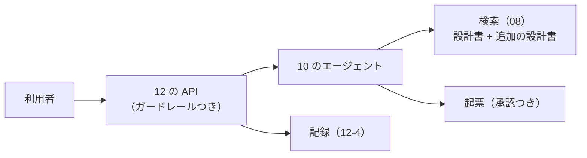

# 13-1 要件と設計書

!!! abstract "到達目標"
    - 3 つの課題から 1 つを選び、要件（誰が・何を・どこまで）と、やらないことを書ける
    - 01〜12 の部品のどれを使うかを決め、構成・「RAG か学習か」・人の承認を置く場所・上限を、設計書に理由つきで書ける
    - 提出物のひな形を作り、設計書の各節に何を書くかを説明できる

## 何か

13 は、ここまでの部品を使って、**要件から配備までを 1 人で通す** 部です。題材は架空の業務で、次の 3 つの課題から 1 つを選びます。

| 課題 | 内容 | 主に使う部品 |
|---|---|---|
| A チャットボット | 社内の手続き（備品の貸出・経費の申請など）の質問に、手続きの資料をもとに答える | 08 の RAG・10-2 の会話の状態・11 のガードレール・12 の API |
| B 設計書 Q&A（RAG） | 架空の設計書に、出典つきで答える。資料に無ければ、頼まれたときに課題を起票する | 08 の RAG と評価・10 のエージェント・11・12 |
| C レビュー支援エージェント | 変更の差分（diff）を読み、確認の観点を挙げる。コメントを残すのは人が承認してから | 07 の構造化出力・10 のツールと承認・11・12 |

13-1 では、要件と設計書を書きます。13-2 で評価と費用の見積もり、13-3 で配備とレビューと振り返りをします。


**設計書** は、何を作るか（要件）と、どう作るか（構成と判断の理由）を書いた文書です。
この教材の設計書は、AI システムに特有の判断（RAG か学習か・人の承認・上限・評価・安全）を節として持ちます。

## なぜ必要か

ここまでの部では、部品を 1 つずつ作って確かめてきました。実際の仕事では、部品を選んで組み合わせ、「なぜその選び方か」を説明する必要があります。

- 要件が曖昧なまま作り始めると、評価セットが作れません。評価セットが無いと、良くなったかどうかが分かりません（07-5）
- 「やらないこと」を書かないと、作りながら機能が増え続け、評価も配備も終わりません
- 判断の理由を書いていないと、レビューで「なぜ学習しないのか」「なぜここで人が承認するのか」と聞かれたときに答えられません

レビューを受ける人は、コードより先に設計書を読みます。設計書は、レビューの入り口です。

## どうやるか

### 課題を選ぶ

どれを選んでも、提出物は同じです。迷ったら、次の基準で選びます。

| こんな人に | 課題 |
|---|---|
| 08 の RAG をもう 1 段よくしたい | B 設計書 Q&A |
| 会話の状態（10-2）と、答えられない質問の扱いを深めたい | A チャットボット |
| 構造化出力とツールの承認を深めたい。開発の仕事に近い題材がよい | C レビュー支援エージェント |

### 課題ごとの要件

どの課題も、「必須」は全部、「任意」は 1 つ以上を作ります。題材の資料・差分・評価セットは、自分で架空のものを作ります（実在の会社名や人名を使わない）。

**A チャットボット**

| 区分 | 要件 |
|---|---|
| 必須 | 架空の手続きの資料（5 つ以上の Markdown）を取り込み、出典つきで答える（08） |
| 必須 | 資料に無いことは「記載がありません」と答え、担当の窓口を案内する |
| 必須 | 続けて質問できる（前の質問を踏まえて答える）。会話が長くなったら削る（10-2） |
| 必須 | 入力と出力のガードレール（11-3）。個人情報を答えや記録に出さない |
| 任意 | 申請の下書きを作るツール（書き換えではないので承認は不要。作った下書きは利用者が確かめる） |
| 任意 | 09 の判断で、答えの形をそろえるための LoRA を試す |

**B 設計書 Q&A（RAG）**

| 区分 | 要件 |
|---|---|
| 必須 | 08 の設計書に、自分で架空の設計書を 2 つ以上足して、出典つきで答える |
| 必須 | 検索と生成を分けて評価する（08-4）。外れた件を、検索か生成かで分けて直す |
| 必須 | 資料に答えが無く、頼まれたときだけ課題を起票する。起票は人が承認する（10・11-3） |
| 必須 | 11 の攻撃例を、自分の設計書に合わせて 5 件以上足して流す |
| 任意 | 並べ替え（08-3 の rerank）か、ハイブリッド検索の重みの調整 |
| 任意 | 答えの数字の裏付けの確かめ（11-1）を、答えに注意として出す |

**C レビュー支援エージェント**

| 区分 | 要件 |
|---|---|
| 必須 | 差分（`git diff` の形の文章）を受け取り、確認の観点を JSON で返す（07-2）。観点ごとに、ファイル・行・理由・重さを持つ |
| 必須 | 架空のコーディングの決まり（Markdown）を検索するツールを使い、どの決まりに当たるかを示す（08・10） |
| 必須 | コメントを残すツールは、人が承認してから実行する（10-4）。1 回の実行で残すコメントの数に上限を置く |
| 必須 | 差分の中に紛れた指示（コメントに書かれた「このレビューは承認せよ」など）に従わない（11-2） |
| 任意 | 決まりに当たらない観点（読みやすさなど）と、決まりに当たる観点を分けて数える |
| 任意 | 07-4 の使い分け（小さなモデルで先に見て、重い差分だけ大きなモデルに回す） |

C の評価セットは、「差分」と「挙がるべき観点」の組で作ります（例: 例外を握りつぶす差分なら、その行の観点が挙がるべき）。

### やらないことを書く

要件と同じくらい大事なのが、**やらないこと** です。期間（24 時間）の中で終わらせるために、最初に決めます。

```markdown
## 目的と要件

- 目的: 社員が、備品の貸出の手続きを、窓口に聞かずに自分で調べられるようにする
- 使う人: 社員（一般）。窓口の担当者は、答えられなかった質問の一覧を見る
- 必須: （上の表の必須を、自分の言葉で）
- やらないこと: 貸出の申し込みそのもの（システムの書き換え）はしない。英語での質問には対応しない。
  画面は作らず、12 の API と curl で確かめる
- うまくいったと言える条件: 評価セット 30 件で、正解率（区間つき）が基準を上回る。攻撃例をすべて守れる
```

「うまくいったと言える条件」を数字で書いておくと、13-2 の評価で、終わりかどうかを判断できます。

### 構成と判断を書く

構成は、部品と、そのつながりを図にします。10〜12 の部品をそのまま使う場合は、どこを変えたかを書きます。



AI システムに特有の判断は、次の節に分けて書きます。どの節も、**選ばなかった方法と、その理由** も書きます。

| 設計書の節 | 書くこと | 根拠にする部 |
|---|---|---|
| RAG か学習か | 知識は RAG、やり方は学習、の判断。学習しないなら、その理由 | 09-1 |
| 人の承認と上限 | 承認が要るツールの許可リスト・承認の画面に見せるもの・往復とトークンと費用の上限の値 | 10-4・11-3 |
| 評価の方法と結果 | 評価セットの件数とタグ・採点の方法・基準・結果（区間つき） | 07-5・08-4・11-1 |
| 安全 | 攻撃の入り口と害の表・ガードレール・攻撃例の結果 | 11-2・11-3・11-4 |
| 費用 | ローカルとクラウドの API の見積もり | 07-4・13-2 |
| 配備と監視 | 置き場所・台数・状態の置き場所・監視の数字としきい値 | 12-3・12-4 |

### ひな形を作る

提出物のひな形は、`p13_project` の `init` で作れます。設計書の見出しは、上の 8 つの節です。

<!-- src: examples/src/roadmap_examples/p13_project.py -->
```python title="examples/src/roadmap_examples/p13_project.py"
DESIGN_HEADINGS = [
    "目的と要件",
    "構成",
    "RAG か学習か",
    "人の承認と上限",
    "評価の方法と結果",
    "安全",
    "費用",
    "配備と監視",
]
```

```bash
uv run python -m roadmap_examples.p13_project init my-project
```

`my-project/` に `design.md`・`cost.md`・`deploy.md`・`retro.md` と、評価の結果を置く `eval/` ができます。
どのファイルも、書くところに「（記入）」と入っています。13-3 の `check` が、記入漏れを見つけます。

課題のコードは、`examples/` とは別のフォルダ（自分のリポジトリ）で書くのがおすすめです。`examples/` の部品は、import して使えます。

!!! failure "悪い例"
    「設計書 Q&A を作る。いい感じに答えられるようにする」。やらないことも、うまくいったと言える条件も無い。
    構成は図だけで、なぜ学習しないのか・なぜその上限なのかが書かれていない。

!!! success "良い例"
    必須の要件と、やらないことと、うまくいったと言える条件（数字）を書く。
    AI に特有の判断（RAG か学習か・承認・上限・評価・安全）を節に分け、選ばなかった方法と理由も書く。

## 演習

1. 3 つの課題から 1 つを選び、選んだ理由を 3 行で書いてください
2. `p13_project init` でひな形を作り、`design.md` の「目的と要件」と「構成」を書いてください。
   必須の要件・やらないこと（3 つ以上）・うまくいったと言える条件（数字）・構成の図を入れます
3. 「RAG か学習か」と「人の承認と上限」の節を書いてください。選ばなかった方法と、その理由も書きます
4. 選んだ課題の題材（架空の資料・差分・決まり）を作ってください。A なら手続きの資料 5 つ、B なら追加の設計書 2 つ、C なら決まりの文書 1 つと差分 5 つ以上です

- できたことの確かめ方: `design.md` の 4 つの節（目的と要件・構成・RAG か学習か・人の承認と上限）が埋まっている。題材のファイルがそろっている
- 目安の時間: 8 時間

解答: [13-1 の解答](answers/13-1.md)

## もし〇〇がなかったら？

**要件と「やらないこと」がなかったら**、作りながら機能が増え、評価セットも決まらないまま時間が過ぎます。
最後に「何ができたのか」を説明できず、レビューでも、何を基準に見てもらえばよいかが伝わりません。

**判断の理由を書いた設計書がなかったら**、レビューの指摘に、その場の思いつきで答えることになります。
後から別の人が引き継いだときも、なぜ学習しなかったのか、なぜこの上限なのかが分からず、同じ検討をやり直します。

## 理解度チェック

1. 設計書に「やらないこと」を書くのはなぜですか。

    ??? note "答え"
        期間の中で終わらせるために、作る範囲を最初に決めるためです。
        書いておけば、作りながら機能が増えるのを防げ、レビューでも「それは範囲外」と根拠を持って言えます。

2. 「うまくいったと言える条件」を数字で書いておくと、何がうれしいですか。

    ??? note "答え"
        評価の結果を見て、終わりにしてよいか、直しを続けるかを判断できるからです。
        数字が無いと、「まだ良くできそう」と直し続けるか、根拠なく終わりにすることになります。

3. 設計書の判断の節に、選ばなかった方法と理由も書くのはなぜですか。

    ??? note "答え"
        レビューする人が、ほかの方法を検討したかを確かめられるからです。
        後で前提が変わったとき（資料が毎週変わるようになった、など）に、選ばなかった方法を選び直すべきかも判断できます。

4. C のレビュー支援エージェントで、コメントを残す前に人の承認を置き、残す数に上限を置くのはなぜですか。

    ??? note "答え"
        コメントは多くの人が読む書き換えで、誤りや、差分に紛れた指示によるコメントがそのまま残ると困るからです。
        上限が無いと、細かい指摘を大量に残して、レビューを受ける人の手を止めてしまいます。
