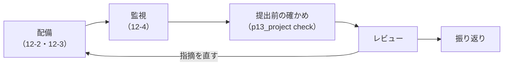

# 13-3 配備・レビュー・振り返り

!!! abstract "到達目標"
    - 12 の型で自分の課題を配備し、配備の手順書と、監視の数字としきい値を書ける
    - 提出物がそろっているかを道具で確かめ、レビューの観点に沿って自分で点検してから、レビューを受けられる
    - 振り返りを、数字で見た変化と、次に直すことに分けて書ける

## 何か

13 の最後の段階です。13-2 までで、作ったものが「どれくらい良いか」と「いくらかかるか」が分かりました。
ここでは、それを動かし続けられる形にして（配備と監視）、ほかの人に確かめてもらい（レビュー）、次に活かす（振り返り）までを行います。



**レビュー** は、作った本人以外が、設計書・評価の結果・コードを読んで、誤りや足りない所を指摘することです。
この教材の課題では、同じ教材を学ぶ人や、職場の先輩などに頼むことを想定しています。頼める人がいなければ、下のレビューの観点で自分で点検します。

## なぜ必要か

作った本人は、自分の前提を当たり前だと思っているので、見落としに気づきにくいものです。
「承認の鍵を設定し忘れても動いてしまう」「攻撃例は通るが、普通の質問を止めすぎている」のような問題は、ほかの人が使って初めて見つかります。

振り返りを書かないと、うまくいった工夫もつまずいた所も、次の仕事に持ち越せません。
数字で書いておけば、「何をしたら、どれだけ良くなったか」が、次の判断の材料になります。

## どうやるか

### 配備する

12-2 の compose と、12-3 の手順書の形で配備します。課題 A・C で、12 の API と違う所（ツール・資料のフォルダ・system）は、
12 の `p12_api` を写して直すか、`build_app` に渡すツールを差し替えます。

配備したら、次を確かめて `deploy.md` に書きます。

| 確かめること | 方法 | 期待する結果 |
|---|---|---|
| 動いている | `curl -s localhost:8000/healthz` | `200` と、プロンプトの版 |
| 答えられる | 評価セットの 1 件を `/ask` に送る | `200` と、出典つきの答え |
| 承認の流れ | 起票（課題 C ならコメント）を頼む質問 → `/approvals` | `202` → `200`。承認の鍵が無いと `401` |
| 記録が残る | `requests.jsonl` の行が増える | 本文が無く、トークンと版がある |
| 止め方・消し方 | `docker compose down`（必要なら `-v`） | 手順書どおりに止まる |

### 監視としきい値を決める

12-4 の `p12_monitor` を、配備した API の記録に対して流します。しきい値は、13-2 の評価と、13-1 の「うまくいったと言える条件」から決めます。

```bash
uv run python -m roadmap_examples.p12_monitor requests.jsonl --html monitor.html \
    --max-p95-ms 20000 --max-stopped-rate 0.1
```

設計書の「配備と監視」には、しきい値とその根拠、超えたときに何をするかを書きます。

```markdown
## 配備と監視

- 置き場所: 手元の PC で compose（12-2）。台数 1。状態と記録はボリューム
- 監視: 毎朝 p12_monitor を流す
  - 応答時間の 95 パーセンタイル 20 秒（13-1 の条件）。超えたら ollama ps でモデルが GPU やメモリに載っているかを確かめる
  - 上限で止まった割合 10%（評価セットでは 3%）。超えたら trace で往復の中身を見て、資料かプロンプトの変化を疑う
  - ガードレールが見つけたこと: 1 日 5 件を超えたら、記録の findings を見て攻撃か誤検知かを確かめる
```

### 提出の前に確かめる

提出物（`design.md`・`cost.md`・`deploy.md`・`retro.md`・`eval/` の結果）がそろっているかを、`p13_project check` で確かめます。

<!-- src: examples/src/roadmap_examples/p13_project.py -->
```python title="examples/src/roadmap_examples/p13_project.py"
    for name in TEMPLATES:
        path = folder / name
        if not path.is_file():
            problems.append(f"{name} がありません")
            continue
        text = path.read_text(encoding="utf-8")
        if TODO in text:
            problems.append(f"{name} に記入していないところがあります（「{TODO}」が残っています）")
        if name == "design.md":
            heads = HEADING.findall(text)
            problems += [f"design.md に見出し「{h}」がありません" for h in DESIGN_HEADINGS if h not in heads]
```

```bash
uv run python -m roadmap_examples.p13_project check my-project
```

ひな形を作った直後は、次のように表示されます。全部を埋めると「提出できます」になります。

```text
NG design.md に記入していないところがあります（「（記入）」が残っています）
NG cost.md に記入していないところがあります（「（記入）」が残っています）
NG deploy.md に記入していないところがあります（「（記入）」が残っています）
NG retro.md に記入していないところがあります（「（記入）」が残っています）
NG eval/ に評価の結果（*.jsonl）がありません
足りないもの: 5 件
```

この道具が確かめるのは「そろっているか」だけです。中身が正しいかは、次のレビューの観点で確かめます。

### レビューの観点

レビューを頼む前に、次の観点で自分で点検します。レビューする人にも、この表を渡します。

| 観点 | 見る所 | 良い状態 |
|---|---|---|
| 要件と範囲 | 設計書の「目的と要件」 | 必須・やらないこと・うまくいったと言える条件（数字）がある |
| 判断の理由 | 「RAG か学習か」「人の承認と上限」 | 選ばなかった方法と理由がある。上限の値に、評価で測った根拠がある |
| 評価 | 「評価の方法と結果」・`eval/` | 件数・タグ・条件・区間がある。悪くなった件の原因が書かれている |
| 安全 | 「安全」・攻撃例のテスト | 課題の入り口に合わせた攻撃例があり、守りなしとの比較がある。普通の質問を止めすぎていない |
| 個人情報と秘密 | 記録・課題の本文・`.env` | 記録に本文が無い。秘密がリポジトリにもイメージにも無い |
| 費用 | `cost.md` | 前提（件数・単価を確かめた日）と、上限・止め方がある |
| 配備と監視 | `deploy.md`・「配備と監視」 | 止め方と消し方がある。しきい値と、超えたときにすることがある |
| コード | テストと lint | `pytest` と `ruff` が通る。テストは LLM もネットワークも使わない |

AI にレビューの下書きを頼むのも有効です（10-5）。そのときも、この表を渡して観点を絞り、指摘は自分で確かめてから採ります。
AI の指摘は「もっともらしいが誤り」のことがあるので、評価の数字やテストで裏付けられるものから直します。

レビューの指摘は、1 件ずつ「直した（どう直したか）」「直さない（理由）」「次に回す」のどれかで答えます。
直したら、評価とテストを流し直し、数字が変わったら設計書も直します。

### 振り返りを書く

`retro.md` は、3 つの節で書きます。

```markdown
# 振り返り

## うまくいったこと
- 13-1 で「やらないこと」を決めたので、PDF の取り込みに時間を取られなかった

## 次に直すこと
- 評価セットの「言い換え」が 9 件しかなく、検索の改善の差が偶然の範囲だった。次は 20 件に増やしてから比べる

## 数字で見た変化
| 項目 | 最初 | 最後 | 何をしたか |
|---|---|---|---|
| 生成の点（30 件） | （値） | （値） | チャンクの大きさ・system の手順 |
| 攻撃例（25 件・台本） | （値） | 25 / 25 | 追加の設計書の注記・決まりで断る係 |
| 1 件の入力トークン | （値） | （値） | 検索の件数を 4 → 3 |
```

「次に直すこと」は、次に何をするかが分かる粒度で書きます（「評価をもっと頑張る」ではなく「言い換えの件を 20 件に増やす」）。

!!! failure "悪い例"
    配備したが、止め方を書いていない。レビューは「見てください」とだけ頼み、観点も提出物の場所も伝えない。
    振り返りは「いろいろ学べた」で終わり、数字も次にすることも無い。

!!! success "良い例"
    手順書どおりに配備・確かめ・停止までを通し、監視のしきい値と根拠を書く。`check` で提出物をそろえ、観点の表と一緒にレビューを頼む。
    指摘には 1 件ずつ答え、振り返りは数字の変化と、次に直すことを具体的に書く。

## 演習

1. 自分の課題を配備し、上の「確かめること」の 5 つを確かめて、`deploy.md` を書いてください
2. 配備した API に、評価セットの質問を 10 件ほど送り、`p12_monitor` で集計してください。しきい値を決めて、設計書の「配備と監視」を書きます
3. `p13_project check` で「提出できます」になるまで、提出物をそろえてください
4. レビューの観点の表で自分で点検し、見つけた所を直してください。頼める人がいれば、表と一緒にレビューを頼み、指摘に 1 件ずつ答えます
5. `retro.md` を書いてください

- できたことの確かめ方: `p13_project check` が「提出できます」を表示する。レビューの指摘と答えの一覧（自分で点検した場合は、点検の結果）がある
- 目安の時間: 8 時間

解答: [13-3 の解答](answers/13-3.md)

## もし〇〇がなかったら？

**配備と監視がなかったら**、作ったものは手元で一度動いただけで終わります。使われ始めてからの遅さや、上限で止まる依頼の増加に気づけず、
「使ってみたら遅いので使わなくなった」で終わってしまいます。

**レビューがなかったら**、自分の前提の見落とし（承認の鍵の付け忘れ・普通の質問を止めすぎるガードレール・止め方の無い手順書）が残ったまま、本番に出ます。
**振り返りがなかったら**、次の仕事でも同じ所でつまずき、うまくいった工夫も忘れてしまいます。

## 理解度チェック

1. 配備した後に、`/healthz` だけでなく、`/ask` と承認の流れまで確かめるのはなぜですか。

    ??? note "答え"
        `/healthz` はモデルを呼ばないので、API が動いていることしか分からないからです。
        答えられるか（モデルと資料につながっているか）と、承認の鍵が効いているかは、実際に呼んで確かめます。

2. `p13_project check` で「提出できます」になっても、レビューが要るのはなぜですか。

    ??? note "答え"
        `check` が確かめるのは、ファイルと見出しがそろい、記入漏れが無いことだけだからです。
        判断の理由が妥当か、評価の数字に区間や条件があるか、秘密が漏れていないかなどの中身は、レビューの観点で確かめます。

3. AI にレビューの下書きを頼むとき、気をつけることは何ですか。

    ??? note "答え"
        観点の表を渡して何を見てほしいかを絞ること、指摘はもっともらしくても誤りのことがあるので、評価の数字やテストで確かめてから採ることです。

4. 振り返りの「次に直すこと」を、具体的な行動で書くのはなぜですか。

    ??? note "答え"
        次に何をすればよいかが分かり、やったかどうかも確かめられるからです。
        「もっと頑張る」のような書き方では、次の仕事で何も変わりません。
