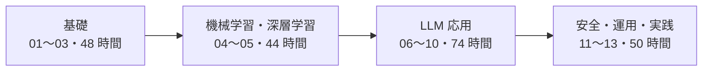
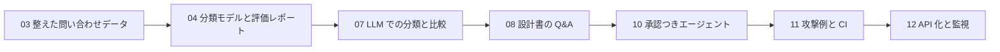

# AI エンジニア学習ロードマップ（Python）

業務開発の経験がある人が、約 7 か月（週 8 時間、合計約 220 時間）で、
**RAG とエージェントを使う AI システムを作り、本番で動かせるようになる** ための教材です。

## 狙い

- 「動くデモ」で終わらせず、評価・費用・安全・運用まで含めて AI システムを作れるようになる
- 各部の成果物を次の部で使い、最後に 1 つのシステムとしてつなげる
- 式の証明や最新モデルの紹介より、「コードで確かめる」「数字で比べる」を優先する

## 対象

- 何か 1 つの言語（Java など）で業務開発の経験がある人
- Python の経験は問いません。[01 Python と基礎](01-python/index.md) で、ほかの言語との違いから学びます
- Git・コンテナ・クラウドは、必要な分だけこの教材の中で扱います

## 4 段階の流れ

| 段階 | 部 | 内容 | 目安 |
|---|---|---|---|
| 基礎 | [01 Python と基礎](01-python/index.md) | Python・Linux と HTTP・データ構造・テストと lint | 16 時間 |
| 基礎 | [02 AI のための数学](02-math/index.md) | ベクトルと類似度・微分と勾配・確率・最適化 | 16 時間 |
| 基礎 | [03 データエンジニアリング](03-data/index.md) | NumPy と pandas・SQL・データの整理・前処理 | 16 時間 |
| 機械学習・深層学習 | [04 機械学習](04-ml/index.md) | 回帰と分類・決定木・クラスタリング・指標と検証 | 20 時間 |
| 機械学習・深層学習 | [05 ディープラーニング](05-deep-learning/index.md) | 誤差逆伝播・PyTorch・アテンション・小さなトランスフォーマー | 24 時間 |
| LLM 応用 | [06 LLM の基礎](06-llm-basics/index.md) | トークン・コンテキスト・学習の種類・モデルの選び方 | 10 時間 |
| LLM 応用 | [07 プロンプトと API](07-prompt-api/index.md) | プロンプト設計・構造化出力・ツール使用・費用・評価セット | 12 時間 |
| LLM 応用 | [08 RAG とベクトルデータベース](08-rag/index.md) | 取り込み・チャンク分割・検索・RAG の評価 | 20 時間 |
| LLM 応用 | [09 ファインチューニングと最適化](09-finetuning/index.md)（発展） | RAG か学習か・LoRA・量子化 | 14 時間 |
| LLM 応用 | [10 AI エージェント](10-agents/index.md) | ループとワークフロー・状態・MCP・人の承認と上限 | 18 時間 |
| 安全・運用・実践 | [11 AI の安全と評価](11-safety/index.md) | 幻覚・プロンプトインジェクション・ガードレール・評価の自動化 | 12 時間 |
| 安全・運用・実践 | [12 MLOps とデプロイ](12-mlops/index.md) | API 化・コンテナと CI/CD・配備・監視と版管理 | 14 時間 |
| 安全・運用・実践 | [13 実践プロジェクト](13-project/index.md) | 要件から配備までを 1 人で通す | 24 時間 |

## 成果物のつながり

各部の成果物は、次の部で使います。

## 進め方

1. 最初に [学び方](guide.md) を読み、演習の環境を作る
2. 部ごとに「到達目標 → 章 → 演習 → 理解度チェック → 成果物」の順に進める
3. 部の成果物ができたら、到達目標を 1 つずつ自分の言葉で説明できるかを確かめる

どの章も同じ型（何か → なぜ必要か → どうやるか → 演習 → もし〇〇がなかったら？ → 理解度チェック）で書きます。
演習の解答は別のページにあります。

## 近道

LLM アプリを作ることだけが目的なら、**01・03・06〜08・10〜13（約 140 時間）** で進められます。
02・04・05・09 は後回しにできます。ただし 07 で「LLM と従来の機械学習を比べる」演習は 04 の成果物を使うので、
04 を飛ばした場合は、用意した基準の数字と比べてください（07 の章で案内します）。

## 費用の方針

- 演習は **無料の範囲で完結** します。LLM は手元で動かすローカルのモデル（Ollama など）が基本です
- 従量課金の API を使う演習は **「任意」** として分けます。試す人向けに、費用の上限の決め方と止め方を同じ章に書きます
- テストと CI は LLM を呼びません。決まった応答を返す偽の実装で確かめます
